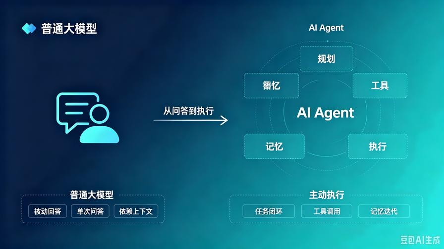
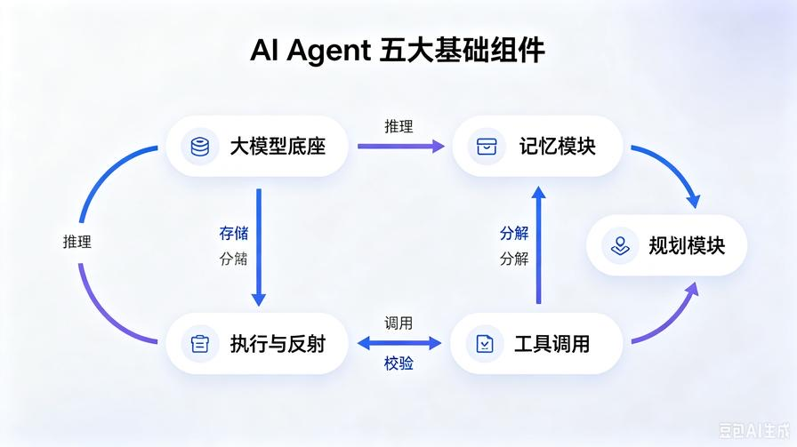
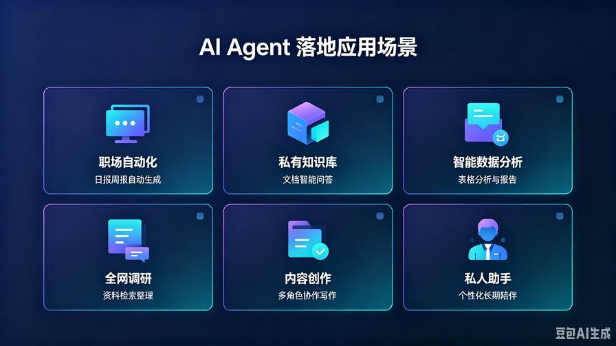
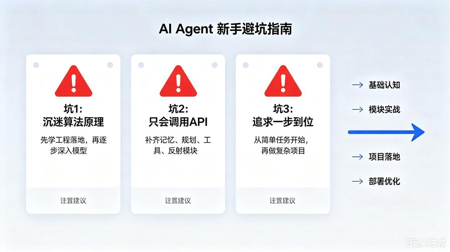

# 第1篇：AI Agent到底是什么？告别玄学，一文读懂智能体的本质

欢迎开启**AI Agent 零基础实战系列**的第一篇内容。

市面上90%的AI教程都在讲模型微调、Prompt技巧、API调用，但很少有人讲清楚一个核心问题：**到底什么是 AI Agent？它和我们平时聊天的 ChatGPT、文心一言，到底差在哪？**

很多新手入门最大的误区，就是把「大模型对话」等同于「AI 智能体」。这也导致大家学了很久，只会简单问答，做不出能自主干活、自动化执行、解决复杂场景的AI工具。

本篇不讲空洞术语、不堆砌学术概念，只用通俗逻辑+真实场景，帮你彻底搞懂AI Agent的核心本质，建立正确的开发认知，为后续全套实战开发打好基础。

读完本文，你将彻底明白：

- 为什么普通AI聊天只能“被动回答”，AI Agent可以“主动干活”
- AI Agent的核心定义与核心能力边界
- 普通大模型 vs AI Agent 的本质区别
- 当下可落地、可变现的Agent真实应用场景
- 新手学习Agent开发的正确避坑路线

## 一、先破误区：ChatGPT 对话，根本不是 AI Agent

我们日常使用的各类大模型对话产品，本质都是**单次问答模型**。

你提问，它回答；你不提问，它不动作。全程是**被动响应**，没有自主思考、没有任务规划、没有主动执行能力。

举个最直观的例子：

如果你让普通大模型：**帮我整理本周的工作内容，生成一份标准周报，筛选重点工作，标注未完成任务，并给出下周工作计划**。

普通AI的表现：只能基于你给出的文字内容，一次性总结输出。**如果信息不全、逻辑断层，它只会凭空编造，不会主动补全、不会分步处理、不会校验结果**。

而 AI Agent 的表现：

1. 主动拆解任务：整理内容→筛选重点→梳理未完成任务→规划下周工作
2. 自主判断信息缺失，按需追问或检索补充
3. 分步执行、迭代优化，出错后自我修正
4. 最终输出结构完整、符合职场规范的成品周报

**一句话总结核心差距：普通大模型是“问答工具”，AI Agent是“自主执行者”。**

## 二、AI Agent 核心本质：到底什么是智能体？

抛开所有玄学包装，给大家一个新手最好理解、最精准的定义：

**AI Agent（人工智能智能体），是一套以大模型为大脑，具备感知、思考、规划、工具调用、迭代执行、自我纠错能力，能够自主完成复杂目标任务的智能程序。**

拆解成四个普通人都能看懂的核心特质，这也是判断一个AI是不是Agent的黄金标准：

### 1. 具备自主目标意识

不需要人类逐指令指挥，只要给定最终目标，就能自主推进任务，而不是一问一答式被动响应。

### 2. 具备任务拆解与规划能力

面对复杂任务，能自动拆分成分步可执行的小任务，梳理执行顺序，解决大模型“只会整体输出、不会分步落地”的短板。

### 3. 具备工具联动执行能力

可以自主调用联网搜索、文件读写、数据计算、Excel处理、数据库查询等工具，突破大模型本身的知识滞后、能力局限。

### 4. 具备记忆与迭代优化能力

可以记住对话历史、任务过程、过往错误，能够自我反思、修正结果，越用越精准，而非每次都从零开始。

简单类比：**普通大模型是“只会答题的学生”，AI Agent 是“会主动规划、主动查资料、主动改错、主动交付结果的全职助理”**。

## 三、直观对比：普通大模型 VS AI Agent（核心差异表）

为了让大家彻底理清边界，我从核心能力、运行逻辑、适用场景、能力上限四个维度做了清晰对比：

| 对比维度 | 普通大模型对话（ChatGPT/文心一言） | AI Agent 智能体 |
|-|-|-|
| 运行逻辑 | 被动响应，单次问答，无持续任务链路 | 主动驱动，目标导向，全流程闭环执行 |
| 任务处理 | 只擅长简单、碎片化问题 | 擅长复杂、多步骤、长流程落地任务 |
| 工具能力 | 原生无工具联动，无法自主调用外部能力 | 原生支持工具调用，可联网、可运算、可操作文件 |
| 记忆能力 | 仅依赖上下文窗口，无长期记忆、无沉淀 | 拥有三级记忆架构，可长期存储、检索、迭代 |
| 纠错能力 | 输出即结束，不会自查、不会修正错误 | 支持自我反射、结果校验、迭代优化 |
| 落地价值 | 辅助咨询、文案改写、简单答疑 | 自动化办公、业务落地、数据处理、项目调研 |

看完这张表就能明白：**未来AI落地的核心竞争力，从来不是“会用AI聊天”，而是“会设计、开发、定制AI Agent”**。

## 四、普通人可落地的AI Agent 主流应用场景

很多人觉得Agent很高端、很遥远，其实目前绝大部分落地场景，都是贴近职场、生活、个人变现的实用功能，没有高大上的技术门槛。

分享6个当下最主流、最好落地、最容易变现的Agent场景：

### 1. 职场自动化Agent

自动整理工作记录、生成日报/周报/月报、自动汇总会议纪要、梳理待办任务、跟进工作进度，彻底解放重复性办公工作。

### 2. 私有知识库Agent

导入企业文档、产品手册、学习资料、个人笔记，搭建专属离线问答助手，不用人工翻阅资料，AI自主检索、精准答疑。

### 3. 智能数据分析Agent

自主读取Excel、CSV表格数据，完成数据清洗、异常分析、趋势总结、生成可视化分析报告，零基础也能搞定专业数据分析。

### 4. 全网调研Agent

针对行业、产品、热点、竞品，自主全网搜索信息、筛选有效内容、去重整合、结构化输出调研报告，解决大模型知识滞后问题。

### 5. 内容创作Agent

多智能体分工协作，完成选题、大纲撰写、内容创作、润色优化、排版输出全流程，批量产出自媒体、文案、推文内容。

### 6. 专属私人助手Agent

定制人设、记忆个人习惯、长期跟进学习计划、生活规划、技能提升，实现个性化智能服务。

这些所有场景，本系列后续都会**从零到一完整实战开发**，每一个案例都提供可直接运行的代码和部署教程。

## 五、新手学AI Agent最大的3个坑（提前避坑）

很多人学Agent开发迟迟入门不了，不是能力不够，而是学习路径错了。这里提前帮大家规避新手高频误区：

### 坑1：沉迷学模型原理、算法公式，忽视工程落地

绝大多数新手不需要懂大模型底层训练、Transformer原理。Agent开发核心是**工程设计、模块组合、流程搭建、场景落地**，本系列全程聚焦实战，规避复杂算法，零基础也能学会。

### 坑2：只会调用API，不懂架构设计

单纯调用大模型API，永远做不出智能体。真正的Agent开发，核心是**记忆、规划、工具、反射、执行**五大模块的组合设计，这也是我们后续重点讲解的核心。

### 坑3：追求一步到位，不练基础直接搞复杂项目

很多新手上来就想做多智能体、商用复杂项目，结果全程踩坑、无从下手。本系列遵循**从基础模块→简单案例→商用项目→优化部署**的循序渐进路径，零基础稳步进阶。

## 六、本篇总结

1. 核心认知：普通大模型是被动问答工具，AI Agent是主动目标驱动的自主智能执行者，二者有着本质区别；

2. Agent核心特质：自主规划、任务拆解、工具调用、记忆迭代、自我纠错；

3. 落地核心价值：解决复杂、多步骤、重复性的实际场景问题，是AI落地变现的核心方向；

4. 新手入门关键：重落地、重架构、循序渐进，拒绝玄学和碎片化学习。

## 下期预告

看懂本质之后，下一篇我们正式拆解**AI Agent 五大核心基础架构**，通俗讲解每一个模块的作用、运行逻辑，帮你搭建完整的Agent架构认知，为后续手写智能体、使用框架开发做足铺垫。

**互动提问：你最想开发哪一类AI Agent工具？评论区告诉我，后续实战优先落地高频需求场景。**

> 来源：头条号《AI Agent 零基础实战》第1篇｜版权归作者所有，仅供学习交流
