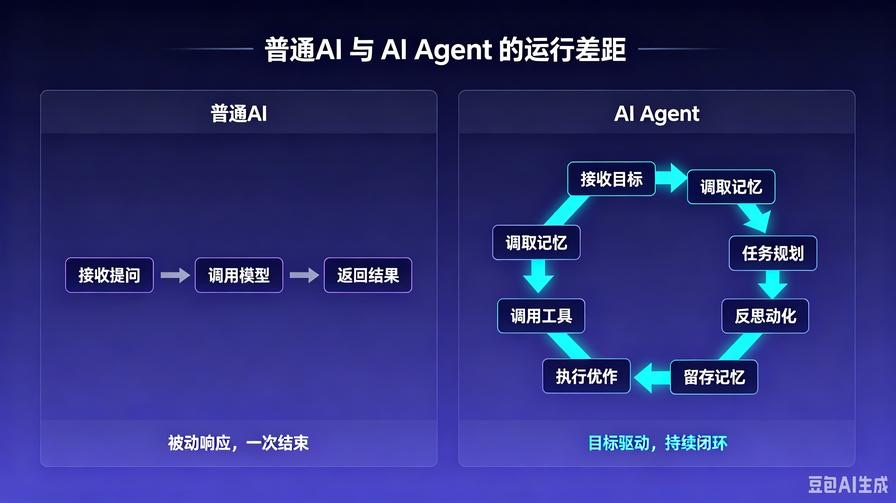
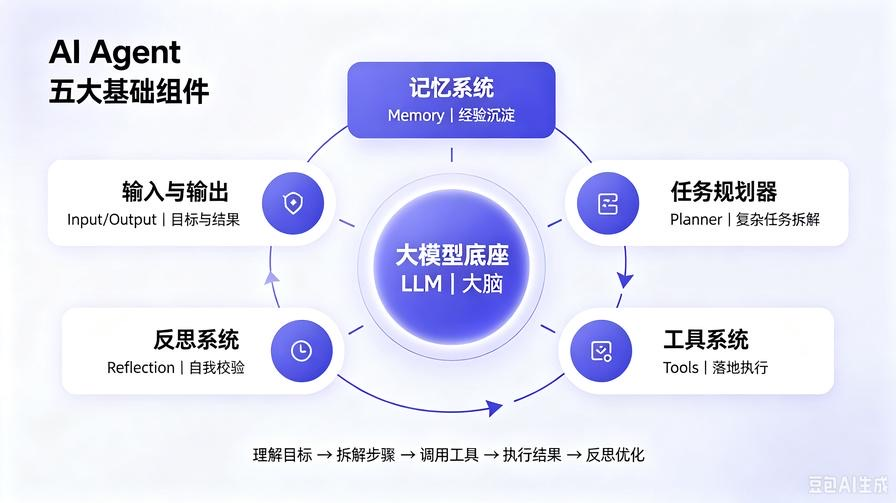
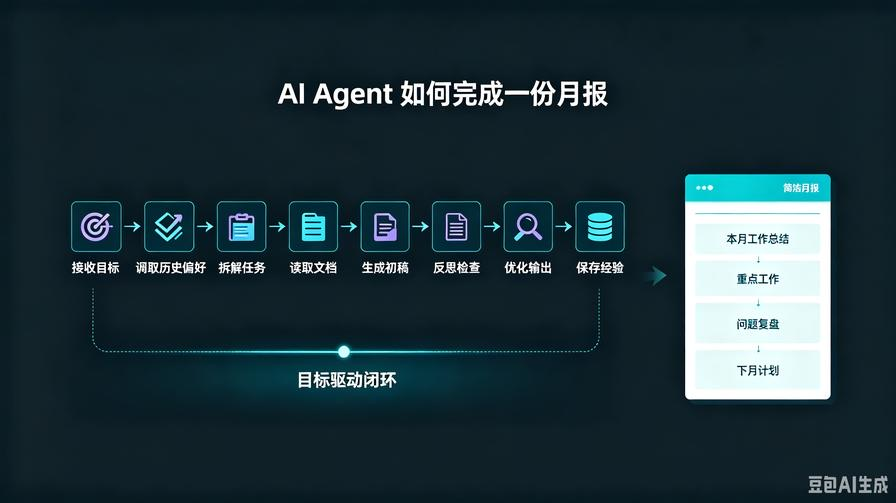
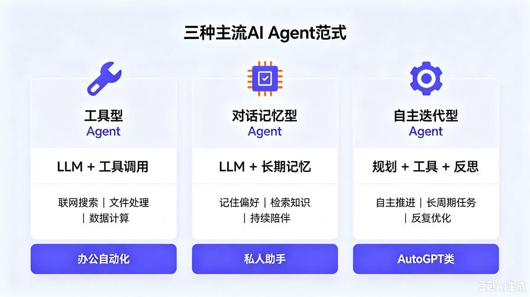

# 第2篇：AI Agent核心架构拆解：新手必须掌握的5大基础组件

在上一篇中，我们彻底撕开了行业玄学，搞懂了一个核心事实：**普通大模型只会“被动聊天”，AI Agent可以“主动做事”**。

但很多人看完依然会有疑问：

同样是调用大模型接口，为什么别人做出来的是全自动智能体，我写的代码只会一问一答？

答案非常简单：**你只用到了“大脑”，而别人搭建了“完整躯体”。**

大模型（LLM）只是Agent的**大脑**。一个完整的智能体，必须拥有记忆、规划、工具、执行、反思这套完整的器官配合。

本篇作为**系列地基核心篇**，我带你从零拆解 AI Agent 的通用底层架构。

读完这篇，你将建立起**所有高级Agent万变不离其宗的设计思维**。未来你学的 LangChain、LlamaIndex、AutoGPT，甚至市面上所有商用AI智能体，全部都是基于这套架构堆叠而成。

## 一、为什么你写的AI永远不够“智能”？

绝大多数新手开发的AI，代码逻辑只有一行：

**接收用户提问 → 传给大模型 → 返回结果**

这就是标准的**玩具式对话Demo**。

它没有状态、没有记忆、没有思考过程、无法使用工具、无法自我纠错。用户一旦给出复杂任务，它立马幻觉、断片、摆烂。

而真正的 AI Agent 运行逻辑是：

**接收目标 → 调取记忆 → 思考规划 → 决定是否调用工具 → 执行动作 → 接收结果 → 反思校验 → 迭代优化 → 输出最终答案并留存记忆**

看懂这两条逻辑的差距，你就看懂了**普通AI与智能体的鸿沟**。

## 二、AI Agent黄金5大组件（通用架构）

无论后续技术如何迭代，目前所有主流智能体，都逃不开这五大核心模块。我用最通俗的**人体拟人化**讲解，让你永久记住。

一个完整的 AI Agent 由这五部分组成：

1. **大脑：大模型底座（LLM）**
2. **记忆：记忆系统（Memory）**
3. **思维：任务规划器（Planner）**
4. **手脚：工具系统（Tools）**
5. **自检：反思系统（Reflection）**

这五个模块缺一不可，组合起来就是一套**具备自主生存能力的智能闭环**。

### 1. 大脑：大模型底座（LLM）—— 负责思考与判断

这是Agent的核心算力来源。

它不负责干活，只负责**决策、推理、判断、理解、总结**。

通俗理解：LLM是Agent的“CPU+大脑”。

当Agent遇到任务时，大脑会瞬间完成判断：

- 这个问题我自己能不能回答？
- 需不需要调用外部工具？
- 任务太复杂，要不要拆分？
- 之前有没有相关记忆可以参考？

**核心痛点**：单纯只有大脑，就是普通聊天AI，无法落地执行复杂任务。

### 2. 记忆系统（Memory）—— 负责经验沉淀

人之所以越来越聪明，是因为有记忆。

普通大模型之所以“健忘”，是因为只有短暂上下文窗口，没有独立记忆存储。

AI Agent 设计了**三级记忆架构**，彻底解决失忆问题：

- **瞬时记忆**：当前对话上下文（临时缓存）
- **短期记忆**：本轮任务全过程记录（任务缓存）
- **长期记忆**：向量数据库持久化存储（知识&经验沉淀）

有了记忆，Agent才能：

- 记住你的人设、偏好、历史指令
- 复用之前的任务经验，不用每次从零思考
- 搭建私有知识库，回答专属领域问题

**没有记忆的Agent，永远成不了专属智能助手。**

### 3. 任务规划器（Planner）—— 负责拆解复杂任务

这是AI Agent **最核心、最灵魂**的能力，也是区别于普通AI的关键。

普通大模型面对复杂问题：硬答、胡编、逻辑混乱。

Agent规划器面对复杂问题：**先拆解、再排序、分步执行**。

举个例子：让AI做一份“2026年行业竞品调研报告”。

**Agent规划逻辑：**

1. 第一步：明确调研目标与核心维度
2. 第二步：联网搜索最新行业数据、竞品动态
3. 第三步：筛选有效信息，剔除过期噪音
4. 第四步：整理对比维度，结构化梳理
5. 第五步：分析优劣势，输出总结与建议

**规划能力，决定了Agent的任务上限。**

后续我们学的 CoT、ToT、ReAct、Self-Plan，全部都是在优化这个模块。

### 4. 工具系统（Tools）—— 负责落地执行

大脑只会思考，工具才能干活。

大模型本身有三大绝症：**知识滞后、无法联网、无法操作本地文件与数据**。

工具系统就是Agent的“手脚”，用来突破能力边界：

- 搜索工具 → 解决知识滞后
- 代码工具 → 解决计算、自动化逻辑
- 文件工具 → 读写Word/Excel/PDF
- 数据库工具 → 批量查询处理数据

高级Agent开发，本质就是**给大脑配置更多、更精准的自定义工具**。

### 5. 反思系统（Reflection）—— 负责自我进化

这是高阶Agent的核心护城河。

普通AI：输出结果即结束，对错不管。

智能Agent：输出结果后，会**回头自查**。

反思模块会反问自己三句话：

- 我的推理逻辑有没有漏洞？
- 工具调用是否准确？有没有冗余步骤？
- 输出结果是否满足用户真实需求？是否需要二次优化？

通过反思迭代，Agent可以**越用越聪明、越跑越精准**，有效解决幻觉、答非所问、任务跑偏等行业通病。

## 三、完整闭环：AI Agent 一次任务的真实运行链路

我把五大组件串成一条完整流程，带你沉浸式看懂智能体工作全过程。

**用户输入目标：帮我整理一份本月工作总结，生成标准月报。**

**Agent 完整执行流程：**

1. **感知输入**：接收用户指令，明确最终目标
2. **调取记忆**：查询历史工作记录、过往月报格式偏好
3. **任务规划**：拆解为内容收集、重点提炼、结构排版、问题总结、下月计划
4. **工具执行**：读取本地工作文档、汇总碎片化内容
5. **内容生成**：大脑整合信息，输出初稿
6. **自我反思**：检查内容是否全面、逻辑是否通顺、格式是否规范
7. **迭代优化**：修正瑕疵，优化措辞
8. **落地输出+记忆留存**：交付成品，同时存档本次任务经验

这就是**全自动、端到端**的AI Agent能力。

## 四、新手必须了解的3种主流Agent范式

弄懂架构后，我们再区分市面上常见的三类智能体，方便你后续精准选型开发。

### 1. 工具型Agent（最常用）

核心：**LLM + 工具调用**

主打落地执行，适合办公自动化、数据处理、内容创作、联网调研。也是本系列重点实战的主流类型。

### 2. 对话记忆型Agent

核心：**LLM + 长期记忆**

主打个性化陪伴、专属知识库问答、私人助手，靠持续记忆沉淀提升智能度。

### 3. 自主迭代型Agent（高阶）

核心：**规划 + 工具 + 反思迭代**

代表项目AutoGPT，无需人工干预，自主完成长周期复杂任务。

## 五、本篇总结

1. 单纯大模型只是大脑，搭配**记忆、规划、工具、反思**四大组件，才是完整可用的AI Agent；

2. 五大组件各司其职：大脑负责思考、记忆负责沉淀、规划负责拆解、工具负责执行、反思负责优化；

3. Agent的核心价值是**目标驱动、全流程自主闭环**，而非被动问答；

4. 所有高级智能体，均是基于这套基础架构迭代升级而来。

## 下期预告

下一篇，我们深入**Agent 核心思维：任务规划机制**。带你彻底搞懂 CoT、ReAct、ToT 到底是什么，为什么它能让AI从“傻瓜回答”变成“聪明解题”，同时上手极简代码实操。

**互动：你之前开发AI时，遇到最多的问题是幻觉、不会分步执行、还是记不住上下文？留言告诉我！**

> 来源：头条号《AI Agent 零基础实战》第2篇｜版权归作者所有，仅供学习交流
