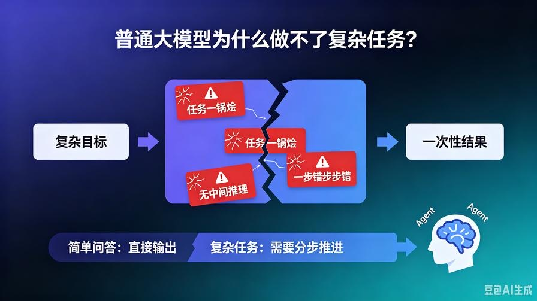
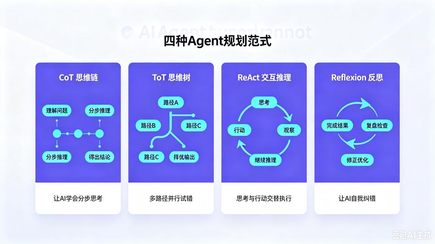
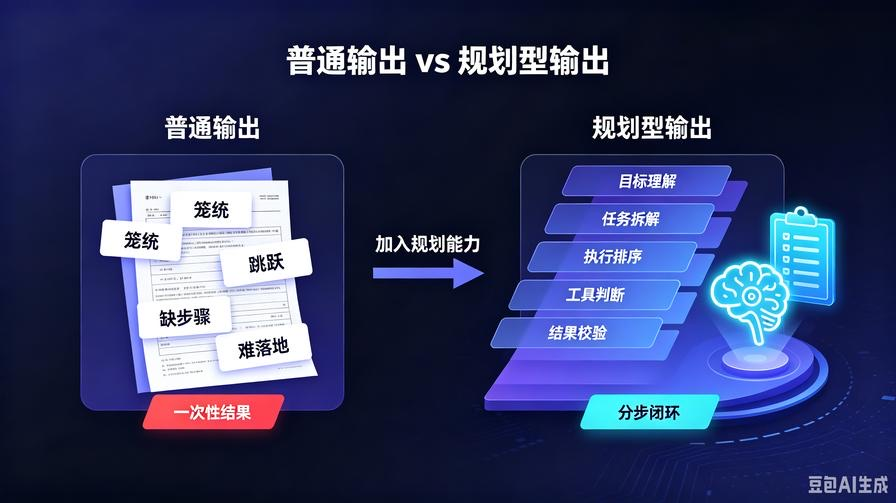
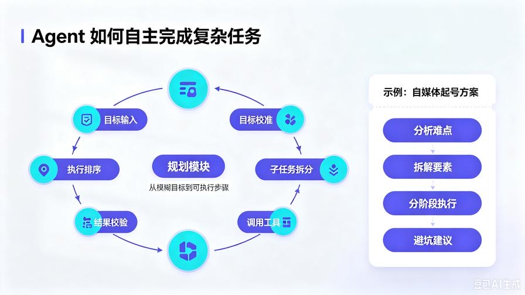

# 第3篇：思维链与规划能力：AI Agent为什么能自主完成复杂任务？

在前两篇中，我们建立了最重要的底层认知：

**普通大模型 = 单点问答**

**AI Agent = 目标驱动的全流程执行**

而支撑 AI Agent 实现“自主干活”的核心引擎，就是今天要讲的——**任务规划能力**。

很多新手会疑惑：同样是调用同一个大模型接口，为什么别人的 AI 可以自动拆任务、分步执行、搞定复杂需求，而我的 AI 只会一次性瞎输出、逻辑断裂、半途翻车？

答案非常直白：**你的模型没有“思考过程”，只有结果输出；而 Agent 拥有完整的“推理与规划链路”。**

本篇是 Agent 开发的**核心思维篇**，也是区分“玩具AI”和“可用智能体”的分水岭。

读完你将彻底掌握：

- 大模型“单次输出”的天生缺陷
- 思维链 CoT 到底解决了什么问题
- Agent 主流规划范式：CoT / ToT / ReAct / Reflexion 通俗拆解
- 可直接复用的极简规划代码实操
- 如何让 AI 从“直接给答案”变成“先思考、再执行、再交付”

## 一、深度剖析：普通大模型为什么做不了复杂任务？




大模型的原生工作逻辑非常简单：**概率接龙**。

它根据前文语义，逐字预测下一个最合理的字，最终拼接成完整回答。这种模式应对简单问题完全够用：写文案、翻译、问答、解释概念。

但一旦遇到**多步骤、有逻辑依赖、需要分步推进**的复杂任务，原生模型会瞬间暴露三大致命问题：

### 1. 任务一锅烩，不会拆解

用户给出复杂目标，模型不会拆分子任务，试图一次性输出所有结果，最终逻辑混乱、要点缺失、结构崩盘。

### 2. 无中间推理，细节容易错漏

模型直接输出最终答案，跳过中间思考步骤，没有验算、没有推理过程，极易出现逻辑BUG和事实幻觉。

### 3. 无法迭代推进，一步错步步错

普通问答是“一次性交付”，没有纠错、没有回溯、没有二次优化，只要初始判断出错，整段结果全部作废。

**总结一句话：原生大模型只有“答案层”，没有“思考层”和“执行层”。**

而 AI Agent 的规划模块，就是专门给大模型补上这套**思考流程**。

## 二、从CoT到ReAct：四大Agent规划范式通俗拆解



目前行业内所有智能体的规划逻辑，全部源自四种经典范式。我避开所有学术公式，用开发者视角通俗讲透，让你知道什么场景用什么方案。

### 1. CoT 思维链：让AI学会“分步思考”

**全称**：Chain of Thought

**核心逻辑**：不直接输出答案，强制模型先输出推理过程，基于过程推导结果。

普通提问：**直接给出结果**

CoT提问：**请一步步思考，分步推导，最后给出答案**

看似只是多了一句话，但效果是颠覆性的：

- 强制模型激活逻辑推理能力
- 降低幻觉概率，让结果有据可依
- 适配推理类、计算类、逻辑类任务

**CoT是所有Agent规划能力的基础底座。**没有思维链，就不存在智能任务拆解。

### 2. ToT 思维树：让AI学会“多路径试错”

**全称**：Tree of Thought

**核心逻辑**：不再是单条线性思考，而是像树一样，发散出多条思考路径、并行推演、择优选择。

CoT 是**一条路走到黑**；

ToT 是**多条路同时走，选最优解**。

适合高难度复杂决策：方案设计、选题规划、策略制定、复杂问题攻坚。AI可以自主判断哪条思路更可行，淘汰错误路径，保留最优逻辑。

### 3. ReAct 交互推理：让AI学会“思考+行动循环”

**全称**：Reason + Act

**核心逻辑**：思考一步、行动一步、观察反馈、再继续思考。

这是目前**工业级Agent最主流的范式**，也是 LangChain 默认的核心逻辑。

它彻底解决了“空想误判”问题：

- Reason（思考）：判断当前需要做什么
- Act（行动）：调用工具、获取信息、执行动作
- Observe（观察）：接收真实反馈
- Loop（循环）：继续下一步推理

**绝大多数能自动搜资料、自动整理、自动办公的Agent，全是基于 ReAct 循环架构跑起来的。**

### 4. Reflexion 自我反思：让AI学会“复盘纠错”

**核心逻辑**：完成一轮任务后，回头复盘自己的思考过程，找出漏洞、修正错误、迭代优化。

前面三种范式解决了“怎么思考、怎么执行”，Reflexion 解决的是**怎么越做越对、越做越好**。

也是高阶Agent和普通Agent的核心差距：**具备自我迭代能力**。

## 三、范式对比：新手如何选型？

我给大家一套可以直接落地的选型标准，以后开发不用纠结：

- **简单问答、文案、推理任务**：用 CoT 思维链
- **复杂决策、方案设计、多维度分析**：用 ToT 思维树
- **需要工具调用、联网、落地执行**：用 ReAct 循环推理
- **需要高精度、低幻觉、持续优化**：叠加 Reflexion 反思机制

所有商用全自动Agent，本质都是**这四种范式的组合堆叠**。

## 四、极简代码实战：亲手实现CoT思维链提升效果



理论看懂不够，我们直接上手极简可运行代码，直观感受“普通输出”和“思维链输出”的差距。

下面示例无需复杂框架，原生 Prompt + 大模型接口即可实现。

### 普通Prompt（无思维链）

```python
prompt = """
帮我分析这个问题：自媒体新人如何快速起号，直接给出答案。
"""
```

结果特点：答案笼统、逻辑单薄、步骤缺失、可落地性差。

### CoT思维链Prompt（带分步推理）

```python
prompt = """
你是一个专业的自媒体运营分析师。
请你一步步思考、分步推导，再给出最终完整方案：
1. 先分析新人起号的核心难点
2. 再拆解起号的关键核心要素
3. 然后给出分阶段执行步骤
4. 最后总结避坑要点和落地建议

问题：自媒体新人如何快速起号？
"""
```

结果特点：**逻辑分层清晰、步骤完整、落地性强、无跳跃性错误**。

仅仅多了一套“分步思考规则”，模型输出质量直接提升一个档次。这就是规划能力的价值。

## 五、进阶认知：真正的Agent规划，是全自动任务拆解



上面的CoT是基础思维优化，而真正的Agent规划更进一步：**让模型自主拆解未知复杂任务，无需人工定义步骤。**

当你给Agent一个模糊、复杂、长周期目标时，规划模块会自动完成：

1. 目标理解与校准
2. 复杂任务子任务拆分
3. 执行优先级排序
4. 判断是否需要调用工具
5. 分步执行、循环推进
6. 全程自我校验纠错

**这就是AI可以自主干活、自主完成项目的核心秘密。**

## 六、本篇核心总结

1. 普通大模型缺陷：只有结果输出，没有中间推理与任务规划，无法应对复杂多步骤任务；

2. CoT思维链：让AI分步思考，解决逻辑推理、细节错漏问题，是所有规划的基础；

3. ToT思维树：多路径推演、择优输出，适配复杂决策场景；

4. ReAct交互推理：思考+行动循环，是工具型Agent落地的核心范式；

5. Reflexion反思：复盘纠错、迭代优化，提升Agent精准度与稳定性。

## 下期预告

有了规划能力，AI已经可以自主拆解任务，但依然会“健忘、重复犯错、记不住你的习惯”。**下一篇我们深度拆解Agent三级记忆架构**，搞懂瞬时记忆、短期记忆、长期记忆与向量存储，让你的AI真正拥有“持续记忆”，越用越智能。

**互动提问：你平时使用AI，最受不了它哪类逻辑错误？是漏步骤、前后矛盾还是凭空瞎编？**

> 来源：头条号《AI Agent 零基础实战》第3篇｜版权归作者所有，仅供学习交流
