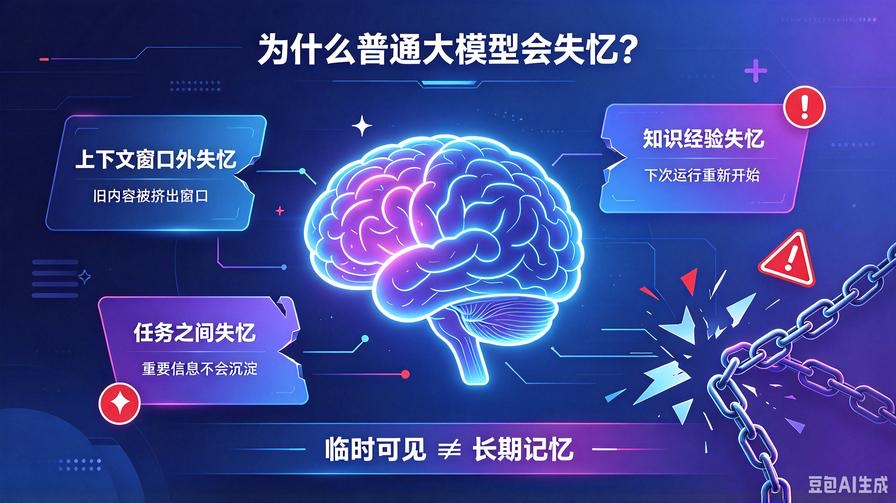
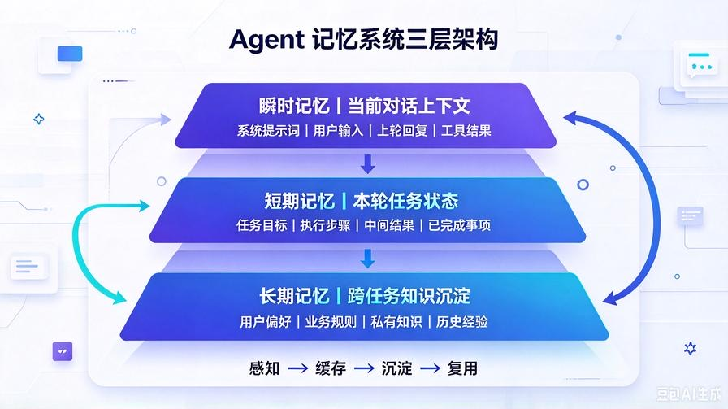
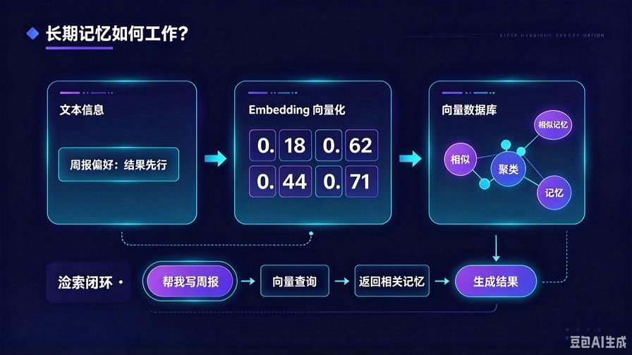
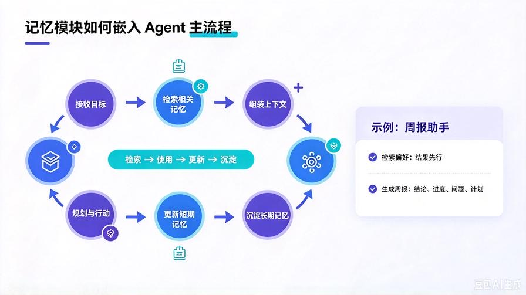

# 第4篇：记忆模块详解：AI Agent如何记住历史、持续对话、迭代优化

在前三篇中，我们已经建立了 AI Agent 最核心的两条能力基线：

**第一，Agent 不是聊天机器人，而是目标驱动的执行系统。**

**第二，规划能力让 Agent 会拆任务，记忆能力让 Agent 记得住任务。**

很多开发者都有这个痛点：

明明第一次交互很顺利，第二次就失忆；  
明明上次已经告诉过它偏好，这次还要重新说；  
明明任务做到一半，结果上下文一满，AI 直接断片翻车。

问题的根源不是模型不够强，而是**没有给 Agent 设计独立的记忆系统**。

本篇是 Agent 开发的关键基础篇。读完后，你将彻底理解：

- 为什么普通大模型会"健忘"
- 瞬时记忆、短期记忆、长期记忆分别解决什么问题
- 向量数据库为什么是 Agent 长期记忆的核心
- 记忆模块如何与规划、工具、反思系统协同工作
- 如何用极简代码给 AI 增加记忆能力

---

# 一、先破误区：大模型不是天然有记忆



很多人以为，只要模型上下文窗口够大，就天然拥有记忆。

这是错的。

严格来说，大模型拥有的只是**上下文感知能力**，不是真正的记忆。

它的工作方式是：

> 根据当前输入窗口里的内容，预测下一个最可能出现的词。

如果内容不在当前窗口里，模型就当它不存在。

所以，普通对话 AI 会出现三种典型失忆：

## 1. 上下文窗口外失忆

对话一旦变长，旧内容会被挤出窗口，模型自然记不住。

## 2. 任务之间失忆

这次任务结束，下次重新开始，之前的偏好、规则、历史经验全部清零。

## 3. 知识经验失忆

模型不知道哪些信息重要，也不会主动沉淀关键知识，每次都像第一次运行。

**结论：大模型的"记性"，本质是临时可见，不是长期存储。**

而 AI Agent 的记忆模块，就是要把"临时可见"变成"可存储、可检索、可复用"。

---

# 二、Agent 记忆系统的三层架构



工业级 Agent 的记忆系统，通常分为三层：

1. 瞬时记忆
2. 短期记忆
3. 长期记忆

这三层不是替代关系，而是协同关系。

## 1. 瞬时记忆：当前对话上下文

瞬时记忆，就是模型当前正在看到的内容。

比如用户刚刚说的话、系统提示词、上一轮回复、工具返回结果，都属于瞬时记忆。

它的特点是：

- 响应最快
- 不需要额外存储
- 容量受上下文窗口限制
- 任务结束后容易丢失

瞬时记忆适合处理：

- 当前轮次理解
- 即时推理
- 短上下文任务

但它不能解决长期记忆问题。

## 2. 短期记忆：本轮任务状态记忆

短期记忆，是 Agent 在执行一个任务过程中的状态缓存。

比如：

- 当前任务目标是什么
- 已经完成了哪些步骤
- 哪些工具已经调用过
- 中间结果是什么
- 哪些信息已经确认过

短期记忆的价值，是让 Agent 在同一个任务中不会混乱。

没有短期记忆，Agent 很容易出现：

- 重复提问
- 重复调用工具
- 忘记已经完成的步骤
- 中途跑偏到无关方向

短期记忆适合处理：

- 单任务状态跟踪
- 多步骤执行记录
- 工具调用结果缓存
- 任务进度管理

## 3. 长期记忆：跨任务知识与经验沉淀

长期记忆，是 Agent 最核心的能力之一。

它把重要信息从单次任务中抽取出来，持久化保存，供未来反复检索使用。

长期记忆可以保存：

- 用户偏好
- 业务规则
- 私有知识
- 历史任务经验
- 常见问题解法
- 文档与案例知识

有了长期记忆，Agent 才能从"每次重新开始"变成"越来越懂你"。

---

# 三、为什么长期记忆是 Agent 的分水岭

很多新手 Agent 项目，本质只是"带了点上下文的聊天机器人"。

原因很简单：它们没有长期记忆，也没有检索机制。

真正可用的 Agent，必须能在需要时主动找到相关信息。

比如：

用户第一次告诉 Agent：  
"我写周报喜欢用结果先行结构，重点突出数据和进度。"

如果没有长期记忆，下次对话就会失效。

如果有长期记忆，Agent 应该自动记住：

- 用户周报偏好：结果先行
- 表达重点：数据、进度
- 输出结构：结论、进展、问题、计划

以后每次生成周报，都能自动检索这些规则，而不用用户重复说明。

这就是长期记忆的价值：

**把一次性指令，变成可持续能力。**

---

# 四、长期记忆怎么实现：向量数据库的角色



长期记忆最常见的实现方式，是使用向量数据库。

很多人一听"向量数据库"就觉得难，其实原理非常简单。

## 第一步：把文本变成向量

一段文本输入给 Embedding 模型后，会被转换成一串数字向量。

语义相近的内容，向量距离也更近。

比如：

- "周报结构：结果先行"
- "我写报告喜欢先给结论"

这两句话字面不同，但语义接近，向量也会靠近。

## 第二步：把向量存起来

向量数据库负责存储这些向量，并记录它们对应的原始文本。

你可以把它理解成一个"智能索引库"。

## 第三步：需要时检索相关记忆

当新任务到来时，Agent 会把当前问题也转成向量，然后去向量库中查找最相似的历史记忆。

比如用户说：  
"帮我写本周工作总结。"

Agent 会自动检索：

- 用户周报偏好
- 历史周报模板
- 相关工作记录
- 之前未完成事项

然后把这些信息一起交给大模型，让模型基于真实记忆生成结果。

**记忆模块的核心，不是存得多，而是需要时能找得到。**

---

# 五、记忆模块如何接入 Agent 主流程



记忆模块不是孤立存在的，它必须嵌入 Agent 的主循环。

一个标准流程是：

## 1. 接收目标

用户输入任务目标。

## 2. 检索相关记忆

Agent 根据当前目标，从长期记忆中检索相关信息。

## 3. 组装上下文

把系统提示词、用户目标、检索到的记忆、当前任务状态一起交给大模型。

## 4. 执行规划与行动

模型基于更完整的上下文进行推理、规划、调用工具。

## 5. 更新短期记忆

记录本轮任务的执行状态、中间结果、已完成步骤。

## 6. 沉淀长期记忆

任务结束后，把重要经验、偏好、规则、新知识写入长期记忆。

这样，Agent 每完成一次任务，都会比之前更聪明一点。

---

# 六、极简代码实战：给 AI 增加记忆能力

下面这个例子，不依赖复杂框架，用最基础的逻辑展示记忆模块的工作原理。

## 场景描述

我们要做一个简单的个人助手：

- 用户可以告诉它偏好
- 下次任务时，助手自动检索偏好
- 生成结果时参考历史记忆

## 伪代码结构

```python
# 1. 模拟长期记忆库
long_term_memory = []

# 2. 写入记忆
def save_memory(item):
    long_term_memory.append(item)

# 3. 检索记忆
def retrieve_memory(query):
    # 这里简化处理，真实场景使用向量检索
    related = [item for item in long_term_memory if query in item]
    return related

# 4. 生成回复
def generate_reply(user_input):
    memory = retrieve_memory(user_input)

    prompt = f"""
    用户输入：{user_input}
    历史记忆：{memory}
    请参考历史记忆，生成符合用户偏好的回复。
    """

    return call_llm(prompt)
```

## 使用方式

```python
# 第一次：写入偏好
save_memory("用户周报喜欢结果先行，突出数据和进度。")

# 第二次：自动参考记忆
result = generate_reply("帮我写本周工作总结。")
```

这个例子虽然简单，但已经包含了记忆模块的三个关键动作：

- 存
- 查
- 用

真实项目中，你只需要把"检索记忆"替换成向量数据库查询即可。

---

# 七、记忆系统的常见设计问题

## 问题1：记忆越多越好吗？

不是。

记忆太多会带来噪音，模型可能引用无关信息，反而降低输出质量。

更合理的方式是：

- 只沉淀高价值信息
- 定期清理低价值记忆
- 给记忆设置权重、来源、有效期

## 问题2：长期记忆会不会导致隐私风险？

会。

凡是保存用户偏好、业务文档、个人记录，都涉及隐私与数据安全。

所以长期记忆模块必须考虑：

- 数据脱敏
- 权限控制
- 存储边界
- 用户知情权
- 可删除机制

## 问题3：记忆模块越复杂越好吗？

不是。

新手开发 Agent，先把这三件事做对：

1. 知道哪些信息该记
2. 知道什么时候该检索
3. 知道检索后怎么用

这比盲目堆复杂架构更重要。

---

# 八、本篇总结

1. 大模型没有天然记忆，只有上下文感知能力；
2. Agent 记忆系统分为瞬时记忆、短期记忆、长期记忆三层；
3. 长期记忆让 Agent 跨任务复用知识，是从聊天机器人到智能助手的关键分水岭；
4. 向量数据库的作用，是把语义相近的信息存起来，在需要时快速检索；
5. 记忆模块必须接入 Agent 主流程，形成"检索—使用—更新—沉淀"闭环。

---

# 下期预告

有了记忆，Agent 能记住过去；有了规划，Agent 能拆解任务。但如果没有工具，Agent 依然只能停留在文本层面。

**下一篇我们进入工具调用机制**，讲清楚 Function Call 的原理、常用工具类型，以及如何让 Agent 真正完成联网、计算、文件处理等实际任务。

> 来源：头条号《AI Agent 零基础实战》第4篇｜版权归作者所有，仅供学习交流
