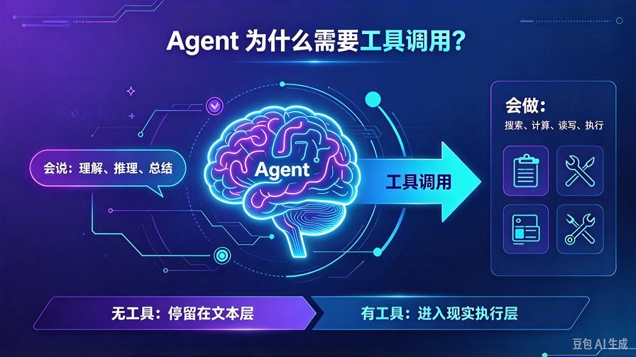
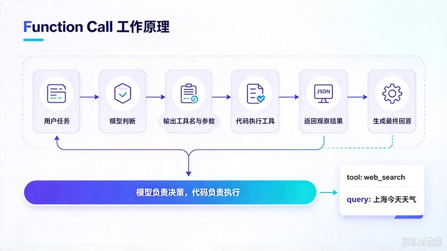
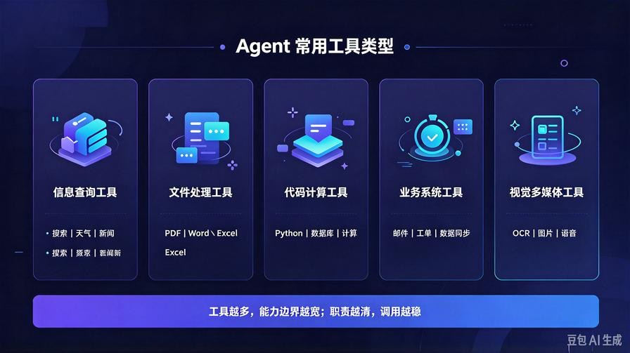
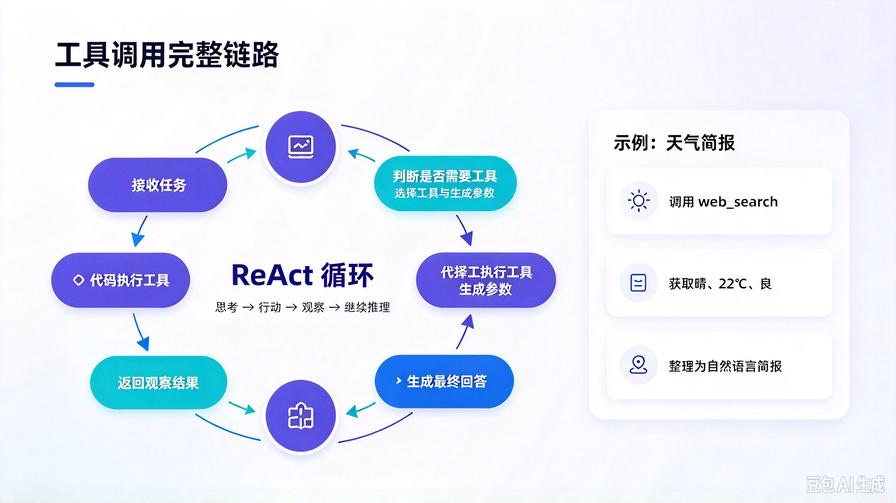

# 第5篇：工具调用机制详解：让AI Agent从"会说"到"会做"

在前四篇中，我们已经搭建起 AI Agent 的完整基础能力框架：

- **第一篇**：区分了普通大模型与 AI Agent
- **第二篇**：拆解了 Agent 五大核心组件
- **第三篇**：讲清了思维链、规划与任务拆解
- **第四篇**：建立了记忆系统与长期知识沉淀

但到目前为止，Agent 依然主要停留在"思考与表达"层面。

要真正完成现实任务，还缺最后一块关键能力：**工具调用**。

很多人对 Agent 的理解停留在"更强的聊天机器人"，这是一个很窄的误区。

普通聊天 AI 输出文字；  
AI Agent 不仅输出文字，还能调用外部工具完成动作。

这就是"会说"和"会做"的区别。

本篇是 Agent 从理论走向落地的关键篇。读完后，你将彻底理解：

- 为什么工具调用是 Agent 落地的核心
- Function Call 的基本工作原理
- Agent 常用工具类型与适用场景
- 工具选择、调用、观察、结果回填的完整链路
- 如何用极简代码实现一个可调用工具的 Agent

---

# 一、先理解：Agent 为什么必须调用工具？



大模型本身有一个能力边界：

它擅长理解、推理、总结、生成文本，但不擅长直接完成现实世界中的精确动作。

比如：

- 实时查天气
- 搜索最新信息
- 读写文件
- 查询数据库
- 计算复杂数据
- 发送邮件
- 控制软件或设备

这些任务，纯靠模型"张嘴回答"不够，必须借助外部工具。

工具调用的本质，就是给 Agent 增加"外设能力"。

可以把它理解成：

- 大模型是大脑
- 记忆系统是知识库
- 规划模块是思考方式
- 工具系统是手脚和外部接口

没有工具，Agent 只能停留在文本层面；  
有了工具，Agent 才能进入现实任务执行层。

---

# 二、Function Call：工具调用的核心机制



Function Call，中文一般叫"函数调用"或"工具调用"。

它的目标很简单：

**让大模型在合适的时机，主动决定调用某个外部函数，并把参数准备好。**

## 1. 工具调用不是模型自己执行

很多新手会误以为：模型调用工具，就是模型直接联网、读文件、操作电脑。

其实不是。

真实过程更准确地说是：

1. 用户提出任务
2. 模型判断需要调用工具
3. 模型输出工具名称和参数
4. 应用代码真正执行工具
5. 工具结果返回给模型
6. 模型基于结果继续推理或生成最终回答

所以，Function Call 更像是：

> 模型负责"决策"，代码负责"执行"。

## 2. Function Call 的输入输出

一个标准工具调用请求，通常包含：

- 工具名称
- 参数列表
- 参数说明
- 返回结果描述

例如，一个搜索工具可能定义为：

```json
{
  "name": "web_search",
  "description": "搜索最新信息",
  "parameters": {
    "query": "搜索关键词"
  }
}
```

当用户问：  
"今天上海天气怎么样？"

模型可能决定调用：

```json
{
  "tool": "web_search",
  "parameters": {
    "query": "上海今天天气"
  }
}
```

工具执行后返回结果：

```json
{
  "天气": "晴",
  "温度": "22℃",
  "风向": "东南风"
}
```

然后模型再把结果整理成自然语言回答用户。

这就是一次完整的工具调用闭环。

---

# 三、Agent 常用工具类型



工具没有固定数量，理论上只要能封装成函数，都可以成为 Agent 的工具。

新手可以先掌握这几类：

## 1. 信息查询工具

用于获取外部世界的实时信息。

常见包括：

- 搜索引擎
- 天气查询
- 新闻检索
- 股票/数据查询
- 行业数据库

**适合场景：**

- 最新信息调研
- 数据报告
- 时效性强的问答

## 2. 文件处理工具

用于读写和处理本地或云端文件。

常见包括：

- 读取 PDF
- 读取 Word/Excel
- 写入文档
- 批量整理文件
- 拆分长文档

**适合场景：**

- 资料整理
- 报告生成
- 知识库构建
- 办公自动化

## 3. 代码与计算工具

用于完成模型不擅长的精确计算、逻辑处理和自动化任务。

常见包括：

- Python 执行器
- 计算器
- 数据库查询
- 数据清洗脚本
- 简单自动化脚本

**适合场景：**

- 数据分析
- 数值计算
- 批量处理
- 复杂逻辑执行

## 4. 业务系统工具

用于连接企业内部系统和业务流程。

常见包括：

- 发送邮件
- 创建工单
- 查询客户信息
- 更新订单状态
- 同步表格数据

**适合场景：**

- 企业办公助手
- 业务流程自动化
- 客户服务 Agent
- 运营数据分析

## 5. 视觉与多媒体工具

用于处理图片、音频、视频等非文本任务。

常见包括：

- OCR 文字识别
- 图片生成
- 语音转文字
- 文件格式转换

**适合场景：**

- 多模态 Agent
- 内容生产助手
- 文档数字化

---

# 四、工具调用完整链路



一个完整的工具调用过程，通常分为六步。

## 第一步：接收任务

用户输入目标，例如：

"帮我查一下今天上海的天气，并整理成一句简报。"

## 第二步：判断是否需要工具

模型分析任务后，判断：

- 是否需要实时信息
- 是否需要精确计算
- 是否需要访问文件或数据库
- 是否必须调用外部接口

如果需要，就进入工具选择阶段。

## 第三步：选择工具并生成参数

模型从可用工具列表中选择最合适的工具，并生成参数。

比如选择 `web_search`，参数为：

```json
{
  "query": "上海今天天气"
}
```

## 第四步：代码执行工具

应用代码收到模型的工具调用请求后，真正执行外部工具。

这一步模型不直接接触外部系统，由代码负责安全执行。

## 第五步：返回观察结果

工具执行结果返回给模型，例如：

```json
{
  "城市": "上海",
  "天气": "晴",
  "温度": "22℃",
  "空气质量": "良"
}
```

## 第六步：生成最终回答

模型基于工具结果，整理成用户可读的答案：

"今天上海晴，气温约 22℃，空气质量良，适合安排户外活动。"

如果任务复杂，这个过程会循环多次：

**思考 → 调用工具 → 观察结果 → 再思考 → 再调用 → 最终输出。**

这就是 ReAct 范式的典型体现。

---

# 五、工具调用与 Agent 组件如何协同

工具调用不是孤立模块，它必须和其他组件协同。

## 1. 与规划模块协同

规划模块决定"先做什么"，工具系统决定"用什么做"。

例如：

- 规划模块把任务拆成"搜索资料、整理结果、生成报告"
- 工具系统负责执行"搜索资料"这一步

## 2. 与记忆模块协同

记忆模块可以帮助 Agent 记住：

- 用户偏好
- 历史工具使用结果
- 某些数据口径
- 特定业务规则

例如，用户之前说过"我只关心温度和空气质量"，Agent 再调用天气工具后，就可以按偏好整理结果。

## 3. 与反思模块协同

反思模块负责检查工具调用是否合理：

- 参数是否正确
- 结果是否满足需求
- 是否需要二次调用
- 是否存在冗余步骤

这能减少无效调用和错误执行。

---

# 六、极简代码实战：实现一个会查天气的 Agent

下面用极简伪代码展示工具调用的核心逻辑。

## 1. 定义工具

```python
tools = [
    {
        "name": "web_search",
        "description": "搜索最新信息",
        "parameters": {
            "query": "搜索关键词"
        }
    }
]
```

## 2. 执行工具

```python
def execute_tool(tool_name, parameters):
    if tool_name == "web_search":
        return search_web(parameters["query"])
```

## 3. Agent 主循环

```python
def agent_run(user_input):
    # 1. 模型判断是否调用工具
    decision = llm_decide_tool(user_input, tools)

    if decision["use_tool"]:
        # 2. 执行工具
        result = execute_tool(
            decision["tool_name"],
            decision["parameters"]
        )

        # 3. 把结果交给模型继续处理
        return llm_generate(user_input, result)
    else:
        # 4. 不需要工具，直接回答
        return llm_direct_reply(user_input)
```

## 4. 使用方式

```python
agent_run("今天上海天气怎么样？")
```

这个例子虽然简单，但已经包含了工具调用的核心闭环：

- 判断
- 选择
- 调用
- 观察
- 回填
- 生成结果

---

# 七、工具调用的关键设计原则

## 原则1：工具职责要单一

一个工具最好只做一件事。

比如：

- 搜索工具只负责搜索
- 天气工具只负责查天气
- 文件工具只负责读文件

职责越清晰，模型越容易正确调用。

## 原则2：参数定义要明确

工具参数必须清楚：

- 参数含义
- 参数类型
- 是否必填
- 示例值

参数越模糊，模型越容易生成错误调用。

## 原则3：结果格式要结构化

工具返回结果尽量使用结构化格式，例如 JSON。

结构化结果更容易被模型理解，也更方便后续处理。

## 原则4：必须有人机边界

不是所有工具都适合自动执行。

涉及支付、删除、发送、修改数据等高风险动作时，应加入：

- 人工确认
- 权限校验
- 风险提示
- 操作审计

---

# 八、本篇总结

1. 工具调用是 Agent 从"会说"到"会做"的关键能力；
2. Function Call 的本质是：模型做决策，代码做执行；
3. Agent 常用工具包括信息查询、文件处理、代码计算、业务系统、视觉多媒体等；
4. 工具调用遵循"判断—选择—执行—观察—回填—生成"闭环；
5. 工具系统必须与规划、记忆、反思模块协同，才能形成稳定 Agent。

---

# 下期预告

有了工具调用，Agent 已经能完成现实动作。但要真正稳定运行，还需要解决一个关键问题：**如何避免幻觉、错误调用和任务跑偏**。

下一篇我们进入反思与校验机制，讲清楚 Agent 如何自查结果、纠错迭代，以及如何构建更可靠的端到端执行链路。

> 来源：头条号《AI Agent 零基础实战》第5篇｜版权归作者所有，仅供学习交流
