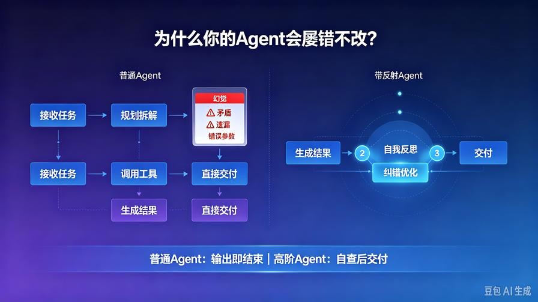
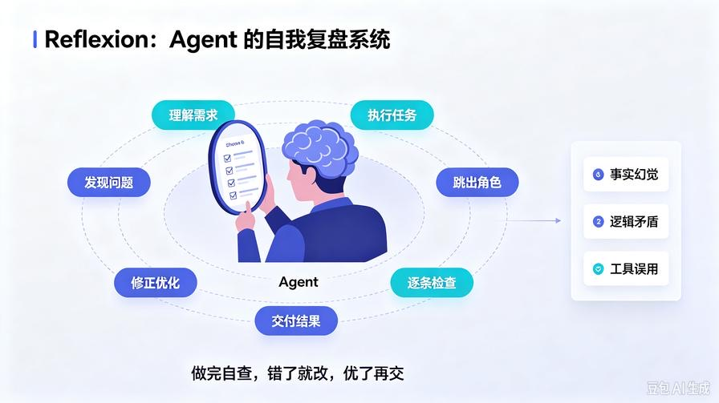
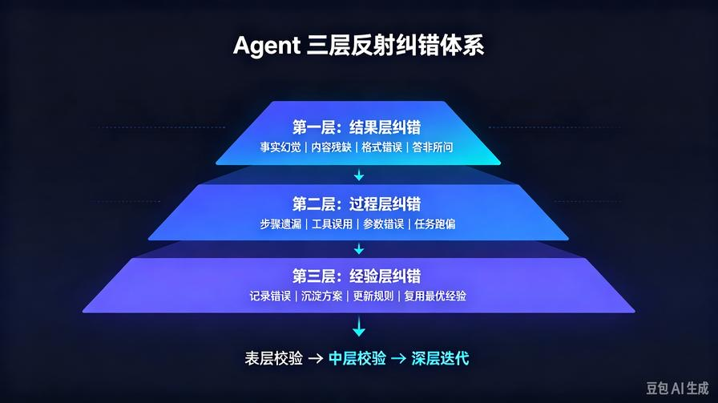
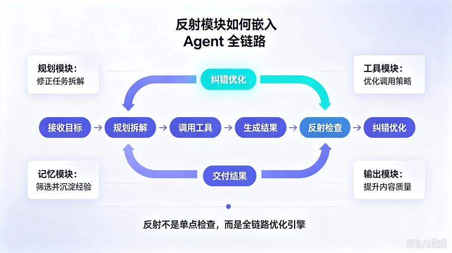

# 第6篇：Agent反射与自我纠错：让AI从“被动回答”变成“主动优化”

欢迎继续更新 **AI Agent 零基础实战连载系列**。

在前五篇，我们已经彻底补齐了智能体的四大核心底座：

1. 搞懂了 **Agent 与普通大模型的本质区别**
2. 吃透了 **五大核心架构组件**
3. 掌握了 **CoT/ReAct 任务规划逻辑**
4. 搭建了 **三级记忆存储系统**
5. 实现了 **工具调用落地执行能力**

到这里，你已经可以开发出一个**能思考、能记忆、能干活**的基础 AI Agent。

但绝大多数新手开发的 Agent，依然存在一个致命短板：**输出即结束，对错全靠蒙，犯错不修正。**

很多人开发的智能体普遍存在这些顽疾：

- 回答前后逻辑矛盾，自己发现不了
- 工具调用多余、重复、参数错误，持续摆烂
- 内容有幻觉、有漏洞，直接交付劣质结果
- 多次迭代任务越做越乱，不会复盘优化

**这就是缺少了高阶 Agent 的核心护城河：反射纠错机制（Reflexion）。**

如果说「规划、记忆、工具」让 AI **能做事**；  
那「反射纠错」就是让 AI **做得对、做得好、越做越稳**。

本篇作为系列**高阶进阶核心篇**，带你从零吃透 Agent 自我反思、自查、纠错、迭代优化的底层逻辑，彻底解决 AI 幻觉、任务出错、输出劣质的行业通病。

读完本文，你将掌握：

- 普通 Agent 与高阶智能体的核心差距
- Reflexion 反射机制的通俗原理与运行逻辑
- Agent 三层自查纠错体系
- 反思 + 规划 + 工具 + 记忆的全链路闭环
- 可直接落地的极简纠错代码实操
- 彻底降低 Agent 幻觉、错误率的落地技巧

## 一、为什么你的 AI Agent 总是 “屡错不改”？



我们先复盘普通 Agent 的完整工作流程：  
**接收任务→规划拆解→调取记忆→调用工具→生成结果→直接交付**

发现问题了吗？  
**整个流程只有 “执行”，没有 “校验” 和 “复盘”。**

这就是所有低阶 Agent 的通病：**单向输出、无反馈、无迭代**。

类比人类：  
普通人做事：做完就结束，对错不管；  
专业的人做事：做完自查、发现漏洞、修正瑕疵、复盘总结、下次优化。

AI Agent 也是同一个逻辑：  
**没有反射机制的智能体，只是一台只会执行的机器；拥有反射机制的智能体，才具备自我进化的智能。**

大模型本身天生存在缺陷：幻觉、逻辑疏漏、参数判断失误、信息整合不全。  
单纯靠模型原生能力，永远无法根治问题。  
**唯一的解决方案：外挂一层自我反思、自我校验、自我纠错的反射模块。**

## 二、什么是 AI Reflexion 反射机制？（通俗白话）



抛开学术论文的晦涩定义，我给开发者最落地的解释：

**Reflexion 反射，就是给 AI Agent 增加一套「自我复盘系统」。**

在任务完成后、结果交付前，让 AI**跳出原有任务逻辑，以第三方审核者的身份**，重新审视自己的全过程：

- 我的任务理解是否准确？
- 我的规划拆解是否合理？
- 工具调用是否正确、有无冗余、有无遗漏？
- 调取的记忆信息是否有效？
- 输出结果是否存在幻觉、漏洞、逻辑矛盾？
- 是否满足用户真实需求？
- 有没有更好的优化方案？

简单一句话：  
**普通 AI：做完就交；高阶 Agent：做完自查、错了就改、优了再交。**

这也是**开源 AutoGPT、商用高级智能助手**能够稳定落地、低出错的核心秘密。

## 三、Agent 三层反射纠错体系（行业通用架构）



真正工业级的反射机制，不是单一的一句 “帮我检查一下”，而是**三层递进式自查闭环**，层层过滤错误、优化结果。

### 第一层：结果层纠错（表层校验）

针对最终输出内容做合规性、准确性、完整性检查。  
核心解决问题：**输出瞎编、内容残缺、格式错误、答非所问**

自查维度：

1. 是否存在事实幻觉、虚假数据、编造信息
2. 是否偏离用户原始需求
3. 内容逻辑是否前后矛盾
4. 结构是否完整、有无关键信息缺失
5. 输出格式是否符合规范

### 第二层：过程层纠错（中层校验）

针对**整个任务执行链路**复盘，不看结果、只看过程。  
核心解决问题：**步骤错乱、工具误用、规划错误、无效执行**

自查维度：

1. 任务拆解逻辑是否合理，有无步骤遗漏或多余
2. 工具选择是否精准，是否存在不该调用却调用的情况
3. 工具参数是否正确，是否影响执行结果
4. 任务执行顺序是否最优
5. 中途是否出现任务跑偏、逻辑断层

### 第三层：经验层纠错（深层迭代）

针对**本次任务全程做经验沉淀**，同步更新记忆系统。  
核心解决问题：**重复踩坑、持续犯错、无法进化**

执行动作：

1. 记录本次出错原因、优化方案
2. 沉淀最优执行流程
3. 更新用户偏好、任务规则
4. 剔除无效旧记忆、沉淀高价值新经验

**三层闭环走完，Agent 完成一次完整的自我进化。**

## 四、反射模块如何和四大核心组件协同工作？



反射不是独立功能，而是**贯穿 Agent 全链路的优化引擎**，和之前的四大模块深度联动，形成终极闭环。

### 1. 联动规划模块：修正错误拆解

当规划拆解逻辑混乱、步骤不合理时，反射模块会检测出问题，**重新二次规划**，修正任务执行逻辑，避免一步错步步错。

### 2. 联动工具模块：优化调用策略

自动识别：重复调用、错误调用、漏调用、参数错误  
自动优化：重新选择工具、修正参数、补齐缺失操作

### 3. 联动记忆模块：筛选有效记忆

反思本次调取的记忆是否精准，过滤无效、过期、错误记忆，同时沉淀本次最优经验，**让下次同类任务直接复用最优方案**。

### 4. 联动输出结果：迭代内容质量

对最终文案、数据、报告做润色、纠错、补全、优化，交付高精准、高质量结果。

**五大组件 + 反射纠错 = 完整商用级 AI Agent 架构**

## 五、极简代码实操：手写一个带自我纠错的 Agent

不用复杂框架，原生 Prompt + 基础逻辑，手把手实现**基础反射纠错能力**，可直接复制运行。

### 核心思路

1. 第一轮：Agent 正常执行任务，输出初始结果
2. 第二轮：Agent 切换「审核模式」自查纠错
3. 第三轮：基于自查报告，迭代优化最终输出

```python
# 模拟大模型调用（通用接口）
def llm_call(prompt):
    # 此处替换为你的真实大模型API调用
    return "模型原始输出结果"

# 1. 第一轮：常规任务执行
def agent_execute(user_input):
    base_prompt = f"请完成用户任务：{user_input}"
    return llm_call(base_prompt)

# 2. 第二轮：反射自查纠错
def agent_reflect(user_input, raw_result):
    reflect_prompt = f"""
    你现在是任务审核专家，请严格自查本次任务全过程，输出纠错报告：
    用户原始需求：{user_input}
    你的原始输出：{raw_result}

    请从以下维度逐条自查：
    1. 是否存在事实幻觉、虚假信息
    2. 是否答非所问、内容残缺
    3. 逻辑是否矛盾、有无漏洞
    4. 格式是否规范、是否需要优化

    请输出：问题清单 + 优化方案
    """
    return llm_call(reflect_prompt)

# 3. 第三轮：迭代优化最终结果
def agent_optimize(user_input, raw_result, reflect_report):
    optimize_prompt = f"""
    根据自查纠错报告，优化你的输出，交付最终成品：
    用户需求：{user_input}
    原始结果：{raw_result}
    纠错报告：{reflect_report}

    请修正所有问题，输出精准、完整、高质量的最终结果。
    """
    return llm_call(optimize_prompt)

# ========== 完整纠错Agent主流程 ==========
def final_agent_run(user_task):
    # 初次执行
    raw = agent_execute(user_task)
    # 自我反思
    reflect = agent_reflect(user_task, raw)
    # 迭代优化
    final_result = agent_optimize(user_task, raw, reflect)
    return final_result
```

### 实战效果对比

- **无反射 Agent**：一次输出，对错随缘，幻觉频发
- **带反射 Agent**：执行→自查→纠错→优化，**错误率大幅降低，输出质量肉眼提升**

工业级框架（LangChain/LangGraph）的反射机制，本质就是**这套逻辑的高级封装**。

## 六、新手开发反射模块的 3 个核心技巧

### 技巧 1：分离「执行角色」和「审核角色」

一定要让 AI 切换身份自查，**自己不能既当执行者又当裁判**。  
单独的审核 Prompt、独立的自查逻辑，才能精准发现问题。

### 技巧 2：固定自查维度，不要模糊检查

禁止使用 “帮我检查一下有没有问题” 这种模糊指令。  
必须给定**明确的检查维度、校验标准**，AI 自查才有效。

### 技巧 3：轻量任务单层自查，复杂任务三层自查

- 简单文案、问答：只做**结果层自查**（高效不冗余）
- 复杂报告、数据处理、多步骤任务：**三层全量自查**（稳准可靠）

## 七、本篇核心总结

1. 普通 Agent 的最大缺陷：单向执行、无校验、无复盘、屡错不改；
2. **Reflexion 反射机制**是高阶 Agent 的核心护城河，实现自我自查、纠错、迭代进化；
3. 工业级反射分为：结果层、过程层、经验层三层递进校验；
4. 反射模块深度联动规划、工具、记忆、输出四大模块，形成完整智能闭环；
5. 极简三层执行逻辑（执行→反思→优化），是所有智能体纠错能力的底层核心。

## 下期预告

到本篇为止，我们已经**完全吃透 AI Agent 所有底层核心原理**。  
下一篇正式进入**落地实战阶段**：

**第 7 篇：AI Agent 开发框架选型对比与新手最优方案**

彻底解决新手框架选择困难，告诉你什么场景用什么框架，避开 90% 的学习弯路，开启真正的工程化开发！

**互动提问：你开发 AI Agent 时，最头疼的问题是幻觉、逻辑错误、还是任务执行出错？评论区告诉我！**

> 来源：头条号《AI Agent 零基础实战》第6篇｜版权归作者所有，仅供学习交流
