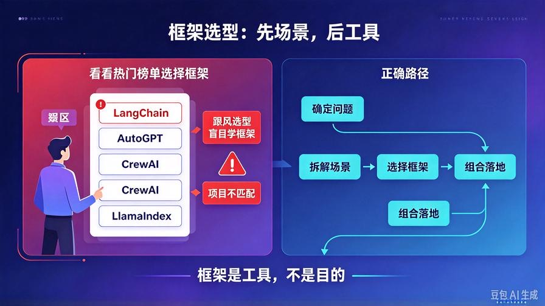
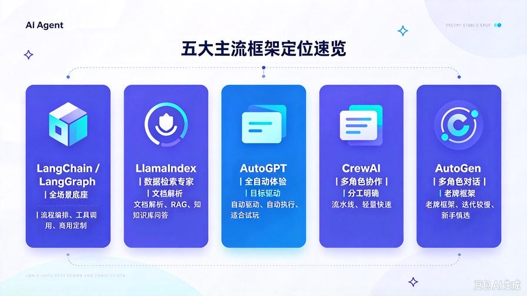
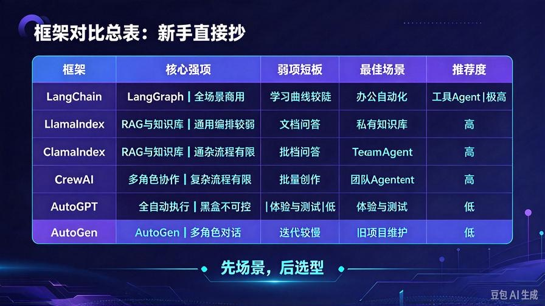
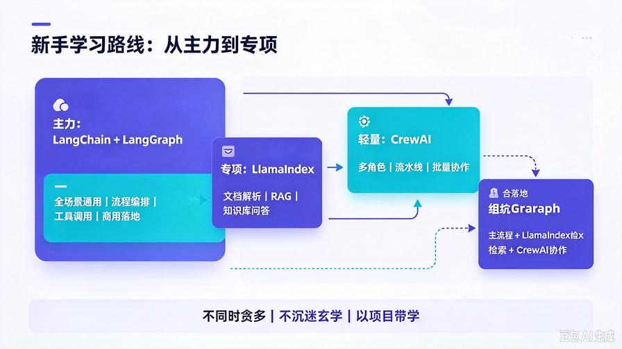

# 第7篇：AI Agent开发框架选型与对比（新手最优落地方案）

欢迎回到 **AI Agent 零基础实战系列**。

在前六篇中，我们已经完整吃透了 AI Agent 的**五大核心底层原理**：本质认知、架构组件、任务规划、记忆存储、工具调用、反射纠错。

理论全部铺垫完毕，从本篇开始，我们正式进入**工程化落地实战阶段**。

很多新手学 Agent 开发，第一步就踩坑：**盲目跟风学框架，学了一堆概念，依然不会落地开发**。

市面上主流框架层出不穷：LangChain、LlamaIndex、AutoGPT、CrewAI、AutoGen……

到底哪个简单易学？哪个适合新手？哪个能做商用项目？哪个是过时鸡肋？

本篇不讲废话、不堆参数、不炒概念，专门给**零基础开发者**做一套「终身可用的 Agent 框架选型标准」。读完你将彻底告别选择困难，精准匹配自己的项目场景，避开90%的学习弯路。

读完本文，你将彻底搞懂：

- 五大主流框架的**核心定位与真实优缺点**
- 新手绝对避坑的框架与学习误区
- 个人开发、副业变现、企业项目分别怎么选
- 2026年最新、最稳、最简的落地技术栈
- 框架组合使用的高阶实战思路

## 一、先破核心误区：新手最大的选型错误

绝大多数人的框架选型逻辑完全颠倒：**看热度选框架，而不是看场景选框架**。

很多新手上来就死磕 LangChain，学了一堆复杂语法、封装、底层API，结果只会写Demo，做不出完整项目；也有人跟风学 AutoGPT，以为能一键生成智能体，最后发现全是黑盒、无法定制、无法商用。

这里给大家一条**终身通用的选型铁律**：

**框架是工具，不是目的。先确定你的Agent要解决什么问题，再选对应的开发框架。**

所有 Agent 框架，本质都是对我们前六篇「五大核心组件」的**不同封装**：有的擅长流程编排、有的擅长数据检索、有的擅长多智能体协作、有的主打全自动执行。

没有最强的框架，只有**最适配场景**的框架。

## 二、五大主流AI Agent框架：通俗定位+优劣拆解

我剔除所有学术晦涩概念，用开发者视角、白话通俗拆解 2026 年五大主流框架，精准标注新手适配度、优缺点、适用场景。

### 1. LangChain / LangGraph：全能通用型开发框架

**核心定位**：目前生态最完善、通用性最强的**全场景Agent开发底座**，主打流程编排、工具调用、复杂任务闭环。

如果用一句话概括：**只要是复杂、多步骤、可定制、可商用的Agent，优先选 LangChain/LangGraph**。

**核心优势**：

- 生态最全：适配所有大模型、向量库、工具接口，无兼容壁垒
- 能力完整：原生支持规划、记忆、工具、反思、状态管理
- 可落地性强：支持循环、分支、断点续跑、人工介入，适配工业级项目
- 调试完善：配套 LangSmith 可视化调试，快速排查报错

**新手痛点**：

- 早期版本封装冗余，新手容易看不懂底层逻辑
- 复杂项目代码量偏大，需要一定基础沉淀

**适配场景**：办公自动化Agent、流程化任务Agent、工具调用型智能体、商用定制项目

**新手适配度**：⭐⭐⭐⭐⭐（首选主力框架）

### 2. LlamaIndex：数据检索专属框架

**核心定位**：**RAG知识库与文档检索天花板**，专为“读文件、查资料、知识库问答”而生。

一句话概括：**做知识库Agent、私有文档问答、企业资料智能查询，LlamaIndex 吊打所有框架**。

**核心优势**：

- 文档处理能力极强：支持130+文件格式，内置精细化解析、分块、索引策略
- 检索精度更高：混合检索、递归检索、权重排序原生支持
- 开箱即用：少量代码即可搭建高精度私有知识库Agent

**新手痛点**：

- 通用流程编排能力弱于 LangChain
- 非RAG场景性价比低，不适合纯工具执行、多流程任务

**适配场景**：企业知识库、私有文档问答、PDF/Word资料智能助手、本地知识库检索

**新手适配度**：⭐⭐⭐⭐（专项场景首选）

### 3. AutoGPT：全自动任务执行框架

**核心定位**：**目标驱动的全自动黑盒Agent**，无需精细编码，输入目标自动拆解、自动执行。

一句话概括：**适合快速体验智能体效果，不适合商用定制开发**。

**核心优势**：

- 上手极快，零代码/少代码即可运行全自动任务
- 原生自带自主规划、循环执行、多轮迭代能力

**新手致命缺点**：

- 高度黑盒，底层逻辑封闭，无法深度定制
- 任务随机性强、稳定性差，极易跑偏
- 不支持精细化调试，完全无法商用落地

**适配场景**：个人趣味体验、简单调研任务、新手认知学习

**新手适配度**：⭐⭐（仅入门体验，不深耕）

### 4. CrewAI：轻量化多智能体框架

**核心定位**：**极简多角色Agent协作框架**，主打分工协作、角色定义、流水线任务。

一句话概括：**想做多AI分工协作，CrewAI是最简方案**。

**核心优势**：

- 语法极简、代码量极少，新手极易上手
- 角色分工清晰：研究员、文案、审核、分析师各司其职
- 天然适配流水线、批量内容生产、多步骤协作任务

**新手痛点**：

- 复杂流程、精细控制能力不如 LangGraph
- 生态相对轻量化，高阶拓展较少

**适配场景**：自媒体批量创作、团队式AI协作、调研分析流水线、轻量化多Agent项目

**新手适配度**：⭐⭐⭐⭐（轻量化多Agent首选）

### 5. AutoGen：老牌多智能体框架

**核心定位**：微软出品的多Agent对话协作框架，主打多角色对话交互。

**新手避坑提醒**：目前处于维护模式，迭代缓慢，新手不优先学习。

优势是多角色对话逻辑成熟，缺点是上手偏复杂、代码冗余，对比 CrewAI 没有新手优势，新项目基本不再首选。

**新手适配度**：⭐⭐（不推荐新手入门）

## 三、2026最新框架横向对比总表（新手直接抄）

我把所有核心维度浓缩成一张表，新手无需记忆，直接对照场景选型：

| 框架 | 核心强项 | 弱项短板 | 最佳使用场景 | 新手推荐度 |
|-|-|-|-|-|
| LangChain/LangGraph | 全场景适配、流程强、可商用、可定制 | 入门稍慢，复杂项目代码偏多 | 办公自动化、工具Agent、商用定制项目 | 极高（主力必学） |
| LlamaIndex | 文档解析、RAG检索、知识库问答 | 通用流程编排能力弱 | 私有知识库、企业文档问答、资料检索 | 高（专项必学） |
| CrewAI | 极简多Agent分工、流水线协作 | 高阶复杂流程支持有限 | 批量创作、多角色AI协作、轻量化项目 | 高（轻量化首选） |
| AutoGPT | 全自动任务、零代码快速运行 | 黑盒不可控、无法商用、稳定性差 | 新手体验、简单全自动任务测试 | 低（仅体验） |
| AutoGen | 多角色对话成熟 | 迭代停滞、上手繁琐、性价比低 | 老旧项目维护，不推荐新项目 | 极低（新手避坑） |

## 四、新手终极选型方案（直接照搬，少走弯路）

结合零基础学习节奏、副业变现、商用落地三大需求，给大家一套**2026年最优学习&落地路线**。

### 1. 新手入门必学组合（优先级最高）

**LangChain + LangGraph**

作为核心主力框架，吃透这套技术栈，足以搞定90%的个人、副业、企业Agent项目，是长期保值、不会过时的核心技能。

### 2. 专项能力必学

**LlamaIndex**

专门攻克知识库、私有文档、RAG检索场景，补足LangChain在数据处理、精准检索上的短板。

### 3. 轻量化多Agent快速开发

**CrewAI**

快速实现多AI分工协作，适合批量内容生产、流水线自动化项目，代码极简、落地极快。

### 4. 新手直接放弃

AutoGen、老旧版本框架、过度封装的黑盒工具，浪费学习时间，无落地价值。

## 五、高阶思路：框架组合使用（商用项目必备）

真正的商用Agent，从来不是单一框架单打独斗，而是**优势互补、组合搭建**。

行业通用最优组合方案：

**主体流程：LangGraph（负责复杂任务编排、工具调用、状态管理）**

**数据检索：LlamaIndex（负责文档解析、精准知识库问答）**

**多智能体协作：CrewAI（负责角色分工、流水线批量执行）**

三者结合，既能保证流程稳定可控、检索精准，又能实现多角色高效协作，完全适配工业级落地标准。

## 六、新手学习避坑3大核心要点

### 1. 不要同时学多个框架

新手最容易犯的错：贪多嚼不烂。先吃透 LangChain，再补 LlamaIndex 专项，最后学 CrewAI 轻量化协作，循序渐进最稳妥。

### 2. 不要沉迷框架玄学

框架只是封装工具，真正的核心是**前六篇的底层架构思维**。懂了原理，换任何框架都能快速上手；只学框架不懂原理，永远只会抄代码。

### 3. 学框架一定要落地项目

不要死磕文档、死磕语法。每学一个模块，就落地一个小项目，从简单工具Agent、知识库Agent，逐步迭代到复杂多智能体项目。

## 七、本篇核心总结

1. 框架选型核心逻辑：**先场景、后选型，拒绝跟风学热门**；

2. 新手主力技术栈：LangChain/LangGraph（全场景通用、商用首选）；

3. 专项场景专属栈：LlamaIndex 做知识库RAG，CrewAI 做多智能体协作；

4. AutoGPT、AutoGen 不推荐新手深耕，仅作认知了解；

5. 商用高阶方案：多框架组合搭建，取长补短、稳定落地。

## 下期预告

框架选型落地完毕，下一篇正式开启首个零基础实战项目：**第 8 篇：首个实战项目：从零手写基础 AI Agent**，手把手带大家搭建完整项目结构、调试流程、落地运行，正式开启工程化开发！

**互动提问：你最想优先开发知识库Agent、办公自动化Agent，还是多角色协作Agent？评论区告诉我，优先更新对应实战教程！**

> 来源：头条号《AI Agent 零基础实战》第7篇｜版权归作者所有，仅供学习交流
