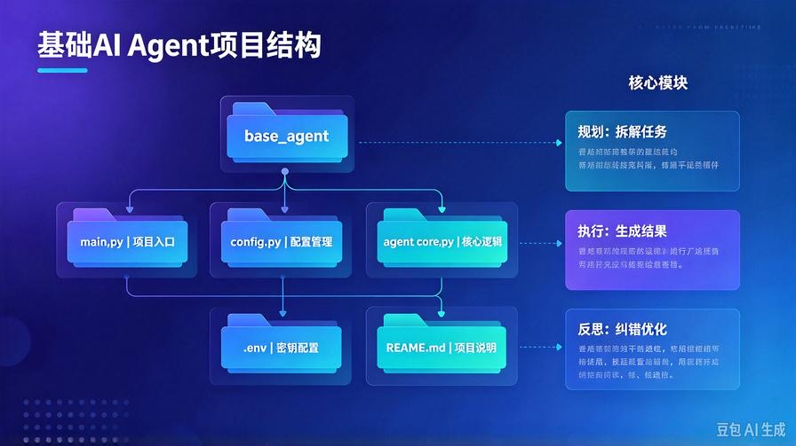
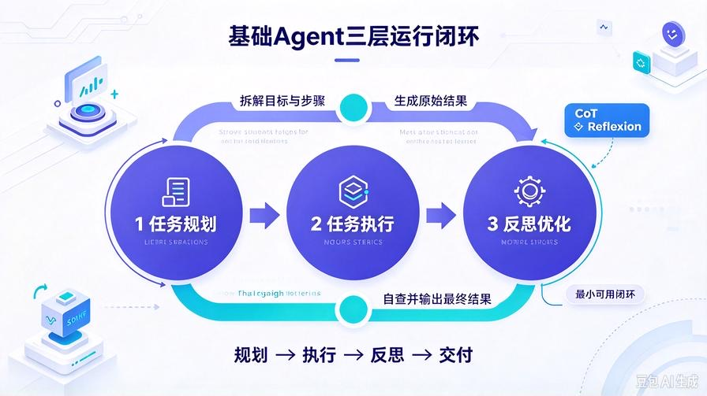
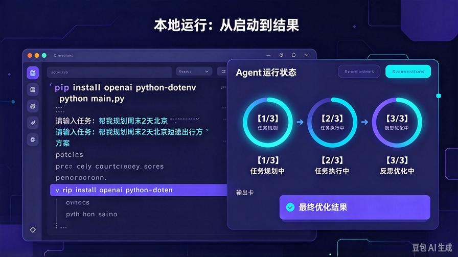
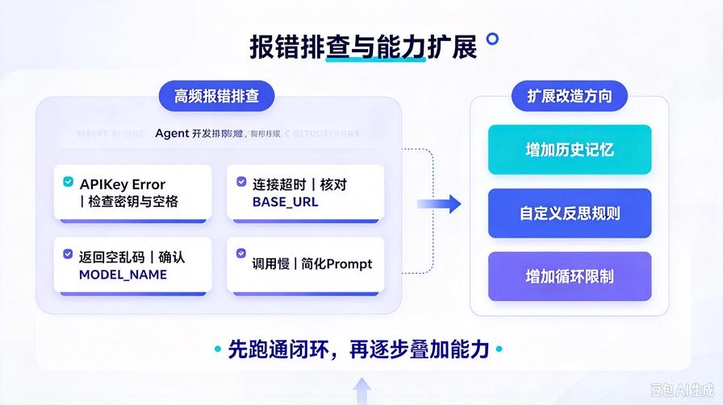

# 第8篇：首个实战项目：从零手写基础AI Agent

欢迎继续更新 **AI Agent 零基础实战连载系列**。

在前7篇，我们已经完成了 **全套理论底层 + 主流框架选型**：

弄懂了 Agent 是什么、为什么智能、由什么组成、该用什么框架开发。

但是——**看懂原理 ≠ 会开发**。

从本篇开始，我们彻底告别纯理论，**正式进入工程化实战阶段**。

很多新手学 Agent 最大的问题：

原理全都懂，框架都会选，**就是写不出一个能完整跑通的 Agent**。

原因非常简单：**缺少一套标准、完整、可落地的项目结构**。

今天这篇，我带你**从零手写搭建第一个真正可用的 AI Agent**。

不堆砌复杂代码、不跳步骤、不省略逻辑，全程最简最标准写法。

读完 + 跟着跑一遍，你将彻底掌握：

- 标准 AI Agent 项目的**完整目录结构**
- 基础智能体的**极简核心代码架构**
- 任务理解 → 思考规划 → 执行输出 → 简单反思全流程
- 本地可直接运行、可二次改造、可扩展的 Agent 模板
- 新手开发 Agent 的标准调试流程

## 一、先定目标：我们这一篇要做出什么样的 Agent？

新手第一课，切忌一上来就做“超级全自动智能体”。

正确的学习节奏：**先跑通最小可用闭环，再逐步叠加能力**。

本篇我们搭建一个 **最简基础版 AI Agent**，具备三大核心能力：

1. **任务理解**：精准识别用户需求
2. **思维规划**：复杂问题分步思考拆解（CoT）
3. **自我反思优化**：输出后自查纠错、优化结果

虽然是基础版，但它的**运行架构和商用Agent完全一致**。

后续所有的工具调用、记忆存储、多智能体协作，都是在这个基础架构上叠加扩展。

## 二、新手必学：标准Agent项目结构



很多人写代码混乱、无法迭代、无法扩展，根源就是**没有项目结构意识**。

我给大家一套 **行业通用、极简标准、终身可用的新手项目结构**。

```plain
base_agent/
├── main.py        # 项目入口、Agent主运行逻辑
├── config.py      # 配置文件、模型密钥、参数设置
├── agent_core.py  # Agent核心逻辑：思考、执行、反思
└── README.md      # 项目说明

```

结构非常干净，没有冗余文件，**新手完全无压力**。

后续我们叠加记忆、工具、数据库、部署功能，只需要新增对应文件夹即可，结构永远不乱。

## 三、环境准备（零基础一键就绪）

本次实战无需复杂环境，只需要两个基础依赖：

```bash
pip install openai python-dotenv

```

适配所有大模型接口：OpenAI、智谱、通义、DeepSeek 等全部兼容。

## 四、逐文件手写完整代码（可直接复制运行）

我按真实工程顺序，逐文件带你写完，每一段都附带注释，新手能看懂、能跑通、能修改。

### 1. config.py 统一配置管理

集中管理密钥、模型、参数，避免硬编码，方便后续切换模型。

```python
from dotenv import load_dotenv
import os

load_dotenv()

# 模型配置
MODEL_API_KEY = os.getenv("API_KEY")
MODEL_BASE_URL = os.getenv("BASE_URL")
MODEL_NAME = "deepseek-chat"

# Agent基础参数
MAX_THOUGHT_STEPS = 3

```

### 2. agent_core.py 核心智能体逻辑



包含三大核心模块：**思考规划、任务执行、自我反思**。

这是整个Agent的灵魂文件。

```python
from openai import OpenAI
from config import MODEL_API_KEY, MODEL_BASE_URL, MODEL_NAME

client = OpenAI(
    api_key=MODEL_API_KEY,
    base_url=MODEL_BASE_URL
)

class BaseAgent:
    def __init__(self):
        self.history = []

    # 1. 思维规划：CoT分步拆解
    def plan_task(self, user_input):
        prompt = f"""
你是专业AI任务规划师，请严格分步思考、拆解用户任务：
用户需求：{user_input}

请输出：
1. 任务核心目标
2. 任务拆解步骤
3. 执行注意事项
        """
        res = client.chat.completions.create(
            model=MODEL_NAME,
            messages=[{"role":"user","content":prompt}]
        )
        return res.choices[0].message.content

    # 2. 任务执行：生成原始结果
    def execute_task(self, user_input, plan_result):
        prompt = f"""
根据任务规划结果，完整落地执行用户需求：
用户需求：{user_input}
任务规划：{plan_result}

请输出完整、清晰、可直接使用的最终内容。
        """
        res = client.chat.completions.create(
            model=MODEL_NAME,
            messages=[{"role":"user","content":prompt}]
        )
        return res.choices[0].message.content

    # 3. 自我反思纠错：Reflexion校验优化
    def reflect_task(self, user_input, raw_result):
        prompt = f"""
你是严格的内容审核师，请自查本次输出：
用户需求：{user_input}
原始输出：{raw_result}

从以下维度自查：
1. 是否答非所问
2. 是否内容残缺、逻辑漏洞
3. 是否存在幻觉、虚假信息
4. 是否可以优化结构、措辞、完整性

输出：问题清单 + 优化后的最终成品
        """
        res = client.chat.completions.create(
            model=MODEL_NAME,
            messages=[{"role":"user","content":prompt}]
        )
        return res.choices[0].message.content

    # Agent完整运行闭环
    def run(self, user_task):
        print("【1/3】任务规划中...")
        plan = self.plan_task(user_task)

        print("【2/3】任务执行中...")
        raw_result = self.execute_task(user_task, plan)

        print("【3/3】自我反思优化中...")
        final_result = self.reflect_task(user_task, raw_result)

        return final_result

```

### 3. main.py 项目入口

极简入口，一键运行，后续所有扩展全部在这里对接。

```python
from agent_core import BaseAgent

if __name__ == "__main__":
    agent = BaseAgent()
    print("=== 基础AI Agent 已启动 ===")
    while True:
        user_input = input("\n请输入任务：")

```





> 来源：头条号《AI Agent 零基础实战》第8篇｜版权归作者所有，仅供学习交流
