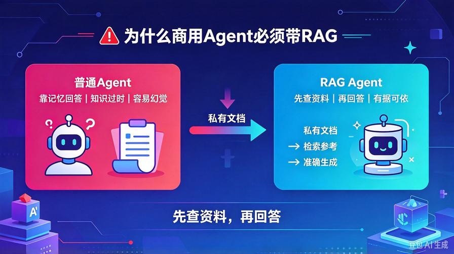
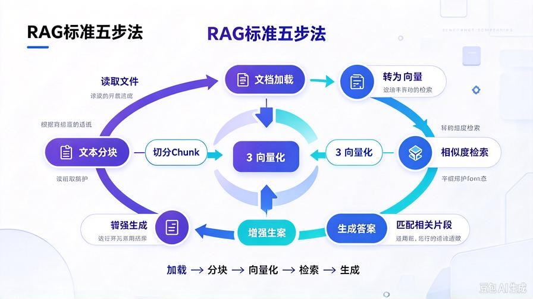
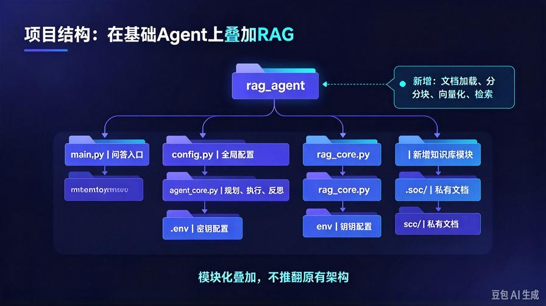
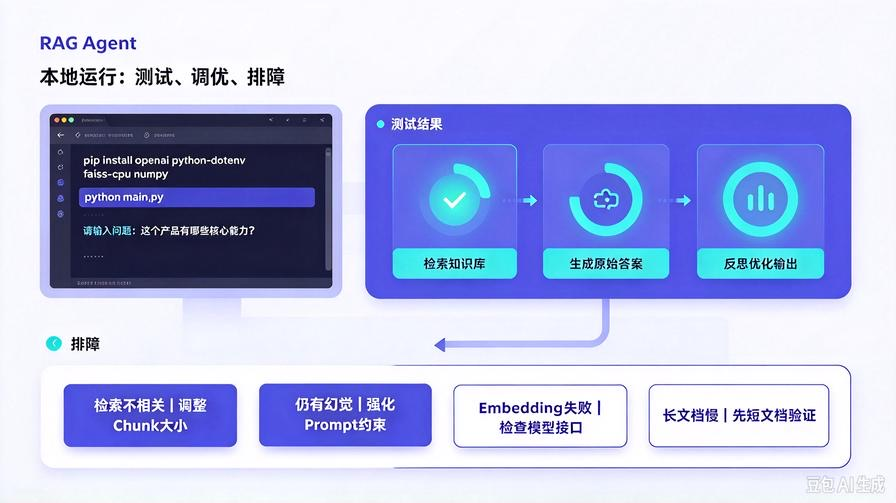

# 第9篇：RAG知识库实战：搭建私有文档问答Agent

欢迎回到 **AI Agent 零基础实战连载系列**。

上一篇我们从零手写了**第一个基础AI Agent**，跑通了行业标准核心闭环：

**任务规划 → 任务执行 → 自我反思纠错**。

但目前的Agent有一个致命短板：**只能依赖模型固有知识和实时对话信息，无法读取私有资料、本地文档**。

如果你问它：

- 这份产品手册的核心功能是什么？
- 这份周报的问题和改进方案有哪些？
- 这份学习文档的重点知识点怎么解读？

基础Agent完全无法回答，要么胡说八道产生幻觉，要么直接告知没有相关知识。

所以，想要AI真正**适配个人、适配企业、适配私有业务**，必须给Agent加装核心能力——**RAG检索增强生成**。

本篇作为**核心实战进阶篇**，零基础手把手带你搭建一套**可直接商用的私有文档问答Agent**，无需复杂框架堆砌，全程极简落地。

读完本文你将彻底掌握：

- RAG的通俗底层原理，彻底弄懂为什么能根治幻觉
- 标准RAG五步法完整流程
- 本地PDF/TXT文档解析、分块、向量化、检索、生成全链路
- 可复用的RAG Agent完整代码，直接落地运行
- 新手做知识库项目的核心避坑要点

## 一、为什么所有商用Agent，都必须带RAG？



先讲透本质：大模型的两大天生缺陷，只有RAG能完美解决。

### 1. 知识时效性滞后

模型训练数据是固定截止的，无法获取最新的文档、业务资料、实时数据，天然不懂你的私有业务。

### 2. 天生幻觉问题

模型不懂就会编，没有参考依据的生成，必然出现虚假数据、错误逻辑、无效内容。

**RAG的核心价值一句话总结：让AI“先查资料，再回答”，所有输出有据可依，从根源降低幻觉。**

普通Agent：靠模型记忆回答，对错随缘。

RAG智能体：**先检索私有文档知识 → 结合问题推理 → 基于真实资料生成答案**，精准、靠谱、可溯源。

## 二、零基础看懂：RAG标准五步法



网上很多教程把RAG讲得极其复杂，其实工业级RAG核心只有五步，全程闭环、通俗易懂。

### 第一步：文档加载

读取本地私有文件：TXT、PDF、Word、笔记、业务文档，将非结构化文件转为纯文本内容。

### 第二步：文本分块（Chunk）

长篇文档无法直接检索，需要切割成短小、独立、语义完整的文本块，避免信息混乱、检索失效。

### 第三步：向量化嵌入（Embedding）

将每一段文本块，通过嵌入模型转为高维数字向量，让计算机能够识别**语义相似度**。

### 第四步：相似度检索

用户提问时，将问题同样转为向量，在向量库中匹配**最语义相近的文档片段**，捞出参考资料。

### 第五步：增强生成

把「用户问题 + 检索到的私有资料」一起交给大模型，模型基于真实资料生成精准答案。

这就是行业通用、所有知识库项目都离不开的 **标准RAG五阶闭环**。

## 三、项目结构升级（兼容上期基础Agent）



本次实战基于第8篇基础Agent迭代升级，不推翻原有架构，仅新增知识库模块，结构清晰、可无缝扩展。

```plain
rag_agent/
├── main.py          # 项目入口、问答交互
├── config.py        # 全局配置、模型密钥
├── agent_core.py    # 原有规划、执行、反思能力
├── rag_core.py      # 新增：RAG知识库核心逻辑
├── .env             # 环境变量配置
└── docs/            # 私有文档存放文件夹
    └── test.txt     # 自定义私有资料

```

所有升级都是**模块式叠加**，符合工程化开发思维，新手可以清晰区分原有能力和新增能力。

## 四、环境依赖安装

在原有依赖基础上，新增文档解析、向量计算所需依赖，一键安装：

```bash
pip install openai python-dotenv faiss-cpu numpy

```

本次使用轻量化FAISS向量库，无需部署复杂数据库，本地即可运行，零基础零压力。

## 五、完整可落地代码逐行实现

保留上期完整基础Agent能力，新增全套RAG检索逻辑，代码精简、注释详细、可直接商用。

### 1. config.py 全局配置（复用升级）

```python
from dotenv import load_dotenv
import os

load_dotenv()

# 大模型配置
MODEL_API_KEY = os.getenv("API_KEY")
MODEL_BASE_URL = os.getenv("BASE_URL")
MODEL_NAME = "deepseek-chat"

# Embedding嵌入模型配置（通用兼容）
EMBED_MODEL_NAME = "text-embedding-ada-002"

# RAG参数设置
CHUNK_SIZE = 300
CHUNK_OVERLAP = 50
TOP_K = 3

```

### 2. rag_core.py 全新知识库核心模块

包含：文档加载、文本分块、向量化存储、相似度检索全套逻辑。

```python
from openai import OpenAI
import faiss
import numpy as np
import os
from config import *

client = OpenAI(
    api_key=MODEL_API_KEY,
    base_url=MODEL_BASE_URL
)

class RAGCore:
    def __init__(self):
        self.chunks = []
        self.index = None

    # 1. 加载本地文档
    def load_doc(self, file_path):
        with open(file_path, "r", encoding="utf-8") as f:
            text = f.read()
        return text

    # 2. 文本分块处理
    def split_chunk(self, text):
        chunks = []
        start = 0
        while start < len(text):
            end = start + CHUNK_SIZE
            chunk = text[start:end]
            chunks.append(chunk)
            # 重叠切割，保证上下文连贯
            start = end - CHUNK_OVERLAP
        self.chunks = chunks
        return chunks

    # 3. 文本向量化
    def get_embedding(self, text):
        res = client.embeddings.create(
            input=text,
            model=EMBED_MODEL_NAME
        )
        return res.data[0].embedding

    # 4. 构建本地向量库
    def build_vector_store(self):
        embeddings = [self.get_embedding(chunk) for chunk in self.chunks]
        embeddings_np = np.array(embeddings).astype("float32")
        # 初始化FAISS索引
        self.index = faiss.IndexFlatL2(embeddings_np.shape[1])
        self.index.add(embeddings_np)

    # 5. 相似度检索
    def search_relevant(self, query):
        query_emb = np.array([self.get_embedding(query)]).astype("float32")
        distances, indices = self.index.search(query_emb, TOP_K)
        # 捞出最相关的文本块
        relevant_chunks = [self.chunks[i] for i in indices[0]]
        return "\n\n".join(relevant_chunks)

    # 初始化知识库
    def init_knowledge_base(self, doc_path):
        print("正在加载文档...")
        text = self.load_doc(doc_path)
        print("正在文本分块...")
        self.split_chunk(text)
        print("正在构建向量知识库...")
        self.build_vector_store()
        print("✅ 知识库初始化完成！")

```

### 3. agent_core.py 融合RAG能力

保留原有规划、执行、反思能力，新增知识库问答逻辑，实现能力融合升级。

```python
from openai import OpenAI
from config import MODEL_API_KEY, MODEL_BASE_URL, MODEL_NAME

client = OpenAI(
    api_key=MODEL_API_KEY,
    base_url=MODEL_BASE_URL
)

class BaseAgent:
    def __init__(self):
        self.history = []
        self.knowledge_context = ""

    # 注入检索到的私有知识
    def set_knowledge(self, context):
        self.knowledge_context = context

    # 任务规划
    def plan_task(self, user_input):
        prompt = f"""
你是专业AI任务规划师，请严格分步思考、拆解用户任务：
用户需求：{user_input}

请输出：
1. 任务核心目标
2. 任务拆解步骤
3. 执行注意事项
        """
        res = client.chat.completions.create(
            model=MODEL_NAME,
            messages=[{"role":"user","content":prompt}]
        )
        return res.choices[0].message.content

    # 融合知识库执行任务
    def execute_task(self, user_input, plan_result):
        prompt = f"""
请结合私有知识库内容，落地执行用户需求：
用户需求：{user_input}
任务规划：{plan_result}
私有参考资料：{self.knowledge_context}

严格基于参考资料回答，禁止编造、禁止幻觉、禁止脱离文档内容。
输出完整、清晰、准确的答案。
        """
        res = client.chat.completions.create(
            model=MODEL_NAME,
            messages=[{"role":"user","content":prompt}]
        )
        return res.choices[0].message.content

    # 自我反思纠错
    def reflect_task(self, user_input, raw_result):
        prompt = f"""
你是严格的内容审核师，请自查本次基于知识库的回答：
用户需求：{user_input}
原始输出：{raw_result}

自查维度：
1. 是否脱离私有文档内容、存在幻觉编造
2. 是否答非所问、遗漏关键信息
3. 逻辑是否通顺、内容是否完整

输出：问题清单 + 优化后的最终答案
        """
        res = client.chat.completions.create(
            model=MODEL_NAME,
            messages=[{"role":"user","content":prompt}]
        )
        return res.choices[0].message.content

    # 完整运行闭环
    def run(self, user_task):
        print("【1/3】任务规划中...")
        plan = self.plan_task(user_task)

        print("【2/3】结合知识库执行中...")
        raw_result = self.execute_task(user_task, plan)

        print("【3/3】反思优化纠错中...")
        final_result = self.reflect_task(user_task, raw_result)

        return final_result

```

### 4. main.py 最终运行入口

整合知识库初始化 + Agent智能问答，一键启动完整RAG智能体。

```python
from agent_core import BaseAgent
from rag_core import RAGCore

if __name__ == "__main__":
    # 1. 初始化RAG知识库
    rag = RAGCore()
    # 读取自定义私有文档（自行替换为你的文档路径）
    rag.init_knowledge_base("./docs/test.txt")

    # 2. 初始化智能体
    agent = BaseAgent()
    print("\n=== 私有文档问答Agent 已启动 ===")

    while True:
        user_input = input
```



> 来源：头条号《AI Agent 零基础实战》第9篇｜版权归作者所有，仅供学习交流
