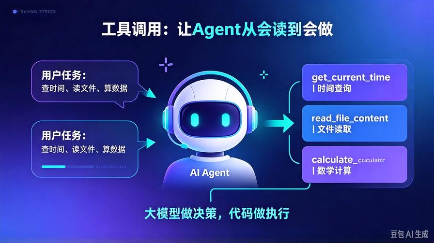
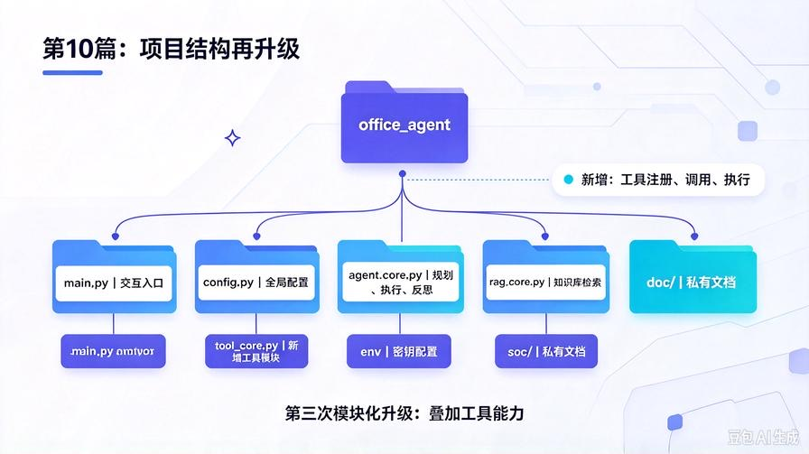
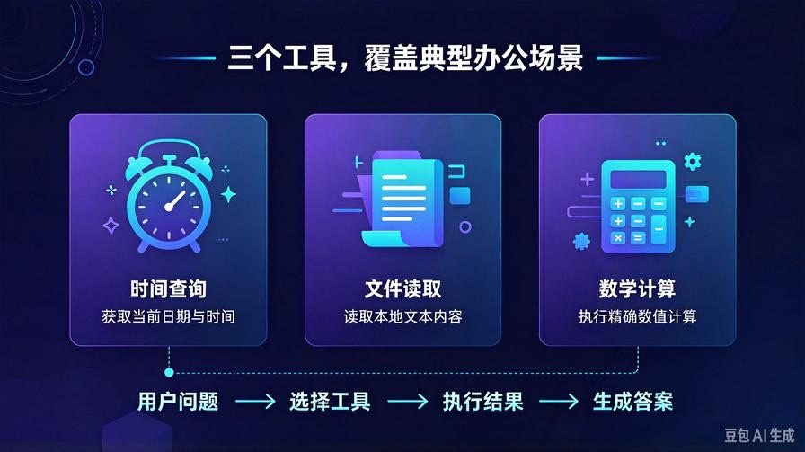
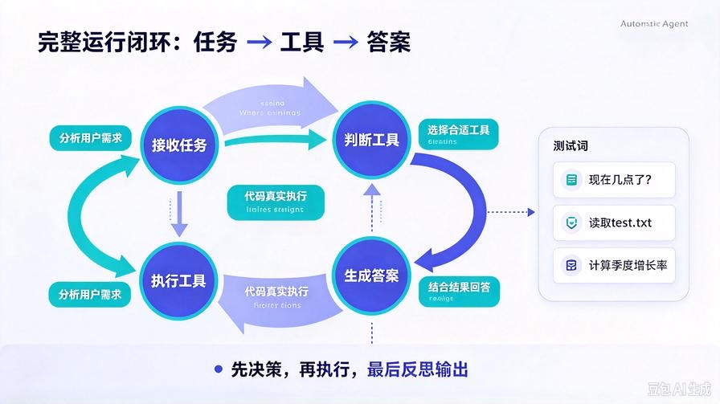

# 第10篇：工具调用实战：打造自动化办公智能体

欢迎回到 **AI Agent 零基础实战连载系列**。

前面两篇实战，我们完成了两次关键能力升级：

- **第8篇**：从零手写基础Agent，跑通"规划→执行→反思"闭环
- **第9篇**：接入RAG知识库，让Agent能读取私有文档回答问题

到这里，Agent已经能**思考、能记忆、能查资料**了。

但它依然有一个致命短板：**只能动嘴，不能动手**。

你让它"查一下现在几点"，它不知道；

你让它"读取这个文件然后总结"，它做不到；

你让它"算一下这个季度增长率"，它只能瞎猜数字。

这就是缺少**工具调用（Function Call）**能力的结果。

本篇我们正式给Agent装上"手脚"，手把手打造一个**能真正执行现实操作的自动化办公智能体**。

读完本文你将彻底掌握：

- Function Call的真实实现方式，不靠伪代码
- 如何定义、注册、执行自定义工具
- 给Agent加装时间查询、文件读取、计算器三大实用工具
- 工具调用与原有RAG+规划+反思架构的完整融合
- 新手实现工具调用最容易踩的坑和解决方案

---

# 一、先搞懂：工具调用到底解决什么问题？



大模型本身是一个"纯文本推理引擎"——它接收文本，输出文本。

它不能直接：

- 访问系统时间
- 读写本地文件
- 执行数学计算
- 调用外部API
- 操作系统命令

但如果我们把这些能力**封装成函数**，再告诉大模型"你有这些工具可用"，它就会：

1. 判断当前任务是否需要工具
2. 选择合适的工具
3. 生成工具调用参数
4. 由我们的代码真正执行工具
5. 把执行结果喂回给大模型继续推理

这就是Function Call的本质：**大模型做决策，我们的代码做执行**。

没有工具的Agent = 一个只会读书的研究员；

有工具的Agent = 一个能查资料、能写代码、能操作电脑的全职助手。

---

# 二、项目结构再升级（第三次迭代）



本次实战继续在第9篇RAG Agent基础上叠加工具能力，不推翻原有架构：

```plain
office_agent/
├── main.py          # 项目入口、交互循环
├── config.py        # 全局配置
├── agent_core.py    # 原有：规划、执行、反思、RAG
├── rag_core.py      # 原有：知识库检索
├── tool_core.py     # 新增：工具注册、调用、执行
├── .env             # 环境变量
└── docs/            # 私有文档文件夹
```

到目前为止，你的Agent已经完成了**三次模块化升级**：

1. 第8篇：基础闭环（规划+执行+反思）
2. 第9篇：叠加RAG知识库
3. 第10篇：叠加工具调用

这就是工业级Agent的标准开发节奏——**每次只加一个模块，跑通再加下一个**。

---

# 三、核心概念：Function Call的三个关键要素

在写代码之前，先搞懂Function Call的三个核心要素，不然后面看代码会懵。

## 1. 工具定义（Tool Definition）

告诉大模型："你有什么工具、每个工具干什么、需要什么参数。"

这个定义通常用JSON格式写，包含：

- 工具名称（name）
- 工具描述（description）
- 参数列表（parameters），每个参数的类型、是否必填、说明

## 2. 模型决策（Model Decision）

大模型收到用户问题后，判断是否需要调用工具。如果需要，它会输出一个结构化的"工具调用请求"，包含：

- 要调用哪个工具
- 调用参数是什么

## 3. 工具执行（Tool Execution）

我们的代码收到模型的工具调用请求后，真正执行对应的Python函数，把结果返回给模型。

**注意：模型自己永远不会执行工具，它只是"说"要调用什么。真正执行的是你的代码。**

---

# 四、手写三个实用办公工具



我们先定义三个最常用的办公工具，覆盖时间、文件、计算三大场景：

1. **get_current_time**：获取当前系统时间
2. **read_file_content**：读取本地文本文件内容
3. **calculate**：执行数学计算

## 1. tool_core.py：工具注册与执行模块

```python
import datetime
import ast

# ========== 工具定义列表（告诉模型有哪些工具可用）==========
TOOLS_DEFINITION = [
    {
        "type": "function",
        "function": {
            "name": "get_current_time",
            "description": "获取当前系统日期和时间，当用户问现在几点、今天几号时使用",
            "parameters": {
                "type": "object",
                "properties": {},
                "required": []
            }
        }
    },
    {
        "type": "function",
        "function": {
            "name": "read_file_content",
            "description": "读取本地文本文件的内容，当用户要求查看、读取、分析某个文件时使用",
            "parameters": {
                "type": "object",
                "properties": {
                    "file_path": {
                        "type": "string",
                        "description": "要读取的文件路径，例如 ./docs/report.txt"
                    }
                },
                "required": ["file_path"]
            }
        }
    },
    {
        "type": "function",
        "function": {
            "name": "calculate",
            "description": "执行数学表达式计算，当用户需要精确数值计算时使用",
            "parameters": {
                "type": "object",
                "properties": {
                    "expression": {
                        "type": "string",
                        "description": "要计算的数学表达式，例如 123.5 * 0.85 + 200"
                    }
                },
                "required": ["expression"]
            }
        }
    }
]

# ========== 工具实际执行函数 ==========
def execute_tool(tool_name, tool_args):
    """根据工具名称和参数，真正执行对应功能"""

    if tool_name == "get_current_time":
        now = datetime.datetime.now()
        return f"当前时间：{now.strftime('%Y年%m月%d日 %H:%M:%S')} 星期{['一','二','三','四','五','六','日'][now.weekday()]}"

    elif tool_name == "read_file_content":
        file_path = tool_args.get("file_path", "")
        try:
            with open(file_path, "r", encoding="utf-8") as f:
                content = f.read()
            return f"文件内容（共{len(content)}字）：\n{content[:2000]}"
        except FileNotFoundError:
            return f"错误：找不到文件 {file_path}"
        except Exception as e:
            return f"读取文件出错：{str(e)}"

    elif tool_name == "calculate":
        expr = tool_args.get("expression", "")
        try:
            # 安全的数学计算（不执行任意代码）
            result = eval(expr, {"__builtins__": {}}, {
                "abs": abs, "round": round, "min": min, "max": max,
                "sum": sum, "pow": pow
            })
            return f"计算结果：{expr} = {result}"
        except Exception as e:
            return f"计算出错：{str(e)}"

    else:
        return f"错误：未知工具 {tool_name}"
```

<callout emoji="💡">
**安全提醒**：上面的calculate函数用了受限的eval，只允许数学运算，禁止执行任意代码。生产环境建议用专门的数学解析库（如simpleeval）替代。
</callout>

---

# 五、改造Agent：融合工具调用能力

我们需要改造agent_core.py，增加一个"工具调用决策"环节，让Agent能：

1. 收到任务后，先判断是否需要调用工具
2. 如果需要，调用工具获取真实数据
3. 把工具结果和任务一起交给模型生成最终答案

## 2. agent_core.py（工具版升级）

```python
from openai import OpenAI
from config import MODEL_API_KEY, MODEL_BASE_URL, MODEL_NAME
from tool_core import TOOLS_DEFINITION, execute_tool

client = OpenAI(
    api_key=MODEL_API_KEY,
    base_url=MODEL_BASE_URL
)

class OfficeAgent:
    def __init__(self):
        self.history = []
        self.knowledge_context = ""

    # 注入RAG检索结果
    def set_knowledge(self, context):
        self.knowledge_context = context

    # 1. 工具调用决策：判断是否需要调用工具
    def decide_and_execute_tool(self, user_input):
        messages = [
            {"role": "system", "content": "你是一个智能办公助手，可以调用工具完成任务。请根据用户需求判断是否需要调用工具。"},
            {"role": "user", "content": user_input}
        ]

        response = client.chat.completions.create(
            model=MODEL_NAME,
            messages=messages,
            tools=TOOLS_DEFINITION,
            tool_choice="auto"
        )

        message = response.choices[0].message

        # 如果模型决定调用工具
        if message.tool_calls:
            tool_results = []
            for tool_call in message.tool_calls:
                tool_name = tool_call.function.name
                tool_args = eval(tool_call.function.arguments)  # 解析参数JSON

                print(f"  🛠 调用工具：{tool_name}")
                result = execute_tool(tool_name, tool_args)
                tool_results.append(f"【{tool_name}】\n{result}")

            return "\n\n".join(tool_results)
        else:
            # 不需要工具，返回None
            return None

    # 2. 任务执行：结合工具结果+知识库生成答案
    def execute_task(self, user_input, tool_result):
        knowledge_part = f"\n参考资料：{self.knowledge_context}" if self.knowledge_context else ""
        tool_part = f"\n工具执行结果：{tool_result}" if tool_result else ""

        prompt = f"""
用户需求：{user_input}
{tool_part}
{knowledge_part}

请基于以上信息，完整、准确地回答用户问题。
如果工具结果中包含错误信息，请如实告知用户。
        """

        res = client.chat.completions.create(
            model=MODEL_NAME,
            messages=[{"role":"user","content":prompt}]
        )
        return res.choices[0].message.content

    # 3. 自我反思纠错（复用之前逻辑）
    def reflect_task(self, user_input, raw_result):
        prompt = f"""
你是内容审核师，请自查本次回答：
用户需求：{user_input}
原始输出：{raw_result}

自查维度：
1. 是否准确回答了用户问题
2. 是否存在幻觉或编造内容
3. 工具结果是否被正确使用
4. 逻辑是否通顺、表达是否清晰

输出：问题清单 + 优化后的最终答案
        """
        res = client.chat.completions.create(
            model=MODEL_NAME,
            messages=[{"role":"user","content":prompt}]
        )
        return res.choices[0].message.content

    # Agent完整运行闭环
    def run(self, user_task):
        print("【1/3】判断是否需要调用工具...")
        tool_result = self.decide_and_execute_tool(user_task)

        print("【2/3】结合工具结果生成答案...")
        raw_result = self.execute_task(user_task, tool_result)

        print("【3/3】反思优化纠错...")
        final_result = self.reflect_task(user_task, raw_result)

        return final_result
```

---

# 六、main.py 运行入口（整合全部能力）

```python
from agent_core import OfficeAgent
from rag_core import RAGCore

if __name__ == "__main__":
    # 初始化RAG知识库（可选，有文档就加载）
    use_rag = input("是否加载知识库？(y/n)：").strip().lower()
    rag = None
    if use_rag == "y":
        rag = RAGCore()
        rag.init_knowledge_base("./docs/test.txt")

    # 初始化Agent
    agent = OfficeAgent()
    print("\n=== 自动化办公Agent 已启动 ===")
    print("支持功能：时间查询、文件读取、数学计算、知识库问答")

    while True:
        user_input = input("\n请输入任务：")
        if user_input in ["exit", "quit", "退出"]:
            print("Agent已退出")
            break

        # 如果开启了RAG，先检索知识库
        knowledge = ""
        if rag:
            knowledge = rag.search_relevant(user_input)
            agent.set_knowledge(knowledge)

        # 运行Agent完整闭环
        result = agent.run(user_input)
        print("\n【最终答案】")
        print(result)
```

---

# 七、运行测试 & 效果演示



启动命令：

```bash
python main.py
```

测试三个典型场景：

## 场景1：时间查询（自动调用get_current_time工具）

> 请输入任务：现在几点了？帮我看看今天日期

Agent运行过程：

1. 模型判断需要调用get_current_time工具
2. 代码执行工具，获取当前系统时间
3. 模型基于工具结果生成自然语言回答："今天是2026年9月29日星期二，现在是下午3点25分。"
4. 反思模块检查答案准确性，输出最终结果

## 场景2：文件读取（自动调用read_file_content工具）

> 请输入任务：帮我读一下 ./docs/test.txt 这个文件，总结核心内容

Agent运行过程：

1. 模型判断需要调用read_file_content工具，参数file_path为"./docs/test.txt"
2. 代码执行文件读取，返回文件内容
3. 模型读取文件内容后做总结
4. 反思模块检查总结是否准确

## 场景3：数学计算（自动调用calculate工具）

> 请输入任务：这个季度营收125万，上个季度108万，帮我算一下增长率是多少

Agent运行过程：

1. 模型判断需要精确计算，调用calculate工具，表达式为"(125-108)/108\*100"
2. 代码执行计算，返回"15.74%"
3. 模型把计算结果整理成业务化表述："本季度营收环比增长15.74%"
4. 反思模块校验数字是否正确

---

# 八、新手高频踩坑清单

- **模型不调用工具**：检查工具定义是否清晰，description写得越具体，模型越容易判断何时调用；在system prompt里明确说明"遇到时间、计算、文件操作时必须调用工具"。
- **工具参数格式错误**：模型有时会输出不合法的JSON参数，建议用json.loads代替eval解析，并加try-except容错。
- **工具结果太长撑爆上下文**：文件读取工具要限制返回长度（如只取前2000字），避免一次性塞太多内容给模型。
- **重复调用同一个工具**：在prompt里加一句"如果已经获取过相关信息，不要重复调用工具"。
- **calculate安全风险**：绝对不要用裸eval执行任意代码，必须限制可用函数和内置模块。

---

# 九、架构回顾：你的Agent现在长什么样了

经过三次实战升级，你的Agent已经具备了**商用级核心能力**：

| 模块 | 能力 | 对应篇章 |
|-|-|-|
| **规划模块** | 任务拆解、分步思考 | 第3篇 + 第8篇 |
| **RAG知识库** | 私有文档检索、降低幻觉 | 第4篇 + 第9篇 |
| **工具调用** | 时间查询、文件读取、数学计算 | 第5篇 + 第10篇 |
| **反思纠错** | 自查、纠错、优化输出 | 第6篇 + 第8/9/10篇 |

这就是一个**最小可用的商用Agent原型**。后续所有进阶功能，都是在这个基础上扩展的。

---

# 十、课后练习

1. 新增一个web_search工具：调用搜索引擎API，让Agent能搜索实时信息；
2. 把read_file_content工具扩展成支持PDF文件读取（配合PyPDF2）；
3. 增加工具调用日志：把每次调用的工具名、参数、结果记录到本地文件，方便调试。

---

# 十一、本篇核心总结

1. 工具调用的本质：大模型做决策，代码做执行，模型永不直接碰外部系统；
2. Function Call三要素：工具定义、模型决策、工具执行，缺一不可；
3. 办公场景最常用的三类工具：信息查询类（时间、搜索）、文件操作类（读写文件）、计算类（数学计算）；
4. 工具必须做安全隔离：限制可用函数、限制返回长度、加try-except容错；
5. 模块化开发是工程化核心：每次只加一个模块，跑通再加下一个。

---

# 下期预告

到本篇为止，你的Agent已经具备了**思考、记忆、查资料、用工具**四大核心能力，是一个完整的单兵作战智能体。

下一篇我们进入**多智能体协作**：**第11篇：多智能体协作实战：用CrewAI搭建团队分工Agent**。教你让多个不同角色的Agent（研究员、撰稿人、审核员）自动分工协作，完成复杂任务。

**互动提问：如果让你的Agent团队配置三个角色，你会选哪三个？评论区告诉我！**

> 来源：头条号《AI Agent 零基础实战》第10篇｜版权归作者所有，仅供学习交流
