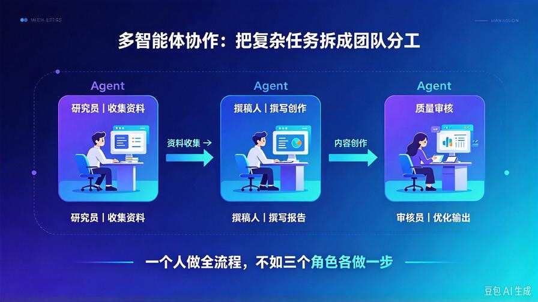
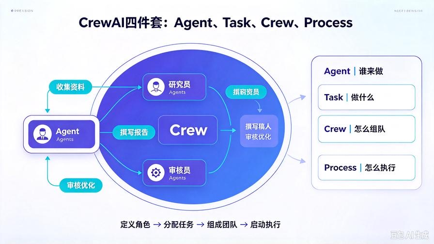
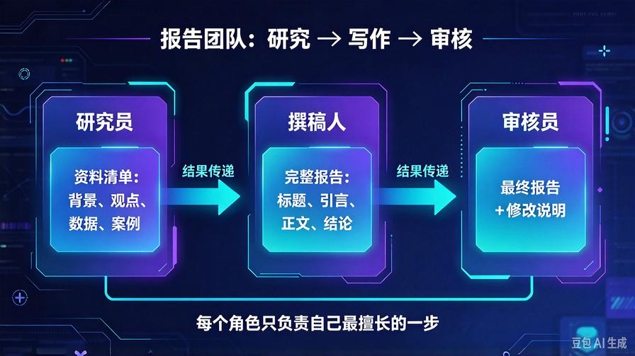
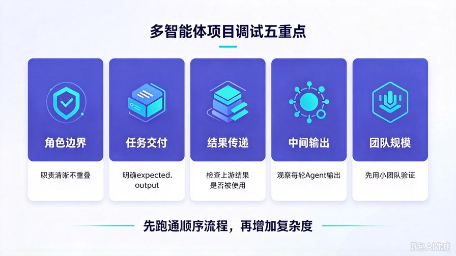

# 第11篇：多智能体协作实战：用CrewAI搭建团队分工Agent

欢迎回到 **AI Agent 零基础实战连载系列**。

前面10篇，我们已经把一个单智能体从“能思考”一路迭代到“能动手”：

\- **第8篇**：手写基础Agent，跑通规划、执行、反思闭环

\- **第9篇**：接入RAG知识库，让Agent会查私有文档

\- **第10篇**：叠加工具调用，让Agent会查时间、读文件、做计算

到这里，你已经拥有一个完整的**单兵作战Agent**。

但现实工作中，很多复杂任务不是一个人能干完的。

写一份报告，通常需要：

1. 一个人收集资料

2. 一个人整理框架

3. 一个人撰写正文

4. 一个人审核校对

这就是多智能体协作要解决的问题：**把不同角色、不同能力的Agent组织成团队，让它们按流程分工完成任务。**

本篇我们就用 **CrewAI** 搭建一个最小可运行的多智能体团队，正式进入“团队级Agent开发”。

读完本文你将彻底掌握：

\- 多智能体协作的真实适用场景

\- CrewAI的核心概念：Agent、Task、Crew、Process

\- 如何搭建研究员、撰稿人、审核员三个角色

\- 如何让Agent按顺序协作完成一份报告

\- 多智能体项目的调试重点和常见坑

## 一、为什么需要多智能体？



单智能体适合做“闭环任务”：

\- 回答一个问题

\- 总结一份文档

\- 调用一个工具

\- 完成一次推理

但复杂任务通常有多个阶段，而且每个阶段需要不同能力：

\- 信息搜集：需要检索、阅读、筛选

\- 内容创作：需要结构表达、语言组织

\- 质量审核：需要检查错误、遗漏、逻辑问题

如果全部交给一个Agent，会出现三个问题：

**1. 角色混乱**：同一个模型既要查资料，又要写内容，还要审核，容易互相干扰

**2. 上下文拥挤**：任务越长，中间信息越容易丢失

**3. 质量不稳定**：没有明确分工，就没有标准交付

多智能体不是“更高级的炫技”，而是把复杂任务拆成**多个明确角色**，让每个Agent只负责自己最擅长的一步。

## 二、CrewAI核心概念速览



CrewAI是一个多智能体编排框架，核心概念非常少，先看懂这四个就够了。

### 1. Agent（智能体）

Agent 是团队里的一个角色。

每个Agent都要有：

\- **role**：角色名称

\- **goal**：目标

\- **backstory**：背景设定

\- **tools**：可用工具

\- **llm**：使用的大模型

例如：

\- 研究员：负责收集资料

\- 撰稿人：负责写正文

\- 审核员：负责检查质量

### 2. Task（任务）

Task 是分配给Agent的具体工作。

每个Task都要有：

\- **description**：任务描述

\- **expected_output**：期望输出

\- **agent**：负责执行的Agent

Task 不是泛泛而谈的“写报告”，而是要明确交付物。

### 3. Crew（团队）

Crew 是把多个Agent和多个Task组织起来的团队。

你可以把它理解成：

\- Agent = 团队成员

\- Task = 工作任务

\- Crew = 项目组

### 4. Process（流程）

Process 决定任务怎么执行。

入门阶段先掌握一个就够：

\- **hierarchical process**：层级流程，适合复杂任务，有角色负责管理和分配

但对于零基础实战，我们先从最简单的**顺序执行**开始，理解“一个任务完成后，下一个任务基于结果继续执行”。

## 三、项目结构：从单Agent升级到多Agent

```plain
multi_agent_crew/
├── main.py             # Crew启动入口
├── config.py           # 模型配置
├── agents.py           # 定义不同角色Agent
├── tasks.py            # 定义每个Agent的任务
├── .env                # 密钥配置
└── requirements.txt    # 依赖清单

```

这是一个非常标准的多智能体项目结构：

\- `agents.py`：管“谁来做”

\- `tasks.py`：管“做什么”

\- `main.py`：管“怎么组队执行”

## 四、环境准备

```bash
pip install crewai python-dotenv openai

```

CrewAI会负责Agent之间的调度和结果传递，我们只需要定义角色和任务。

## 五、配置文件：统一管理模型

### config.py

```python
from dotenv import load_dotenv
import os
from crewai import LLM

load_dotenv()

def get_llm():
    return LLM(
        model=os.getenv("MODEL_NAME", "deepseek-chat"),
        api_key=os.getenv("API_KEY"),
        base_url=os.getenv("BASE_URL")
    )

```

这里我们通过CrewAI的`LLM`类统一给Agent提供模型能力。

## 六、定义三个角色Agent



我们来搭建一个最小报告团队：

1. **研究员**：负责收集资料

2. **撰稿人**：负责写报告

3. **审核员**：负责审核优化

### agents.py

```python
from crewai import Agent
from config import get_llm

llm = get_llm()

researcher = Agent(
    role="研究员",
    goal="收集并整理主题相关资料，为报告提供可靠素材",
    backstory="你是一名资深研究员，擅长快速定位关键信息、筛选资料、整理要点。",
    llm=llm,
    verbose=True
)

writer = Agent(
    role="撰稿人",
    goal="根据研究员提供的资料，撰写结构清晰、内容完整的中文报告",
    backstory="你是一名优秀的内容撰稿人，擅长把资料组织成逻辑清楚、易读的正式文本。",
    llm=llm,
    verbose=True
)

reviewer = Agent(
    role="审核员",
    goal="检查报告是否完整、准确、逻辑通顺，并输出最终优化版本",
    backstory="你是一名严格的内容审核员，关注结构、事实、表达和可读性。",
    llm=llm,
    verbose=True
)

```

注意：每个Agent只定义自己的角色，不负责直接调度别人。调度由Crew统一管理。

## 七、定义任务：明确每个角色交付什么

任务定义的关键不是“描述多”，而是**交付清晰**。

### tasks.py

```python
from crewai import Task
from agents import researcher, writer, reviewer

research_task = Task(
    description="针对主题“{topic}”，收集相关背景、核心观点、关键数据和应用案例，整理成资料清单。",
    expected_output="一份结构化资料清单，包含背景、核心观点、关键数据、应用案例四部分。",
    agent=researcher
)

writing_task = Task(
    description="基于研究员提供的资料，撰写一份完整中文报告。报告包含标题、引言、正文、结论四个部分。",
    expected_output="一篇结构完整、逻辑清晰、语言正式的中文报告。",
    agent=writer
)

review_task = Task(
    description="审核报告，检查是否存在信息遗漏、逻辑断层、表达不清或结构问题，并输出最终优化版。",
    expected_output="一份经过审核优化后的最终报告，并附修改说明。",
    agent=reviewer
)

```

这里的`{topic}`是一个输入变量，运行时可以动态替换成任意主题。

## 八、组队执行：把Agent和Task放进Crew

### main.py

```python
from crewai import Crew
from tasks import research_task, writing_task, review_task
from agents import researcher, writer, reviewer

if __name__ == "__main__":
    topic = input("请输入报告主题：")

    crew = Crew(
        agents=[researcher, writer, reviewer],
        tasks=[research_task, writing_task, review_task],
        verbose=True
    )

    result = crew.kickoff(inputs={"topic": topic})

    print("\n===== 最终报告 =====")
    print(result)

```

这就是CrewAI最核心的启动方式：

1. 定义Agent

2. 定义Task

3. 组成Crew

4. 调用`kickoff()`开始执行

## 九、运行测试 & 效果演示

启动命令：

```bash
python main.py

```

输入示例主题：

```text
AI Agent 在企业客服中的应用

```

执行过程大致如下：

### 第一轮：研究员收集资料

研究员会围绕主题整理：

\- 背景：AI Agent是什么，为什么进入客服场景

\- 核心观点：降本、提效、7×24服务、复杂问题转接

\- 关键数据：可用支撑指标，如响应时长、重复咨询率、满意度

\- 应用案例：售前咨询、售后故障排查、订单查询、智能分诊

### 第二轮：撰稿人写报告

撰稿人基于研究员结果，生成完整报告结构：

\- 标题

\- 引言

\- 正文

\- 结论

### 第三轮：审核员优化

审核员检查：

\- 报告结构是否完整

\- 论点是否有资料支撑

\- 逻辑是否连贯

\- 表达是否清晰

最后输出“最终报告 + 修改说明”。

## 十、多智能体项目的调试重点



多智能体比单智能体更难调试，因为问题可能出在：

1. **Agent角色定义不清**

2. **任务边界模糊**

3. **上下文传递丢失**

4. **Agent互相重复工作**

5. **输出格式不稳定**

给你五个最实用的调试建议：

### 1. 先从顺序流程开始

不要一开始就做复杂自治团队。

先让任务按顺序执行：

`研究 → 写作 → 审核`

跑通以后，再考虑更复杂的协作方式。

### 2. 每个Task都写清楚expected_output

很多失败不是模型能力问题，而是任务描述太虚。

反例：

`写一份关于AI的报告`

正例：

`写一份包含标题、引言、正文、结论的中文报告，正文分三个小节。`

### 3. 控制团队规模

入门阶段不要做5个、8个Agent。

最佳起步团队：

\- 2人团队：执行 + 审核

\- 3人团队：研究 + 写作 + 审核

### 4. 观察中间输出

CrewAI的`verbose=True`会打印很多过程信息。

重点看：

\- 每个Agent当前在做什么

\- 上一个任务结果有没有被下一个任务使用

\- 是否出现重复推理

### 5. 用小任务验证链路

不要一上来就让团队写一万字报告。

先用小主题验证：

`AI Agent 的应用价值`

链路跑通后，再扩大任务复杂度。

## 十一、常见问题

### 1. 为什么不直接让一个Agent写完？

因为单Agent容易把资料、写作、审核混在一起。

多智能体通过角色分工，让每个Agent只关注一个阶段，质量更稳定。

### 2. 多智能体一定比单智能体好吗？

不一定。

简单任务用单Agent更稳；复杂分阶段任务才适合多智能体。

### 3. Agent之间怎么传递信息？

在CrewAI中，默认情况下后一个任务可以访问前一个任务的输出。

这是最基础的“结果传递”机制。

### 4. 适合生产环境吗？

适合作为原型和工作流助手。

但生产级多智能体通常还需要增加：

\- 状态管理

\- 结果校验

\- 人工审批

\- 失败重试

\- 日志监控

## 十二、本篇核心总结

1. 多智能体适合复杂分阶段任务，不是所有任务都值得做多Agent

2. CrewAI的核心是：Agent、Task、Crew、Process

3. 入门先做顺序协作：研究 → 写作 → 审核

4. Task定义必须明确expected_output，否则Agent很难稳定交付

5. 调试重点：角色边界、任务交付、结果传递、中间输出、团队规模

## 下期预告

到本篇为止，我们已经完成了从单Agent、RAG、工具调用到多智能体协作的完整主线。

下一篇开始，我们进入**Agent工程化部署**：**第12篇：Agent服务化部署：把智能体包装成API接口**。带你把本地Agent变成可调用的Web服务，为后续前端页面、系统集成和应用调用打下基础。

**互动提问：你最想让多智能体团队帮你完成哪类任务？写报告、做分析、处理数据，还是自动运营？评论区留言。**

> 来源：头条号《AI Agent 零基础实战》第11篇｜版权归作者所有，仅供学习交流
