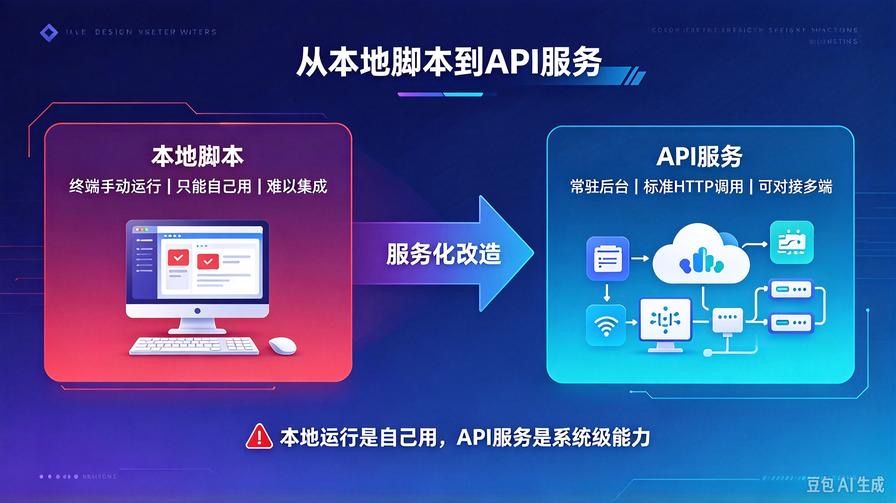
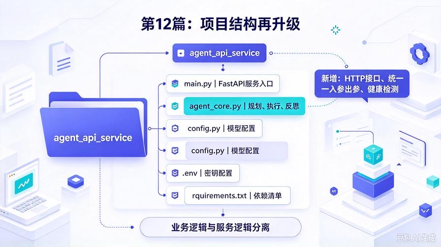
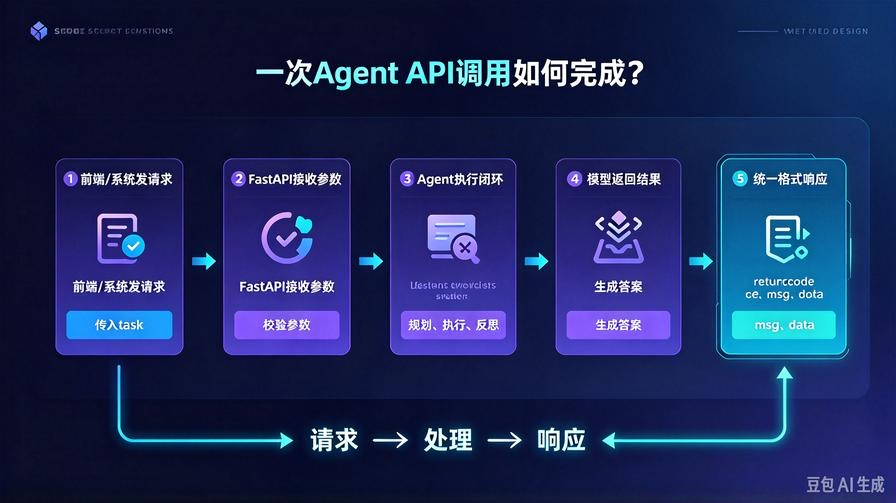
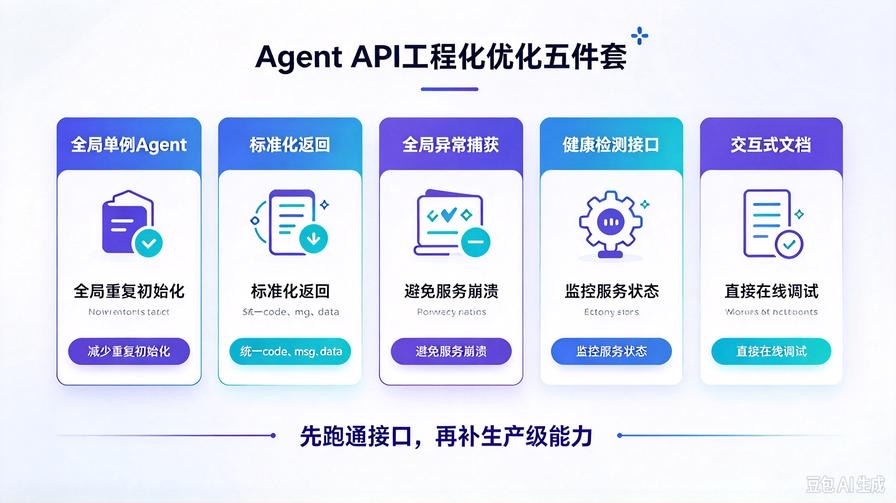

# 第12篇：Agent服务化部署：把智能体包装成API接口

欢迎回到 **AI Agent 零基础实战连载系列**。

在前11篇的实战中，我们完成了AI Agent的**全能力迭代**：

从基础思考闭环、RAG私有知识库、工具调用，到CrewAI多智能体团队协作，我们已经能在本地运行功能完整的智能体。

但所有本地Agent，都有一个致命短板：**只能自己本地运行，无法被其他程序、网页、客户端、系统调用**。

哪怕你的Agent再智能，只能在终端运行，就永远只是“本地脚本”，无法落地成真正可用的AI应用。

**真正的工程化落地，第一步就是服务化、接口化。**

本篇作为Agent部署开篇，零基础手把手带你：**把前面的完整AI Agent，封装成标准API接口**。

无需复杂服务器知识，全程极简FastAPI实战，写完直接可用、可对接前端、可对接小程序、可对接业务系统。

读完本文你将彻底掌握：

- 为什么所有AI应用都必须做API服务化
- FastAPI极速搭建AI服务的核心逻辑
- 将基础Agent封装成通用问答API
- 接口调试、参数传参、返回值标准化
- 本地服务部署、跨程序调用、常见报错排查
- 为后续网页端、移动端、企业系统集成铺路

## 一、为什么一定要把Agent改成API接口？



很多新手学到最后都会卡在这里：**代码能跑、功能很强，但无法对外使用**。

我们区分两个核心概念，彻底打通工程思维：

### 1. 本地脚本模式（目前我们的旧版本）

只能在终端手动输入问题、手动触发运行，生命周期仅限本地进程，无法被外部程序调用。

定位：**学习demo、本地测试工具**，无法商用、无法落地、无法集成。

### 2. 服务化API模式（本篇升级方向）

Agent常驻后台运行，开启Web服务，提供标准HTTP接口。

任何设备、任何程序都可以调用：前端网页、小程序、Python脚本、Java系统、自动化工具。

定位：**可落地、可集成、可商用的AI微服务**。

**一句话总结：本地运行是“自己用”，API服务是“所有人、所有系统一起用”。**

所有市面的AI产品、智能客服、AI助手，底层全部是「Agent + API服务化」架构。

## 二、技术选型：为什么用FastAPI？

本次服务化部署我们选用 **FastAPI** 作为Web框架，是AI项目的行业首选，对比Flask、Django优势极其明显：

- 原生异步，适配大模型流式、慢响应场景
- 自动生成交互式接口文档，零基础直接调试
- 代码极简、冗余极少、开发效率拉满
- 高性能、支持高并发，适配多用户调用

完全适配AI Agent的调用特性：**单次请求耗时久、需要异步处理、需要标准化返回**。

## 三、升级后项目结构（服务化标准结构）



基于第8篇基础Agent迭代，保留原有核心能力，新增服务入口，结构干净标准：

```plain
agent_api_service/
├── main.py          # 【新增】FastAPI服务入口、API接口定义
├── agent_core.py   # 原有Agent核心：规划、执行、反思
├── config.py       # 全局模型配置
├── .env            # 密钥环境变量
└── requirements.txt # 完整依赖

```

核心原则：**业务逻辑和服务逻辑分离**。

agent_core 只负责AI思考与任务处理，main.py 只负责接口接收请求、返回结果，符合工业级开发规范。

## 四、环境依赖安装

在原有依赖基础上，新增FastAPI运行环境，一键安装：

```bash
pip install fastapi uvicorn python-dotenv openai

```

其中 uvicorn 是ASGI高性能服务器，用于启动和运行FastAPI服务。

## 五、完整可落地代码逐行实现

完全复用之前成熟的Agent核心逻辑，仅新增服务层代码，无破坏性修改，兼容原有所有能力。

### 1. config.py 全局配置（完全复用）

```python
from dotenv import load_dotenv
import os

load_dotenv()

# 大模型基础配置
MODEL_API_KEY = os.getenv("API_KEY")
MODEL_BASE_URL = os.getenv("BASE_URL")
MODEL_NAME = "deepseek-chat"

# Agent运行参数
MAX_THOUGHT_STEPS = 3

```

### 2. agent_core.py 智能体核心（复用成熟闭环）

保留 **任务规划、任务执行、自我反思** 完整能力，保证接口调用和本地调用效果完全一致。

```python
from openai import OpenAI
from config import MODEL_API_KEY, MODEL_BASE_URL, MODEL_NAME

client = OpenAI(
    api_key=MODEL_API_KEY,
    base_url=MODEL_BASE_URL
)

class BaseAgent:
    def __init__(self):
        self.history = []

    # 任务规划模块
    def plan_task(self, user_input):
        prompt = f"""
你是专业AI任务规划师，请严格分步思考、拆解用户任务：
用户需求：{user_input}

请输出：
1. 任务核心目标
2. 任务拆解步骤
3. 执行注意事项
        """
        res = client.chat.completions.create(
            model=MODEL_NAME,
            messages=[{"role":"user","content":prompt}]
        )
        return res.choices[0].message.content

    # 任务执行模块
    def execute_task(self, user_input, plan_result):
        prompt = f"""
根据任务规划结果，完整落地执行用户需求：
用户需求：{user_input}
任务规划：{plan_result}

请输出完整、清晰、可直接使用的最终内容。
        """
        res = client.chat.completions.create(
            model=MODEL_NAME,
            messages=[{"role":"user","content":prompt}]
        )
        return res.choices[0].message.content

    # 自我反思纠错模块
    def reflect_task(self, user_input, raw_result):
        prompt = f"""
你是严格的内容审核师，请自查本次输出：
用户需求：{user_input}
原始输出：{raw_result}

从以下维度自查：
1. 是否答非所问
2. 是否内容残缺、逻辑漏洞
3. 是否存在幻觉、虚假信息
4. 是否可以优化结构、措辞、完整性

输出：问题清单 + 优化后的最终成品
        """
        res = client.chat.completions.create(
            model=MODEL_NAME,
            messages=[{"role":"user","content":prompt}]
        )
        return res.choices[0].message.content

    # 完整Agent运行闭环
    def run(self, user_task):
        plan = self.plan_task(user_task)
        raw_result = self.execute_task(user_task, plan)
        final_result = self.reflect_task(user_task, raw_result)
        return {
            "user_task": user_task,
            "task_plan": plan,
            "raw_result": raw_result,
            "final_result": final_result
        }

# 全局初始化Agent实例（服务常驻复用）
agent = BaseAgent()

```

### 3. main.py 全新API服务入口（核心新增）

封装标准POST接口，定义统一入参、统一返回格式，适配所有外部调用场景。

```python
from fastapi import FastAPI, HTTPException
from pydantic import BaseModel
from agent_core import agent

# 初始化FastAPI服务
app = FastAPI(
    title="AI Agent 通用服务接口",
    description="基于规划-执行-反思闭环的通用智能体API服务",
    version="1.0.0"
)

# 定义请求参数模型（标准化入参）
class AgentRequest(BaseModel):
    task: str

# 定义核心Agent问答接口
@app.post("/api/agent/run")
async def agent_run(request: AgentRequest):
    """
    通用AI Agent任务执行接口
    传入用户任务，返回完整思考、执行、优化结果
    """
    try:
        # 调用Agent完整闭环
        result = agent.run(request.task)
        return {
            "code": 200,
            "msg": "请求成功",
            "data": result
        }
    except Exception as e:
        raise HTTPException(status_code=500, detail=f"服务执行失败：{str(e)}")

# 健康检测接口（服务存活校验）
@app.get("/health")
async def health_check():
    return {"code": 200, "msg": "服务正常运行", "status": "online"}

if __name__ == "__main__":
    import uvicorn
    # 启动服务：0.0.0.0允许外网访问，端口8000
    uvicorn.run(app, host="0.0.0.0", port=8000)

```

## 六、服务启动 & 交互式调试



### 1. 启动API服务

终端进入项目目录，执行启动命令：

```bash
python main.py

```

启动成功后，服务会常驻运行在：`http://127.0.0.1:8000`

### 2. 自动接口文档调试

FastAPI自动生成可视化接口文档，浏览器打开地址：

`http://127.0.0.1:8000/docs`

在这里可以**零代码调试接口**，直接在线输入任务、查看返回结果，非常适合新手测试。

### 3. 接口调用示例

POST请求地址：`http://127.0.0.1:8000/api/agent/run`

请求JSON参数：

```json
{"task":"帮我梳理一下AI Agent的核心开发流程"}

```

返回结果会完整包含：任务目标、规划步骤、原始输出、优化后最终结果，结构极其清晰，方便前端解析展示。

## 七、工程化关键优化点（新手必看）



### 1. 全局单例Agent

代码中全局初始化Agent实例，避免每次请求重复创建对象，减少资源消耗、提升响应速度，符合服务开发规范。

### 2. 标准化返回格式

统一 code、msg、data 返回结构，前端、其他系统可以固定格式解析，无需适配不同返回样式。

### 3. 全局异常捕获

所有接口请求异常统一捕获，返回标准500错误信息，避免服务崩溃、页面报错。

### 4. 健康检测接口

新增 /health 接口，用于服务器监控、负载均衡探测，是生产级服务的标配。

## 八、高频报错 & 踩坑排查清单

- **端口占用报错**：8000端口被其他程序占用，修改port参数为8001、8002即可
- **模型调用失败**：检查.env密钥、接口地址是否正确，本地能跑通agent_core就可以正常接口调用
- **跨域请求失败**：后续对接前端报错，安装cors依赖，添加跨域中间件即可解决
- **服务启动无响应**：确认依赖全部安装完成，关闭代理、保证网络通畅
- **请求超时**：大模型响应本身较慢，可在服务配置中延长超时时间

## 九、可扩展进阶方向（课后实战练习）

本篇是服务化的基石，基于当前代码可以快速扩展生产级能力：

1. 增加**CORS跨域配置**，支持前端网页直接调用
2. 接入**多轮对话记忆**，实现接口上下文连续对话
3. 增加**请求频率限制**，防止恶意刷接口、消耗token
4. 新增**流式输出接口**，实现打字机实时响应效果
5. 接入日志系统，记录每一次请求、响应、报错信息

## 十、本篇核心总结

1. 本地Agent是Demo，API服务化Agent才是可落地的工程应用；

2. FastAPI是AI Agent服务化最优框架，极简、高性能、自动文档、适配异步；

3. 工程开发核心思想：**业务逻辑与服务逻辑分离**，便于迭代和维护；

4. 标准化入参、出参、异常处理、健康检测，是生产级服务的基础标配；

5. 服务化后，Agent彻底解锁无限集成能力，可对接任意前端、后端、客户端系统。

## 下期预告

API服务已经搭建完成，下一篇我们将解决**前端展示问题**：**第13篇：Agent前端可视化：搭建极简AI对话网页**。手把手从零写一个聊天界面，实现网页输入、实时流式回复、对话记录展示，让你的AI Agent拥有专属网页端。

**互动提问：你想优先对接网页端、小程序，还是企业内部系统？评论区告诉我！**

> 来源：头条号《AI Agent 零基础实战》第12篇｜版权归作者所有，仅供学习交流
