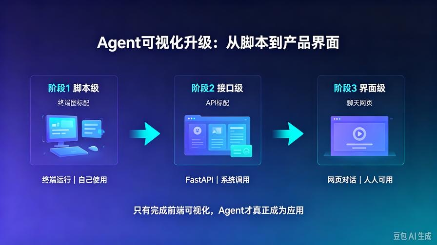
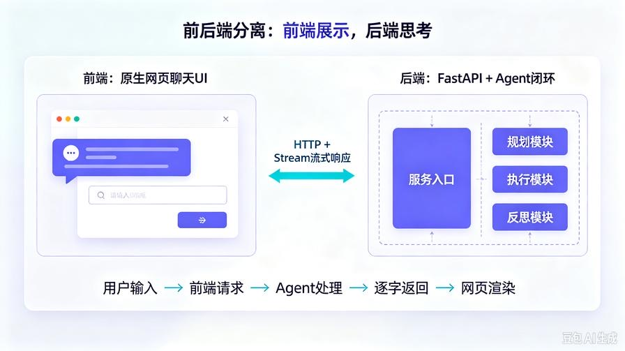
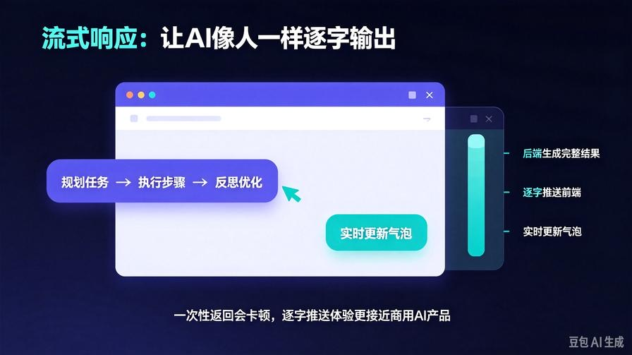
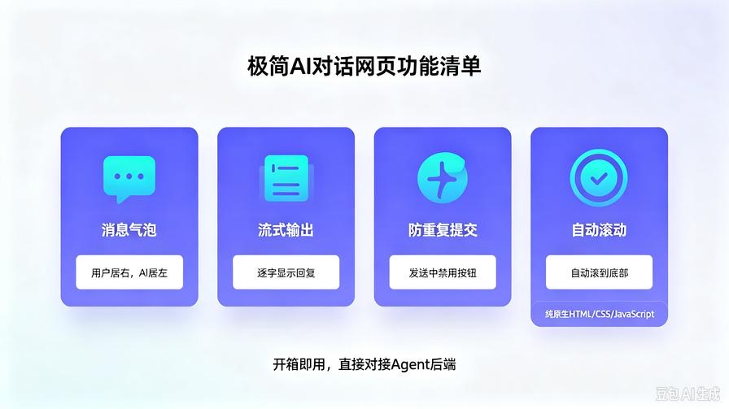

# 第13篇：Agent前端可视化：搭建极简AI对话网页

欢迎回到 **AI Agent 零基础实战连载系列**。

前12篇，我们已经彻底走完 **AI Agent 底层全链路**：

- 会思考：规划、执行、反思闭环
- 会知识：RAG私有文档问答
- 会干活：工具调用自动化
- 会团队：多智能体分工协作
- 会部署：FastAPI 后端 API 服务化

但是！**只有接口、没有界面的AI，永远只能自己开发用。**

普通用户不会调用 API、不会运行脚本。

**真正的产品化第一步：拥有可视化聊天界面。**

本篇零基础带你 **从零手写专属 AI Agent 网页客户端**。

不用 Vue、不用 React、不用复杂工程化。

**纯原生 HTML + CSS + JavaScript，开箱即用、直接对接第12篇后端接口。**

读完本篇你一次性搞定：

- 前后端完整联调架构
- 仿ChatGPT流式打字机实时输出
- 网页对话历史、左右气泡布局
- 输入框锁定、加载状态、防重复提交
- 一套可直接部署、可二次开发、可商用的Agent前端界面

## 一、为什么必须做前端可视化？



开发Agent分为三个阶段：

### 阶段1：脚本级（入门）

终端输入、终端输出。

问题：**无法给别人用、不是产品、没有体验。**

### 阶段2：接口级（工程化）

FastAPI 提供API，程序可调用。

问题：**普通用户完全用不了。**

### 阶段3：界面级（产品化）

网页可视化聊天窗口，人人点开即用。

**只有走完前端可视化，你的AI Agent才算真正成型为「应用」。**

我们本篇最终实现效果：

1. 浏览器打开网页即可对话
2. AI 逐字流式输出（打字机效果）
3. 用户消息居右、AI消息居左
4. 自动滚动到底部
5. 请求中禁止重复发送
6. 完整对接我们自己的后端Agent服务

## 二、前后端整体架构总览



本次是**标准工业级前后端分离架构**

- **后端（已有）**：FastAPI + 自研Agent闭环（思考/执行/反思）
- **前端（本篇新建）**：原生网页聊天UI
- **通信协议**：HTTP + Stream 流式响应

链路：

用户输入问题 → 前端JS发送请求 → FastAPI后端接收 → Agent执行完整思考闭环 → **流式逐字返回网页实时渲染**

## 三、升级后完整项目结构

整合第12篇后端，新增前端页面，最终结构如下：

```Plain Text
agent_api_service/
├── index.html        # 【新增】AI对话网页前端
├── main.py           # FastAPI 服务入口
├── agent_core.py     # Agent核心逻辑
├── config.py         # 配置文件
├── .env              # 密钥配置
└── requirements.txt
```

**真正的极简完整AI应用结构**，没有任何冗余。

## 四、后端改造：支持流式响应（关键升级）



上一篇的接口是**一次性返回**，没有打字机效果。

想要网页实时输出，必须升级为 **Stream 流式接口**。

我们只改接口层，**不改动Agent核心逻辑**，保证原有思考、反思能力完全不变。

### 修改 main.py

```Python
from fastapi import FastAPI, HTTPException
from fastapi.middleware.cors import CORSMiddleware
from pydantic import BaseModel
from starlette.responses import StreamingResponse
from agent_core import agent
import json
app = FastAPI(
    title="AI Agent 对话服务",
    description="前后端联调流式对话服务",
    version="1.1.0"
)
# 解决前端跨域（必须配置）
app.add_middleware(
    CORSMiddleware,
    allow_origins=["*"],
    allow_credentials=True,
    allow_methods=["*"],
    allow_headers=["*"],
)
class AgentRequest(BaseModel):
    task: str
# 流式对话核心接口
@app.post("/api/agent/stream")
async def agent_stream_run(request: AgentRequest):
    try:
        result = agent.run(request.task)
        final_text = result["final_result"]
        # 逐字流式生成
        def stream_generator():
            for char in final_text:
                yield json.dumps({"char": char}, ensure_ascii=False) + "\n"
        return StreamingResponse(
            stream_generator(),
            media_type="text/event-stream"
        )
    except Exception as e:
        raise HTTPException(status_code=500, detail=str(e))
# 健康检测
@app.get("/health")
async def health_check():
    return {"code":200, "msg":"服务正常"}
if __name__ == "__main__":
    import uvicorn
    uvicorn.run(app, host="0.0.0.0", port=8000)
```

### 本次升级核心亮点

1. **新增CORS跨域**：彻底解决前端本地调试跨域报错
2. **新增流式接口**：逐字推送，实现打字机效果
3. **完全兼容旧Agent逻辑**：智能思考、反思能力无变化

## 五、全新前端页面完整代码（index.html）



直接新建 `index.html`，**全量复制即可用**。

界面仿主流AI聊天产品，干净、现代、自适应PC/手机。

```HTML
<!DOCTYPE html>
<html lang="zh-CN">
<head>
    <meta charset="UTF-8">
    <meta name="viewport" content="width=device-width, initial-scale=1.0">
    AI Agent 智能对话助手
    <style>
        * {
            margin: 0;
            padding: 0;
            box-sizing: border-box;
        }
        body {
            background-color: #f5f7fa;
            font-family: "Microsoft Yahei", sans-serif;
        }
        .container {
            max-width: 1000px;
            margin: 0 auto;
            height: 100vh;
            display: flex;
            flex-direction: column;
            padding: 20px;
        }
        .title {
            text-align: center;
            font-size: 24px;
            font-weight: bold;
            color: #222;
            margin-bottom: 20px;
        }
        /* 聊天窗口 */
        .chat-box {
            flex: 1;
            overflow-y: auto;
            background: #fff;
            border-radius: 12px;
            padding: 20px;
            margin-bottom: 20px;
            box-shadow: 0 2px 12px #00000010;
        }
        .msg-item {
            margin-bottom: 16px;
            display: flex;
        }
        .user-msg {
            justify-content: flex-end;
        }
        .msg-content {
            max-width: 70%;
            padding: 12px 16px;
            border-radius: 10px;
            line-height: 1.6;
            white-space: pre-wrap;
        }
        .ai-msg .msg-content {
            background: #f0f4ff;
            color: #222;
        }
        .user-msg .msg-content {
            background: #367bfa;
            color: #fff;
        }
        /* 输入区域 */
        .input-box {
            display: flex;
            gap: 10px;
        }
        #input-text {
            flex: 1;
            height: 48px;
            padding: 0 16px;
            border: 1px solid #ddd;
            border-radius: 8px;
            font-size: 16px;
        }
        #send-btn {
            width: 90px;
            height: 48px;
            border: none;
            background: #367bfa;
            color: #fff;
            border-radius: 8px;
            font-size: 16px;
            cursor: pointer;
        }
        #send-btn:disabled {
            background: #94b8fa;
            cursor: not-allowed;
        }
    </style>
</head>
<body>
    <div class="container">
        <div class="title">AI Agent 智能对话助手（自研规划-执行-反思闭环）</div>
        <div class="chat-box" id="chatBox"></div>
        <div class="input-box">
            <input type="text" id="input-text" placeholder="请输入你的问题..." autocomplete="off">
            <button id="send-btn">发送</button>
        </div>
    </div>
    <script>
        const chatBox = document.getElementById("chatBox");
        const inputText = document.getElementById("input-text");
        const sendBtn = document.getElementById("send-btn");
        // 服务地址
        const API_URL = "http://127.0.0.1:8000/api/agent/stream";
        // 滚动到底部
        function scrollBottom() {
            chatBox.scrollTop = chatBox.scrollHeight;
        }
        // 添加消息气泡
        function addMsg(text, isUser = false) {
            const div = document.createElement("div");
            div.className = `msg-item ${isUser ? "user-msg" : "ai-msg"}`;
            div.innerHTML = `<div class="msg-content">${text}</div>`;
            chatBox.appendChild(div);
            scrollBottom();
            return div;
        }
        // 发送请求
        async function sendMessage() {
            const text = inputText.value.trim();
            if (!text) return;
            // 用户消息
            addMsg(text, true);
            inputText.value = "";
            sendBtn.disabled = true;
            // AI占位气泡
            let aiDom = addMsg("");
            let contentDom = aiDom.querySelector(".msg-content");
            let fullText = "";
            try {
                const response = await fetch(API_URL, {
                    method: "POST",
                    headers: {"Content-Type": "application/json"},
                    body: JSON.stringify({task: text})
                });
                // 流式逐字读取
                const reader = response.body.getReader();
                const decoder = new TextDecoder("utf-8");
                while (true) {
                    const {done, value} = await reader.read();
                    if (done) break;
                    const chunk = decoder.decode(value);
                    const lines = chunk.split("\n").filter(line => line);
                    for (let line of lines) {
                        const data = JSON.parse(line);
                        fullText += data.char;
                        contentDom.innerText = fullText;
                        scrollBottom();
                    }
                }
            } catch (e) {
                contentDom.innerText = "服务请求失败，请检查后端服务是否启动！";
            }
            sendBtn.disabled = false;
        }
        // 绑定事件
        sendBtn.addEventListener("click", sendMessage);
        inputText.addEventListener("keydown", e => {
            if (e.key === "Enter") sendMessage();
        });
    </script>
</body>
</html>
```

## 六、完整运行步骤（100%成功）

### 1. 启动后端服务

```Bash
python main.py
```

确保服务运行在：`http://127.0.0.1:8000`

### 2. 直接打开网页

双击 `index.html` 即可打开界面

### 3. 输入问题测试

例如：

- 帮我规划高效的每日学习流程
- 分析AI Agent未来的落地场景
- 写一份简短的工作总结

你会看到：

**Agent在后端完整执行 规划→执行→反思，前端逐字动态渲染输出！**

## 七、技术拆解：你必须吃透的产品逻辑

### 1. 为什么要用流式响应？

大模型/Agent 推理耗时较长。

一次性等待全部结果 → 用户卡顿、体验极差

**逐字推送 → 实时反馈、感知极快、接近商用AI产品**

### 2. 前后端分离优势

- 后端专注 **智能逻辑、推理、知识库、工具**
- 前端专注 **交互、体验、布局、动画**

完全符合大厂AI项目架构。

### 3. 我们的Agent和普通大模型对话区别

普通网页AI：直接调用模型  

我们的网页AI：**模型 + 结构化规划 + 执行落地 + 自我纠错反思**

**智能层级完全碾压普通对话机器人。**

## 八、新手高频问题 & 排错清单

1. **网页无响应**

- 检查后端是否启动成功
- 检查端口是否8000
- 查看浏览器F12控制台报错

1. **跨域报错**

- 确认已经添加 CORSMiddleware

1. **服务返回500**

- .env密钥错误、接口不可用
- 网络无法连通模型服务商

1. **没有打字机效果**

- 必须使用新版流式接口，不要调用旧接口

## 九、课后可扩展进阶方向

你可以基于本篇无限升级产品形态：

1. **增加对话记忆存储**（浏览器本地存储）
2. **新增清空对话、新建对话功能**
3. **适配RAG知识库，网页私有文档问答**
4. **增加深色/浅色主题切换**
5. **增加对话参数调节（温度、随机性）**
6. **部署公网，发给朋友使用**

## 十、本篇核心总结

1. **Agent真正产品化的标志：拥有前端交互界面**
2. 工业级标准架构：前后端分离 + 流式响应
3. 不依赖任何前端框架，零基础可运行、可部署
4. 保留了我们整套Agent最强核心：**三层思考闭环**
5. 从此你的AI不再是脚本，而是真正可用的AI应用

## 下期预告

界面、服务、智能体全部跑通！

**第14篇：持久化记忆实战：让AI Agent拥有长期记忆与上下文对话**

彻底解决“每次对话都失忆”的问题，让你的Agent记住历史对话、越用越懂你。

**互动提问：你想让AI优先记住你的哪些习惯？工作风格、写作风格，还是日常偏好？**

> 来源：头条号《AI Agent 零基础实战》第13篇｜版权归作者所有，仅供学习交流
