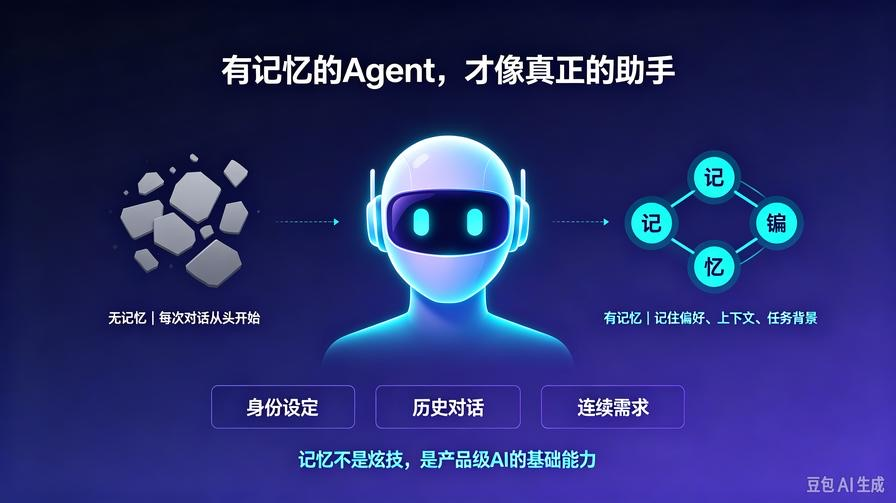
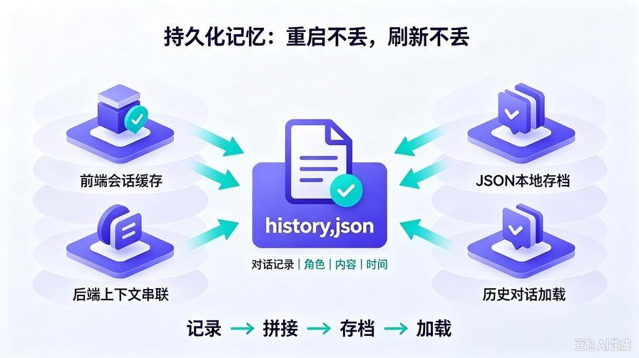
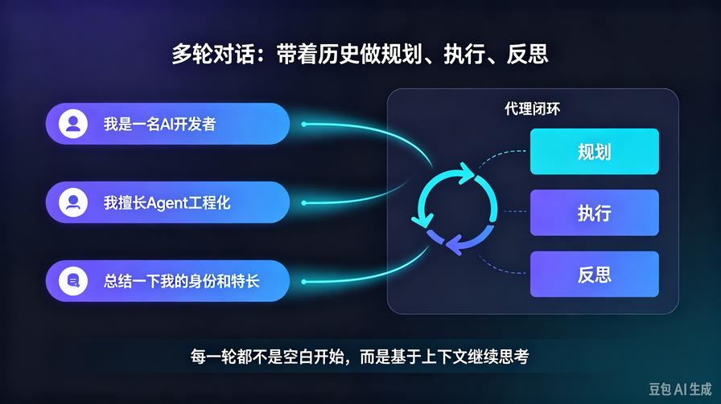
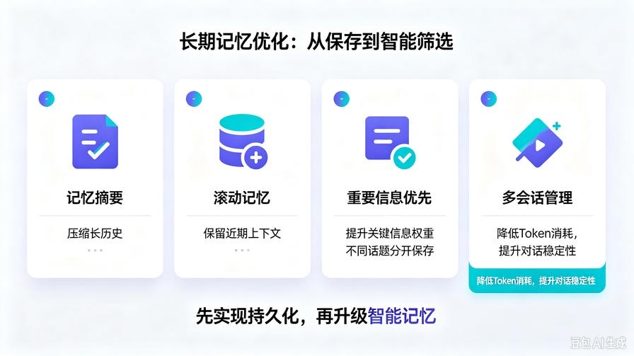

# 第14篇：持久化记忆实战：让AI Agent拥有长期记忆与连续对话

欢迎回到 **AI Agent 零基础实战连载系列**。

在前13篇的完整迭代中，我们已经搭建出一套**完整可用的AI Agent产品雏形**：

- ✅ 基础Agent：规划 → 执行 → 反思 三层闭环
- ✅ RAG知识库：私有文档问答、解决幻觉
- ✅ 工具调用：自动执行任务
- ✅ 多智能体团队：分工协作
- ✅ API服务化：工程化部署
- ✅ 前端网页界面：流式对话、可视化产品

但目前的Agent，存在**所有新手AI项目最大的硬伤**：

**每次对话全部“失忆”，没有上下文，无法连续聊天。**

你上一句问的需求、设定、偏好，下一句全部清空，导致智能体完全不像“私人助手”。

真正**可用、好用、贴近产品级**的AI Agent，必须具备核心能力：**长期记忆持久化**。

本篇零基础带你从零实现：

**上下文连续对话 + 本地持久化记忆 + 多轮对话闭环 + 记忆自动刷新**

读完本篇你彻底掌握：

- 大模型记忆的底层原理
- 为什么普通对话越聊越卡、越聊越乱
- 如何实现**永久保存对话记录**
- 多轮上下文精准传递给Agent思考闭环
- 本地JSON持久化、自动存档、新建对话
- 完整可直接商用的记忆版Agent

## 一、为什么AI Agent必须做持久化记忆？



### 1. 无记忆Agent（当前版本）

每一次请求都是**独立空白对话**：

- 不知道你上一句说了什么
- 不知道任务背景
- 无法承接连续需求
- 无法迭代优化答案

**本质：一次性问答工具。**

### 2. 有记忆Agent（本篇升级后）

全程**上下文串联**：

- 记住你的身份、偏好、需求
- 记住本次对话全部历史
- 基于历史持续优化回答
- 连贯思考、连续任务、迭代输出

**本质：真正的智能助手。**

### 3. 持久化 vs 临时记忆

- 临时记忆：程序重启、页面刷新、服务重启 → **全部丢失**
- 持久化记忆：**重启不丢、刷新不丢、长期留存**

**产品化AI，唯一分水岭：记忆能力。**

## 二、记忆实现原理（通俗大白话）



大模型本身**没有记忆**。

所有AI记忆，都是**开发者手动实现的人工记忆**。

原理只有三步：

1. **记录**：保存用户每一句提问、AI每一句回答
2. **拼接**：新一轮提问时，把「历史对话+新问题」一起喂给模型
3. **存档**：写入本地文件持久化保存

我们本次实现架构：

**前端会话缓存 + 后端内存串联 + 本地JSON永久存档**

## 三、升级后完整项目结构

在第13篇前后端项目基础上升级，无破坏性改动：

```Plain Text
agent_api_service/
├── index.html        # 前端聊天页面（新增记忆逻辑）
├── main.py           # FastAPI服务（新增记忆接口）
├── agent_core.py     # Agent核心（升级多轮思考）
├── config.py
├── .env
└── chat_memory/      # 【新增】持久化记忆文件夹
    └── history.json # 自动生成对话记录
```

## 四、后端全套代码升级（可直接覆盖）



### 1. agent_core.py 升级：支持多轮上下文记忆

改造Agent核心，支持传入历史对话，实现**连贯思考闭环**

```Python
from openai import OpenAI
from config import MODEL_API_KEY, MODEL_BASE_URL, MODEL_NAME
client = OpenAI(
    api_key=MODEL_API_KEY,
    base_url=MODEL_BASE_URL
)
class BaseAgent:
    def __init__(self):
        self.history = []
    # 载入历史对话
    def load_history(self, history_list):
        self.history = history_list
    # 任务规划（带上下文）
    def plan_task(self, user_input):
        context = ""
        if self.history:
            context = f"历史对话记录：{self.history}\n"
        prompt = f"""
你是专业AI任务规划师，请结合历史对话，分步思考用户当前任务。
{context}
当前用户新需求：{user_input}
请严格输出：
1. 任务核心目标
2. 结合上下文的任务拆解步骤
3. 本次执行注意事项
        """
        res = client.chat.completions.create(
            model=MODEL_NAME,
            messages=[{"role":"user","content":prompt}]
        )
        return res.choices[0].message.content
    # 任务执行（带上下文）
    def execute_task(self, user_input, plan_result):
        context = ""
        if self.history:
            context = f"历史对话记录：{self.history}\n"
        prompt = f"""
结合历史对话与任务规划，完整落地执行：
{context}
当前需求：{user_input}
任务规划：{plan_result}
输出完整、连贯、贴合上下文的最终内容。
        """
        res = client.chat.completions.create(
            model=MODEL_NAME,
            messages=[{"role":"user","content":prompt}]
        )
        return res.choices[0].message.content
    # 自我反思（带上下文校验）
    def reflect_task(self, user_input, raw_result):
        context = ""
        if self.history:
            context = f"历史对话记录：{self.history}\n"
        prompt = f"""
结合历史对话自查本次回答是否连贯、合理：
{context}
当前需求：{user_input}
原始输出：{raw_result}
自查：连贯性、完整性、是否遗忘上文、是否逻辑冲突
输出：问题清单 + 最终优化答案
        """
        res = client.chat.completions.create(
            model=MODEL_NAME,
            messages=[{"role":"user","content":prompt}]
        )
        return res.choices[0].message.content
    # 完整多轮对话闭环
    def run_with_history(self, user_task, history_list):
        self.load_history(history_list)
        plan = self.plan_task(user_task)
        raw = self.execute_task(user_task, plan)
        final = self.reflect_task(user_task, raw)
        return {
            "user_task": user_task,
            "plan": plan,
            "raw_result": raw,
            "final_result": final
        }
agent = BaseAgent()
```

### 2. main.py 升级：新增记忆持久化接口

实现：**自动读写JSON、保存对话、加载历史、清空记忆**

```Python
from fastapi import FastAPI, HTTPException
from fastapi.middleware.cors import CORSMiddleware
from pydantic import BaseModel
from starlette.responses import StreamingResponse
from agent_core import agent
import json
import os
app = FastAPI(title="记忆版AI Agent服务", version="2.0")
# 跨域
app.add_middleware(
    CORSMiddleware,
    allow_origins=["*"],
    allow_credentials=True,
    allow_methods=["*"],
    allow_headers=["*"],
)
# 记忆文件夹初始化
MEMORY_DIR = "chat_memory"
MEMORY_FILE = os.path.join(MEMORY_DIR, "history.json")
os.makedirs(MEMORY_DIR, exist_ok=True)
# 初始化空记忆文件
if not os.path.exists(MEMORY_FILE):
    with open(MEMORY_FILE, "w", encoding="utf-8") as f:
        json.dump([], f, ensure_ascii=False, indent=2)
class ChatRequest(BaseModel):
    task: str
    history: list
# 流式对话 + 自动保存记忆
@app.post("/api/agent/stream")
async def stream_chat(req: ChatRequest):
    try:
        # 执行带记忆Agent推理
        result = agent.run_with_history(req.task, req.history)
        final_text = result["final_result"]
        # 持久化写入本地JSON
        req.history.append({"role":"user","content":req.task})
        req.history.append({"role":"assistant","content":final_text})
        with open(MEMORY_FILE, "w", encoding="utf-8") as f:
            json.dump(req.history, f, ensure_ascii=False, indent=2)
        # 流式逐字输出
        def stream():
            for char in final_text:
                yield json.dumps({"char":char}, ensure_ascii=False)+"\n"
        return StreamingResponse(stream(), media_type="text/event-stream")
    except Exception as e:
        raise HTTPException(status_code=500, detail=str(e))
# 读取历史记忆
@app.get("/api/agent/history")
async def get_history():
    with open(MEMORY_FILE, "r", encoding="utf-8") as f:
        data = json.load(f)
    return {"code":200, "history":data}
# 清空记忆
@app.post("/api/agent/clear")
async def clear_history():
    with open(MEMORY_FILE, "w", encoding="utf-8") as f:
        json.dump([], f)
    return {"code":200, "msg":"记忆已清空"}
# 健康检测
@app.get("/health")
async def health():
    return {"code":200, "msg":"记忆版Agent服务正常"}
if __name__ == "__main__":
    import uvicorn
    uvicorn.run(app, host="0.0.0.0", port=8000)
```

## 五、前端页面升级：实现连续对话记忆

更新 index.html，新增：

- 页面刷新**自动加载历史对话**
- 全程上下文传递
- 一键清空记忆功能

### 新版完整 index.html

```HTML
<!DOCTYPE html>
<html lang="zh-CN">
<head>
    <meta charset="UTF-8">
    <meta name="viewport" content="width=device-width, initial-scale=1.0">
    记忆版AI Agent | 长期连续对话助手
    <style>
        * {margin:0;padding:0;box-sizing:border-box;}
        body {background:#f5f7fa;font-family:"Microsoft Yahei",sans-serif;}
        .container {max-width:1000px;margin:0 auto;height:100vh;display:flex;flex-direction:column;padding:20px;}
        .top-bar {display:flex;justify-content:space-between;align-items:center;margin-bottom:20px;}
        .title {font-size:24px;font-weight:bold;color:#222;}
        .clear-btn {padding:6px 14px;background:#f53f3f;color:#fff;border:none;border-radius:6px;cursor:pointer;}
        .chat-box {flex:1;overflow-y:auto;background:#fff;border-radius:12px;padding:20px;margin-bottom:20px;box-shadow:0 2px 12px #00000010;}
        .msg-item {margin-bottom:16px;display:flex;}
        .user-msg {justify-content:flex-end;}
        .msg-content {max-width:70%;padding:12px 16px;border-radius:10px;line-height:1.6;white-space:pre-wrap;}
        .ai-msg .msg-content {background:#f0f4ff;color:#222;}
        .user-msg .msg-content {background:#367bfa;color:#fff;}
        .input-box {display:flex;gap:10px;}
        #input-text {flex:1;height:48px;padding:0 16px;border:1px solid #ddd;border-radius:8px;font-size:16px;}
        #send-btn {width:90px;height:48px;border:none;background:#367bfa;color:#fff;border-radius:8px;font-size:16px;cursor:pointer;}
        #send-btn:disabled {background:#94b8fa;cursor:not-allowed;}
    </style>
</head>
<body>
    <div class="container">
        <div class="top-bar">
            <div class="title">记忆版AI Agent 连续对话助手</div>
            <button class="clear-btn" onclick="clearMemory()">清空记忆</button>
        </div>
        <div class="chat-box" id="chatBox"></div>
        <div class="input-box">
            <input type="text" id="input-text" placeholder="输入问题，拥有长期记忆..." autocomplete="off">
            <button id="send-btn">发送</button>
        </div>
    </div>
    <script>
        const API = "http://127.0.0.1:8000/api/agent";
        const chatBox = document.getElementById("chatBox");
        const inputText = document.getElementById("input-text");
        const sendBtn = document.getElementById("send-btn");
        let chatHistory = [];
        // 页面加载读取历史记忆
        async function loadHistory() {
            let res = await fetch(`${API}/history`);
            let json = await res.json();
            chatHistory = json.history;
            // 渲染历史对话
            chatHistory.forEach(item=>{
                if(item.role === "user") addMsg(item.content, true);
                else addMsg(item.content, false);
            });
        }
        function scrollBottom(){
            chatBox.scrollTop = chatBox.scrollHeight;
        }
        function addMsg(text, isUser=false){
            let div = document.createElement("div");
            div.className = `msg-item ${isUser?"user-msg":"ai-msg"}`;
            div.innerHTML = `<div class="msg-content">${text}</div>`;
            chatBox.appendChild(div);
            scrollBottom();
            return div;
        }
        async function sendMessage(){
            let text = inputText.value.trim();
            if(!text) return;
            addMsg(text, true);
            inputText.value = "";
            sendBtn.disabled = true;
            let aiDom = addMsg("");
            let contentDom = aiDom.querySelector(".msg-content");
            let fullText = "";
            let res = await fetch(`${API}/stream`,{
                method:"POST",
                headers:{"Content-Type":"application/json"},
                body:JSON.stringify({task:text, history:chatHistory})
            });
            let reader = res.body.getReader();
            let decoder = new TextDecoder("utf-8");
            while(true){
                let {done,value} = await reader.read();
                if(done) break;
                let chunk = decoder.decode(value);
                let lines = chunk.split("\n").filter(line=>line);
                for(let line of lines){
                    let data = JSON.parse(line);
                    fullText += data.char;
                    contentDom.innerText = fullText;
                    scrollBottom();
                }
            }
            // 更新本地对话记录
            chatHistory.push({role:"user",content:text});
            chatHistory.push({role:"assistant",content:fullText});
            sendBtn.disabled = false;
        }
        // 清空记忆
        async function clearMemory(){
            await fetch(`${API}/clear`,{method:"POST"});
            chatHistory = [];
            chatBox.innerHTML = "";
        }
        sendBtn.addEventListener("click", sendMessage);
        inputText.addEventListener("keydown", e=>e.key==="Enter"&&sendMessage());
        // 页面初始化加载记忆
        loadHistory();
    </script>
</body>
</html>
```

## 六、完整运行流程

### 1. 启动服务

```Bash
python main.py
```

### 2. 打开网页

双击 `index.html`

### 3. 测试记忆效果

第一轮提问：

`我是一名AI开发者，擅长Agent工程化`

第二轮提问：

`总结一下我的身份和特长`

**Agent完美记住上文、连贯总结、不会失忆！**

### 4. 关闭网页、重启服务、重新打开

**记忆完全不丢失，永久留存！**

## 七、核心升级亮点（工业级价值）

1. **三层Agent思考闭环 + 多轮上下文联动**

不是简单拼接对话，是**带着历史做规划、执行、反思**

1. **本地JSON持久化**

无需数据库、零配置、永久存档

1. **前端自动加载历史**

刷新不丢、重启不丢、关闭不丢

1. **一键清空记忆**

支持重置对话、开启新会话

1. **完全兼容前面所有能力**

RAG、工具调用、多智能体均可叠加记忆

## 八、新手避坑清单



1. **没有传history参数 → 没有记忆**

必须每一轮都携带完整历史数组

1. **历史过长导致token超标**

后续进阶可实现：**记忆摘要、滚动记忆、智能压缩**

1. **重复对话堆积**

服务端自动去重、前端只渲染一次

1. **JSON文件乱码**

代码已配置 `ensure_ascii=False`，完美支持中文

## 九、课后进阶练习

1. 实现**多对话会话**（多文件存储不同话题记忆）
2. 增加**记忆自动摘要压缩**，解决超长上下文
3. 增加**记忆权重**，重要信息优先记住
4. 对接数据库替代JSON，支持大规模商用

## 十、本篇核心总结

1. **记忆是AI Agent从玩具变成产品的核心标志**
2. 大模型无原生记忆，所有智能记忆都是工程实现
3. 本次实现：前端缓存 + 后端联动 + 本地持久化
4. 保留规划-执行-反思闭环，**比普通AI对话更智能**
5. 彻底解决“每次聊天从头开始”的痛点

## 下期预告

**第15篇：智能记忆压缩与长期记忆优化**

解决对话越长越慢、token爆炸问题，实现**永久无限记忆、越聊越聪明**。

想要把Agent打磨成**私人专属智能助理**，千万别错过！

> 来源：头条号《AI Agent 零基础实战》第14篇｜版权归作者所有，仅供学习交流
