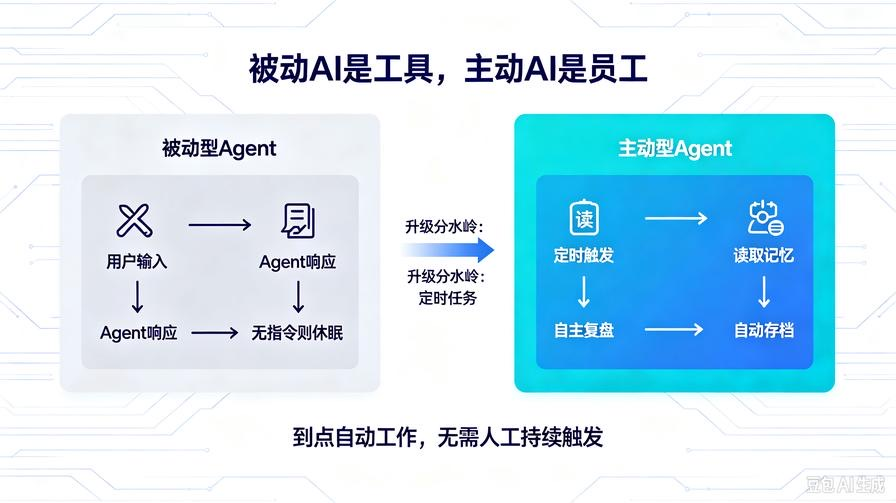
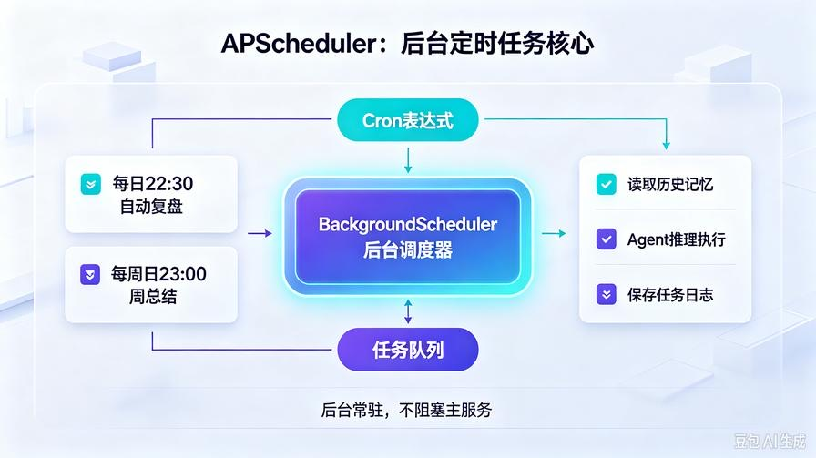
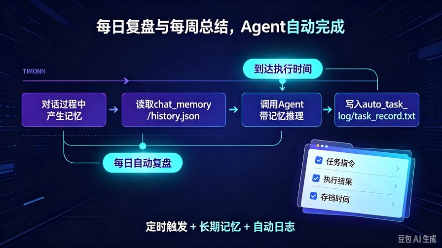
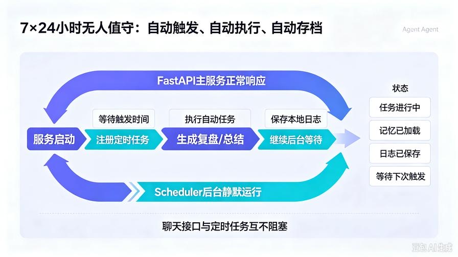

# 第16篇：Agent定时任务实战！脱离手动触发，实现7×24小时全自动后台自主工作

欢迎回到 **AI Agent 零基础实战连载系列**。

在前15篇，我们已经把AI Agent从**简单脚本**打磨成**具备永久记忆的智能助理**：

- ✅ 三层思考闭环：规划 → 执行 → 反思
- ✅ 流式网页对话、前后端产品化
- ✅ 持久化长期记忆
- ✅ 智能记忆压缩、彻底解决Token爆炸

但目前所有能力，**仍然依赖手动触发**：

你不点、不输入、不发送，Agent就**不会主动工作**。

真正的**工程级、助理级AI**，核心特征只有一个：

**自主运转、主动干活、定时执行、无人值守。**

普通AI：你问一句、动一句

**全自动Agent：到点自动工作、自动复盘、自动生成内容、自动总结**

本篇从零搭建 **Agent定时任务系统**，接入后台常驻定时器，彻底解放双手。

读完本篇你直接掌握：

- Python工业级定时任务架构
- Agent后台常驻、不阻塞主服务
- 每日自动复盘、每周总结、定时报告
- 定时任务 + 长期记忆联动
- 可商用无人值守AI服务模型

## 一、为什么一定要做「自动定时任务」？



Agent产品化分为三个层级：

### 1.0 被动型Agent（我们前15篇）

- 用户输入 → Agent响应
- 无指令就休眠
- 适合问答、辅助工具

### 2.0 主动型Agent（本篇升级）

- **无需用户干预**
- 到时间自动触发任务
- 结合历史记忆自主复盘、迭代
- **全天候自主运转**

### 3.0 超级自主Agent（未来进阶）

- 自主规划每日工作清单
- 自我监督、自我纠错、自我升级
- 真正的「数字员工」

**定时任务，是AI从“工具”变成“员工”的关键分水岭。**

## 二、技术选型：为什么用 APScheduler？



我们本次选用工业级库 **APScheduler**

AI Agent项目**最优定时框架**，完胜原生time.sleep：

- 支持：间隔定时、固定时间、日历定时
- 支持：后台常驻、不阻塞接口服务
- 支持：动态增删任务、启停任务
- 适配服务部署、支持重启续跑

完全适配AI后台自动化场景。

## 三、升级后完整项目结构

新增定时任务核心模块，**兼容全部历史代码**，无破坏性改动：

```Plain Text
agent_api_service/
├── index.html
├── main.py               # FastAPI主服务（新增定时任务注册）
├── agent_core.py         # 智能体核心（复用思考+记忆）
├── memory_utils.py      # 记忆压缩工具（复用）
├── config.py
├── .env
├── chat_memory/
│   └── history.json
└── scheduler_task.py     # 【全新新增】定时任务核心服务
```

## 四、安装依赖

```Bash
pip install apscheduler
```

## 五、全新定时任务模块：scheduler_task.py



**完整可直接落地**

整合记忆 + Agent推理 + 自动任务

```Python
from apscheduler.schedulers.background import BackgroundScheduler
from agent_core import agent
import json
import os
# 记忆文件路径
MEMORY_DIR = "chat_memory"
MEMORY_FILE = os.path.join(MEMORY_DIR, "history.json")
# 初始化后台调度器
scheduler = BackgroundScheduler(timezone="Asia/Shanghai")
# 读取历史记忆
def load_all_memory():
    if not os.path.exists(MEMORY_FILE):
        return []
    with open(MEMORY_FILE, "r", encoding="utf-8") as f:
        return json.load(f)
# 1. 每日自动复盘任务
def daily_auto_review():
    print("[定时任务执行] 每日AI自动复盘")
    history = load_all_memory()
    task_prompt = """
请结合我们今日所有对话，帮我完成一次**每日工作复盘**
输出格式：
1. 今日核心事项总结
2. 收获与进步
3. 存在不足
4. 明日优化计划
"""
    # 调用带记忆的Agent推理
    res = agent.run_with_history(task_prompt, history)
    save_auto_task_record("【每日自动复盘】", task_prompt, res["final_result"])
# 2. 每周总结任务
def weekly_summary():
    print("[定时任务执行] 每周AI总结")
    history = load_all_memory()
    task_prompt = """
请基于本周全部对话记录，生成一份**周度工作总结与成长分析**
包含：本周核心成果、知识沉淀、问题汇总、下周规划
"""
    res = agent.run_with_history(task_prompt, history)
    save_auto_task_record("【每周自动总结】", task_prompt, res["final_result"])
# 自动任务结果存档
def save_auto_task_record(task_name, prompt, result):
    os.makedirs("auto_task_log", exist_ok=True)
    with open("auto_task_log/task_record.txt", "a", encoding="utf-8") as f:
        f.write(f"\n===={task_name}====\n【任务指令】{prompt}\n【执行结果】\n{result}\n")
# 注册定时任务
def start_scheduler():
    # 每天 22:30 自动复盘
    scheduler.add_job(daily_auto_review, "cron", hour=22, minute=30)
    # 每周日 23:00 周总结
    scheduler.add_job(weekly_summary, "cron", day_of_week=6, hour=23, minute=0)
    scheduler.start()
    print("✅ AI Agent 全自动定时任务服务启动成功！")
# 动态关闭任务
def shutdown_scheduler():
    scheduler.shutdown()
    print("定时任务服务已关闭")
```

### 核心能力亮点

1. **后台异步运行**：不占用主接口、不阻塞对话
2. **自带历史记忆**：自动读取整段对话，复盘真实精准
3. **自动日志存档**：所有自动干活记录永久留存
4. 支持 **自定义任意时间、任意任务**

## 六、升级 main.py 整合定时服务

只需三行代码，实现**服务启动即自动常驻**

```Python
from fastapi import FastAPI, HTTPException
from fastapi.middleware.cors import CORSMiddleware
from pydantic import BaseModel
from starlette.responses import StreamingResponse
from agent_core import agent
from memory_utils import compress_history
from scheduler_task import start_scheduler
import json
import os
app = FastAPI(title="全自动AI Agent服务", version="4.0 主动智能版")
# 启动定时任务（全局只启动一次）
start_scheduler()
# 跨域
app.add_middleware(
    CORSMiddleware,
    allow_origins=["*"],
    allow_credentials=True,
    allow_methods=["*"],
    allow_headers=["*"],
)
MEMORY_DIR = "chat_memory"
MEMORY_FILE = os.path.join(MEMORY_DIR, "history.json")
os.makedirs(MEMORY_DIR, exist_ok=True)
if not os.path.exists(MEMORY_FILE):
    with open(MEMORY_FILE, "w", encoding="utf-8") as f:
        json.dump([], f, ensure_ascii=False, indent=2)
class ChatRequest(BaseModel):
    task: str
    history: list
# 流式对话接口（完全保留）
@app.post("/api/agent/stream")
async def stream_chat(req: ChatRequest):
    try:
        compressed_hist = compress_history(req.history)
        result = agent.run_with_history(req.task, compressed_hist)
        final_text = result["final_result"]
        req.history.append({"role":"user","content":req.task})
        req.history.append({"role":"assistant","content":final_text})
        with open(MEMORY_FILE, "w", encoding="utf-8") as f:
            json.dump(req.history, f, ensure_ascii=False, indent=2)
        def stream():
            for char in final_text:
                yield json.dumps({"char":char}, ensure_ascii=False)+"\n"
        return StreamingResponse(stream(), media_type="text/event-stream")
    except Exception as e:
        raise HTTPException(status_code=500, detail=str(e))
@app.get("/api/agent/history")
async def get_history():
    with open(MEMORY_FILE, "r", encoding="utf-8") as f:
        data = json.load(f)
    return {"code":200, "history":data}
@app.post("/api/agent/clear")
async def clear_history():
    with open(MEMORY_FILE, "w", encoding="utf-8") as f:
        json.dump([], f)
    return {"code":200, "msg":"记忆已清空"}
@app.get("/health")
async def health():
    return {"code":200, "msg":"全自动Agent服务正常运行"}
if __name__ == "__main__":
    import uvicorn
    uvicorn.run(app, host="0.0.0.0", port=8000)
```

## 七、原有前端 index.html【无需任何改动】

**完全兼容！**

聊天功能、流式对话、记忆加载 **全部正常使用**

定时任务在**后端静默自主运行**，用户无感升级。

## 八、运行测试 & 效果演示

### 1. 启动服务

```Bash
python main.py
```

控制台输出：

`✅ AI Agent 全自动定时任务服务启动成功！`

### 2. 自动能力

- 每天晚上 22:30：自动读取今日全部对话 → 自动复盘
- 每周日 23:00：自动周总结、沉淀本周成长

### 3. 自动存档路径

所有AI自动干活记录保存至：

`auto_task_log/task_record.txt`

永久留存、可回溯、可复盘。

## 九、自由扩展：你可以自定义无数全自动任务

直接新增到 `scheduler_task.py`，无限拓展：

1. 每日晨间工作计划生成
2. 定期知识库整理归档
3. 自动生成技术日记
4. 定时热点资讯汇总
5. 定期自我能力复盘优化
6. 自动文件归档、自动代码注释、自动项目总结

**你的AI从此不用你催，自己主动打工。**

## 十、工业级避坑要点

1. **后台调度器是后台线程**

不会阻塞FastAPI主服务，线上安全稳定

1. **重启不重复执行**

APScheduler时间机制精准，不会重复跑任务

1. **结合记忆压缩**

超长周期任务自动压缩历史，不会Token爆炸

1. **任务独立存档**

聊天记忆 + 自动任务记忆 双向隔离、互不干扰

## 十一、本篇核心总结



1. **被动AI是工具，主动AI是员工**
2. 定时任务是Agent产品化的**终极关键能力**
3. 实现7×24无人值守、自主复盘、自主工作
4. 完美联动「三层思考闭环+永久记忆+智能压缩」
5. 一套真正可商用、可长期运行的完整AI助理系统

## 下期预告：第17篇｜AI Agent 自动工具调用实战

让Agent**自主判断、自主选择工具、自主执行工作**

不用你指定指令，AI自己分析需求、自己选工具、自己做完交付！

**真正完全自主的智能体，即将成型！**

> 来源：头条号《AI Agent 零基础实战》第16篇｜版权归作者所有，仅供学习交流
