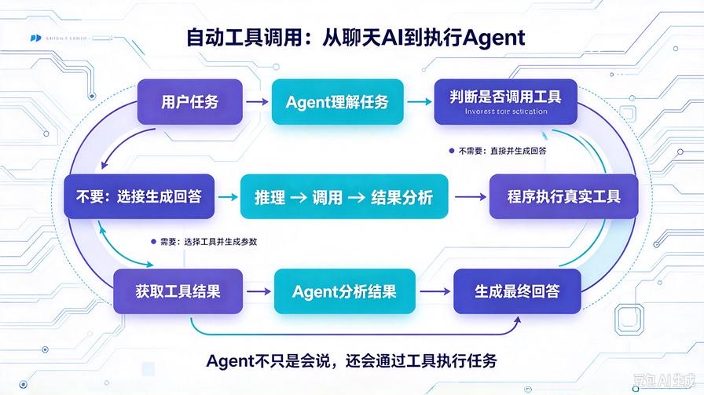
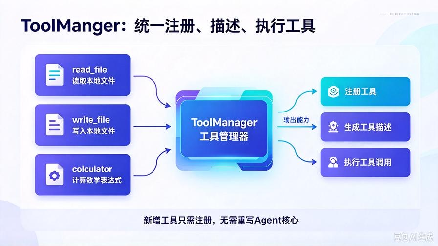
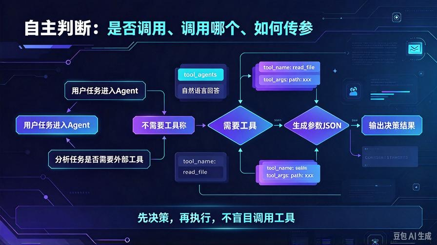
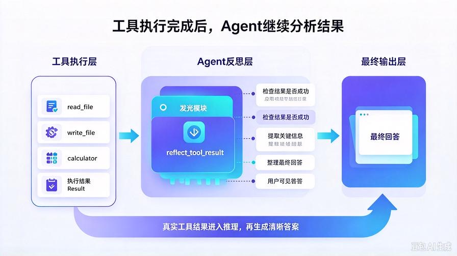

# 第17篇：自动工具调用实战！让Agent自主判断、自选工具、独立完成任务

欢迎回到 **AI Agent 零基础实战连载系列**。

在前16篇里，我们已经把AI Agent从一个被动问答脚本，升级成了**具备长期记忆、自动压缩、定时复盘能力的主动智能体**：

- ✅ 三层思考闭环：规划 → 执行 → 反思
- ✅ 持久化记忆：重启不丢、刷新不丢
- ✅ 智能记忆压缩：解决Token爆炸
- ✅ 定时任务：7×24小时自动复盘、自动总结

但目前的Agent，**还不能算真正自主**。

因为它有一个明显短板：

**遇到外部任务时，仍然需要你告诉它用什么工具。**

比如：

- 你说“查一下今天天气”，它只会生成一段自然语言回答；
- 你说“读取这个文件”，它可能假装读取，而不是真正调用文件工具；
- 你说“搜索最新信息”，它可能凭经验编造，而不是真实联网检索。

真正的AI Agent，必须具备一个核心能力：

**自主决策能力。**

它要能自己判断：

这个任务要不要调用工具？  
该调用哪个工具？  
调用失败后要不要重试？  
拿到结果后要不要继续推理？

本篇就带你从零实现 **Agent自动工具调用系统**，让AI从“会聊天”进化成“会自己干活”。

读完本篇你直接掌握：

- 工具调用的底层原理
- 如何给Agent注册可用工具
- 如何让AI自主选择工具并传参
- 如何处理工具返回结果
- 如何构建“推理 → 调用 → 反思”的完整闭环
- 一个可直接运行的自动工具调用Agent

## 一、为什么必须做自动工具调用？

先区分三个概念：

### 1. 普通聊天AI

只会生成自然语言。  
优点：稳定。  
缺点：无法访问外部世界，无法真正执行任务。

### 2. 指令式工具AI

你明确说：“用搜索工具查AI新闻。”  
优点：能完成具体任务。  
缺点：仍然依赖人类指令，不够自主。

### 3. 自动工具调用Agent

你只说任务，Agent自己决定：  
要不要调用工具？  
调用哪个工具？  
传什么参数？

这才更接近真正的智能体。

## 二、自动工具调用的底层原理



核心原理非常简单，一共四步：

### 第一步：系统提示词告诉Agent有哪些工具

你要把工具描述清楚：

- 工具名称
- 工具功能
- 输入参数
- 返回结果

### 第二步：用户提出任务后，Agent先推理

Agent判断：

这个任务是否需要外部工具？  
如果需要，应该调用哪个工具？  
参数怎么填？

### 第三步：程序执行真实工具调用

如果Agent决定调用工具，程序就真正执行：

- 读文件
- 写文件
- 搜索
- 计算
- 调用API

### 第四步：把工具结果还给Agent继续分析

工具执行完以后，把结果重新交给大模型，让它继续推理、总结或二次决策。

所以，自动工具调用不是“生成一句话”，而是一个闭环：

**推理 → 选工具 → 执行 → 结果分析 → 最终回答**

## 三、技术方案设计

我们将实现一个轻量级自动工具调用框架，结构如下：

1. **工具注册表**：统一管理所有可用工具
2. **工具描述生成器**：把工具描述成大模型能理解的格式
3. **Agent决策模块**：判断是否调用工具、调用哪个工具
4. **工具执行模块**：真实执行函数
5. **结果反思模块**：根据工具结果继续生成最终答案

这种设计的好处是：

- 新增工具不需要重写Agent核心
- 工具调用与业务逻辑解耦
- 后续可以很容易扩展到搜索、数据库、API、文件系统等

## 四、升级后项目结构

```plain text
agent_api_service/
├── index.html
├── main.py
├── agent_core.py
├── memory_utils.py
├── scheduler_task.py
├── config.py
├── .env
├── chat_memory/
│   └── history.json
├── auto_task_log/
│   └── task_record.txt
└── tools/
    └── tool_manager.py       # 【全新新增】工具管理器
```

## 五、创建工具管理器：tools/tool_manager.py



新建文件夹 `tools`，并新增 `tool_manager.py`。

这个模块负责：

- 注册工具
- 生成工具描述
- 执行工具调用

```python
import json
from typing import Callable, Dict, Any

class ToolManager:
    def __init__(self):
        self.tools: Dict[str, Dict[str, Any]] = {}

    def register_tool(
        self,
        name: str,
        description: str,
        parameters: Dict[str, Any],
        func: Callable
    ):
        """注册一个可用工具"""
        self.tools[name] = {
            "description": description,
            "parameters": parameters,
            "func": func
        }

    def get_tools_description(self) -> str:
        """生成给大模型看的工具描述"""
        desc = "你可以使用以下工具：\n\n"
        for name, tool in self.tools.items():
            desc += f"工具名称：{name}\n"
            desc += f"工具功能：{tool['description']}\n"
            desc += f"输入参数：{json.dumps(tool['parameters'], ensure_ascii=False)}\n"
            desc += "-" * 30 + "\n"
        return desc

    def execute_tool(self, tool_name: str, tool_args: Dict[str, Any]) -> str:
        """真实执行工具调用"""
        if tool_name not in self.tools:
            return f"错误：未找到工具 {tool_name}"

        try:
            result = self.tools[tool_name]["func"](**tool_args)
            return str(result)
        except Exception as e:
            return f"工具执行失败：{str(e)}"
```

这个文件是整个自动工具调用系统的核心。

以后你想新增工具，只需要：

1. 定义一个Python函数
2. 注册到 `ToolManager`
3. 告诉Agent工具功能和参数

## 六、新增三个基础工具

我们先实现三个最常用的工具：

- `read_file`：读取本地文件
- `write_file`：写入本地文件
- `calculator`：执行数学计算

在 `tools/tool_manager.py` 末尾追加：

```python
def read_file(path: str) -> str:
    """读取本地文件内容"""
    try:
        with open(path, "r", encoding="utf-8") as f:
            return f.read()
    except Exception as e:
        return f"读取文件失败：{str(e)}"

def write_file(path: str, content: str) -> str:
    """写入内容到本地文件"""
    try:
        with open(path, "w", encoding="utf-8") as f:
            f.write(content)
        return f"文件写入成功"
    except Exception as e:
        return f"写入文件失败：{str(e)}"

def calculator(expression: str) -> str:
    """计算数学表达式，支持加减乘除和括号"""
    try:
        result = eval(expression, {"__builtins__": {}})
        return str(result)
    except Exception as e:
        return f"计算失败：{str(e)}"

def create_default_tools():
    """创建默认工具集"""
    tool_manager = ToolManager()

    tool_manager.register_tool(
        name="read_file",
        description="读取本地文件内容，适合获取文档、代码、日志等信息",
        parameters={
            "path": "文件路径，字符串类型"
        },
        func=read_file
    )

    tool_manager.register_tool(
        name="write_file",
        description="将内容写入本地文件，适合保存结果、生成报告、记录数据",
        parameters={
            "path": "文件路径，字符串类型",
            "content": "要写入的内容，字符串类型"
        },
        func=write_file
    )

    tool_manager.register_tool(
        name="calculator",
        description="计算数学表达式，支持加减乘除和括号",
        parameters={
            "expression": "数学表达式，字符串类型，例如 '12+34'、'(100-20)*5'"
        },
        func=calculator
    )

    return tool_manager
```

这里要注意：

`calculator` 使用 `eval` 只适合本地可信场景，生产环境建议换成更安全的表达式解析器。

## 七、升级 Agent 核心：自主判断是否调用工具



修改 `agent_core.py`，让Agent具备工具调用决策能力。

完整代码如下：

```python
from openai import OpenAI
from config import MODEL_API_KEY, MODEL_BASE_URL, MODEL_NAME
from memory_utils import compress_history
from tools.tool_manager import create_default_tools
import json

client = OpenAI(
    api_key=MODEL_API_KEY,
    base_url=MODEL_BASE_URL
)

tool_manager = create_default_tools()

class ToolAgent:
    def __init__(self):
        self.history = []

    def load_history(self, history_list):
        self.history = compress_history(history_list)

    def build_system_prompt(self):
        return """你是一个具备自动工具调用能力的AI Agent。
请根据用户任务自主判断：
1. 是否需要调用工具；
2. 需要调用哪个工具；
3. 需要传入什么参数。

如果你认为不需要调用工具，请直接给出自然语言回答。
如果你认为需要调用工具，请严格返回以下JSON格式：
{
  "tool_call": true,
  "tool_name": "工具名称",
  "tool_args": {
    "参数名": "参数值"
  }
}

不要在JSON外添加多余解释。
"""

    def decide_tool(self, user_input):
        """让Agent自主决定是否调用工具"""
        tools_desc = tool_manager.get_tools_description()
        system_prompt = self.build_system_prompt()

        context = ""
        if self.history:
            context = f"历史对话：{self.history}\n"

        prompt = f"{system_prompt}\n\n{tools_desc}\n\n{context}用户任务：{user_input}"

        res = client.chat.completions.create(
            model=MODEL_NAME,
            messages=[{"role": "user", "content": prompt}]
        )

        content = res.choices[0].message.content.strip()

        try:
            decision = json.loads(content)
            if decision.get("tool_call"):
                return decision
        except json.JSONDecodeError:
            pass

        return {"tool_call": False, "answer": content}

    def execute_tool_call(self, decision):
        """执行真实工具调用"""
        tool_name = decision["tool_name"]
        tool_args = decision["tool_args"]
        return tool_manager.execute_tool(tool_name, tool_args)

    def reflect_tool_result(self, user_input, tool_result):
        """根据工具结果继续分析，生成最终答案"""
        prompt = f"""用户任务：{user_input}

工具执行结果：
{tool_result}

请根据工具结果，给用户一个清晰、完整的最终回答。
"""
        res = client.chat.completions.create(
            model=MODEL_NAME,
            messages=[{"role": "user", "content": prompt}]
        )
        return res.choices[0].message.content

    def run(self, user_input, history_list):
        self.load_history(history_list)
        decision = self.decide_tool(user_input)

        if decision.get("tool_call"):
            tool_result = self.execute_tool_call(decision)
            final_answer = self.reflect_tool_result(user_input, tool_result)
            return {
                "tool_call": True,
                "tool_name": decision["tool_name"],
                "tool_args": decision["tool_args"],
                "tool_result": tool_result,
                "final_answer": final_answer
            }
        else:
            return {
                "tool_call": False,
                "final_answer": decision["answer"]
            }

agent = ToolAgent()
```

这里的关键不是“让AI调用工具”，而是：

**先让AI做决策，再让程序执行，最后让AI反思结果。**

这才是自动工具调用Agent的完整闭环。

## 八、升级 main.py：支持工具调用接口

新增一个专门的工具调用接口 `/api/agent/tool-use`。

```python
from fastapi import FastAPI, HTTPException
from fastapi.middleware.cors import CORSMiddleware
from pydantic import BaseModel
from starlette.responses import StreamingResponse
from agent_core import agent
from memory_utils import compress_history
from scheduler_task import start_scheduler
import json
import os

app = FastAPI(title="自动工具调用Agent服务", version="5.0 自主执行版")

start_scheduler()

app.add_middleware(
    CORSMiddleware,
    allow_origins=["*"],
    allow_credentials=True,
    allow_methods=["*"],
    allow_headers=["*"],
)

MEMORY_DIR = "chat_memory"
MEMORY_FILE = os.path.join(MEMORY_DIR, "history.json")
os.makedirs(MEMORY_DIR, exist_ok=True)

if not os.path.exists(MEMORY_FILE):
    with open(MEMORY_FILE, "w", encoding="utf-8") as f:
        json.dump([], f, ensure_ascii=False, indent=2)

class ChatRequest(BaseModel):
    task: str
    history: list

class ToolUseRequest(BaseModel):
    task: str
    history: list

@app.post("/api/agent/stream")
async def stream_chat(req: ChatRequest):
    try:
        compressed_hist = compress_history(req.history)
        result = agent.run(req.task, compressed_hist)
        final_text = result["final_answer"]

        req.history.append({"role": "user", "content": req.task})
        req.history.append({"role": "assistant", "content": final_text})

        with open(MEMORY_FILE, "w", encoding="utf-8") as f:
            json.dump(req.history, f, ensure_ascii=False, indent=2)

        def stream():
            for char in final_text:
                yield json.dumps({"char": char}, ensure_ascii=False) + "\n"
        return StreamingResponse(stream(), media_type="text/event-stream")

    except Exception as e:
        raise HTTPException(status_code=500, detail=str(e))

@app.post("/api/agent/tool-use")
async def tool_use_chat(req: ToolUseRequest):
    try:
        compressed_hist = compress_history(req.history)
        result = agent.run(req.task, compressed_hist)

        req.history.append({"role": "user", "content": req.task})
        req.history.append({"role": "assistant", "content": result["final_answer"]})

        with open(MEMORY_FILE, "w", encoding="utf-8") as f:
            json.dump(req.history, f, ensure_ascii=False, indent=2)

        return result

    except Exception as e:
        raise HTTPException(status_code=500, detail=str(e))

@app.get("/api/agent/history")
async def get_history():
    with open(MEMORY_FILE, "r", encoding="utf-8") as f:
        data = json.load(f)
    return {"code": 200, "history": data}

@app.post("/api/agent/clear")
async def clear_history():
    with open(MEMORY_FILE, "w", encoding="utf-8") as f:
        json.dump([], f)
    return {"code": 200, "msg": "记忆已清空"}

@app.get("/health")
async def health():
    return {"code": 200, "msg": "自动工具调用Agent服务正常运行"}

if __name__ == "__main__":
    import uvicorn
    uvicorn.run(app, host="0.0.0.0", port=8000)
```

这里新增了 `/api/agent/tool-use` 接口，专门用于返回工具调用详情。

如果你想在前端展示“AI调用了什么工具、传了什么参数、得到了什么结果”，就调用这个接口。

## 九、测试任务示例

启动服务：

```bash
python main.py
```

然后测试以下任务：

### 测试1：文件读取任务

你输入：  
`读取 auto_task_log/task_record.txt 的内容，并总结最近一次任务执行结果`

Agent会自主判断：

- 需要调用 `read_file`
- 传入参数 `path="auto_task_log/task_record.txt"`
- 读取文件后总结内容

### 测试2：文件写入任务

你输入：  
`把这段内容写入 output.txt：今天完成了自动工具调用Agent的核心开发`

Agent会自主判断：

- 需要调用 `write_file`
- 传入 `path` 和 `content`
- 写入成功后给你确认结果

### 测试3：计算任务

你输入：  
`计算 (128+64)*3 的结果，并把结果保存到 result.txt`

Agent可能会：

1. 先调用 `calculator` 计算结果
2. 再调用 `write_file` 保存结果
3. 最后给你最终确认

注意：

这个版本是基础自动工具调用框架，复杂多步任务需要更强的规划与重试机制。

## 十、自动工具调用的完整闭环



一个完整的自动工具调用过程，应该是这样的：

用户任务  
↓  
Agent理解任务  
↓  
判断是否需要工具  
↓  
不需要：直接生成回答  
↓  
需要：选择工具 + 生成参数  
↓  
程序执行真实工具  
↓  
获取工具结果  
↓  
Agent分析结果  
↓  
生成最终回答

这就是Agent区别于普通聊天AI的关键：

**它不只是“会说”，而是“会通过工具改变外部世界”。**

## 十一、生产环境建议

### 1. 工具参数校验

线上工具必须做参数校验，防止路径穿越、非法表达式等问题。

### 2. 工具权限控制

不是所有工具都能开放给用户。比如：

- 文件工具要限制目录
- 计算工具要限制表达式复杂度
- API工具要限制调用范围

### 3. 增加重试机制

工具调用可能失败，Agent应该具备：

- 重试
- 参数修正
- 换工具
- 失败后降级回答

### 4. 结构化输出约束

为了减少JSON解析失败，可以使用更严格的输出格式，例如：

- 只允许在指定标签中输出JSON
- 使用函数调用模式
- 增加格式纠错步骤

## 十二、本篇核心总结

1. **普通AI只会生成语言，Agent会调用工具执行任务**
2. 自动工具调用的本质是一个闭环：推理 → 调用 → 结果分析
3. `ToolManager` 让工具管理更清晰，新增工具更方便
4. Agent必须自主判断：是否调用、调用哪个、怎么传参
5. 工具执行完成后，必须把结果还给Agent继续反思
6. 这是Agent从“聊天助手”走向“执行助手”的关键一步

## 下期预告：第18篇｜多工具协同与任务规划

让Agent不再只会单次调用，而是能像程序员一样：  
**拆分任务 → 连续调用工具 → 检查结果 → 完成交付。**

真正的任务执行型Agent，即将更上一层楼。

> 来源：头条号《AI Agent 零基础实战》第17篇｜版权归作者所有，仅供学习交流
