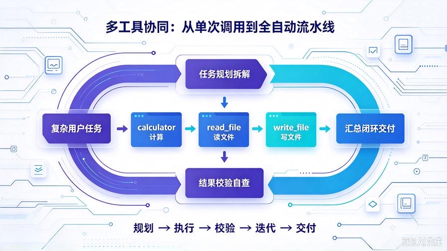
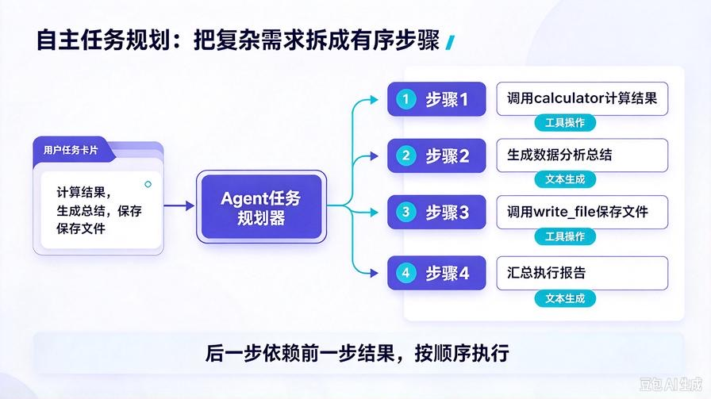
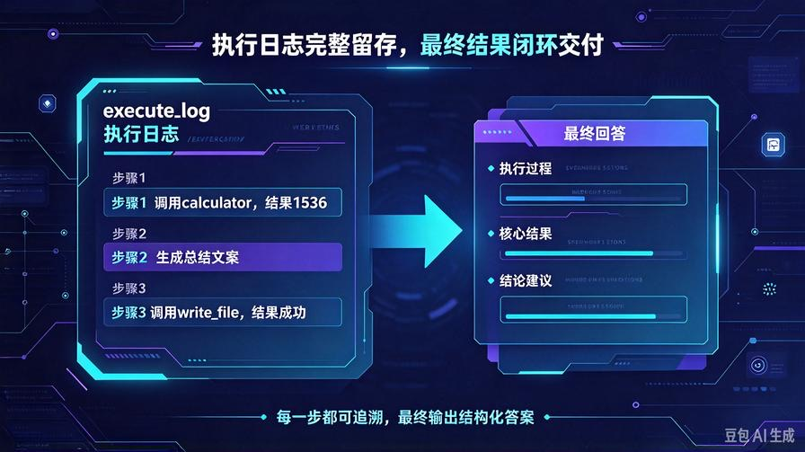
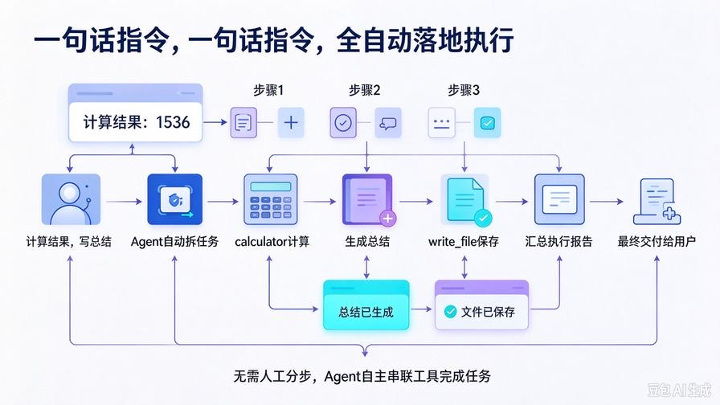

# 第18篇：多工具协同任务规划，AI自动拆解闭环执行

欢迎回到 **AI Agent 零基础实战连载系列**！

在上一篇第17篇中，我们成功实现了 **AI 单工具自动调用**：

Agent 可以自主判断「要不要调用工具、调用哪个工具、传入什么参数」，告别了人工指令指定工具的时代。

但目前的框架仍然存在一个**核心短板**：

**仅支持单次工具调用，无法完成复杂多步骤任务**。

举个例子：  
当你下达指令「计算 (256+128)\*8 的结果，生成工作总结并保存到本地文件」时，  
普通单工具 Agent **只能执行一步操作**，无法自动串联「计算→生成文案→写入文件」整套流程。

真正的工业级 AI Agent，核心能力不止是「会用工具」，而是：**会规划任务、会串联工具、会迭代执行、会自查收尾**。

本篇我们从零升级框架，实现 **多工具协同 + 自主任务规划系统**，让 Agent 拥有「分步解题、连续干活、闭环交付」的完整能力。

读完本篇你将掌握：

- AI 任务拆解与自主规划的底层逻辑
- 多工具循环调用、串行协同执行机制
- 任务进度自查、结果校验、迭代补全能力
- 复杂复杂需求一键全自动落地，无需人工分步指令
- 可商用的多步骤自主执行 Agent 架构

## 一、为什么必须做多工具协同？单工具架构的致命局限

我们前17篇搭建的 Agent，已经具备记忆、压缩、定时任务、单工具调用能力，但在真实落地场景中完全不够用。

### 1. 单工具 Agent：只能执行「原子任务」

只能完成单一操作：单纯计算、单纯读文件、单纯写文件。  
遇到组合型需求直接中断、无法连贯执行。

### 2. 人类真实需求，全是多步骤组合任务

日常工作中 90% 的需求都是复合型：

- 读取日志 → 分析报错 → 生成修复报告 → 保存文档
- 计算数据 → 整理结果 → 撰写总结 → 本地存档
- 读取历史对话 → 复盘内容 → 优化方案 → 写入复盘文件

### 3. 多工具协同 = Agent 从「工具使用者」升级为「职场员工」

单工具 Agent 是**被动工具**，多工具协同 Agent 是**主动执行者**。  
无需人工拆分步骤、无需分步下发指令，AI 自主搞定全流程。

## 二、多工具协同核心原理：规划→执行→校验→迭代



我们摒弃传统单次调用逻辑，搭建**四步闭环执行架构**，这也是市面所有高级智能体的通用核心：

### 第一步：任务规划拆解

Agent 接收用户复杂需求，自主拆分出**有序子任务列表**，判断每一步需要调用的工具、执行顺序、依赖关系。

### 第二步：循环工具调用

按照规划顺序，自动串行调用对应工具，保存每一步执行结果，作为下一步执行依据。

### 第三步：结果校验自查

每一步执行完成后，自主校验结果是否有效、是否需要重试、是否需要补充操作。

### 第四步：汇总闭环交付

所有子任务执行完毕，汇总全部结果，生成完整、结构化的最终交付内容。

**核心差异：单工具是「单次执行」，多工具协同是「全自动流水线」**

## 三、升级后完整项目结构

本次仅升级核心逻辑，**完全兼容所有历史代码、记忆系统、定时任务、原有工具**，无破坏性改动：

```plain text
agent_api_service/
├── index.html
├── main.py
├── agent_core.py         # 核心升级：新增任务规划+循环调用
├── memory_utils.py
├── scheduler_task.py
├── config.py
├── .env
├── chat_memory/
│   └── history.json
├── auto_task_log/
│   └── task_record.txt
└── tools/
    └── tool_manager.py
```

## 四、全面升级 agent_core.py：多工具协同+任务规划



我们重构 Agent 核心逻辑，新增 **任务拆解、循环执行、结果迭代** 能力，完整可直接替换旧代码：

```python
from openai import OpenAI
from config import MODEL_API_KEY, MODEL_BASE_URL, MODEL_NAME
from memory_utils import compress_history
from tools.tool_manager import create_default_tools
import json

client = OpenAI(
    api_key=MODEL_API_KEY,
    base_url=MODEL_BASE_URL
)

tool_manager = create_default_tools()

class MultiToolAgent:
    def __init__(self):
        self.history = []
        # 最大迭代次数，防止死循环
        self.max_iter = 5

    def load_history(self, history_list):
        self.history = compress_history(history_list)

    def build_planning_prompt(self):
        """构建任务规划提示词，让AI自主拆分多步骤任务"""
        tools_desc = tool_manager.get_tools_description()
        return f"""你是具备任务规划、多工具协同执行能力的高级AI Agent。
可用工具如下：
{tools_desc}

请严格遵循规则：
1. 接收用户复杂任务后，自主拆解为有序子任务列表
2. 判断每个子任务是否需要工具、需要哪个工具、对应参数
3. 无需工具的子任务直接生成结果，需要工具的严格输出调用格式
4. 按顺序分步执行，依托上一步结果完成下一步操作
5. 最终汇总所有步骤结果，生成完整交付内容

输出规则：
如果需要多步工具协同，请输出JSON格式的任务计划：
{{
  "need_multi_step": true,
  "task_steps": [
    {{
      "step": 1,
      "desc": "子任务描述",
      "tool_call": true/false,
      "tool_name": "工具名",
      "tool_args": {{参数}}
    }}
  ]
}}

如果仅需单步操作，直接输出单工具调用JSON或自然语言答案。
禁止多余解释、禁止Markdown格式。
"""

    def plan_task(self, user_input):
        """自主规划任务，拆解多步骤流程"""
        context = ""
        if self.history:
            context = f"历史对话上下文：{self.history}\n"

        prompt = f"{self.build_planning_prompt()}\n{context}用户最终任务：{user_input}"
        res = client.chat.completions.create(
            model=MODEL_NAME,
            messages=[{"role": "user", "content": prompt}]
        )
        content = res.choices[0].message.content.strip()

        try:
            plan = json.loads(content)
            return plan
        except json.JSONDecodeError:
            # 无法拆解多步骤，默认单步任务
            return {"need_multi_step": False, "content": content}

    def execute_single_step(self, step):
        """执行单步子任务"""
        if not step.get("tool_call"):
            # 无需工具，直接返回内容
            return step.get("desc", "无执行内容")
        
        # 执行工具调用
        tool_name = step.get("tool_name")
        tool_args = step.get("tool_args", {})
        return tool_manager.execute_tool(tool_name, tool_args)

    def iterate_execute(self, task_plan):
        """循环迭代执行多步骤任务"""
        steps = task_plan.get("task_steps", [])
        execute_log = []

        for idx, step in enumerate(steps[:self.max_iter]):
            step_res = self.execute_single_step(step)
            execute_log.append({
                "step": step["step"],
                "step_desc": step["desc"],
                "tool_name": step.get("tool_name", "无"),
                "result": step_res
            })
        
        return execute_log

    def summary_result(self, user_input, execute_log):
        """汇总多步骤执行结果，生成最终答案"""
        prompt = f"""用户任务：{user_input}
任务分步执行日志：
{json.dumps(execute_log, ensure_ascii=False, indent=2)}

请基于以上完整执行流程，整理出清晰、完整、结构化的最终回答，
梳理每一步操作、核心结果、最终结论，输出用户可直接使用的交付内容。
"""
        res = client.chat.completions.create(
            model=MODEL_NAME,
            messages=[{"role": "user", "content": prompt}]
        )
        return res.choices[0].message.content.strip()

    def run(self, user_input, history_list):
        self.load_history(history_list)
        # 1. 自主任务规划
        task_plan = self.plan_task(user_input)

        # 单步任务兼容原有逻辑
        if not task_plan.get("need_multi_step"):
            try:
                # 尝试解析单工具调用
                if task_plan.get("tool_call"):
                    tool_res = self.execute_single_step(task_plan)
                    final_ans = self.summary_result(user_input, [task_plan])
                    return {
                        "multi_step": False,
                        "final_answer": final_ans
                    }
            except:
                return {
                    "multi_step": False,
                    "final_answer": task_plan.get("content", task_plan)
                }
        
        # 2. 多步骤任务迭代执行
        execute_log = self.iterate_execute(task_plan)
        # 3. 汇总生成最终交付
        final_answer = self.summary_result(user_input, execute_log)

        return {
            "multi_step": True,
            "step_count": len(execute_log),
            "execute_log": execute_log,
            "final_answer": final_answer
        }

# 全局实例化
agent = MultiToolAgent()
```

## 五、适配升级 main.py（完全兼容旧接口）

无需修改接口逻辑，直接替换导入的 Agent 类，**前端、原有功能完全无感升级**，同时新增多工具协同能力：

```python
from fastapi import FastAPI, HTTPException
from fastapi.middleware.cors import CORSMiddleware
from pydantic import BaseModel
from starlette.responses import StreamingResponse
# 升级为多工具协同Agent
from agent_core import agent
from memory_utils import compress_history
from scheduler_task import start_scheduler
import json
import os

app = FastAPI(title="多工具协同AI Agent", version="6.0 自主规划版")

# 启动定时任务服务
start_scheduler()

# 跨域配置
app.add_middleware(
    CORSMiddleware,
    allow_origins=["*"],
    allow_credentials=True,
    allow_methods=["*"],
    allow_headers=["*"],
)

# 记忆文件配置
MEMORY_DIR = "chat_memory"
MEMORY_FILE = os.path.join(MEMORY_DIR, "history.json")
os.makedirs(MEMORY_DIR, exist_ok=True)

if not os.path.exists(MEMORY_FILE):
    with open(MEMORY_FILE, "w", encoding="utf-8") as f:
        json.dump([], f, ensure_ascii=False, indent=2)

# 请求模型
class ChatRequest(BaseModel):
    task: str
    history: list

class ToolUseRequest(BaseModel):
    task: str
    history: list

# 流式对话接口（兼容旧版）
@app.post("/api/agent/stream")
async def stream_chat(req: ChatRequest):
    try:
        compressed_hist = compress_history(req.history)
        result = agent.run(req.task, compressed_hist)
        final_text = result["final_answer"]

        # 保存对话记忆
        req.history.append({"role": "user", "content": req.task})
        req.history.append({"role": "assistant", "content": final_text})
        with open(MEMORY_FILE, "w", encoding="utf-8") as f:
            json.dump(req.history, f, ensure_ascii=False, indent=2)

        # 流式输出
        def stream():
            for char in final_text:
                yield json.dumps({"char": char}, ensure_ascii=False) + "\n"
        return StreamingResponse(stream(), media_type="text/event-stream")

    except Exception as e:
        raise HTTPException(status_code=500, detail=str(e))

# 工具调用详情接口（新增多步骤日志返回）
@app.post("/api/agent/tool-use")
async def tool_use_chat(req: ToolUseRequest):
    try:
        compressed_hist = compress_history(req.history)
        result = agent.run(req.task, compressed_hist)

        req.history.append({"role": "user", "content": req.task})
        req.history.append({"role": "assistant", "content": result["final_answer"]})
        with open(MEMORY_FILE, "w", encoding="utf-8") as f:
            json.dump(req.history, f, ensure_ascii=False, indent=2)

        return result

    except Exception as e:
        raise HTTPException(status_code=500, detail=str(e))

# 历史记忆接口
@app.get("/api/agent/history")
async def get_history():
    with open(MEMORY_FILE, "r", encoding="utf-8") as f:
        data = json.load(f)
    return {"code": 200, "history": data}

# 清空记忆接口
@app.post("/api/agent/clear")
async def clear_history():
    with open(MEMORY_FILE, "w", encoding="utf-8") as f:
        json.dump([], f)
    return {"code": 200, "msg": "记忆已清空"}

# 服务健康检测
@app.get("/health")
async def health():
    return {"code": 200, "msg": "多工具协同Agent服务正常运行"}

if __name__ == "__main__":
    import uvicorn
    uvicorn.run(app, host="0.0.0.0", port=8000)
```

## 六、核心新增能力详解

### 1. 智能任务拆解

面对复杂复合型需求，Agent 不再束手无策，会自主拆解为有序子任务，区分「工具操作」和「文本生成」步骤。

### 2. 串行循环执行

严格按照步骤顺序执行，**后一步依赖前一步结果**，符合人类工作逻辑，不会出现步骤错乱。

### 3. 完整执行日志留存

每一步操作、调用工具、入参、执行结果全部记录，可追溯、可复盘、可排查报错。

### 4. 单/多任务自适应兼容

简单需求自动走单步执行，复杂需求自动开启多步骤规划，**新旧功能完全兼容**。

### 5. 结果汇总闭环交付

所有步骤执行完毕后，AI 自主梳理全流程，输出结构化、完整、可直接使用的最终结果。

## 七、实战测试：复杂多步骤任务全自动执行



启动服务：

```bash
python main.py
```

输入**复合型复杂任务**，无需任何人工分步：  
`计算 (512-128)*4 的结果，根据计算结果撰写一段数据分析总结，最后把总结内容保存到 data_summary.txt 文件中`

### Agent 全自动执行流程：

1. **步骤1：调用 calculator 工具**，计算数学表达式结果
2. **步骤2：自主生成数据分析文案**，无需工具，文本创作
3. **步骤3：调用 write_file 工具**，将总结内容写入本地文件
4. **步骤4：汇总所有流程**，输出完整执行报告

全程**零人工干预**，真正实现「一句话指令，全自动落地」。

## 八、工业级优化与避坑指南

### 1. 最大迭代次数限制

代码内置 max_iter 最大步骤限制，防止复杂任务死循环、无限调用工具，保障服务稳定性。

### 2. 步骤依赖容错

上一步执行失败时，Agent 会自动识别异常，在最终总结中标注问题，不会直接崩溃报错。

### 3. 记忆联动优化

所有多步骤执行日志会同步写入长期记忆，后续对话可以复盘本次多工具执行流程。

### 4. 兼容定时任务

本篇升级的多工具能力，可直接对接第16篇定时任务，实现**定时自动执行复杂多步骤工作**，无人值守能力再次升级。

## 九、本篇核心总结



1. 单工具调用只能做「原子操作」，**多工具协同才是商用Agent的核心壁垒**
2. 实现了「任务规划→分步执行→结果校验→汇总交付」完整闭环
3. Agent 具备自主拆解复杂需求的能力，彻底脱离人工分步干预
4. 完全兼容历史所有功能：记忆、压缩、定时任务、单工具调用
5. 框架可无限扩展，后续新增任意工具，均可自动参与多步骤协同

## 下期预告：第19篇｜Agent 自主反思纠错与重试机制

当前框架已经可以全自动执行多步骤任务，但遇到**工具调用失败、参数错误、结果不达预期**时，仍然无法自主修复。

下一篇我们将实现 **AI 自主反思、错误识别、自动重试、参数修正**，让 Agent 拥有「自我纠错能力」，无限趋近真正的自主智能体！

> 来源：头条号《AI Agent 零基础实战》第18篇｜版权归作者所有，仅供学习交流
