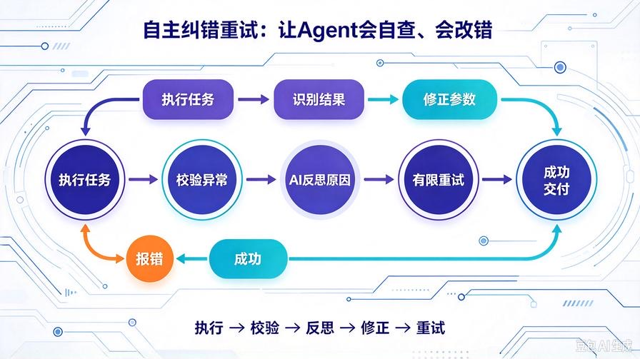
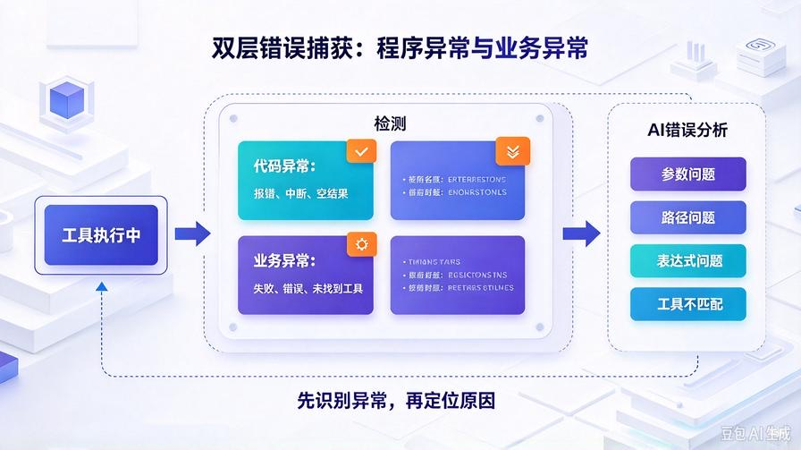
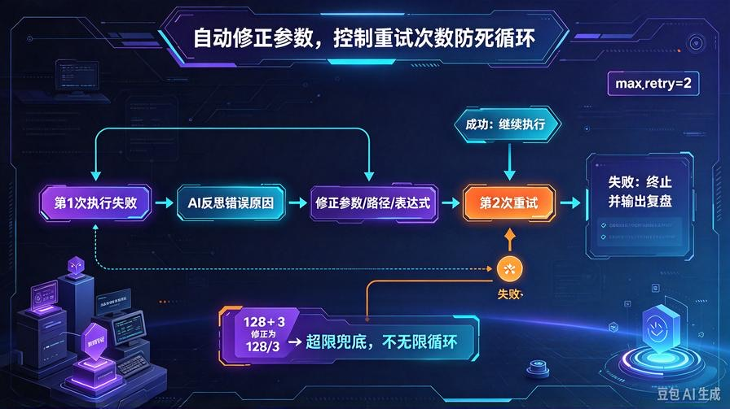
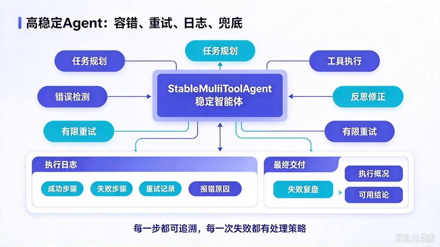

# 第19篇：Agent自主纠错重试，打造高稳定全自动执行体

欢迎回到 **AI Agent 零基础实战连载系列**！

上一篇第18篇，我们完成了 **多工具协同 + 自主任务规划** 的核心能力：

AI 可以把复杂需求自动拆分成多步任务、串行调用工具、自动汇总结果交付。

到这里，我们的 Agent 已经**看起来完全自主**，但是在线上落地有一个致命缺陷：

**只会死板执行，不会改错、不会重试、不会修正参数。**

只要出现一点点异常，整套自动化流程直接断裂：

- 路径写错 → 文件读取失败，直接摆烂
- 表达式不规范 → 计算报错，流程终止
- 参数缺失 → 工具调用失败，无法继续执行
- 大模型输出格式错乱 → 直接抛出异常

**不会纠错的自动化，是最不稳定的自动化。**

真正工程级可商用 Agent，必须具备「自我反思、错误识别、自动修正、重试兜底」能力。

本篇从零搭建 **Agent 自主反思纠错系统**，让你的智能体从「只会干活」升级为「会自查、会改错、会稳定干活」。

读完本篇彻底掌握：

- 工具调用失败的全场景错误定位逻辑
- AI 自主反思、识别问题、分析原因
- 自动修正参数、修正指令、二次重试
- 多级兜底策略，杜绝流程崩溃
- 高稳定、可线上部署的全自动 Agent 架构

## 一、为什么一定要做「自主纠错重试」？

目前绝大多数新手 Agent 项目，都死在同一个问题：**鲁棒性极差**。

正常场景跑的通，稍微异常直接报废，完全无法落地生产。

### 1. 传统执行模式：单次执行、成败定论

调用工具成功就交付，失败直接报错终止。没有补救、没有复盘、没有重试。

### 2. 人类真实工作逻辑：尝试 → 报错 → 修改 → 重试

程序员写代码报错会改参数、文件打不开会检查路径、计算报错会修正表达式。  
**AI 员工也必须拥有同等容错能力。**

### 3. 纠错重试 = Agent 从「demo玩具」变成「商用项目」

容错、纠错、重试、兜底，是工业级自动化系统的**核心分水岭**。

## 二、自主纠错核心原理：执行-校验-反思-修正-重试



我们在原有多工具协同闭环基础上，新增 **五层容错闭环架构**：

1. **执行**：正常调用工具、执行子任务
2. **校验**：识别执行结果是否异常、是否报错、是否为空
3. **反思**：AI 自主分析报错原因、定位问题节点
4. **修正**：自动修改参数、路径、表达式、指令逻辑
5. **重试**：二次执行，超限兜底，保障流程闭环

简单说：**错了不怕，AI 自己查、自己改、自己重新做。**

## 三、升级后项目结构

本次升级无破坏性改动，完全兼容历史记忆、定时任务、多工具架构：

```plain text
agent_api_service/
├── index.html
├── main.py
├── agent_core.py         # 核心升级：新增反思+纠错+重试机制
├── memory_utils.py
├── scheduler_task.py
├── config.py
├── .env
├── chat_memory/
├── auto_task_log/
└── tools/
    └── tool_manager.py
```

## 四、重磅升级 agent_core.py：容错纠错重试完整版



我们重构 Agent 核心执行逻辑，新增错误检测、反思分析、参数修正、有限重试机制，**直接替换旧文件即可**：

```python
from openai import OpenAI
from config import MODEL_API_KEY, MODEL_BASE_URL, MODEL_NAME
from memory_utils import compress_history
from tools.tool_manager import create_default_tools
import json

client = OpenAI(
    api_key=MODEL_API_KEY,
    base_url=MODEL_BASE_URL
)

tool_manager = create_default_tools()

class StableMultiToolAgent:
    def __init__(self):
        self.history = []
        self.max_iter = 5        # 最大任务步骤数
        self.max_retry = 2       # 最大纠错重试次数

    def load_history(self, history_list):
        self.history = compress_history(history_list)

    # 任务规划提示词
    def build_planning_prompt(self):
        tools_desc = tool_manager.get_tools_description()
        return f"""你是具备任务规划、多工具协同、错误自查能力的稳定AI Agent。
可用工具如下：
{tools_desc}

规则：
1. 复杂任务自主拆解为有序子任务，按顺序依赖执行
2. 精准判断每一步是否需要工具、工具名称、入参
3. 输出规范JSON任务计划，禁止多余解释
4. 遇到参数缺失、路径不明确时，自动补全合理默认值

多步骤输出格式：
{{
  "need_multi_step": true,
  "task_steps": [{{"step":1,"desc":"","tool_call":true,"tool_name":"","tool_args":{{}}}}]
}}

单步骤直接输出工具调用JSON或自然语言答案。
"""

    # 错误反思修正提示词
    def build_retry_prompt(self, step, error_msg):
        return f"""当前执行子任务失败，请自主反思错误并修正参数重试。
任务步骤：{step}
执行报错信息：{error_msg}

请分析错误原因，修正参数、路径、表达式或逻辑，输出修正后的完整步骤JSON，
严格保持格式不变，只修改错误内容，无需多余解释。
"""

    # 任务整体规划
    def plan_task(self, user_input):
        context = f"历史上下文：{self.history}\n" if self.history else ""
        prompt = f"{self.build_planning_prompt()}\n{context}用户任务：{user_input}"

        res = client.chat.completions.create(
            model=MODEL_NAME,
            messages=[{"role": "user", "content": prompt}]
        )
        content = res.choices[0].message.content.strip()

        try:
            return json.loads(content)
        except:
            return {"need_multi_step": False, "content": content}

    # 单步执行 + 自动重试
    def execute_step_with_retry(self, step):
        current_step = step
        error_log = []

        for i in range(self.max_retry + 1):
            try:
                if not current_step.get("tool_call"):
                    return {"success": True, "result": current_step.get("desc", ""), "error": ""}

                # 执行工具调用
                tool_name = current_step.get("tool_name")
                tool_args = current_step.get("tool_args", {})
                result = tool_manager.execute_tool(tool_name, tool_args)

                # 检测业务级错误
                if "失败" in result or "错误" in result or "未找到工具" in result:
                    raise Exception(result)

                return {"success": True, "result": result, "error": ""}

            except Exception as e:
                err_msg = str(e)
                error_log.append(f"第{i+1}次执行失败：{err_msg}")

                # 重试次数耗尽，直接返回失败
                if i >= self.max_retry:
                    return {"success": False, "result": "", "error": " | ".join(error_log)}

                # AI 自主反思修正参数
                retry_prompt = self.build_retry_prompt(current_step, err_msg)
                retry_res = client.chat.completions.create(
                    model=MODEL_NAME,
                    messages=[{"role": "user", "content": retry_prompt}]
                )
                try:
                    current_step = json.loads(retry_res.choices[0].message.content.strip())
                except:
                    # 修正格式失败，维持原步骤重试
                    pass

        return {"success": False, "result": "", "error": "重试次数耗尽，执行失败"}

    # 批量迭代执行所有步骤
    def iterate_execute(self, task_plan):
        steps = task_plan.get("task_steps", [])
        execute_log = []

        for step in steps[:self.max_iter]:
            res = self.execute_step_with_retry(step)
            execute_log.append({
                "step": step["step"],
                "step_desc": step["desc"],
                "tool_name": step.get("tool_name", "无"),
                "success": res["success"],
                "result": res["result"],
                "error": res["error"]
            })
        return execute_log

    # 汇总最终结果
    def summary_result(self, user_input, execute_log):
        fail_count = sum(1 for item in execute_log if not item["success"])
        prompt = f"""用户任务：{user_input}
全流程执行日志：
{json.dumps(execute_log, ensure_ascii=False, indent=2)}

本次任务失败步骤数：{fail_count}
请根据执行情况输出：
1. 整体执行概况
2. 每一步执行结果说明
3. 失败原因复盘（如有）
4. 最终可用结论与交付内容
"""
        res = client.chat.completions.create(
            model=MODEL_NAME,
            messages=[{"role": "user", "content": prompt}]
        )
        return res.choices[0].message.content.strip()

    # 总入口
    def run(self, user_input, history_list):
        self.load_history(history_list)
        task_plan = self.plan_task(user_input)

        # 单步任务
        if not task_plan.get("need_multi_step"):
            try:
                if task_plan.get("tool_call"):
                    res = self.execute_step_with_retry(task_plan)
                    final_ans = self.summary_result(user_input, [res])
                    return {
                        "multi_step": False,
                        "final_answer": final_ans
                    }
            except:
                return {
                    "multi_step": False,
                    "final_answer": task_plan.get("content", "任务执行异常，请重试")
                }

        # 多步任务
        execute_log = self.iterate_execute(task_plan)
        final_answer = self.summary_result(user_input, execute_log)

        return {
            "multi_step": True,
            "step_count": len(execute_log),
            "fail_count": sum(1 for x in execute_log if not x["success"]),
            "execute_log": execute_log,
            "final_answer": final_answer
        }

agent = StableMultiToolAgent()
```

## 五、核心升级能力详解

### 1. 双层错误捕获机制

同时捕获 **代码异常** 和**业务执行异常**，无论是程序报错、工具报错、参数错误，全部可以识别拦截，不会直接崩服务。

### 2. AI 自主反思修正

执行失败后，Agent 会自主分析报错原因：路径错误、参数缺失、表达式非法、工具不匹配，自动修正内容重新执行。

### 3. 有限重试策略（防死循环）

默认最大重试2次，超限自动终止，输出报错复盘，兼顾**容错性**和**稳定性**，杜绝无限循环调用。

### 4. 全流程错误日志留存

成功、失败、重试过程、报错信息全部记录，支持后续复盘、问题追溯、定时任务异常排查。

### 5. 单/多任务全兼容

单工具、多工具任务全部适配纠错重试，旧功能完全保留，无兼容性问题。

## 六、适配 main.py（无需大幅改动）

仅需替换 Agent 类，**所有接口、前端、记忆、定时任务完全不变**，无感升级：

原有 `from agent_core import agent` 保持不变，其余代码无需修改，直接运行即可拥有纠错能力。

## 七、实战测试：故意制造错误，验证自愈能力



启动服务：

```bash
python main.py
```

输入**存在明显错误的任务指令**：  
`计算 128+/3 的结果，把结果写入 test_001.txt`

### 执行过程：

1. 第一步：执行非法数学表达式，计算工具报错
2. 第二步：Agent 捕获异常、自主反思语法错误
3. 第三步：自动修正表达式、重新重试计算
4. 第四步：执行文件写入，完成全流程闭环
5. 第五步：汇总报错、修正、执行全过程，输出复盘报告

全程无需人工干预，**AI 自主改错、自主完成任务**。

## 八、生产级容错优化策略

### 1. 重试次数动态可调

可根据场景调整 max_retry，简单任务1次重试，复杂运维任务3次重试，灵活适配。

### 2. 错误分级处理

语法错误、参数错误可自动修正；资源不存在、权限问题直接终止并给出明确提示，不无效重试。

### 3. 结合记忆实现长期优化

所有错误复盘记录存入长期记忆，后续同类错误可直接规避，越用越稳定。

### 4. 定时任务容错兜底

定时自动任务执行失败后，不会静默崩溃，会自动重试并留存错误日志，保障无人值守稳定性。

## 九、本篇核心总结



1. 无容错的 Agent 只能做演示，**带纠错重试的 Agent 才能落地商用**
2. 搭建了「执行-校验-反思-修正-重试」五层自愈闭环
3. 支持语法错误、参数错误、路径错误的自主修复
4. 有限重试机制杜绝死循环，保障服务高可用
5. 完全兼容历史所有功能，架构平滑升级

## 下期预告：第20篇｜Agent 知识库挂载！私有文档本地检索问答

前面我们实现了记忆、工具、规划、纠错，下一篇正式接入 **本地私有知识库**，让 Agent 可以读取你的私有文档、笔记、项目资料，实现**私有数据专属问答、内容检索、文档总结**，彻底脱离外网模型幻觉！

> 来源：头条号《AI Agent 零基础实战》第19篇｜版权归作者所有，仅供学习交流
