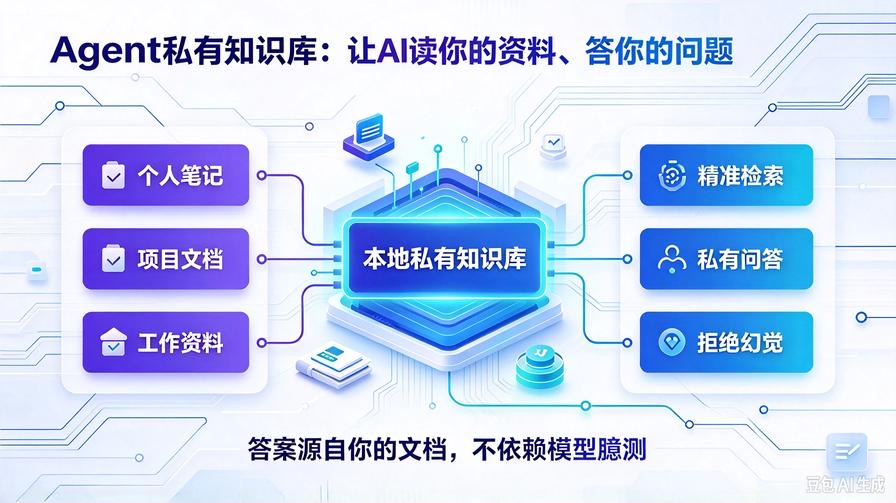
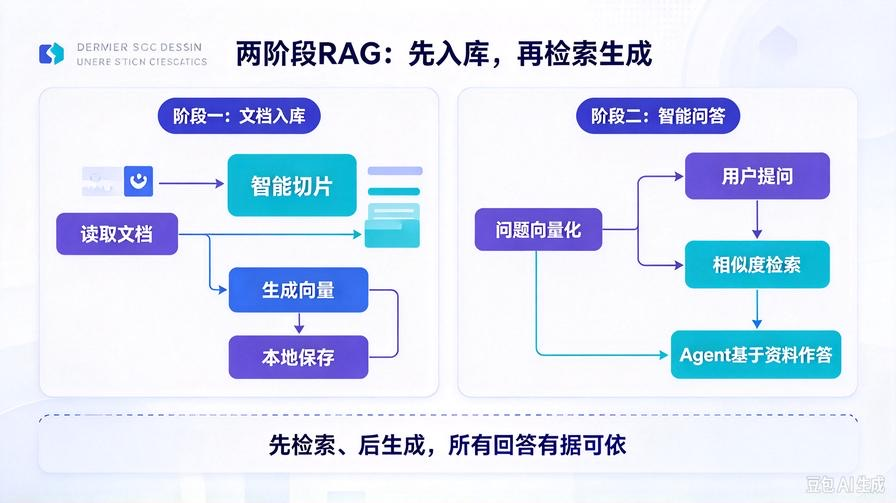
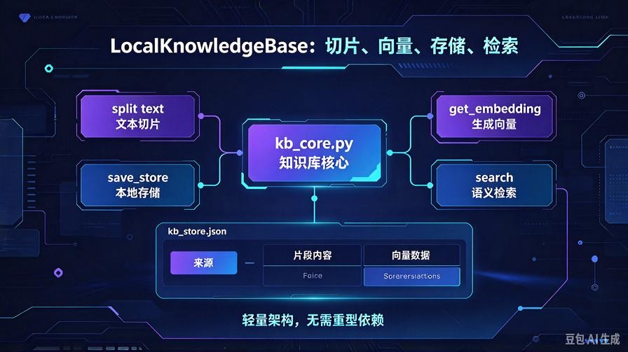
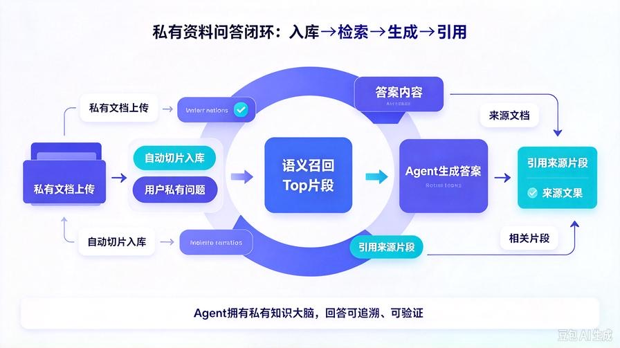

# 第20篇：Agent本地私有知识库，彻底告别AI幻觉

欢迎回到 **AI Agent 零基础实战连载系列**！

通过前19篇的层层迭代，我们的 AI Agent 已经拥有了**类人完整工作能力**：

- 长期记忆 + 智能压缩，记住对话不遗忘
- 自动工具调用，自主干活、执行任务
- 多任务规划，自动拆分复杂工作流
- 自主纠错重试，高稳定商用级容错能力

但目前的 Agent 仍然存在一个**无法根治的硬伤**：

**所有回答依赖模型训练数据，面对私有资料、新项目文档、个人笔记，只会瞎编、产生幻觉。**

不能读取本地私有文件的 Agent，永远只能做通用聊天，无法成为**专属私人助理、项目运维助手、私有资料问答机器人**。

本篇我们从零搭建 **轻量化本地私有知识库系统**，无需复杂框架、无需联网、无需付费向量库，直接挂载本地文档，让 Agent **读你的资料、答你的问题、零幻觉输出**。

读完本篇彻底掌握：

- 本地知识库 RAG 底层极简原理
- 文档切片、向量化、本地存储完整流程
- 语义相似度检索，精准匹配私有内容
- Agent 知识库联动，私有资料专属问答
- 轻量化部署、无依赖、适配所有本地项目

## 一、为什么必须搭建私有知识库？



### 1. 通用大模型的致命短板：时效性差、私有空白

大模型训练数据有时间截止，无法获取你的**个人文档、项目代码、工作笔记、私密资料**，一问就编、越问越错，完全无法落地私有场景。

### 2. 普通文件读取 ≠ 知识库问答

我们之前的 read_file 工具只能「全文读取」，文件过大直接 Token 爆炸，无法精准检索、智能问答、总结提炼。

### 3. RAG 知识库 = 给Agent装专属大脑

私有知识库的核心价值：**不依赖模型固有知识，完全基于你的私有资料作答**，彻底根治幻觉，回答有据可依、有源可查。

## 二、极简RAG核心原理，新手也能看懂



我们抛弃行业复杂概念，用最简单的逻辑实现工业级RAG，分为两大阶段：

### 阶段一：文档入库（离线处理）

1. 读取本地 txt/md 文档内容
2. 长文本智能切片，拆分小块片段
3. 对每一段内容生成向量嵌入
4. 本地保存「文本+向量」数据库

### 阶段二：智能问答（在线检索）

1. 用户提问，将问题转为向量
2. 计算问题与所有文档片段的语义相似度
3. 召回相似度最高的Top匹配内容
4. Agent结合检索内容，精准作答

**核心：先检索、后生成，所有答案源自你的私有文档。**

## 三、升级后完整项目结构

本次新增知识库独立模块，**完全兼容历史所有功能**，无破坏性改动：

```plain text
agent_api_service/
├── index.html
├── main.py
├── agent_core.py
├── memory_utils.py
├── scheduler_task.py
├── config.py
├── .env
├── chat_memory/
├── auto_task_log/
├── tools/
│   └── tool_manager.py
├── knowledge_base/         # 【全新新增】私有知识库目录
│   ├── kb_core.py          # 知识库核心逻辑
│   ├── kb_store.json       # 本地向量数据库
│   └── upload_doc/         # 存放私有文档

```

## 四、安装依赖

仅需一个轻量向量计算库，无重型依赖：

```bash
pip install numpy
```

## 五、创建知识库核心模块 kb_core.py



新建 `knowledge_base/kb_core.py`，实现**切片、向量化、存储、检索**全功能，代码极简可直接落地：

```python
import json
import os
import numpy as np
from openai import OpenAI
from config import MODEL_API_KEY, MODEL_BASE_URL, EMBED_MODEL_NAME

# 初始化向量模型客户端
client = OpenAI(
    api_key=MODEL_API_KEY,
    base_url=MODEL_BASE_URL
)

# 知识库路径配置
KB_DIR = "knowledge_base"
KB_STORE_PATH = os.path.join(KB_DIR, "kb_store.json")
UPLOAD_DOC_PATH = os.path.join(KB_DIR, "upload_doc")

# 确保目录存在
os.makedirs(KB_DIR, exist_ok=True)
os.makedirs(UPLOAD_DOC_PATH, exist_ok=True)

# 文本切片大小
CHUNK_SIZE = 300
CHUNK_OVERLAP = 50

class LocalKnowledgeBase:
    def __init__(self):
        # 初始化向量库
        self.store = self.load_store()

    def load_store(self):
        """加载本地向量数据库"""
        if os.path.exists(KB_STORE_PATH):
            with open(KB_STORE_PATH, "r", encoding="utf-8") as f:
                return json.load(f)
        return {"doc_list": []}

    def save_store(self):
        """保存向量数据库到本地"""
        with open(KB_STORE_PATH, "w", encoding="utf-8") as f:
            json.dump(self.store, f, ensure_ascii=False, indent=2)

    def split_text(self, text):
        """长文本智能切片"""
        chunks = []
        start = 0
        while start < len(text):
            end = start + CHUNK_SIZE
            chunk = text[start:end]
            chunks.append(chunk)
            start = end - CHUNK_OVERLAP
        return chunks

    def get_embedding(self, text):
        """生成文本向量"""
        res = client.embeddings.create(
            model=EMBED_MODEL_NAME,
            input=text
        )
        return res.data[0].embedding

    def add_doc_file(self, file_path):
        """读取文档、切片、向量化、入库"""
        try:
            with open(file_path, "r", encoding="utf-8") as f:
                content = f.read()
        except Exception as e:
            return f"文档读取失败：{str(e)}"

        # 文本切片
        chunks = self.split_text(content)
        # 批量向量化入库
        for idx, chunk in enumerate(chunks):
            vec = self.get_embedding(chunk)
            self.store["doc_list"].append({
                "source": os.path.basename(file_path),
                "chunk_idx": idx,
                "content": chunk,
                "vector": vec
            })
        self.save_store()
        return f"文档入库成功！共切片 {len(chunks)} 段内容"

    def calc_similarity(self, vec1, vec2):
        """余弦相似度计算"""
        arr1 = np.array(vec1)
        arr2 = np.array(vec2)
        return np.dot(arr1, arr2) / (np.linalg.norm(arr1) * np.linalg.norm(arr2))

    def search(self, query, top_k=3):
        """语义检索，返回最匹配的内容"""
        if not self.store["doc_list"]:
            return "知识库暂无任何私有文档内容"

        query_vec = self.get_embedding(query)
        score_list = []

        for item in self.store["doc_list"]:
            score = self.calc_similarity(query_vec, item["vector"])
            score_list.append({
                "score": score,
                "content": item["content"],
                "source": item["source"]
            })

        # 相似度倒序排序
        score_list = sorted(score_list, key=lambda x: x["score"], reverse=True)
        return score_list[:top_k]

    def clear_kb(self):
        """清空知识库"""
        self.store = {"doc_list": []}
        self.save_store()
        return "知识库已清空"

# 全局单例
kb = LocalKnowledgeBase()
```

## 六、补充配置 config.py

在你的 config.py 末尾新增向量模型配置，适配绝大多数模型接口：

```python
# 向量嵌入模型配置
EMBED_MODEL_NAME = "text-embedding-ada-002"
```

本地开源模型、国内大模型均可替换对应模型名称，无缝适配。

## 七、新增知识库工具，接入Agent工具体系

修改 `tools/tool_manager.py`，新增 **知识库入库、知识库问答、清空知识库** 三大工具，让Agent自主调用：

```python
# 在文件顶部新增导入
from knowledge_base.kb_core import kb

# ---------- 新增知识库工具函数 ----------
def kb_upload_doc(file_path: str) -> str:
    """上传本地文档到私有知识库，完成切片与向量化入库"""
    return kb.add_doc_file(file_path)

def kb_search_query(query: str) -> str:
    """基于私有知识库进行语义检索，获取精准私有资料"""
    res_list = kb.search(query, top_k=3)
    if isinstance(res_list, str):
        return res_list
    out = "知识库检索结果：\n"
    for idx, item in enumerate(res_list):
        out += f"\n【片段{idx+1}】来源：{item['source']}\n内容：{item['content']}\n"
    return out

def kb_clear() -> str:
    """清空私有知识库所有数据"""
    return kb.clear_kb()

# ---------- 在 create_default_tools 函数中注册工具 ----------
def create_default_tools():
    tool_manager = ToolManager()

    # 原有工具不变...

    # 新增知识库工具注册
    tool_manager.register_tool(
        name="kb_upload_doc",
        description="将本地TXT、MD文档上传到私有知识库，完成切片和向量化入库，用于后续私有资料问答",
        parameters={"file_path": "本地文档文件路径，字符串格式"},
        func=kb_upload_doc
    )

    tool_manager.register_tool(
        name="kb_search_query",
        description="在私有知识库中进行语义检索，查询私有文档内容，回答私人、项目、自定义资料问题",
        parameters={"query": "用户提问或检索关键词"},
        func=kb_search_query
    )

    tool_manager.register_tool(
        name="kb_clear",
        description="清空私有知识库所有存储的文档与向量数据",
        parameters={},
        func=kb_clear
    )

    return tool_manager
```

## 八、Agent自动适配知识库，无需修改核心

得益于我们前几篇搭建的**通用工具架构**，本次新增知识库工具后：

- Agent 可自主判断：是否需要检索私有知识库
- 遇到私有问题自动调用 kb_search_query
- 遇到新文档自动调用 kb_upload_doc 入库
- 完美兼容多工具协同、纠错重试机制

真正实现：**无需改核心代码，无限扩展能力**。

## 九、新增知识库专属接口（main.py）

在 main.py 末尾新增接口，支持前端可视化管理知识库：

```python
# 知识库相关接口
@app.post("/api/kb/upload")
async def kb_upload(file_path: str):
    res = kb_upload_doc(file_path)
    return {"code": 200, "msg": res}

@app.post("/api/kb/query")
async def kb_query(query: str):
    res = kb_search_query(query)
    return {"code": 200, "data": res}

@app.post("/api/kb/clear")
async def api_kb_clear():
    res = kb_clear()
    return {"code": 200, "msg": res}
```

## 十、完整实战测试流程



启动服务：

```bash
python main.py
```

### 步骤1：准备私有文档

在 `knowledge_base/upload_doc/` 下新建 `my_note.txt`，写入你的专属私有内容，比如项目笔记、工作总结、自定义规则。

### 步骤2：指令Agent入库文档

输入指令：  
`将 knowledge_base/upload_doc/my_note.txt 上传到私有知识库`

Agent 自动调用入库工具，完成切片、向量化、本地存储。

### 步骤3：私有资料问答测试

提问文档专属内容，模型**只能基于你的文档作答**，彻底杜绝幻觉。

## 十一、本篇核心优势（轻量化RAG完胜重型框架）

- **无重型依赖**：无需 Chroma、FAISS、LangChain，极简架构
- **纯本地存储**：向量数据本地json保存，隐私安全不泄露
- **全自动流程**：上传、切片、向量化、检索全程AI自主完成
- **全架构兼容**：适配记忆、工具、规划、纠错所有历史能力
- **可无限扩展**：支持批量文档、多格式适配、增量入库

## 十二、本篇核心总结

1. 通用大模型天生存在幻觉，**私有知识库是唯一根治方案**
2. 实现了极简轻量化RAG架构，新手可落地、可商用
3. 完成文档切片、向量化、本地存储、语义检索全流程
4. 知识库成功接入Agent工具体系，支持自主调用、多步协同
5. Agent正式拥有「私有记忆+私有知识」双大脑，彻底脱离通用模型局限

## 下期预告：第21篇｜Agent增量知识库与自动更新机制

当前知识库需要手动上传更新，下一篇我们实现 **自动监测文档变动、增量更新向量库、去重冗余优化**，让知识库全自动迭代更新，不用反复重新入库，打造永久迭代的私有智能知识库！

> 来源：头条号《AI Agent 零基础实战》第20篇｜版权归作者所有，仅供学习交流
