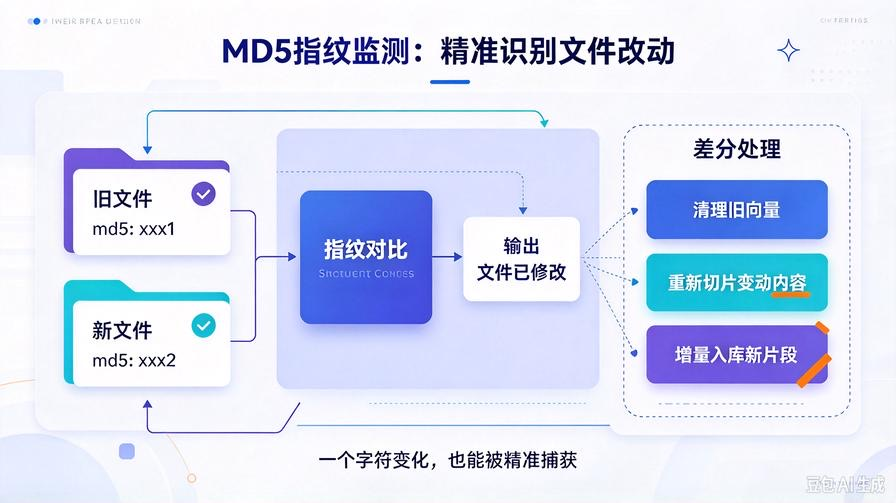
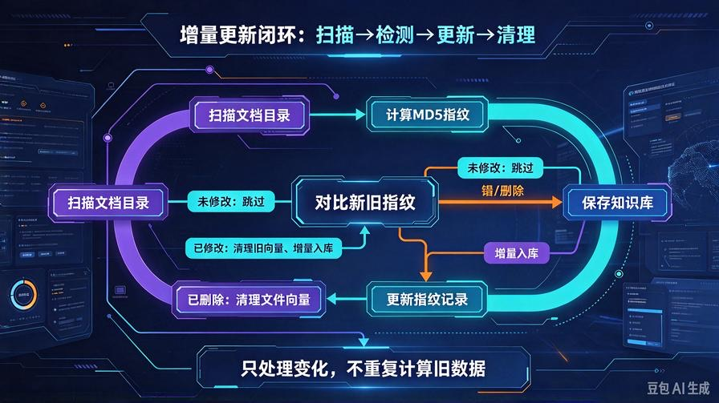
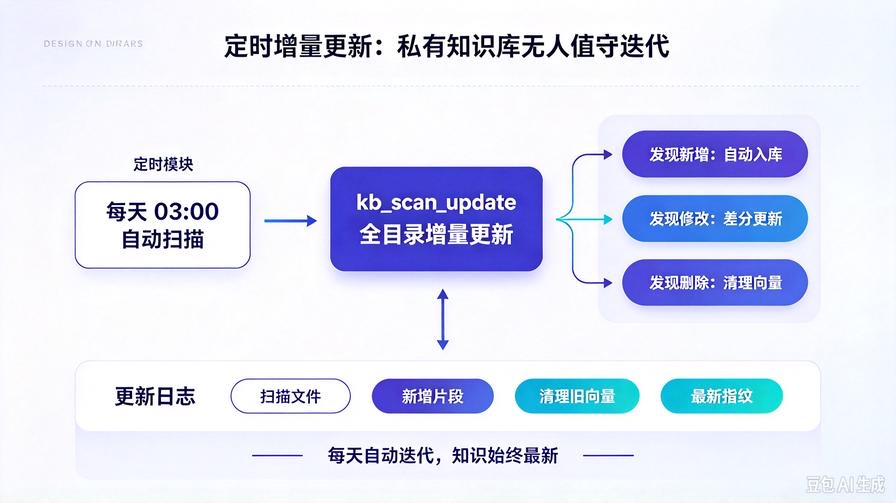

# 第21篇：增量知识库自动更新，打造永续迭代私有大脑

欢迎回到 **AI Agent 零基础实战连载系列**！

上一篇第20篇，我们成功给 Agent 接入了 **本地私有 RAG 知识库**。

从此彻底摆脱大模型幻觉，让 AI 基于你的私有文档、笔记、项目资料精准作答。

但上一版知识库存在一个**非常影响使用体验的短板**：

**文档一旦入库，后续修改、新增、删除内容，知识库不会自动同步。**

每次更新笔记、修改项目文档，都需要手动清空向量库、重新全量入库，不仅耗时，还会产生大量**重复向量、冗余数据、垃圾切片**。

真正可用的长期私有知识库，绝对不能是「一次性静态库」。

它必须像人类大脑一样：**支持增量记忆、自动更新、自动去重、迭代优化**。

本篇我们从零升级 **增量式智能知识库系统**，实现全自动监测文档变动、增量更新、冗余清理、版本留存。

读完本篇你彻底掌握：

- 全量知识库与增量知识库的核心区别
- 文件MD5指纹监测，精准识别文档改动
- 增量切片、增量向量化、增量入库机制
- 自动去重、冗余清理、避免Token冗余爆炸
- Agent全自动管理知识库，无需人工干预

## 一、为什么必须做增量更新？静态知识库根本没法长期用


### 1. 静态全量入库：低效、冗余、垃圾数据堆积

每次文档改一个字，都需要全部重新切片、重新向量化、重新存储。  
久而久之知识库充斥大量相似片段、过期内容、重复向量，问答精度大幅下降。

### 2. 真实工作资料是持续迭代的

笔记新增、方案修改、日志更新、规则迭代、版本更新，**私有资料永远在变动**。  
不能自动更新的知识库，用几天就彻底报废。

### 3. 增量更新 = 商用知识库的核心标准

工业级 RAG 系统绝对不会全量重刷，全部采用「**只更新变动内容、保留有效内容**」的增量机制，高效、干净、精准、永续迭代。

## 二、增量知识库核心原理



我们在原有 RAG 基础上，新增 **文件指纹监测 + 增量差分更新** 架构：

1. **指纹记录**：入库时保存每个文件的 MD5 指纹
2. **变动监测**：每次更新前对比新旧指纹，判断文件是否修改
3. **差分处理**：未修改文件直接跳过，仅处理新增/修改文件
4. **增量入库**：只对变动内容切片、向量化，不重复处理旧数据
5. **自动清理**：删除过期片段、冗余数据、废弃文档向量

**简单一句话：没变的不动，变了的才更，删了的清空。**

## 三、升级后项目结构（无破坏性改动）

```plain text
agent_api_service/
├── knowledge_base/
│   ├── kb_core.py         # 核心升级：增量更新+指纹监测
│   ├── kb_store.json      # 新增fingerprint指纹字段
│   └── upload_doc/
├── tools/
│   └── tool_manager.py    # 新增增量更新工具
├── main.py                # 新增增量更新接口
├── agent_core.py
└── config.py
```

## 四、重磅升级 kb_core.py 增量完整版



直接替换旧的 kb_core.py，本次升级新增：MD5指纹、增量更新、文件监听、自动去重、冗余清理全套能力：

```python
import json
import os
import hashlib
import numpy as np
from openai import OpenAI
from config import MODEL_API_KEY, MODEL_BASE_URL, EMBED_MODEL_NAME

# 初始化向量模型客户端
client = OpenAI(
    api_key=MODEL_API_KEY,
    base_url=MODEL_BASE_URL
)

# 知识库路径配置
KB_DIR = "knowledge_base"
KB_STORE_PATH = os.path.join(KB_DIR, "kb_store.json")
UPLOAD_DOC_PATH = os.path.join(KB_DIR, "upload_doc")

# 确保目录存在
os.makedirs(KB_DIR, exist_ok=True)
os.makedirs(UPLOAD_DOC_PATH, exist_ok=True)

# 文本切片参数
CHUNK_SIZE = 300
CHUNK_OVERLAP = 50

def get_file_md5(file_path):
    """获取文件MD5指纹，用于监测文件变动"""
    md5 = hashlib.md5()
    with open(file_path, "rb") as f:
        for chunk in iter(lambda: f.read(4096), b""):
            md5.update(chunk)
    return md5.hexdigest()

class LocalKnowledgeBase:
    def __init__(self):
        self.store = self.load_store()

    def load_store(self):
        """加载本地向量数据库，兼容旧版本"""
        if os.path.exists(KB_STORE_PATH):
            with open(KB_STORE_PATH, "r", encoding="utf-8") as f:
                data = json.load(f)
            # 兼容旧数据，新增指纹字典
            if "file_fingerprint" not in data:
                data["file_fingerprint"] = {}
            if "doc_list" not in data:
                data["doc_list"] = []
            return data
        return {"doc_list": [], "file_fingerprint": {}}

    def save_store(self):
        """保存知识库数据"""
        with open(KB_STORE_PATH, "w", encoding="utf-8") as f:
            json.dump(self.store, f, ensure_ascii=False, indent=2)

    def split_text(self, text):
        """长文本切片"""
        chunks = []
        start = 0
        while start < len(text):
            end = start + CHUNK_SIZE
            chunk = text[start:end]
            chunks.append(chunk)
            start = end - CHUNK_OVERLAP
        return chunks

    def get_embedding(self, text):
        """生成向量嵌入"""
        res = client.embeddings.create(
            model=EMBED_MODEL_NAME,
            input=text
        )
        return res.data[0].embedding

    def single_file_increment_update(self, file_path):
        """单文件增量更新核心逻辑"""
        if not os.path.exists(file_path):
            # 文件已删除，清理该文件所有向量
            return self.clean_file_vector(os.path.basename(file_path))

        file_name = os.path.basename(file_path)
        new_md5 = get_file_md5(file_path)

        # 1. 文件未改动，直接跳过
        if file_name in self.store["file_fingerprint"]:
            old_md5 = self.store["file_fingerprint"][file_name]
            if new_md5 == old_md5:
                return f"【无需更新】文件无变动：{file_name}"

        # 2. 文件已修改，先清理旧向量
        self.clean_file_vector(file_name)

        # 3. 重新切片、向量化、增量入库
        with open(file_path, "r", encoding="utf-8") as f:
            content = f.read()
        chunks = self.split_text(content)

        for idx, chunk in enumerate(chunks):
            vec = self.get_embedding(chunk)
            self.store["doc_list"].append({
                "source": file_name,
                "chunk_idx": idx,
                "content": chunk,
                "vector": vec
            })

        # 4. 更新文件指纹
        self.store["file_fingerprint"][file_name] = new_md5
        self.save_store()
        return f"【增量更新成功】{file_name}，新增切片{len(chunks)}段"

    def clean_file_vector(self, file_name):
        """清理指定文件所有旧向量数据"""
        old_count = len(self.store["doc_list"])
        # 过滤掉该文件所有旧片段
        self.store["doc_list"] = [
            item for item in self.store["doc_list"]
            if item["source"] != file_name
        ]
        # 清除指纹
        if file_name in self.store["file_fingerprint"]:
            del self.store["file_fingerprint"][file_name]
        self.save_store()
        return f"清理旧向量片段{old_count - len(self.store['doc_list'])}段"

    def scan_all_update(self):
        """扫描全部文档，全自动增量更新"""
        update_log = []
        # 遍历upload_doc下所有txt/md文件
        for fname in os.listdir(UPLOAD_DOC_PATH):
            if fname.endswith((".txt", ".md")):
                fpath = os.path.join(UPLOAD_DOC_PATH, fname)
                res = self.single_file_increment_update(fpath)
                update_log.append(res)
        return update_log

    def calc_similarity(self, vec1, vec2):
        """余弦相似度计算"""
        arr1 = np.array(vec1)
        arr2 = np.array(vec2)
        return np.dot(arr1, arr2) / (np.linalg.norm(arr1) * np.linalg.norm(arr2))

    def search(self, query, top_k=3):
        """语义检索"""
        if not self.store["doc_list"]:
            return "知识库暂无任何私有文档内容"

        query_vec = self.get_embedding(query)
        score_list = []

        for item in self.store["doc_list"]:
            score = self.calc_similarity(query_vec, item["vector"])
            score_list.append({
                "score": score,
                "content": item["content"],
                "source": item["source"]
            })

        score_list = sorted(score_list, key=lambda x: x["score"], reverse=True)
        return score_list[:top_k]

    def clear_kb(self):
        """清空全量知识库"""
        self.store = {"doc_list": [], "file_fingerprint": {}}
        self.save_store()
        return "全量知识库已清空"

# 全局单例
kb = LocalKnowledgeBase()
```

## 五、核心升级能力详细解读

### 1. MD5 文件指纹精准监测

对每一个入库文件计算唯一 MD5 哈希值，文件哪怕只修改一个字符，指纹都会变化。  
真正做到：**精准识别改动、零误判、零遗漏**。

### 2. 纯增量更新机制

旧版本：文件改一点 → 全量重刷 → 产生大量重复垃圾数据。  
新版本：**只清理旧片段、只入库新内容、不变数据完全保留**。  
极大节省 Token、磁盘空间、向量计算资源。

### 3. 自动文件监听扫描

支持一键扫描整个文档目录，自动识别：新增文件、修改文件、删除文件，全自动同步知识库，无需人工逐个上传。

### 4. 智能冗余清理

自动清理过期片段、废弃文档向量、重复内容，始终保持知识库干净、轻量化、高精准。

### 5. 完美兼容旧数据

升级后**完全兼容历史知识库**，无需清空重来，自动适配指纹字段，平滑升级无成本。

## 六、升级工具管理器，新增增量工具

修改 `tool_manager.py`，新增 **全库扫描更新、单文件增量更新** 工具，让 Agent 可以自主维护知识库：

```python
# 新增工具函数
def kb_scan_update() -> str:
    """全自动扫描所有文档，增量更新知识库，无需手动上传"""
    log = kb.scan_all_update()
    return "知识库全自动增量更新完成：\n" + "\n".join(log)

def kb_increment_file(file_path: str) -> str:
    """针对单个文件增量更新，仅更新变动内容"""
    return kb.single_file_increment_update(file_path)

# 在 create_default_tools 中注册
tool_manager.register_tool(
    name="kb_scan_update",
    description="全自动扫描知识库文档目录，检测文件变动，执行增量更新，自动维护私有知识库",
    parameters={},
    func=kb_scan_update
)

tool_manager.register_tool(
    name="kb_increment_file",
    description="对指定单个文档执行增量更新，只更新修改部分，不重复计算全量内容",
    parameters={"file_path": "文档完整路径"},
    func=kb_increment_file
)
```

## 七、新增增量更新接口（main.py）

方便前端调用、定时任务调用、一键更新知识库：

```python
@app.post("/api/kb/scan-update")
async def api_kb_scan_update():
    """一键全目录增量更新"""
    log = kb.scan_all_update()
    return {"code": 200, "log": log}

@app.post("/api/kb/increment-file")
async def api_increment_file(file_path: str):
    """单文件增量更新"""
    res = kb.single_file_increment_update(file_path)
    return {"code": 200, "msg": res}
```

## 八、结合定时任务：全自动无人值守更新



依托我们第16篇开发的定时任务系统，可以实现：

**每天凌晨自动扫描所有笔记、文档，增量更新知识库，全程无人值守。**

只需在 `scheduler_task.py` 新增定时任务：

```python
from knowledge_base.kb_core import kb

def auto_kb_update_task():
    """定时自动增量更新知识库"""
    kb.scan_all_update()

def start_scheduler():
    scheduler.add_job(
        auto_kb_update_task,
        "cron",
        hour=3,
        minute=0,
        id="auto_kb_update",
        replace_existing=True
    )
```

从此你的私有知识库：**每天自动迭代、自动优化、自动更新**。

## 九、实战测试流程

启动服务：

```bash
python main.py
```

### 测试1：修改已有文档

修改 upload_doc 内任意笔记内容，输入指令：  
`全自动扫描更新知识库`

Agent 自动检测变动、清理旧数据、增量入库新内容。

### 测试2：新增文档

新建一个 md 笔记，再次扫描更新，自动入库新文档。

### 测试3：删除文档

删除本地文件，扫描更新，知识库自动清理该文件所有过期向量。

## 十、增量知识库核心优势

- **极致节省资源**：不变内容不重复向量化，大幅降低算力消耗
- **知识库永久干净**：自动清理过期、冗余、废弃数据
- **完全自动化**：支持手动更新 + 定时无人值守更新
- **适配全Agent能力**：兼容多工具协同、纠错重试、长期记忆
- **真正永续迭代**：你的资料越用越新，AI知识越用越准

## 十一、本篇核心总结

1. 静态知识库只能演示，**增量更新知识库才能长期商用**
2. 通过MD5文件指纹，实现精准文件变动监测
3. 完成「增量扫描-差分更新-冗余清理-版本留存」完整闭环
4. 支持单文件更新 + 全目录批量更新双模式
5. 结合定时任务，实现私有知识库全自动无人值守迭代

## 下期预告：第22篇｜Agent多模态文件解析，支持PDF/Word/TXT批量知识库入库

目前我们仅支持 TXT、MD 格式，下一篇全面升级文件解析引擎，让 Agent 自动解析 **PDF、Word、TXT、Markdown** 全格式文档，批量全自动入库，真正适配电脑所有私有资料！

> 来源：头条号《AI Agent 零基础实战》第21篇｜版权归作者所有，仅供学习交流
