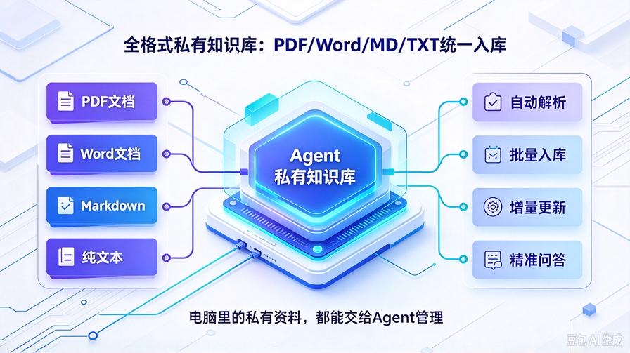
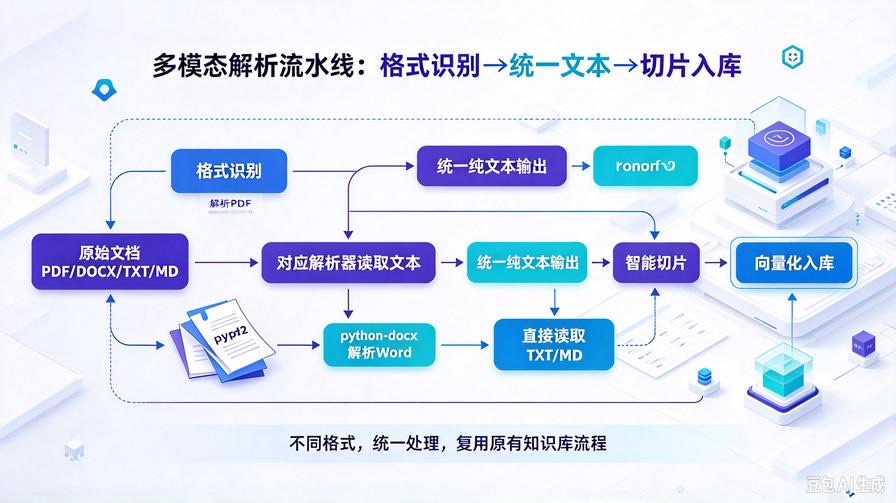
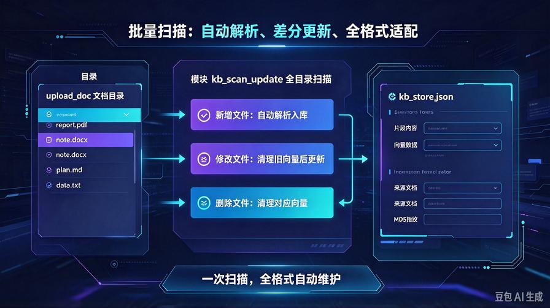
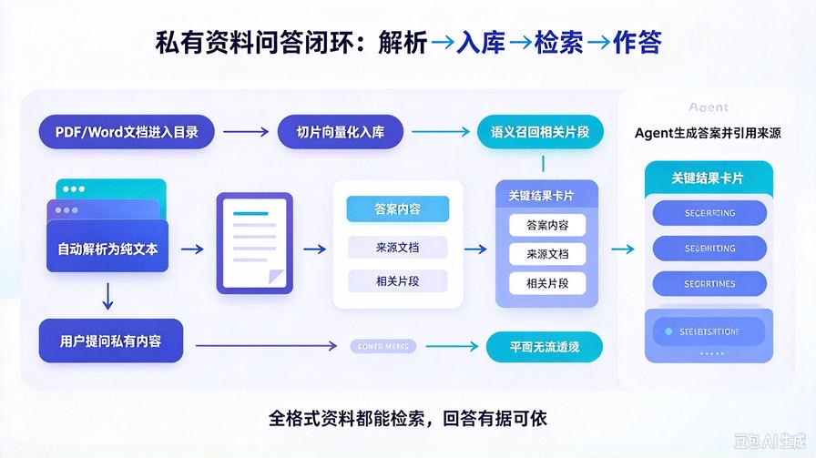

# 第22篇：Agent多模态文档解析，PDF/Word/MD全格式批量入库

欢迎回到 **AI Agent 零基础实战连载系列**！

通过前两篇的迭代，我们已经搭建完成**轻量化私有RAG知识库 + 全自动增量更新系统**。

目前的知识库已经具备商用级核心能力：语义检索、零幻觉问答、自动迭代、冗余清理。

但仍然存在一个**非常局限落地场景的问题**：

**仅支持 TXT、MD 纯文本格式，日常最常用的 PDF、Word 文档无法解析入库。**

电脑中90%的私有资料：项目文档、学习资料、报告文件、合同文案、读书笔记，全都是 PDF、DOCX 格式。

不能解析多格式文件的知识库，始终只能用少量手动转码的文本文件，**无法全盘接管你的私有资料**。

本篇我们全面升级 Agent 文件解析引擎，搭建 **多模态通用文档解析系统**，一次性支持**PDF、Word、TXT、Markdown** 全格式文件，实现批量自动解析、自动切片、自动增量入库。

读完本篇彻底掌握：

- PDF、DOCX、TXT、MD 全格式文档本地解析原理
- 轻量化解析依赖安装，无需复杂环境配置
- 统一文档读取接口，适配所有常见文本文档
- 多文件批量遍历、自动解析、全自动入库
- 兼容原有增量更新体系，无缝衔接历史所有功能

## 一、为什么必须做多格式文档解析？



### 1. 纯文本格式实用性极低

日常工作、学习、项目中的正式资料几乎不会用 TXT/MD 存储，大量 PDF、Word 文档无法利用，知识库形同半残废。

### 2. 网上多数RAG项目只支持纯文本

绝大多数开源Agent、轻量化RAG教程，为了降低难度只做文本解析，导致**只能跑Demo，无法落地日常使用**。

### 3. 全格式解析 = 知识库彻底落地可用

支持PDF+Word+文本全格式后，你的Agent可以直接读取电脑任意私有文档，**全盘私有化资料入库，真正实现私人专属智能知识库**。

## 二、多模态解析核心原理



我们采用「**分格式解析 + 统一内容输出**」的轻量化架构：

1. **格式识别**：自动判断文件后缀（pdf/docx/txt/md）
2. **分区解析**：不同格式调用对应解析器读取纯文本内容
3. **内容统一**：所有文件最终输出标准纯文本
4. **复用旧流程**：文本交付原有切片、向量化、增量入库逻辑

**核心优势：不改动原有知识库核心，仅扩展解析能力，零兼容性问题。**

## 三、安装多格式解析依赖

只需两个轻量库，分别适配 PDF、Word 解析，无重型环境依赖：

```bash
# 解析PDF文档
pip install pypdf2
# 解析Word DOCX文档
pip install python-docx
```

安装完成即可支持全主流文本文档格式，无需额外配置。

## 四、新增通用文档解析工具 parse_doc.py

在 `knowledge_base/` 目录新建 **parse_doc.py**，封装全格式解析通用方法，统一输出纯文本：

```python
import os
from PyPDF2 import PdfReader
from docx import Document

def parse_file_to_text(file_path: str) -> str:
    """
    通用文档解析器：支持 pdf / docx / txt / md
    统一返回纯文本内容
    """
    if not os.path.exists(file_path):
        return f"文件不存在：{file_path}"

    suffix = file_path.lower().split(".")[-1]
    content = ""

    try:
        if suffix in ["txt", "md"]:
            # 纯文本/马克down直接读取
            with open(file_path, "r", encoding="utf-8") as f:
                content = f.read()

        elif suffix == "pdf":
            # PDF逐页解析
            reader = PdfReader(file_path)
            for page in reader.pages:
                page_text = page.extract_text()
                if page_text:
                    content += page_text + "\n"

        elif suffix == "docx":
            # Word文档逐段落解析
            doc = Document(file_path)
            for para in doc.paragraphs:
                if para.text.strip():
                    content += para.text.strip() + "\n"

        else:
            return f"暂不支持解析该格式：.{suffix}"

    except Exception as e:
        return f"文档解析失败：{str(e)}"

    return content.strip()
```

## 五、升级 kb_core.py 适配多格式解析



打开 `knowledge_base/kb_core.py`，导入解析工具，修改文件读取逻辑，适配所有格式文档，**原有增量更新、指纹监测逻辑完全保留**：

### 1. 顶部新增导入

```python
# 顶部新增
from .parse_doc import parse_file_to_text
```

### 2. 修改单文件增量更新读取逻辑

找到 `single_file_increment_update` 方法内的文件读取代码，替换为通用解析接口：

```python
# 替换原来的 open 读取方式
# 原代码废弃：
# with open(file_path, "r", encoding="utf-8") as f:
#     content = f.read()

# 新的通用解析代码
content = parse_file_to_text(file_path)
if content.startswith("文档解析失败") or content.startswith("暂不支持解析"):
    return f"【解析失败】{os.path.basename(file_path)}：{content}"
```

### 3. 升级目录扫描后缀规则

找到 `scan_all_update` 方法，修改文件遍历筛选，支持全格式：

```python
# 替换原有后缀判断
# 原代码：if fname.endswith((".txt", ".md")):

# 新代码
if fname.endswith((".txt", ".md", ".pdf", ".docx")):
```

## 六、升级工具能力，支持全格式批量入库

无需修改工具注册逻辑，原有三个知识库工具**全自动适配PDF/Word**：

- **kb_upload_doc**：支持上传任意格式文档入库
- **kb_scan_update**：全自动扫描目录内所有PDF、DOCX、TXT、MD文件
- **kb_increment_file**：单文件增量更新适配全格式

Agent 可以自主识别文档格式、自主解析、自主入库，全程无需人工干预。

## 七、兼容定时无人值守更新

上一篇搭建的**凌晨自动增量更新任务**无需任何修改，现在会自动：

- 扫描文件夹内所有PDF、Word、文本文档
- 检测文件变动、新增、删除
- 多格式自动解析、增量更新知识库
- 清理过期冗余向量数据

真正实现：**电脑所有文档全自动托管迭代**。

## 八、完整实战测试流程



重启服务生效：

```bash
python main.py
```

### 测试1：PDF文档入库

在 `upload_doc` 放入任意PDF学习资料、项目文档，输入指令：  
`全自动扫描更新知识库`

Agent自动解析PDF文本、切片、向量化、增量入库。

### 测试2：Word文档问答

放入DOCX工作总结、方案文档，扫描更新后，直接提问文档内专属内容，**精准回答、无幻觉、有据可查**。

### 测试3：多文件批量更新

同时新增、修改、删除PDF/Word/文本文件，一键扫描，系统全自动差分更新，不重复计算、不产生垃圾数据。

## 九、多模态知识库核心优势

- **全场景适配**：覆盖日常99%的私有文档格式
- **轻量化无负担**：仅两个轻量依赖，无需OCR、无需重型框架
- **完全兼容旧架构**：增量更新、指纹监测、冗余清理全部保留
- **全自动闭环**：解析-切片-入库-更新-清理全流程自动化
- **彻底落地可用**：真正能接管电脑所有私有资料的智能知识库

## 十、本篇核心总结

1. 纯文本知识库仅适合演示，**全格式解析知识库才是商用标配**
2. 实现 PDF、Word、TXT、MD 四格式统一解析入库
3. 新增通用文档解析引擎，格式拓展简单、可无限新增格式
4. 完美适配增量更新体系，多文件批量全自动迭代
5. Agent 私有资料处理能力彻底成型，脱离玩具级Demo

## 下期预告：第23篇｜智能文档清洗与精炼切片，彻底解决乱码、换行、无效内容

多格式解析后会出现脏数据、乱码、空行、冗余表头页脚，下一篇我们实现 **AI智能文档清洗、内容精炼、优化切片**，大幅提升知识库问答精准度，彻底解决解析脏数据问题！

> 来源：头条号《AI Agent 零基础实战》第22篇｜版权归作者所有，仅供学习交流
