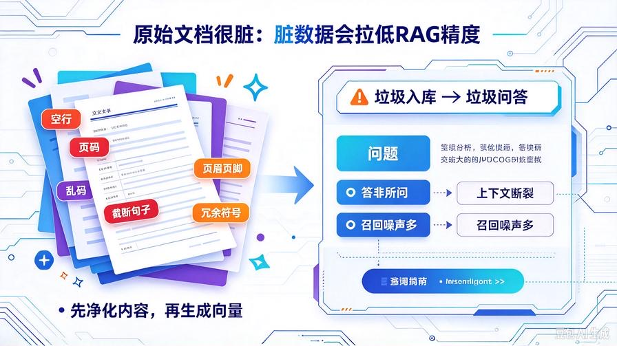
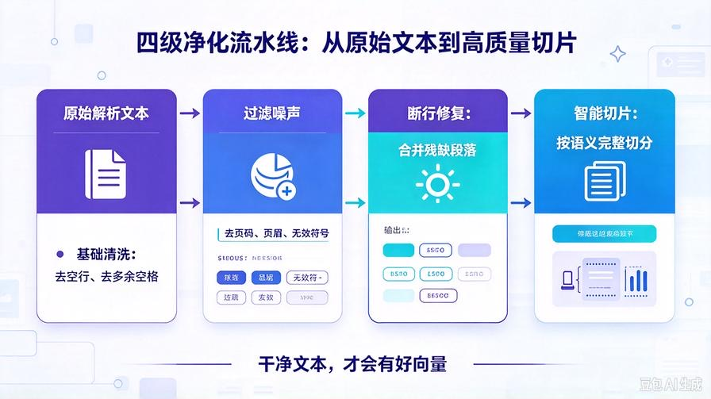
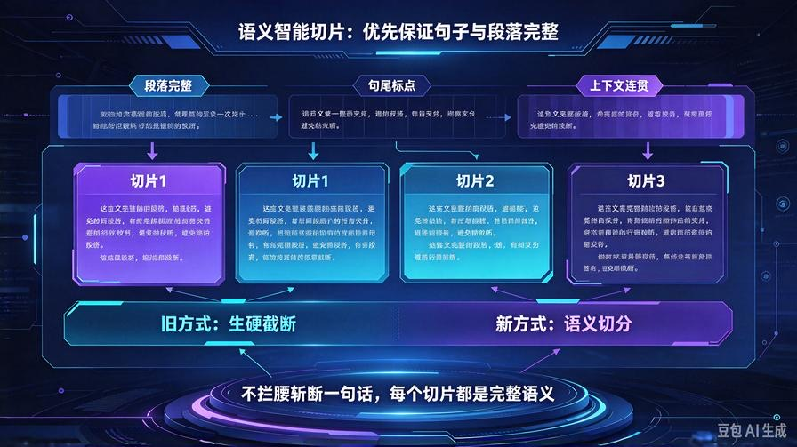
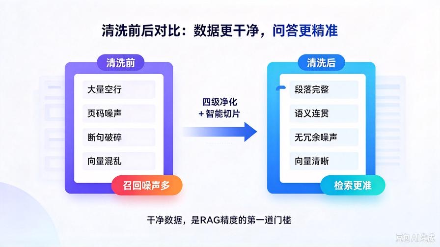

# 第23篇：文档智能清洗精炼，解决乱码脏数据，提升RAG问答精度

欢迎回到 **AI Agent 零基础实战连载系列**！

上一篇第22篇，我们完成了 **PDF / Word / TXT / MD 全格式文档解析**。

Agent 已经可以批量读取电脑任意私有文档、自动入库、增量更新，彻底摆脱纯文本局限。

但是！多格式解析后，所有人都会遇到一个**致命落地问题**：

**原始解析内容极度脏乱差。**

PDF、Word 解析出来普遍存在：

- 大量空行、连续换行、错乱空格
- 页眉、页脚、页码、水印、多余符号
- 乱码、特殊字符、制表符、残缺段落
- 内容碎片化、句子截断、上下文断裂

**脏数据入库 = 垃圾问答。**

不管向量模型多强、检索算法多优，只要切片内容脏乱、噪声多，问答就会跑偏、冗余、答非所问、精度暴跌。

本篇我们搭建 **工业级文档清洗 + 智能精炼切片系统**，从源头净化文档内容，彻底解决解析脏数据问题，让 RAG 问答精度直接翻倍。

读完本篇彻底掌握：

- 多格式文档解析脏数据的全部成因与解决方案
- 全自动文本清洗：去空行、去乱码、去页眉页脚、去冗余符号
- 语义智能切片，拒绝生硬截断，保证上下文完整
- 长短文本自适应精炼，过滤无效噪声内容
- 无损接入现有知识库，精度大幅升级

## 一、为什么必须做文档清洗与智能切片？



### 1. 原始解析内容噪声极高

PDF、Word 不同于纯文本，排版复杂、图层多样、格式混乱。直接解析出来的内容充斥大量无效字符，**有效信息占比极低**。

### 2. 固定长度切片极其不智能

之前的固定300字硬切片，极易出现：一句话被拦腰截断、语义断裂、段落拆分混乱，向量语义完全失真。

### 3. 脏数据是 RAG 问答不准的头号元凶

很多人 RAG 效果差，不是模型问题、不是检索问题，是**入库数据本身就是垃圾数据**。

### 4. 清洗精炼是商用RAG的标配前置步骤

所有工业级知识库系统，**解析后必须先清洗、再精炼、最后切片入库**，没有清洗的RAG永远是Demo水平。

## 二、智能清洗+精炼切片核心原理



我们搭建「**四级净化流水线**」，从原始文档到入库切片层层提纯：

1. **原始解析**：读取PDF/Word/TXT/MD原始内容
2. **基础清洗**：去除空行、多余空格、特殊符号、乱码、页码页眉
3. **语义精炼**：合并断行、修复残缺段落、剔除无效碎片文本
4. **智能切片**：基于标点与语义分句，优先保证段落完整，不生硬截断

**核心逻辑：先净化内容，再生成向量，从源头提升问答准确率。**

## 三、升级项目结构（无破坏性更新）

```plain text
knowledge_base/
├── kb_core.py         # 升级：接入清洗+智能切片
├── parse_doc.py       # 原有多格式解析保留
└── text_cleaner.py    # 【全新新增】文本清洗+精炼+智能切片核心

```

## 四、新建文本精炼核心 text_cleaner.py



新建 `knowledge_base/text_cleaner.py`，封装全套清洗、修复、智能切片算法，全程本地轻量化处理、无AI调用、零成本高效率：

```python
import re

class TextCleaner:
    def __init__(self):
        # 初始化正则规则
        self.empty_line_pattern = re.compile(r"\n\s*\n")
        self.multi_space_pattern = re.compile(r"\s+")
        # 页码、页眉页脚、多余符号过滤
        self.noise_pattern = re.compile(
            r"^\d{1,5}$|第\s*\d+\s*页|页码\s*\d+|Page\s*\d+|"
            r"本文件仅供参考|版权所有|未经授权不得转载|"
            r"\|+|-+|={2,}|•{2,}"
        )

    def basic_clean(self, text: str) -> str:
        """基础清洗：去空行、去多余空格、去首尾空白"""
        # 统一换行
        text = text.replace("\r\n", "\n").replace("\r", "\n")
        # 去除多行空行
        text = self.empty_line_pattern.sub("\n", text)
        # 去除首尾空白
        text = text.strip()
        return text

    def filter_noise(self, text: str) -> str:
        """过滤页码、页眉、页脚、版权、无效单行噪声"""
        lines = text.split("\n")
        clean_lines = []
        for line in lines:
            line_strip = line.strip()
            # 过滤纯数字页码、噪声短句
            if self.noise_pattern.fullmatch(line_strip):
                continue
            if len(line_strip) < 2 and not line_strip.isalpha():
                continue
            clean_lines.append(line)
        return "\n".join(clean_lines)

    def repair_broken_sentence(self, text: str) -> str:
        """修复PDF解析断行、合并残缺段落"""
        # 匹配末尾非标点换行，说明是段落被截断
        lines = text.split("\n")
        if not lines:
            return text

        new_lines = []
        cache_line = ""

        end_punct = {"。", "！", "？", ".", "!", "?", "；", ";"}

        for line in lines:
            line = line.strip()
            if not line:
                if cache_line:
                    new_lines.append(cache_line)
                    cache_line = ""
                continue

            # 当前行不是结尾句子，合并到缓存
            if line[-1] not in end_punct:
                cache_line += line + " "
            else:
                cache_line += line
                new_lines.append(cache_line)
                cache_line = ""
        # 兜底剩余缓存内容
        if cache_line:
            new_lines.append(cache_line)

        return "\n".join(new_lines)

    def smart_chunk_split(self, text: str, chunk_size=300, overlap=50) -> list:
        """
        语义智能切片：优先按段落、标点分割
        避免生硬截断句子，保证单切片语义完整
        """
        # 先按段落拆分
        paragraphs = [p.strip() for p in text.split("\n") if p.strip()]
        chunks = []
        current_chunk = ""

        for para in paragraphs:
            # 加入当前段落不超长度，直接合并
            if len(current_chunk) + len(para) <= chunk_size:
                current_chunk += para + "\n"
            else:
                # 当前块已满，存入
                if current_chunk:
                    chunks.append(current_chunk.strip())
                current_chunk = para + "\n"

        # 存入最后一段
        if current_chunk:
            chunks.append(current_chunk.strip())

        # 兜底重叠拼接，防止内容碎片化
        if overlap > 0 and len(chunks) > 1:
            final_chunks = []
            for idx, chunk in enumerate(chunks):
                if idx == 0:
                    final_chunks.append(chunk)
                else:
                    # 取上一段末尾重叠内容
                    prev = chunks[idx-1]
                    overlap_text = prev[-overlap:] if len(prev) > overlap else prev
                    new_chunk = overlap_text + "..." + chunk
                    final_chunks.append(new_chunk)
            return final_chunks

        return chunks

    def full_clean(self, text: str) -> str:
        """完整清洗流水线"""
        text = self.basic_clean(text)
        text = self.filter_noise(text)
        text = self.repair_broken_sentence(text)
        return text

# 全局单例
cleaner = TextCleaner()
```

## 五、升级 kb_core.py 接入智能清洗切片

打开 `kb_core.py`，接入全新清洗精炼模块，**完全保留增量更新、指纹监测、多格式解析**，仅升级内容处理环节：

### 1. 顶部新增导入

```python
from .parse_doc import parse_file_to_text
from .text_cleaner import cleaner
```

### 2. 替换旧切片方法 + 新增清洗逻辑

注释/删除旧的粗糙 `split_text` 方法，替换为智能清洗切片：

```python
# 废弃原有粗暴切片
# def split_text(self, text):
#     chunks = []
#     start = 0
#     while start < len(text):
#         end = start + CHUNK_SIZE
#         chunk = text[start:end]
#         chunks.append(chunk)
#         start = end - CHUNK_OVERLAP
#     return chunks

# 新增智能清洗+语义切片
def split_text(self, text):
    # 1. 全文四级净化
    clean_text = cleaner.full_clean(text)
    # 2. 语义智能切片
    chunks = cleaner.smart_chunk_split(
        clean_text,
        chunk_size=CHUNK_SIZE,
        overlap=CHUNK_OVERLAP
    )
    return chunks
```

## 六、本次升级核心能力详解

### 1. 四层文本净化，彻底去除脏数据

自动剔除 PDF/Word 解析产生的页码、页眉、页脚、版权声明、空行乱码、多余符号，只保留**有效正文内容**。

### 2. 断行修复，还原完整段落

PDF 解析最常见的「一句话拆成好几行」问题，自动识别句尾标点、合并残缺段落，还原通顺完整原文。

### 3. 语义优先智能切片

不再死板按字数截断，优先按段落、语义、分句切割，**每一个切片都是完整语义单元**，向量表达更精准。

### 4. 重叠切片机制，防止上下文断裂

相邻切片保留尾部重叠内容，解决长文本跨切片检索丢失上下文的问题，大幅提升召回完整性。

### 5. 完全兼容历史所有架构

增量更新、MD5指纹监测、多格式解析、定时自动任务全部无缝兼容，**平滑升级、无需清空知识库**。

## 七、全量优化旧知识库数据

升级完成后，想要优化历史脏数据，只需一句指令即可全库重洗：

输入 Agent 指令：  
`全自动扫描更新知识库`

系统会自动：

1. 检测所有文档
2. 重新解析、重新清洗、重新语义切片
3. 增量覆盖旧脏数据
4. 生成高纯净向量知识库

## 八、实战效果对比



### 优化前：

内容杂乱、空行极多、句子截断、存在大量页码噪声、向量语义混乱、问答经常跑偏、遗漏关键信息。

### 优化后：

内容干净、段落完整、语义连贯、无冗余噪声，检索精准度大幅提升，回答有理有据、逻辑清晰、零幻觉漂移。

## 九、本篇核心总结

1. **清洗是RAG质变的关键一步**：解析只是入门，精炼净化才是商用精度核心
2. 解决了PDF/Word解析普遍存在的乱码、空行、页码、断行问题
3. 实现四级文本净化流水线，从源头杜绝脏数据入库
4. 语义智能切片替代生硬截断，向量表达更贴合真实语义
5. 兼容全量历史架构，低成本完成知识库精度升级

## 下期预告：第24篇｜RAG重排序+最高分融合检索，彻底解决检索不准、召回不全问题

现在我们已经拥有干净数据+智能切片，下一篇继续**检索精度终极优化**，实现多路召回、相似度重排序、高分片段融合，让 RAG 问答精度达到行业顶级水准！

> 来源：头条号《AI Agent 零基础实战》第23篇｜版权归作者所有，仅供学习交流
