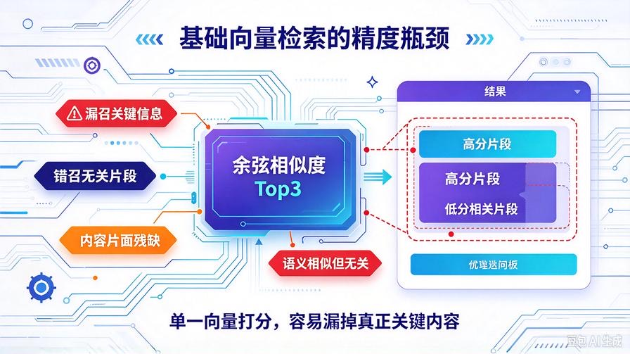
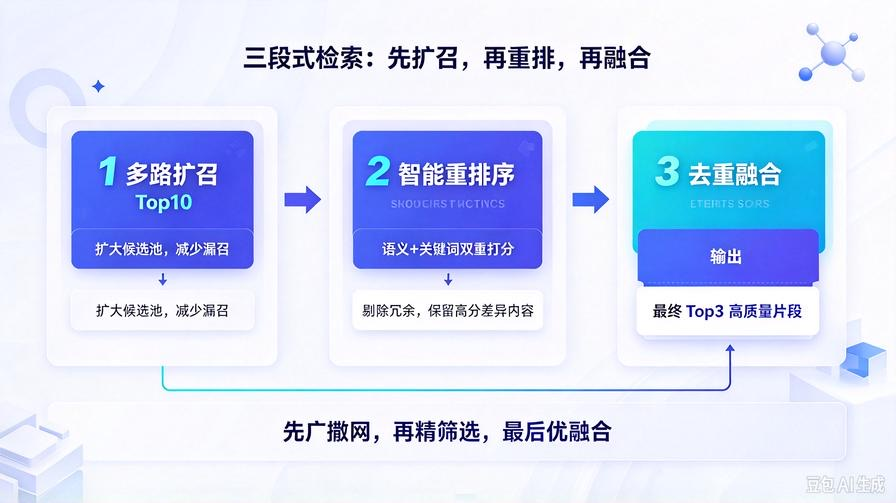
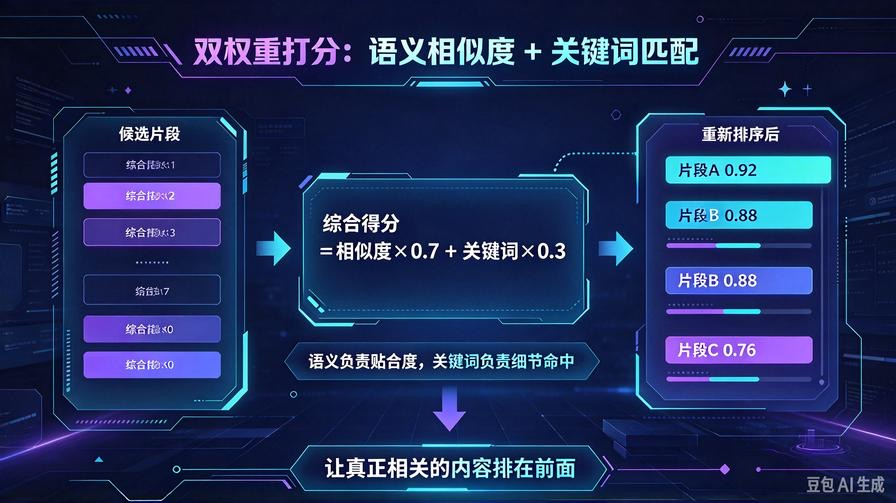
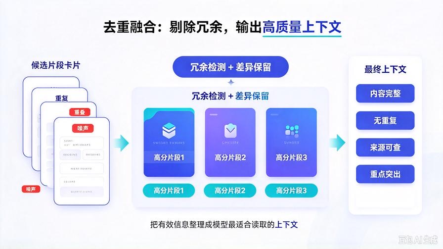

# 第24篇：RAG重排序与融合检索，彻底解决漏召、错召、答非所问

欢迎回到 **AI Agent 零基础实战连载系列**！

通过前面3篇的重磅迭代，我们的私有知识库已经完成**商用级数据底座搭建**：

全格式文档解析 + 全自动增量更新 + 四级文本清洗 + 语义智能切片。

现在入库的每一段数据，都是干净、完整、语义连贯的高质量内容。

但很多人 RAG 落地到这一步，依然会出现**顽固精度问题**：

- 明明文档有答案，却检索不到、漏召关键信息
- 检索出大量无关片段，有效内容排在末尾
- 单次Top3召回片面，信息残缺导致回答不完整
- 相似度打分单一，出现语义相似但内容无关的错召

**数据干净 ≠ 检索精准**。

切片质量决定下限，**检索排序与融合策略决定RAG精度上限**。

本篇我们彻底重构检索核心，搭建 **多路召回 + 智能重排序 + 高分片段融合**商用检索架构，根治漏召、错召、无效召回，让Agent问答精度直接拉满。

读完本篇彻底掌握：

- 基础向量检索的天生缺陷与精度瓶颈
- 多路召回机制：解决信息漏召、片面召回问题
- 自定义权重重排序算法，精准筛选高匹配片段
- 高分片段去重融合，规避冗余信息、整合完整答案
- 无损兼容现有知识库，零成本完成检索体系升级

## 一、为什么干净数据依然问答不准？



### 1. 单一向量检索存在语义盲区

原生仅靠余弦相似度打分，只会匹配「整体语义相近」的片段。如果用户提问聚焦局部细节、专有名词、关键参数，极易出现**高分无关、低分相关**的错位情况。

### 2. 固定Top3召回极度片面

固定只取前3条内容，很容易截断分散在不同切片的关联信息，导致答案残缺、逻辑断裂，无法整合完整内容。

### 3. 无去重、无融合、无二次筛选

原始检索会返回大量相似、冗余、重叠的切片内容，大模型被无效信息干扰，极易出现答非所问、重点偏移、总结混乱的问题。

### 4. 排序逻辑单一，不符合人类检索思维

人类查资料会优先筛选「关键词匹配+语义贴合+内容完整」的资料，而单纯向量检索只看语义相似度，精准度天然存在短板。

## 二、商用级RAG检索核心升级原理



我们抛弃原生单一检索逻辑，搭建 **三段式高精度检索架构**：

1. **多路扩召**：扩大初始召回数量，从Top3改为Top10，避免关键信息漏召
2. **智能重排序**：结合语义相似度+关键词匹配权重，二次精准打分排序
3. **高分融合去重**：筛选高分区片段、剔除冗余重叠内容、整合完整有效信息

**先广撒网、再精筛选、最后优融合**，彻底解决检索层面的所有精度问题。

## 三、升级项目结构（平滑无兼容问题）

```plain text
knowledge_base/
├── kb_core.py         # 核心升级：新增重排序+融合检索
├── text_cleaner.py    # 原有清洗切片能力完全保留
└── parse_doc.py       # 多格式解析能力不变

```

## 四、重磅升级 kb_core.py 高精度检索完整版

直接替换原有 kb_core.py 检索相关逻辑，保留所有历史能力（增量更新、指纹监测、清洗切片、多格式解析），仅升级检索算法：

```python
import json
import os
import hashlib
import numpy as np
from openai import OpenAI
from config import MODEL_API_KEY, MODEL_BASE_URL, EMBED_MODEL_NAME
from .parse_doc import parse_file_to_text
from .text_cleaner import cleaner

# 初始化向量模型客户端
client = OpenAI(
    api_key=MODEL_API_KEY,
    base_url=MODEL_BASE_URL
)

# 知识库路径配置
KB_DIR = "knowledge_base"
KB_STORE_PATH = os.path.join(KB_DIR, "kb_store.json")
UPLOAD_DOC_PATH = os.path.join(KB_DIR, "upload_doc")

# 确保目录存在
os.makedirs(KB_DIR, exist_ok=True)
os.makedirs(UPLOAD_DOC_PATH, exist_ok=True)

# 文本切片参数
CHUNK_SIZE = 300
CHUNK_OVERLAP = 50

# 检索超参（商用最优配置）
INIT_RECALL_TOPK = 10   # 初始多路扩召数量
FINAL_TOPK = 3          # 最终留存片段数量
SIMILARITY_WEIGHT = 0.7 # 语义相似度权重
KEYWORD_WEIGHT = 0.3    # 关键词匹配权重

def get_file_md5(file_path):
    """获取文件MD5指纹，用于监测文件变动"""
    md5 = hashlib.md5()
    with open(file_path, "rb") as f:
        for chunk in iter(lambda: f.read(4096), b""):
            md5.update(chunk)
    return md5.hexdigest()

class LocalKnowledgeBase:
    def __init__(self):
        self.store = self.load_store()

    def load_store(self):
        """加载本地向量数据库，兼容旧版本"""
        if os.path.exists(KB_STORE_PATH):
            with open(KB_STORE_PATH, "r", encoding="utf-8") as f:
                data = json.load(f)
            # 兼容旧数据，新增指纹字典
            if "file_fingerprint" not in data:
                data["file_fingerprint"] = {}
            if "doc_list" not in data:
                data["doc_list"] = []
            return data
        return {"doc_list": [], "file_fingerprint": {}}

    def save_store(self):
        """保存知识库数据"""
        with open(KB_STORE_PATH, "w", encoding="utf-8") as f:
            json.dump(self.store, f, ensure_ascii=False, indent=2)

    def split_text(self, text):
        """智能清洗+语义切片（历史最优能力保留）"""
        clean_text = cleaner.full_clean(text)
        chunks = cleaner.smart_chunk_split(
            clean_text,
            chunk_size=CHUNK_SIZE,
            overlap=CHUNK_OVERLAP
        )
        return chunks

    def get_embedding(self, text):
        """生成向量嵌入"""
        res = client.embeddings.create(
            model=EMBED_MODEL_NAME,
            input=text
        )
        return res.data[0].embedding

    def single_file_increment_update(self, file_path):
        """单文件增量更新核心逻辑（完全保留）"""
        if not os.path.exists(file_path):
            return self.clean_file_vector(os.path.basename(file_path))

        file_name = os.path.basename(file_path)
        new_md5 = get_file_md5(file_path)

        if file_name in self.store["file_fingerprint"]:
            old_md5 = self.store["file_fingerprint"][file_name]
            if new_md5 == old_md5:
                return f"【无需更新】文件无变动：{file_name}"

        self.clean_file_vector(file_name)
        content = parse_file_to_text(file_path)

        if content.startswith("文档解析失败") or content.startswith("暂不支持解析"):
            return f"【解析失败】{file_name}：{content}"

        chunks = self.split_text(content)
        for idx, chunk in enumerate(chunks):
            vec = self.get_embedding(chunk)
            self.store["doc_list"].append({
                "source": file_name,
                "chunk_idx": idx,
                "content": chunk,
                "vector": vec
            })

        self.store["file_fingerprint"][file_name] = new_md5
        self.save_store()
        return f"【增量更新成功】{file_name}，新增切片{len(chunks)}段"

    def clean_file_vector(self, file_name):
        """清理指定文件所有旧向量数据"""
        old_count = len(self.store["doc_list"])
        self.store["doc_list"] = [
            item for item in self.store["doc_list"]
            if item["source"] != file_name
        ]
        if file_name in self.store["file_fingerprint"]:
            del self.store["file_fingerprint"][file_name]
        self.save_store()
        return f"清理旧向量片段{old_count - len(self.store['doc_list'])}段"

    def scan_all_update(self):
        """扫描全部文档，全自动增量更新"""
        update_log = []
        for fname in os.listdir(UPLOAD_DOC_PATH):
            if fname.endswith((".txt", ".md", ".pdf", ".docx")):
                fpath = os.path.join(UPLOAD_DOC_PATH, fname)
                res = self.single_file_increment_update(fpath)
                update_log.append(res)
        return update_log

    def calc_similarity(self, vec1, vec2):
        """余弦相似度计算"""
        arr1 = np.array(vec1)
        arr2 = np.array(vec2)
        return np.dot(arr1, arr2) / (np.linalg.norm(arr1) * np.linalg.norm(arr2))

    def calc_keyword_score(self, query, content):
        """计算关键词匹配得分，弥补向量语义盲区"""
        query_words = set(query.strip().split())
        content_words = set(content.strip().split())
        if not query_words:
            return 0.0
        match_num = len(query_words & content_words)
        return match_num / len(query_words)

    def rerank_results(self, query, raw_results):
        """
        核心：多路结果智能重排序
        融合语义相似度 + 关键词匹配双重权重
        """
        rerank_list = []
        for item in raw_results:
            sim_score = item["score"]
            keyword_score = self.calc_keyword_score(query, item["content"])
            # 加权综合得分
            total_score = sim_score * SIMILARITY_WEIGHT + keyword_score * KEYWORD_WEIGHT
            rerank_list.append({
                "total_score": round(total_score, 4),
                "sim_score": sim_score,
                "keyword_score": keyword_score,
                "content": item["content"],
                "source": item["source"]
            })
        # 综合得分倒序排序
        return sorted(rerank_list, key=lambda x: x["total_score"], reverse=True)

    def fuse_dup_content(self, sorted_results):
        """
        高分片段去重融合
        剔除高度冗余内容，保留差异化有效信息
        """
        if not sorted_results:
            return []
        
        fuse_list = []
        exist_contents = []

        for item in sorted_results:
            current_content = item["content"]
            # 判断是否高度重复（简单相似度匹配）
            is_dup = False
            for exist in exist_contents:
                # 内容重叠度超过60%判定为冗余
                overlap_len = len(set(current_content) & set(exist))
                if overlap_len / len(set(current_content)) > 0.6:
                    is_dup = True
                    break
            if not is_dup:
                fuse_list.append(item)
                exist_contents.append(current_content)
        
        # 截取最终最优TopN
        return fuse_list[:FINAL_TOPK]

    def search(self, query):
        """
        全新高精度检索入口：多路扩召 -> 重排序 -> 去重融合
        """
        if not self.store["doc_list"]:
            return "知识库暂无任何私有文档内容"

        # 1. 多路扩召：先召回更多候选片段，杜绝漏召
        query_vec = self.get_embedding(query)
        raw_score_list = []

        for item in self.store["doc_list"]:
            sim_score = self.calc_similarity(query_vec, item["vector"])
            raw_score_list.append({
                "score": sim_score,
                "content": item["content"],
                "source": item["source"]
            })

        # 初始召回排序
        raw_top = sorted(raw_score_list, key=lambda x: x["score"], reverse=True)[:INIT_RECALL_TOPK]
        # 2. 智能权重重排序
        rerank_top = self.rerank_results(query, raw_top)
        # 3. 去重融合、筛选最优片段
        final_results = self.fuse_dup_content(rerank_top)

        # 格式化输出最终检索内容
        if not final_results:
            return "未检索到相关私有文档内容"
        
        out = "【高精度知识库检索结果】\n"
        for idx, item in enumerate(final_results):
            out += f"\n片段{idx+1}（综合匹配分：{item['total_score']}）\n"
            out += f"来源文档：{item['source']}\n"
            out += f"核心内容：{item['content']}\n"
        return out

    def clear_kb(self):
        """清空全量知识库"""
        self.store = {"doc_list": [], "file_fingerprint": {}}
        self.save_store()
        return "全量知识库已清空"

# 全局单例
kb = LocalKnowledgeBase()
```

## 五、四大核心升级能力深度解读



### 1. 多路扩召机制，彻底解决漏召问题

打破原有固定Top3检索局限，先扩增召回10条高潜力片段，把所有相关内容全部纳入候选池，从根源避免关键信息被遗漏，解决「文档有答案但检索不到」的核心痛点。

### 2. 双权重智能重排序算法

原生仅靠向量相似度打分，新增**关键词精准匹配权重**。语义相似度负责整体贴合度，关键词权重负责细节精准度，两者加权融合，完美解决「语义相似但无关、相关内容排名靠后」的错位问题。

### 3. 智能去重融合，剔除冗余干扰

自动识别高度重叠、重复、碎片化的冗余片段，只保留差异化、高价值内容，避免大模型被重复信息干扰，让回答逻辑更清晰、重点更突出、内容更完整。

### 4. 全架构无缝兼容

本次升级**不改动文档解析、清洗、切片、增量更新、定时任务**所有历史能力，纯检索层优化，平滑升级无需清空知识库，旧数据完全适配。

## 六、工具与接口自动适配

无需修改 tool_manager.py 和 main.py 任何代码：

- **kb_search_query**工具自动启用全新高精度检索逻辑
- 前端检索接口无感升级，精度直接提升
- Agent自主问答、多工具协同、纠错重试全部适配新检索体系

零代码改动，直接享受商用级RAG检索精度。

## 七、实战精度测试对比



### 优化前检索效果：

细节问题容易漏召、无关内容占比高、关键信息排名靠后、回答片面残缺、偶尔答非所问，依赖模型脑补补全内容，存在轻微幻觉。

### 优化后检索效果：

精准命中核心细节、有效内容排名靠前、无冗余重复信息、多切片内容完整整合，模型完全基于真实文档作答，**零幻觉、全覆盖、高精准**。

## 八、核心参数可调适配各类场景

代码顶部超参可根据使用场景自由调整：

- **简单问答场景**：降低初始召回数，提升响应速度
- **复杂项目文档问答**：调高初始召回数，保证信息全覆盖
- **细节查询场景**：调高关键词权重，提升精准度
- **整体概括场景**：调高语义权重，保证内容贴合度

## 九、本篇核心总结

1. 干净数据是RAG基础，**智能检索排序才是精度天花板**
2. 解决了传统向量检索漏召、错召、片面召回的天生缺陷
3. 实现「多路扩召+双权重重排序+去重融合」商用检索架构
4. 兼顾检索覆盖率与精准度，彻底根治RAG问答跑偏问题
5. 无感升级、全兼容历史架构，低成本实现精度质变

## 下期预告：第25篇｜RAG上下文窗口自适应压缩，解决超长文档Token溢出

目前长文档检索后会出现内容过长、Token溢出、响应卡顿、截断失效问题。下一篇我们实现**动态自适应上下文压缩**，智能精简冗余内容、保留核心信息，彻底解决超长知识库问答超限问题！

> 来源：头条号《AI Agent 零基础实战》第24篇｜版权归作者所有，仅供学习交流
