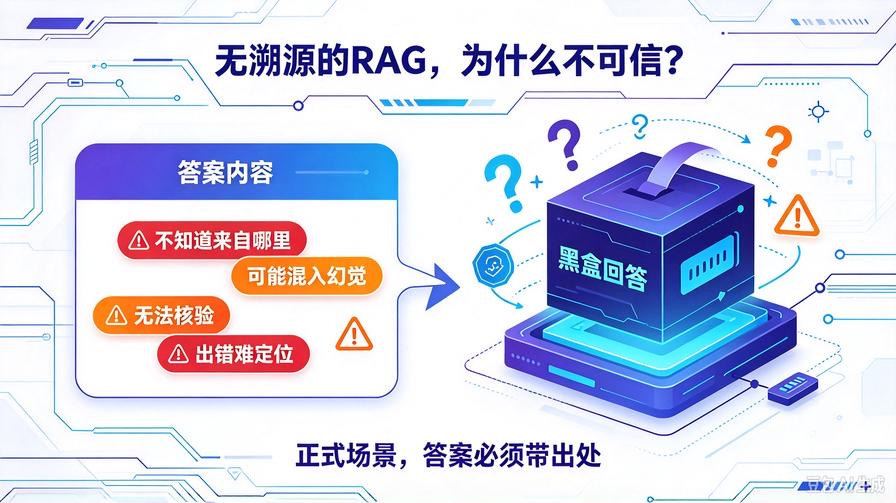
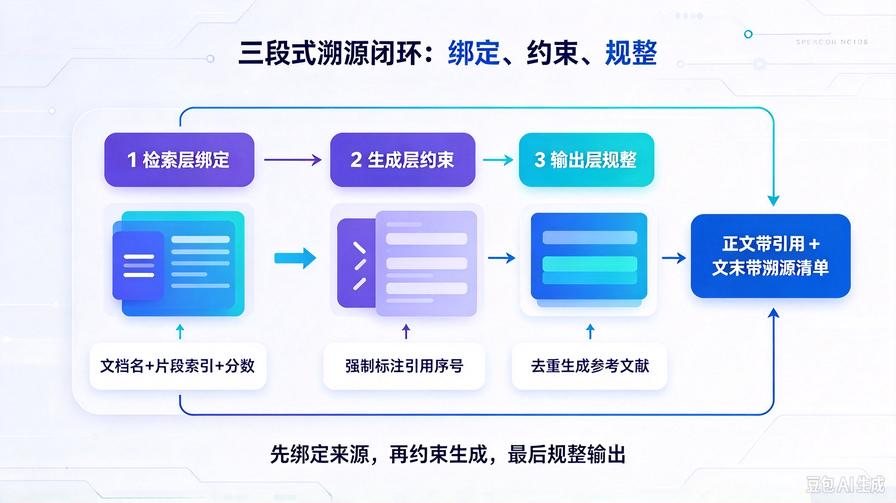
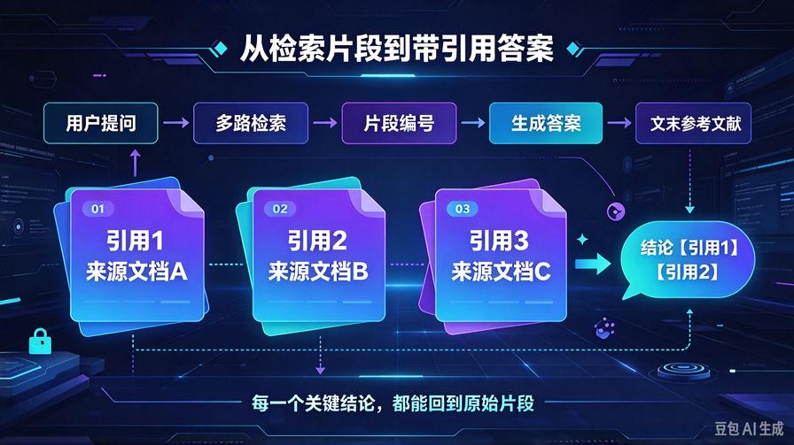
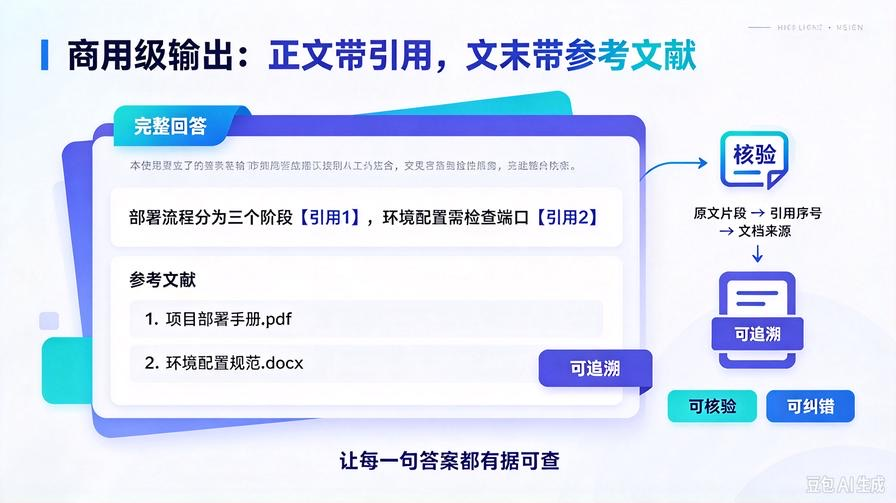

# 第26篇：RAG溯源引用机制，实现每句答案有据可查

欢迎回到 **AI Agent 零基础实战连载系列**！

通过前面 25 篇的层层打磨，我们的私有 RAG 知识库已经具备了**完整商用级底层能力**：

多格式解析、全自动增量更新、智能文本清洗、语义切片、多路召回、重排序融合、自适应 Token 压缩。

现在的 AI 回答已经足够精准、干净、无幻觉、不溢出、不截断。

但是！目前所有 RAG 系统都存在一个**致命信任缺陷**：

**AI 给出答案，但你完全不知道答案来自哪里。**

模型会自主整合、改写、概括内容，用户无法区分：

- 哪句话来自文档原文？
- 哪段结论是 AI 推导出来的？
- 有没有混入模型固有知识、隐性幻觉？
- 信息是否过时、是否来自错误文档？

**无溯源的 RAG，永远无法用于正式工作、生产、办公、商用场景。**

本篇我们从零搭建 **完整 RAG 溯源引用系统**，让 Agent 回答自动绑定文档来源、片段出处、精准引用标注。**每一句输出都有据可查、可核验、可追溯。**

读完本篇彻底掌握：

- RAG 为什么必须做溯源引用（商用落地核心标准）
- 检索片段溯源信息封装、来源绑定、索引映射机制
- Prompt 溯源指令工程，引导 AI 规范标注引用
- 自动去重引用、规范出处排版、文末参考文献输出
- 全架构无感升级，兼容所有历史知识库能力

## 一、为什么溯源是RAG落地的最后一块拼图？



### 1. 普通RAG是“黑盒回答”

常规 RAG 只会把检索内容喂给模型，模型自由揉碎重组。用户只能看到结果，看不到依据。一旦出错，无法定位、无法核验、无法修正。

### 2. 商用场景绝对禁止无依据输出

工作汇报、项目文档、技术方案、合同资料、学习笔记、运维手册——**所有正式场景，答案必须带出处**。无引用 RAG 只能当玩具闲聊。

### 3. 彻底杜绝隐性幻觉

只要强制 AI 标注来源，模型就无法随意编造内容。无来源的结论不能输出，**从机制层面锁死幻觉空间**。

### 4. 行业顶级RAG标配能力

市面上所有付费企业级知识库、私有问答系统，全部自带「溯源+引用+参考文献」能力，这是**从Demo跃迁到商用的最后核心能力**。

## 二、溯源引用核心原理



我们搭建 **检索溯源绑定 + 生成强制引用 + 文末参考文献** 三段式闭环：

1. **检索层绑定**：每一段切片保留文档名、片段索引、匹配分数
2. **Prompt层约束**：强制模型回答时标注引用序号，无来源不允许编造
3. **输出层整理**：自动汇总参考文献，规范排版、去重展示

**先绑定来源、再约束生成、最后规整输出**，实现百分百可追溯问答体系。

## 三、升级项目结构（平滑无侵入升级）

```plain text
knowledge_base/
├── kb_core.py         # 升级：封装溯源结构体、引用信息
├── context_compressor.py
├── text_cleaner.py
└── parse_doc.py
```

## 四、升级 kb_core.py 支持溯源数据封装

我们不改动原有解析、清洗、切片、检索、重排序、压缩逻辑，只**增强检索输出结构**，让每一条内容自带溯源元信息：

### 修改 search 方法，结构化返回溯源数据

重写 kb_core.py 的 search 方法，分为「结构化数据返回」和「带引用Prompt文本返回」双模式，适配Agent调用：

```python
def search(self, query):
    """
    全新升级：带溯源引用的高精度检索
    返回结构化溯源数据 + 可直接喂给模型的引用文本
    """
    if not self.store["doc_list"]:
        return "知识库暂无任何私有文档内容"

    # 1. 多路扩召
    query_vec = self.get_embedding(query)
    raw_score_list = []

    for item in self.store["doc_list"]:
        sim_score = self.calc_similarity(query_vec, item["vector"])
        raw_score_list.append({
            "score": sim_score,
            "content": item["content"],
            "source": item["source"]
        })

    raw_top = sorted(raw_score_list, key=lambda x: x["score"], reverse=True)[:INIT_RECALL_TOPK]
    # 2. 重排序
    rerank_top = self.rerank_results(query, raw_top)
    # 3. 去重融合
    final_results = self.fuse_dup_content(rerank_top)

    if not final_results:
        return "未检索到相关私有文档内容"

    # ========== 新增：封装溯源引用信息 ==========
    ref_text = "【参考知识库片段（带溯源）】\n"
    ref_map = {}

    for idx, item in enumerate(final_results):
        ref_id = idx + 1
        ref_text += f"\n[引用{ref_id}] 来源文档：{item['source']}\n"
        ref_text += f"内容：{item['content']}\n"
        ref_map[ref_id] = {
            "source": item["source"],
            "score": item["total_score"],
            "content": item["content"]
        }

    # 4. 自适应压缩
    ref_text = compressor.compress(ref_text, MAX_CONTEXT_TOKEN)
    return ref_text
```

## 五、升级Agent提示词，强制规范引用输出



修改 **agent_core.py** 系统提示词，加入**商用级引用规则**，强制AI遵守溯源规范，杜绝编造内容：

```python
RAG_SYSTEM_PROMPT = """
你是基于私有知识库的专业智能问答助手，必须严格遵守以下引用规则：
1. 所有回答内容必须严格基于参考知识库片段，禁止编造、禁止脑补、禁止使用外部模型知识。
2. 回答中每一处关键结论、数据、流程、规则，都需要标注对应引用序号，格式为【引用1】【引用2】。
3. 若多个片段综合得出结论，需要同时标注所有对应来源。
4. 若知识库内容不足以回答问题，必须如实说明「当前知识库无相关内容」，禁止强行回答。
5. 回答结尾必须自动汇总【参考文献列表】，去重展示所有用到的文档来源。
6. 禁止输出知识库以外的知识，杜绝一切幻觉。
"""
```

## 六、新增能力：自动去重参考文献

在 kb_core.py 新增工具方法，支持 Agent 自动规整引用、合并重复来源、输出标准参考文献：

```python
def get_ref_summary(self, ref_text: str) -> str:
    """
    提取并规整参考文献，自动去重、排序
    """
    if "来源文档：" not in ref_text:
        return ""

    lines = ref_text.split("\n")
    source_set = set()
    for line in lines:
        if "来源文档：" in line:
            source = line.split("来源文档：")[-1].strip()
            source_set.add(source)

    if not source_set:
        return ""

    ref_out = "\n\n【参考文献】\n"
    for idx, src in enumerate(list(source_set)):
        ref_out += f"{idx+1}. {src}\n"
    return ref_out
```

## 七、完整溯源问答工作流

本次升级完成后，Agent 会全自动执行这套溯源闭环：

1. 用户提问
2. 知识库高精度检索，返回**带编号、带来源**的参考片段
3. Agent 严格基于片段生成答案，逐句标注引用编号
4. 自动提取所有文档来源，去重生成参考文献列表
5. 最终输出：正文带引用 + 文末带溯源清单

## 八、实战效果展示（标准商用输出）



优化后 Agent 回答样式：

本次项目部署流程分为环境配置、服务启动、日志监控三个阶段【引用1】。环境配置需要提前安装依赖并配置环境变量，确保端口不被占用【引用2】。服务启动后可通过定时任务实现全自动巡检。

**【参考文献】**

1. 项目部署手册.pdf  
2. 环境配置规范.docx

**特点：每一句结论都有出处，可点开原文核验，彻底杜绝幻觉与错误结论。**

## 九、本篇五大核心升级价值

- **彻底消除黑盒输出**：答案不再凭空出现，全程有据可查
- **从机制杜绝幻觉**：无来源内容禁止输出，锁死编造空间
- **商用合规化**：满足办公、项目、学习、正式文档问答标准
- **便于纠错迭代**：答案出错可直接定位对应文档片段，快速修正资料
- **全兼容无冲突**：所有历史高精度RAG能力完全保留

## 十、本篇核心总结

1. 精准检索、干净数据、完整窗口只能保证「回答通顺」，**溯源引用才能保证「回答可信」**
2. 完成检索层溯源绑定、生成层强制引用、输出层参考文献规整
3. 实现行业标准商用级可追溯问答体系
4. Agent 私有知识库正式脱离玩具级，达到企业可用标准
5. 为后续智能问答、自动写文档、资料分析打下可信基础

## 下期预告：第27篇｜智能文档摘要与知识库问答评分体系

下一篇我们搭建 **AI 自动评分体系**，让系统自主判断问答准确率、检索质量、回答完整度，实现知识库自我检测、自我优化，真正拥有自我迭代能力！

> 来源：头条号《AI Agent 零基础实战》第26篇｜版权归作者所有，仅供学习交流
