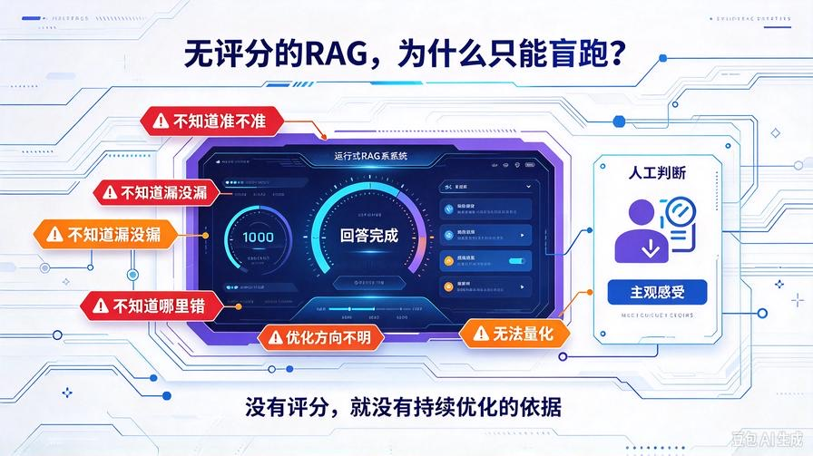
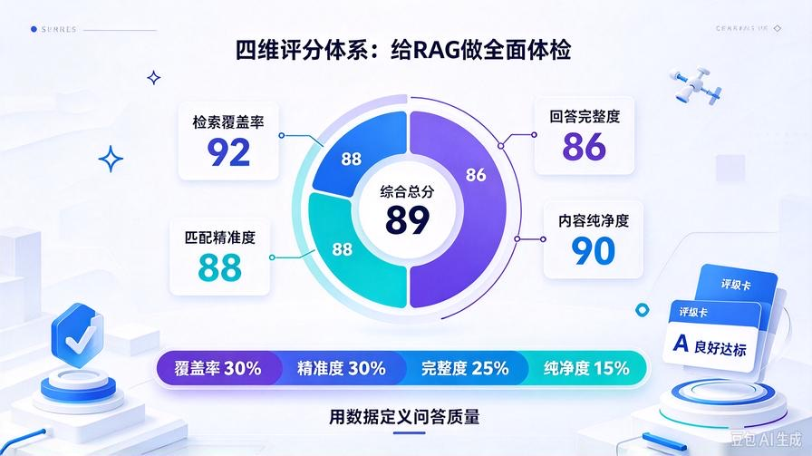
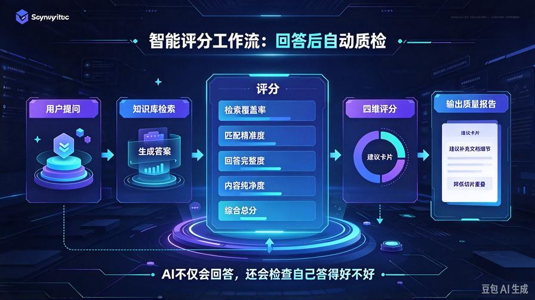
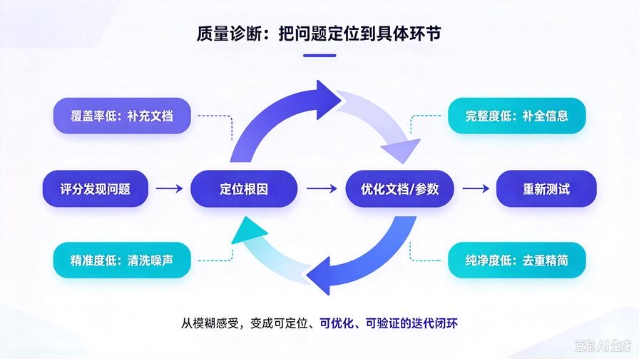

# 第27篇：RAG智能评分体系，实现知识库自检与自我迭代

欢迎回到 **AI Agent 零基础实战连载系列**！

在前26篇的持续打磨中，我们的私有RAG知识库已经完成了**全套商用能力闭环**：

多格式解析、增量自动更新、文本智能清洗、语义切片、多路召回、重排序融合、Token自适应压缩、溯源引用标注。

到这里，绝大多数开源RAG项目已经彻底封顶。

但我们还要解决一个**行业普遍痛点**：

**你永远不知道当前知识库「到底准不准、好不好、哪里有问题」。**

传统RAG只能靠**人工主观感受**判断效果：

- 检索到底有没有漏信息？
- 回答完整性够不够？
- 匹配精度是否达标？
- 有没有隐性幻觉、冗余、偏差？

**没有量化评分的RAG，就没有优化方向。**

本篇我们搭建 **轻量化RAG智能评分体系**，让系统自动检测：检索质量、匹配准确度、回答完整度、内容冗余度，实现**知识库自检、自评、自我迭代**，让你的私有AI越用越精准。

读完本篇彻底掌握：

- RAG四大核心评分维度：检索、匹配、回答、冗余
- 本地量化评分算法，零模型调用、低成本高精度
- 自动生成问答质量报告，精准定位知识库缺陷
- 低分自动预警，指导文档补充、切片优化、参数调优
- 无缝兼容全套历史架构，开启RAG迭代进化能力

## 一、为什么必须做RAG量化评分？



### 1. 人工判断极度主观

平时使用只能凭感觉判断“答得好/不好”，无法精准定位问题：是切片问题？检索问题？文档缺失问题？还是权重参数问题？无法针对性优化。

### 2. 知识库迭代盲目无方向

新增文档、调整参数、修改切片规则后，**无法量化对比优化效果**，不知道改动是提升了精度还是降低了精度。

### 3. 隐性问题长期积累

部分场景漏召、细节缺失、轻微冗余、匹配偏差等隐性问题，人工很难察觉，长期积累导致知识库效果越来越差。

### 4. 商用RAG必备质检体系

所有企业级RAG平台，都自带**量化评估、质量打分、问题溯源、迭代分析**能力，评分体系是RAG从“可用”走向“精良”的核心关键。

## 二、四大维度智能评分核心原理



我们搭建**轻量化四维量化评估模型**，全程本地算法计算、无需训练、无需标注数据：

1. **检索覆盖率评分**：检测检索片段是否覆盖提问核心关键词与语义
2. **语义匹配度评分**：判断检索内容与用户问题的贴合精准度，过滤无效召回
3. **回答完整度评分**：评估答案是否完整解答问题，有无残缺、遗漏
4. **内容纯净度评分**：检测回答冗余度、重复度、无效信息占比

**四维加权得出总分，精准定义RAG问答质量。**

## 三、升级项目结构

```plain text
knowledge_base/
├── kb_core.py
├── text_cleaner.py
├── parse_doc.py
├── context_compressor.py
└── rag_evaluator.py   # 【全新新增】RAG智能评分质检核心

```

## 四、新建智能评分核心 rag_evaluator.py

全新搭建轻量化评分工具，实现四大维度全自动打分、质量评级、问题诊断，代码直接落地：

```python
import re
import numpy as np

class RAGEvaluator:
    def __init__(self):
        # 停用词过滤（无意义词汇不参与评分）
        self.stop_words = {"的","了","是","在","我","你","他","和","与","及","等","可以","能够","需要"}

    def extract_key_words(self, text: str) -> list:
        """提取文本核心关键词，过滤停用词"""
        words = re.findall(r"[\u4e00-\u9fa5a-zA-Z0-9]+", text)
        key_words = [w for w in words if w not in self.stop_words and len(w) > 1]
        return list(set(key_words))

    def calc_recall_score(self, query: str, retrieve_content: str) -> float:
        """
        1. 检索覆盖率评分（0-100）
        核心关键词覆盖越多，分数越高
        """
        query_keys = self.extract_key_words(query)
        if not query_keys:
            return 100.0
        retrieve_keys = self.extract_key_words(retrieve_content)
        match_keys = [k for k in query_keys if k in retrieve_keys]
        recall_rate = len(match_keys) / len(query_keys)
        return round(recall_rate * 100, 2)

    def calc_precision_score(self, query: str, retrieve_content: str) -> float:
        """
        2. 语义匹配精准度评分（0-100）
        检索内容有效信息占比，剔除无关冗余内容
        """
        query_keys = self.extract_key_words(query)
        retrieve_keys = self.extract_key_words(retrieve_content)
        if not retrieve_keys:
            return 0.0
        match_keys = [k for k in retrieve_keys if k in query_keys]
        precision_rate = len(match_keys) / len(retrieve_keys)
        return round(precision_rate * 100, 2)

    def calc_complete_score(self, query: str, answer: str) -> float:
        """
        3. 回答完整度评分（0-100）
        判断答案是否覆盖提问核心诉求
        """
        query_keys = self.extract_key_words(query)
        if not query_keys:
            return 100.0
        ans_keys = self.extract_key_words(answer)
        match_num = sum(1 for k in query_keys if k in ans_keys)
        complete_rate = match_num / len(query_keys)
        return round(complete_rate * 100, 2)

    def calc_purity_score(self, answer: str) -> float:
        """
        4. 内容纯净度评分（0-100）
        检测重复语句、冗余内容、无效话术
        """
        lines = [line.strip() for line in answer.split("\n") if line.strip()]
        if not lines:
            return 0.0
        # 计算重复行占比
        unique_lines = list(set(lines))
        purity_rate = len(unique_lines) / len(lines)
        return round(purity_rate * 100, 2)

    def get_grade(self, total_score: float) -> str:
        """分数评级：S/A/B/C/D"""
        if total_score >= 90:
            return "S 顶级优质问答"
        elif total_score >= 80:
            return "A 良好达标"
        elif total_score >= 70:
            return "B 合格可用"
        elif total_score >= 60:
            return "C 一般需优化"
        else:
            return "D 较差存在缺陷"

    def evaluate(self, query: str, retrieve_content: str, answer: str) -> dict:
        """
        一站式综合评分入口
        返回四维分数、总分、评级、优化建议
        """
        # 四大维度打分
        recall_sc = self.calc_recall_score(query, retrieve_content)
        precision_sc = self.calc_precision_score(query, retrieve_content)
        complete_sc = self.calc_complete_score(query, answer)
        purity_sc = self.calc_purity_score(answer)

        # 加权综合总分
        total = (recall_sc * 0.3) + (precision_sc * 0.3) + (complete_sc * 0.25) + (purity_sc * 0.15)
        total = round(total, 2)

        # 智能优化建议
        suggest = []
        if recall_sc < 70:
            suggest.append("检索覆盖率低：存在关键词漏召，建议扩充文档或调整切片大小")
        if precision_sc < 70:
            suggest.append("匹配精度低：检索存在无关内容，建议清洗文档或调高关键词权重")
        if complete_sc < 70:
            suggest.append("回答完整度不足：知识库关键信息缺失，需补充对应文档内容")
        if purity_sc < 70:
            suggest.append("内容纯净度低：回答存在冗余重复，可优化切片重叠参数")
        if not suggest:
            suggest.append("问答质量优秀，无需优化")

        return {
            "检索覆盖率": recall_sc,
            "匹配精准度": precision_sc,
            "回答完整度": complete_sc,
            "内容纯净度": purity_sc,
            "综合总分": total,
            "质量评级": self.get_grade(total),
            "优化建议": suggest
        }

# 全局单例
evaluator = RAGEvaluator()
```

## 五、接入知识库，实现全自动评分

无需改动原有检索、溯源、压缩逻辑，只需要在 **kb_core.py** 顶部导入评分器，新增评分查询方法：

### 1. 新增导入

```python
from .rag_evaluator import evaluator
```

### 2. 新增智能评分查询方法

在 LocalKnowledgeBase 类中新增方法，支持单次问答全自动质检：

```python
def evaluate_qa_quality(self, query: str, answer: str, retrieve_text: str) -> dict:
    """
    对外暴露：问答质量智能评分接口
    """
    return evaluator.evaluate(query, retrieve_text, answer)
```

## 六、Agent 联动评分实战工作流



升级后，完整问答链路变成**问答+自检双闭环**：

1. 用户发起提问
2. 知识库高精度检索，带回溯源内容
3. Agent 生成带引用的标准回答
4. 系统自动四维评分、质量评级、生成优化建议
5. 输出答案 + 质量报告 + 优化方案

**从此AI不仅会回答问题，还会自己检查答得好不好、哪里需要优化。**

## 七、评分标准与质量等级解读

### 四大维度权重逻辑（商用最优配比）

- **检索覆盖率30%**：保证信息不漏召，是问答完整的基础
- **匹配精准度30%**：保证检索不乱召，杜绝无关内容干扰
- **回答完整度25%**：最终答案是否解决用户核心问题
- **内容纯净度15%**：剔除冗余重复，保证回答简洁高效

### 五级质量评级

- **S级 90分+**：顶级问答，全覆盖、高精准、无冗余
- **A级 80-89分**：良好达标，日常使用完全够用
- **B级 70-79分**：合格可用，轻微瑕疵不影响使用
- **C级 60-69分**：存在明显缺陷，需要针对性优化文档
- **D级 60分以下**：检索或文档存在严重问题，必须迭代更新

## 八、实战落地价值：精准定位问题



以往效果差，你只能模糊感知；现在可以**精准定位根因**：

- **覆盖率低** = 文档内容不全、关键词缺失、切片过短
- **精准度低** = 语义混淆、噪声过多、权重配比不合理
- **完整度低** = 关键信息未入库、内容碎片化
- **纯净度低** = 文档重复多、切片重叠过大、清洗不彻底

**有数据、有评级、有方案，知识库从此精准迭代，不再盲目优化。**

## 九、本篇核心总结

1. 无量化评分的RAG只能盲跑，**量化评估是知识库进化的核心动力**
2. 搭建四维评分体系：检索、精准、完整、纯净全覆盖检测
3. 本地轻量化算法，零AI调用、零成本、高效率质检
4. 自动评级+自动诊断+自动给出优化方案
5. 完美兼容全套架构，实现RAG全自动自检迭代闭环

## 下期预告：第28篇｜长期记忆+知识库融合，打造真正永续进化AI私人大脑

下一篇我们打通 **对话长期记忆 + 私有知识库**，让AI既记住你的对话习惯，又掌握你的私有资料，实现**越聊越懂你、越用越智能**的终极私人AI大脑！

> 来源：头条号《AI Agent 零基础实战》第27篇｜版权归作者所有，仅供学习交流
