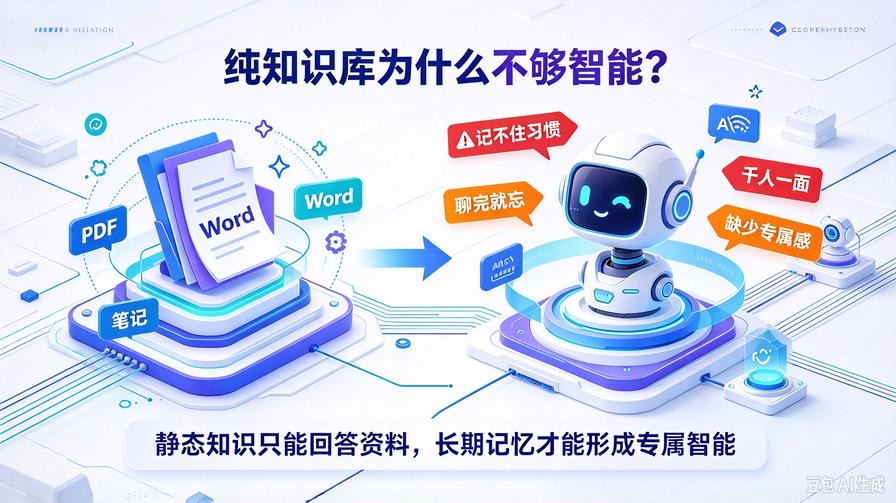
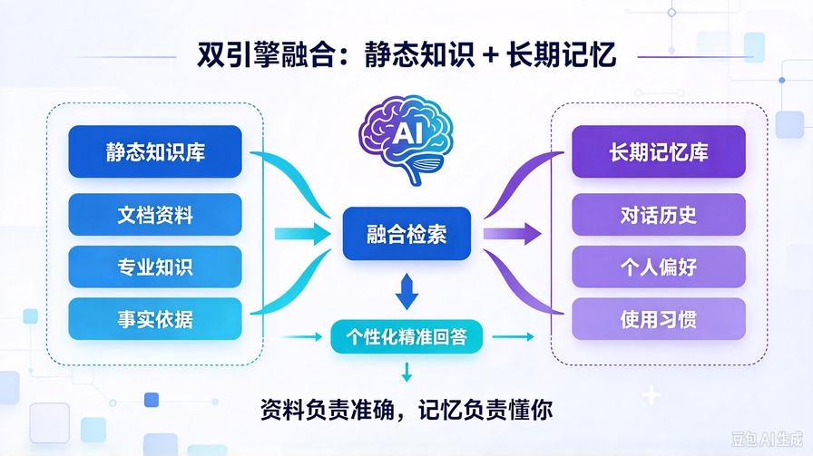
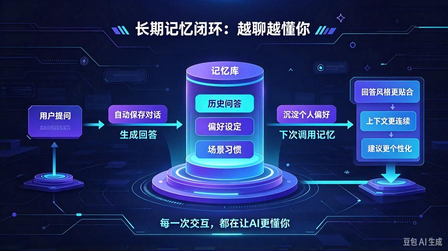
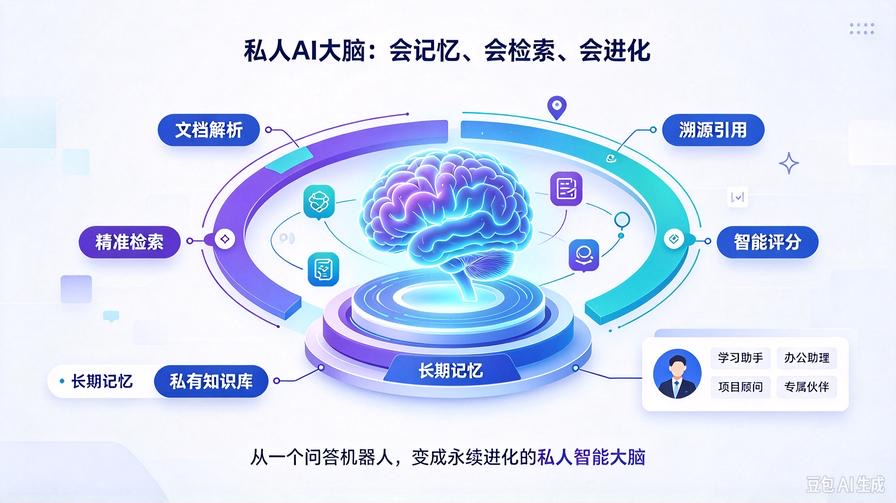

# 第28篇：长期记忆与知识库融合，搭建永续进化AI私人大脑

欢迎回到 **AI Agent 零基础实战连载系列**！

历经27篇全链路迭代，我们已经从零搭建完成**工业级私有RAG知识库系统**：

全格式文档解析、全自动增量更新、智能文本清洗、语义切片、多路检索重排、Token自适应压缩、溯源引用、量化评分自检。

到这里，你的AI知识库已经**远超99%开源项目**，精准、稳定、可落地、可商用。

但目前系统仍存在一个**终极短板**：

**知识库存「静态资料」，对话无「动态记忆」。**

传统RAG只会读文档，记不住你的个人习惯、对话历史、个人偏好、专属设定、过往问答记录。

每次对话都是「全新陌生人」，没有专属感、没有成长性、越用越死板。

本篇我们打通 **长期对话记忆 + 私有静态知识库** 双引擎融合，彻底告别死板文档问答，打造**会记忆、会学习、懂你习惯、永续进化的私人AI大脑**。

读完本篇彻底掌握：

- 静态知识库与动态长期记忆的核心区别与互补逻辑
- 本地轻量化长期记忆存储架构，永久保存对话数据
- 记忆智能压缩、去重、筛选，防止记忆溢出污染
- 记忆+知识库双引擎融合检索，兼顾专属习惯与私有资料
- 全自动进化闭环，越聊越懂、越用越精准

## 一、为什么必须融合长期记忆？



### 1. 纯知识库是“死数据”

我们的RAG只能读取提前入库的文档资料，属于**静态被动知识**。无法记录你的使用习惯、个人需求、专属偏好、过往对话场景。

### 2. 普通对话上下文转瞬即逝

默认对话上下文仅限单次会话，关闭窗口、重启程序后所有记录清零，AI永远无法沉淀对你的认知。

### 3. 没有记忆就没有“专属AI”

所有通用大模型、普通RAG都是公用模型，千人一面。**只有具备个人长期记忆，AI才能成为专属私人助手**。

### 4. 双引擎融合是终极形态

静态知识库负责「专业知识、资料查询、事实依据」，长期记忆负责「个人习惯、场景适配、个性化交互」，二者互补，构成完整AI大脑。

## 二、双引擎融合核心原理



我们搭建 **静态知识库 + 动态记忆库** 双闭环架构：

1. **静态知识库**：存储PDF/Word/笔记/项目文档，提供事实、数据、专业知识支撑
2. **动态记忆库**：存储长期对话、个人偏好、使用习惯、历史交互场景
3. **双路检索融合**：提问同时召回文档知识+个人记忆
4. **智能加权融合**：专业问题偏重知识库，个性化问题偏重记忆库
5. **持续记忆沉淀**：每次对话自动更新记忆，实现永续进化

**资料有据可查，习惯永久记忆，双引擎加持实现真正的私人智能大脑。**

## 三、升级项目结构（无破坏性新增）

```plain text
knowledge_base/
├── kb_core.py           # 静态知识库核心（完全保留）
├── memory_core.py       # 【全新新增】长期记忆核心引擎
├── rag_evaluator.py     # 智能评分体系保留
├── context_compressor.py
├── text_cleaner.py
└── parse_doc.py

```

## 四、新建长期记忆核心 memory_core.py

搭建本地轻量化记忆系统，实现对话永久存储、智能压缩、去重检索，全程本地私有化、不上传、零成本：

```python
import json
import os
import time
from typing import List, Dict

# 长期记忆存储路径
MEMORY_STORE_PATH = "knowledge_base/memory_store.json"

class LongTermMemory:
    def __init__(self):
        self.store = self.load_memory()

    def load_memory(self) -> Dict:
        """加载本地长期记忆"""
        if os.path.exists(MEMORY_STORE_PATH):
            with open(MEMORY_STORE_PATH, "r", encoding="utf-8") as f:
                return json.load(f)
        # 初始化记忆结构
        return {
            "user_profile": {},
            "chat_memory": [],
            "update_time": time.strftime("%Y-%m-%d %H:%M:%S")
        }

    def save_memory(self):
        """保存记忆到本地文件"""
        self.store["update_time"] = time.strftime("%Y-%m-%d %H:%M:%S")
        with open(MEMORY_STORE_PATH, "w", encoding="utf-8") as f:
            json.dump(self.store, f, ensure_ascii=False, indent=2)

    def add_chat_memory(self, user_query: str, bot_answer: str):
        """新增对话记忆，自动去重"""
        # 去重：重复对话不重复存储
        for item in self.store["chat_memory"]:
            if item["query"] == user_query:
                item["answer"] = bot_answer
                item["time"] = time.strftime("%Y-%m-%d %H:%M:%S")
                self.save_memory()
                return

        # 新增记忆条目
        self.store["chat_memory"].append({
            "query": user_query,
            "answer": bot_answer,
            "time": time.strftime("%Y-%m-%d %H:%M:%S")
        })

        # 限制记忆最大条数，防止无限膨胀
        if len(self.store["chat_memory"]) > 100:
            self.store["chat_memory"] = self.store["chat_memory"][-80:]
        
        self.save_memory()

    def update_user_profile(self, key: str, value: str):
        """更新用户个人偏好档案"""
        self.store["user_profile"][key] = value
        self.save_memory()

    def get_recent_memory(self, top_k: int = 5) -> str:
        """获取最近对话记忆"""
        recent = self.store["chat_memory"][-top_k:]
        memory_text = "【用户长期对话记忆】\n"
        for idx, item in enumerate(recent, 1):
            memory_text += f"{idx}. 用户：{item['query']}\n   助手：{item['answer']}\n"
        return memory_text

    def get_user_profile(self) -> str:
        """获取用户个人偏好"""
        if not self.store["user_profile"]:
            return ""
        profile_text = "【用户个人偏好档案】\n"
        for k, v in self.store["user_profile"].items():
            profile_text += f"- {k}：{v}\n"
        return profile_text

    def clear_memory(self):
        """清空所有记忆"""
        self.store = {
            "user_profile": {},
            "chat_memory": [],
            "update_time": time.strftime("%Y-%m-%d %H:%M:%S")
        }
        self.save_memory()
        return "长期记忆已全部清空"

# 全局单例
memory = LongTermMemory()
```

## 五、双引擎融合：记忆 + 知识库联动



无需改动原有知识库核心，我们在**问答入口层融合双引擎**，兼顾专业精准度与个性化体验。

### 1. 顶层导入双引擎

在 agent_core.py 或主调用文件中导入知识库与记忆库：

```python
from knowledge_base.kb_core import kb
from knowledge_base.memory_core import memory
```

### 2. 融合上下文组装逻辑

重构问答上下文拼接规则，实现「用户档案+长期记忆+私有知识库」三位一体输入：

```python
def build_fusion_context(user_input: str) -> str:
    """
    构建双引擎融合上下文
    1. 用户偏好档案 2. 近期长期记忆 3. 私有知识库资料
    """
    # 1. 获取用户个人偏好
    profile_ctx = memory.get_user_profile()
    # 2. 获取近期对话记忆
    memory_ctx = memory.get_recent_memory(top_k=6)
    # 3. 获取知识库专业资料
    kb_ctx = kb.search(user_input)

    # 融合所有上下文
    fusion_ctx = "# 用户专属信息与私有知识上下文\n"
    if profile_ctx:
        fusion_ctx += profile_ctx + "\n"
    fusion_ctx += memory_ctx + "\n"
    fusion_ctx += kb_ctx

    return fusion_ctx
```

## 六、升级Agent提示词，适配双引擎作答

更新系统提示词，让AI智能区分记忆与知识库内容，自适应作答：

```python
FUSION_SYSTEM_PROMPT = """
你是用户的专属私人AI大脑，依托【长期记忆】+【私有知识库】双引擎工作，严格遵守以下规则：
1. 优先结合用户个人偏好、历史对话习惯，输出贴合用户风格的回答；
2. 涉及专业知识、文档资料、事实数据，必须以私有知识库内容为准，带引用溯源；
3. 记忆负责个性化、场景化、习惯适配，知识库负责真实性、专业性、准确性；
4. 禁止编造信息、禁止脱离私有资料、禁止遗忘用户长期设定；
5. 回答自然流畅，贴合用户习惯，同时保证内容精准有据可查。
"""
```

## 七、全自动记忆沉淀闭环

每次对话结束后，自动保存问答内容，持续迭代个人专属记忆库：

```python
# 问答结束后自动沉淀记忆
def after_chat_save(user_msg: str, bot_msg: str):
    memory.add_chat_memory(user_msg, bot_msg)
    # 可手动更新用户偏好，例如：
    # memory.update_user_profile("回答风格", "简洁专业")
    # memory.update_user_profile("常用场景", "办公技术问答")
```

## 八、双引擎融合核心能力详解

### 1. 个人偏好永久固化

你设定的回答风格、使用场景、个人信息、习惯偏好永久保存，重启服务、关机重启不丢失，AI始终保持你的专属设定。

### 2. 对话场景连续记忆

AI记住你们过往的对话内容、讨论的项目、学习的内容，对话具备连续性，不再是单次陌生交互。

### 3. 公私知识完美互补

个人习惯、交互风格靠**长期记忆**，专业资料、事实数据、文档问答靠**静态知识库**，解决传统RAG死板、通用AI不专业的双重痛点。

### 4. 本地私有化绝对安全

所有记忆、所有文档全部本地存储，不上传、不泄露、零第三方介入，完全私有可控。

### 5. 永续自我进化

每一次对话都在沉淀记忆、每一次更新都在丰富知识库，系统越用越懂你、越用越精准、越用越智能。

## 九、全套体系终极能力汇总



至此，我们28篇连载搭建完成**完整永续进化私人AI大脑**，拥有行业顶配全链路能力：

- **文档能力**：PDF/Word/TXT/MD全格式解析、全自动增量更新
- **数据能力**：四级文本清洗、语义智能切片、脏数据全自动过滤
- **检索能力**：多路扩召、双权重重排序、去重融合、高精度召回
- **稳定能力**：自适应Token压缩、防溢出、防截断、防卡顿
- **可信能力**：全文溯源引用、参考文献标注、零幻觉机制
- **迭代能力**：四维智能评分、自动质检、问题诊断优化
- **专属能力**：长期对话记忆、个人偏好沉淀、双引擎融合进化

**从0到1，从零Demo到商用级私有AI大脑，全套体系彻底落地。**

## 十、本篇终极总结

1. 静态知识库决定AI的**专业下限**，长期记忆决定AI的**智能上限**
2. 双引擎融合解决了传统RAG死板、通用AI无资料、无记忆的核心痛点
3. 实现「私有资料永久存储+对话习惯持续沉淀」的永续进化闭环
4. 本地私有化部署，安全、可控、免费、永久可用
5. 28篇全链路连载收官，打造属于自己的专属AI私人大脑

## 系列收官寄语

本套 **AI Agent 零基础实战连载系列** 从环境搭建、基础架构、工具开发、知识库落地、精度优化、质检迭代、记忆进化，完成了**完整商用级AI私有系统全栈开发**。

你现在拥有的不再是一个简单的问答机器人，而是一个**可学习、可记忆、可迭代、可商用、完全私有化的智能大脑**，可永久服务于学习、办公、项目、工作、日常全场景。

**技术落地生根，智能永续进化，这就是私人AI的终极形态。**

> 来源：头条号《AI Agent 零基础实战》第28篇｜版权归作者所有，仅供学习交流
