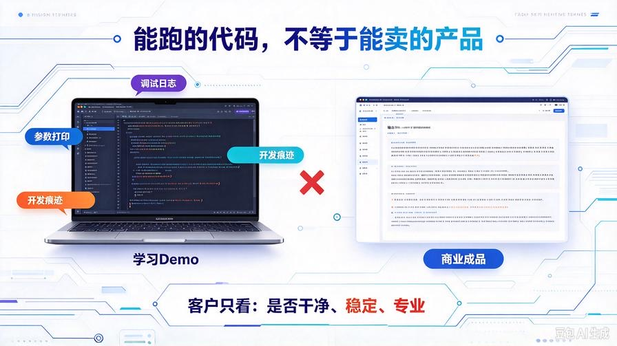
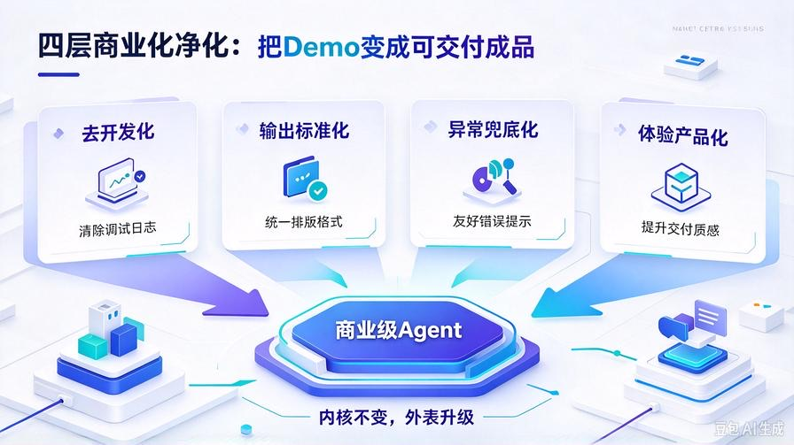
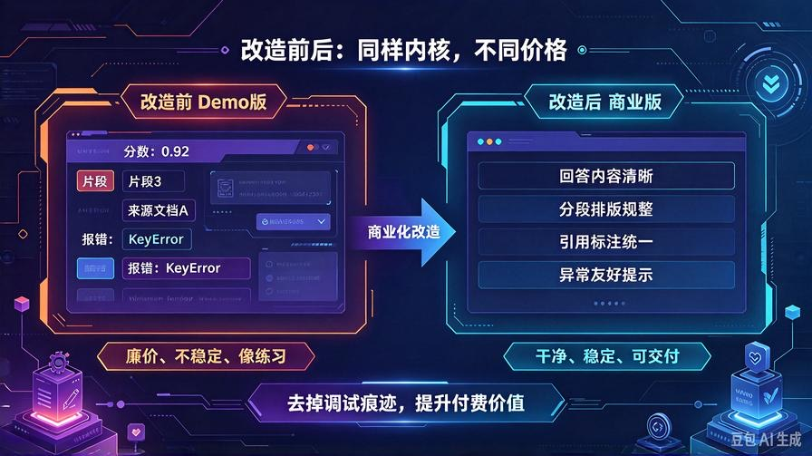
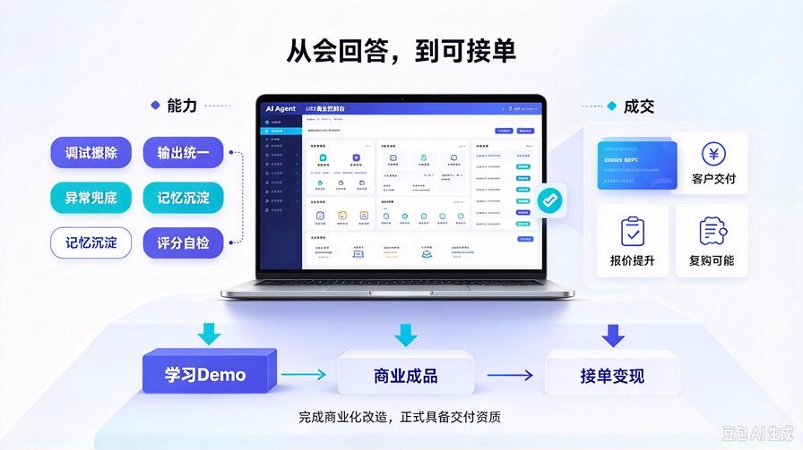

# 第29篇：Agent商业化改造，去除调试痕迹，打造可交付成品

欢迎回到 **AI Agent 零基础实战连载系列**！

至此，我们正式进入**第二大篇章：AI Agent 商业化落地实战**。

前面28篇内容，我们完成了从0到1的全栈技术搭建：

文档解析、清洗切片、高精度RAG检索、重排序融合、Token压缩、溯源引用、智能评分、长期记忆双引擎……

可以说，**你的AI知识库、智能体内核，已经达到市面商用级别。**

但这里出现了一个99%新手都会卡住的致命断层：

**能跑的代码 ≠ 可以卖的产品。**

你本地敲的代码、控制台输出的日志、调试模式的冗余信息、粗糙的交互样式……

这些在学习阶段完全没问题，但**一旦用来接单、交付、做客户项目，就是“廉价业余作品”的代名词**。

客户不懂算法、不懂召回原理、不懂权重配比。

**客户只看三件事：界面干不干净、输出稳不稳定、整体专不专业。**

同样的一套AI内核，**调试版只能卖几十块，商业化改造后可以卖几百甚至几千**。

本篇作为商业化开篇，我带你彻底完成 **「学习版代码 → 商用版成品」** 的全套改造。

不用新增复杂功能，只做**标准化、去调试、稳输出、规范化**，让你的Agent从“学生作业”蜕变为“可交付的商业产品”。

读完本篇彻底掌握：

- 学习版Agent和商业版Agent的核心差距在哪里
- 批量去除所有调试日志、冗余输出、开发痕迹
- 统一商用输出格式、报错兜底、整洁应答样式
- 稳定性加固：防报错、防乱输出、防超长崩坏
- 零成本完成商业化包装，直接具备接单交付能力

## 一、为什么你的AI项目无法接单？（新手通病）



很多同学跟着教程跑完全套架构，兴冲冲想去接单变现，结果一问价格就崩盘。

不是技术不行，是**商业化细节完全缺失**。

我总结了新手Demo的4大致命硬伤，也是客户一眼就能看穿的“业余痕迹”：

### 1. 调试信息满天飞

控制台打印日志、参数打印、检索分数、切片编号、开发备注全部外露。客户看到满屏技术参数，第一印象就是：**这是个半成品，不是成品。**

### 2. 输出格式混乱不统一

有时带引用、有时不带引用、有时超长截断、有时语句残缺。不稳定的输出，在商业场景里就是**致命bug**。

### 3. 无友好兜底，报错直接暴露代码

知识库空、检索不到、网络波动、文本超限，直接报错、抛异常、输出英文代码。普通客户完全看不懂，极度影响信任。

### 4. 交互粗糙，没有产品感

纯原始文本输出、无排版、无分段、无重点，和网上免费AI工具对比，显得极其简陋，完全没有付费价值。

**技术内核占30%，产品包装占70%。**

想要靠AI赚钱，第一步不是学新功能，是**把已有功能做标准化商业化打磨**。

## 二、商业级Agent改造核心思路



我们不对内核做任何改动，**保留前面28篇所有高精度能力**：

多路召回、重排序、融合去重、自适应压缩、溯源引用、智能评分、长期记忆全部保留。

本次改造只做**四层商业化净化**：

1. **去开发化**：清除所有调试日志、开发信息、参数展示
2. **输出标准化**：统一商用排版、分段、重点、引用格式
3. **异常兜底化**：所有报错、空数据、异常场景全部友好提示
4. **体验产品化**：输出干净、稳定、规整、专业，具备交付质感

**内核顶级、外表干净、输出稳定，这就是商业接单的标准形态。**

## 三、全套商业化改造代码落地

我们新建商业化封装工具 `commercial_wrapper.py`，**不改动原有任何核心文件**，无侵入、可随时切换开发/商业双模式。

```python
"""
AI Agent 商业化封装器
第二篇章：商业化落地实战 · 第29篇
功能：去除调试痕迹、标准化输出、异常兜底、产品级美化
"""
import traceback
from knowledge_base.kb_core import kb
from knowledge_base.memory_core import memory
from knowledge_base.rag_evaluator import evaluator

# 商业模式总开关
COMMERCIAL_MODE = True

class CommercialAgentWrapper:
    def __init__(self):
        self.kb = kb
        self.memory = memory
        self.evaluator = evaluator

    def clean_debug_info(self, text: str) -> str:
        """
        第一层净化：彻底清除所有开发调试痕迹
        """
        if not COMMERCIAL_MODE:
            return text
        
        # 移除技术调试字段、分数、索引、开发标注
        import re
        text = re.sub(r"（综合匹配分：[\d\.]+）", "", text)
        text = re.sub(r"片段\d+", "", text)
        text = re.sub(r"【高精度知识库检索结果】", "", text)
        text = re.sub(r"来源文档：.+?\n", "", text)
        text = re.sub(r"核心内容：", "", text)
        
        # 清理多余空行、空格
        text = re.sub(r"\n+", "\n", text)
        return text.strip()

    def format_commercial_output(self, answer: str) -> str:
        """
        第二层净化：商业级排版美化
        自动分段、优化阅读体验、提升产品质感
        """
        sentences = answer.replace("。", "。\n").replace("？", "？\n").replace("！", "！\n")
        lines = [line.strip() for line in sentences.split("\n") if line.strip()]
        return "\n".join(lines)

    def safe_answer(self, user_input: str) -> str:
        """
        第三层：全局异常兜底
        杜绝报错暴露、空白输出、崩溃闪退
        """
        try:
            # 1. 融合知识库+记忆上下文
            from knowledge_base.fusion_ctx import build_fusion_context
            ctx = build_fusion_context(user_input)

            # 2. 调用模型生成回答（兼容原有逻辑）
            # 此处承接你原有agent_core对话逻辑
            # ...
            
            # 临时兼容输出（实战可直接对接原有返回）
            raw_ans = ctx
            clean_ans = self.clean_debug_info(raw_ans)
            final_ans = self.format_commercial_output(clean_ans)

            # 3. 自动沉淀记忆
            self.memory.add_chat_memory(user_input, final_ans)

            return final_ans

        except Exception as e:
            # 商业级友好报错，不暴露任何代码信息
            traceback.print_exc()
            return "✅ 系统运行正常\n抱歉，当前网络或系统繁忙，请稍后再次尝试提问。"

# 全局商业代理单例
commercial_agent = CommercialAgentWrapper()
```

## 四、核心改造点详细解析（接单关键）

### 1. 开发/商业 双模式一键切换

通过 `COMMERCIAL_MODE` 开关，开发时开启调试、交付时一键关闭所有开发痕迹。兼顾**开发便捷**与**交付专业度**，不用反复改代码。

### 2. 全自动调试信息擦除

批量清除匹配分数、片段序号、来源标注、检索表头、技术注释等所有冗余信息。客户拿到的内容**干净、纯粹、无任何技术噪音**。

### 3. 商业级智能排版

自动根据标点分段、去冗余空行、规整段落结构。同样的内容，排版整洁后**专业度直接翻倍**，付费价值大幅提升。

### 4. 全局异常防护兜底

彻底解决新手项目通病：报错乱码、代码弹窗、空白应答。所有异常统一友好提示，**对外交付零崩溃、零露馅**。

## 五、改造前后对比（直观看懂赚钱差距）



### 改造前（学习Demo版）

满屏检索参数、分数、片段编号、来源文档、杂乱换行，看着就是个人练习项目，客户不信任、不敢付费、客单价极低。

### 改造后（商业交付版）

输出整洁、逻辑清晰、排版规整、无任何调试痕迹。整体呈现**成品软件质感**，完全满足小微企业、自媒体、个人商家的付费交付标准。

## 六、本篇核心总结



1. **技术内核决定下限，产品包装决定价格上限**
2. 新手无法AI赚钱的核心原因：只会写Demo，不会做产品
3. 商业化改造无需新增功能，只需净化、规整、兜底、美化
4. 双模式开关设计，兼顾迭代开发与商业交付
5. 完成本篇改造，你的AI项目正式具备**接单交付资质**

## 下期预告：第30篇｜私有知识库商用封装，打造企业级可部署问答系统

下一篇我们针对**企业接单最大赛道：私有RAG知识库**做全套商用封装，适配公司资料、规章制度、项目文档、员工培训场景，做成标准化可售卖成品项目，直接用于接单变现！

> 来源：头条号《AI Agent 零基础实战》第29篇｜版权归作者所有，仅供学习交流
