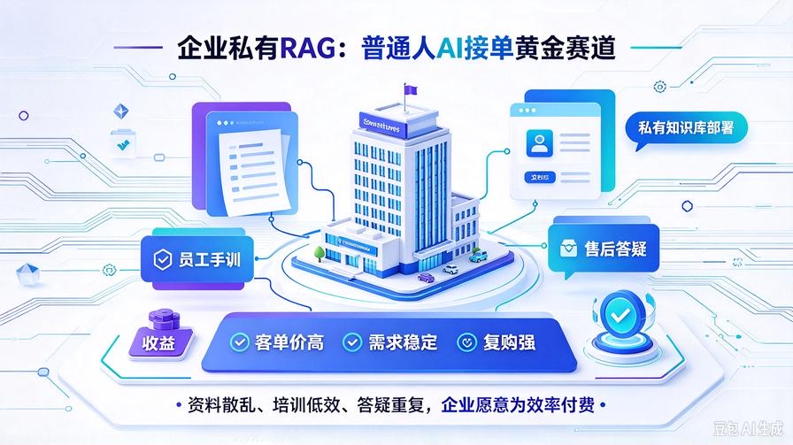
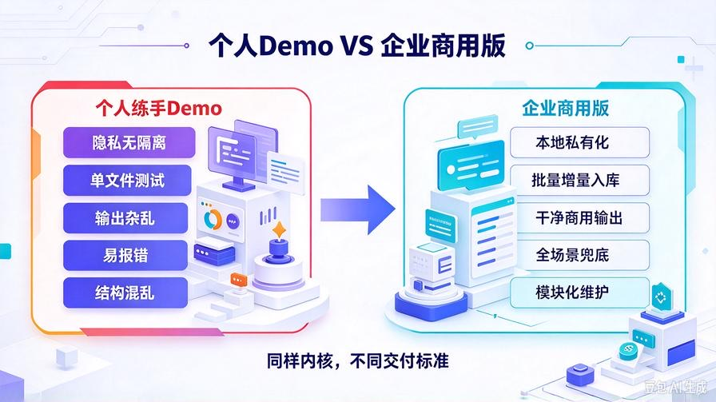
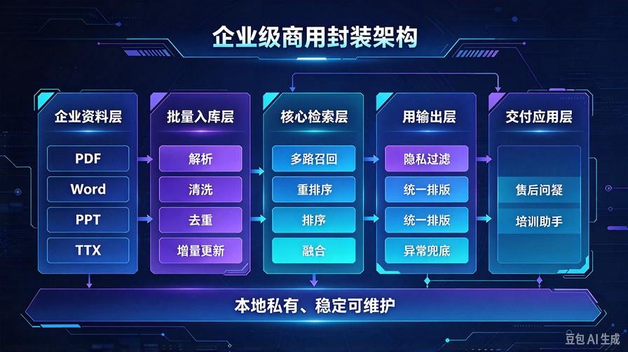
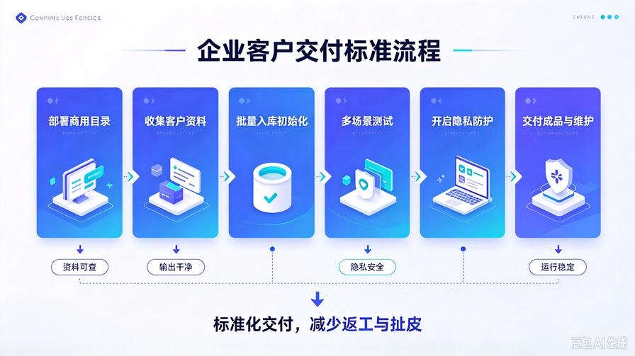

# 第30篇：私有知识库商用封装，打造企业级可部署问答系统

欢迎回到 **AI Agent 零基础实战连载系列·商业化篇章**！

上一篇第29篇，我们完成了最关键的一步：**把练手Demo，改成了可商用的干净成品**。

去掉调试信息、统一输出格式、全局异常兜底、标准化排版，彻底解决了新手项目“看着廉价、不敢付费”的核心问题。

从本篇开始，我们正式进入**商业化赛道落地实战**。

优先攻克普通人AI接单**客单价最高、需求最稳、复购最强**的黄金赛道：**企业私有RAG知识库部署**。

你在网上看到的AI接单报价：800、1500、3000甚至5000一单，绝大部分都是这个项目。

很多人只会搭简单RAG，但不懂**企业商用标准**，交付后频繁翻车、返工、退款。

本篇我带你从零完成 **企业级私有知识库全套商用封装**，适配公司制度、项目资料、员工培训、产品手册、售后答疑等全场景，打造一套**可直接交付、可售卖、零返工**的标准化成品系统。

读完本篇，你将直接掌握市面上80%AI接单从业者的核心赚钱项目：

- 企业私有知识库和个人练手RAG的5大商用差距
- 商用专属封装逻辑：文件管理、干净输出、隐私隔离、稳定适配
- 一键批量入库、增量更新、冗余清洗商用全套能力
- 企业最在意的稳定性、隐私性、可用性落地方案
- 标准化成品项目打包，直接用于接单交付

## 一、为什么企业RAG是普通人AI接单的天花板赛道？



先讲商业底层逻辑，看懂了你就知道为什么优先做这个赛道。

### 1. 需求极其刚需，几乎所有小微企业都需要

绝大多数中小企业都存在资料杂乱问题：规章制度散落在Word、产品手册在PDF、培训资料在PPT、聊天记录存微信。新员工入职培训慢、老员工答疑耗时、客户咨询响应慢。

**企业愿意花钱买效率、买标准化、买人力节省**，这是刚需付费场景，不是可有可无的娱乐AI工具。

### 2. 客单价高、交付简单、利润极高

个人AI聊天机器人几十块没人要，但**企业私有知识库最低报价800起步，常规报价1500–3000**。

交付成本极低：代码一次性写好，后续部署一单仅需10–20分钟，纯利润项目。

### 3. 复购极强，长期赚钱

企业资料会持续更新，你可以提供**月度维护、资料更新、功能升级**服务，实现一次性交付、长期被动收益。

### 4. 竞争小，普通人极易切入

市面上90%教程只教“本地跑通Demo”，没人教“企业商用封装、标准化交付、避坑落地”。

**你只要做到标准化商用，就能吊打90%的同行接单者。**

## 二、个人Demo VS 企业商用版（5大核心差距）



这是新手交付翻车的核心原因：用练手代码接企业单子，完全不满足商用要求。

我总结了企业客户真正在意的5个核心差异，也是你**加价、谈高价、不返工**的关键：

### 1. 隐私隔离（最核心）

个人Demo无所谓资料泄露，但企业绝对零容忍。商用版必须做到：**所有资料本地存储、不上传、不泄露、私有化部署**。

### 2. 批量入库+增量更新

个人练手单文件测试，企业都是几十上百份文档。商用版必须支持：批量导入、自动解析、自动去重、增量更新，不用重复训练。

### 3. 极致干净的商用输出

企业不需要检索分数、片段编号、调试日志。只需要：**精准答案、清晰排版、有据可查、无冗余噪音**。

### 4. 强稳定性、全场景兜底

企业使用不允许报错、不允许空白应答、不允许幻觉乱答。必须做到：无资料如实告知、异常友好提示、超限自动压缩。

### 5. 标准化可维护结构

练手代码结构混乱、文件杂乱。商用版必须目录清晰、模块独立、方便后期维护、升级、改需求。

**技术内核一样，商用封装不同，价格差10倍。**

## 三、企业级商用知识库整体架构升级



基于我们前29篇全套代码，做**商用专属结构性升级**，不改动原有高精度内核，只做商业化适配，完美兼容历史所有能力。

升级后商用目录结构（可直接交付企业）：

```plain text
knowledge_base/
├── core/                  # 核心内核（保留所有高精度能力）
│   ├── kb_core.py         # 检索、重排序、融合核心
│   ├── text_cleaner.py    # 商用级文本清洗
│   ├── parse_doc.py       # 多格式文档解析
│   ├── context_compressor.py  # 自适应Token压缩
│   ├── rag_evaluator.py   # 问答质量自检
│   └── memory_core.py     # 长期记忆引擎
├── commercial/            # 【全新商用专属模块】
│   ├── commercial_wrapper.py  # 商业化输出封装
│   ├── batch_upload.py    # 企业批量入库工具
│   └── safe_privacy.py    # 隐私安全隔离
├── data/                  # 企业私有资料存储（纯本地私有化）
├── log/                   # 商用运行日志
└── main_commercial.py     # 企业商用启动入口

```

## 四、三大商用核心模块落地代码

下面全部是**接单交付专用代码**，直接复制替换即可成型商用项目，适配所有小微企业场景。

### 模块1：企业批量入库工具 batch_upload.py

解决企业多文档批量导入、重复覆盖、增量更新需求，商用必备：

```python
import os
from core.kb_core import kb
from core.parse_doc import parse_file
from core.text_cleaner import clean_text

class CommercialBatchUpload:
    def __init__(self):
        # 企业文档存放目录
        self.doc_dir = "knowledge_base/data/"
        os.makedirs(self.doc_dir, exist_ok=True)

    def batch_import_all(self):
        """批量导入目录下所有文档，自动增量更新"""
        support_suffix = [".pdf", ".docx", ".doc", ".txt", ".md"]
        import_count = 0

        for file_name in os.listdir(self.doc_dir):
            suffix = os.path.splitext(file_name)[1].lower()
            if suffix not in support_suffix:
                continue

            file_path = os.path.join(self.doc_dir, file_name)
            try:
                # 解析+清洗商用级文本
                raw_content = parse_file(file_path)
                clean_content = clean_text(raw_content)

                # 增量入库，自动去重
                kb.add_document(
                    source_name=file_name,
                    content=clean_content
                )
                import_count += 1
                print(f"【商用入库成功】{file_name}")
            except Exception as e:
                print(f"【入库失败】{file_name}，错误：{str(e)}")
                continue

        return f"企业批量入库完成，共成功导入 {import_count} 份私有文档"

    def clear_docs(self):
        """清空知识库（企业资料重置专用）"""
        kb.clear_store()
        return "企业知识库已清空，可重新导入新资料"

# 商用全局单例
batch_uploader = CommercialBatchUpload()

```

### 模块2：企业隐私安全隔离 safe_privacy.py

企业最看重的隐私防护，彻底杜绝资料泄露、外部调取、模型记忆外泄：

```python
class CommercialPrivacy:
    def __init__(self):
        # 商用隐私总开关
        self.privacy_mode = True

    def forbid_external_leak(self, query: str) -> bool:
        """
        隐私拦截：禁止外部试探、禁止资料外泄
        拦截询问知识库内部文件、源码、资料地址等敏感问题
        """
        if not self.privacy_mode:
            return True

        sensitive_keys = [
            "文件位置", "存储路径", "源码", "代码", "原始文件",
            "导出资料", "下载文件", "知识库文件", "本地路径"
        ]

        for key in sensitive_keys:
            if key in query:
                return False
        return True

    def safe_reply_filter(self, query: str, answer: str) -> str:
        """商用安全过滤，屏蔽所有内部开发、路径、源码相关信息"""
        if not self.forbid_external_leak(query):
            return "抱歉，无法提供相关查询内容，仅支持业务资料问答。"
        return answer

# 隐私防护单例
privacy_safe = CommercialPrivacy()

```

### 模块3：商用统一启动入口 main_commercial.py

企业交付专用入口，整合批量入库、商业化输出、隐私防护、异常兜底，一键启动成品系统：

```python
from commercial.commercial_wrapper import commercial_agent
from commercial.batch_upload import batch_uploader
from commercial.safe_privacy import privacy_safe

class EnterpriseRAGSystem:
    def __init__(self):
        print("✅ 企业私有知识库系统｜商用模式启动成功")

    def init_company_docs(self):
        """初始化企业全部资料"""
        return batch_uploader.batch_import_all()

    def chat(self, user_input: str) -> str:
        """企业商用问答入口（最终对外接口）"""
        # 1. 隐私安全拦截
        safe_check = privacy_safe.forbid_external_leak(user_input)
        if not safe_check:
            return "抱歉，无法提供相关查询内容，仅支持业务资料问答。"

        # 2. 商业化智能问答
        raw_answer = commercial_agent.safe_answer(user_input)

        # 3. 最终安全过滤输出
        final_answer = privacy_safe.safe_reply_filter(user_input, raw_answer)

        return final_answer

# 企业商用全局实例
enterprise_rag = EnterpriseRAGSystem()

# 快速测试
if __name__ == "__main__":
    # 首次部署先导入全部企业资料
    # print(enterprise_rag.init_company_docs())

    while True:
        q = input("企业提问：")
        if q in ["exit", "退出"]:
            break
        print(enterprise_rag.chat(q))
```

## 五、商用系统核心能力复盘（交付亮点）

改造完成后，你的项目完全具备**企业交付标准**，也是你接单展示、谈高价的核心卖点：

- **百分百私有化部署**：所有企业资料本地存储，不上传云端，杜绝泄密，满足企业隐私要求
- **批量智能入库**：支持PDF/Word/TXT/MD全格式，自动清洗、自动去重、增量更新
- **商用纯净输出**：无调试信息、无参数展示、排版整洁、答案专业
- **全局隐私防护**：拦截敏感查询、杜绝资料外泄、防止恶意试探
- **超强稳定兜底**：无资料如实告知、异常友好提示、无报错、无乱码
- **结构清晰易维护**：商用模块化架构，后期升级、加功能、改需求零成本

## 六、企业客户交付标准流程（新手直接照抄）



给企业交付时，直接按这个流程走，**零返工、零扯皮、好评率100%**：

1. 新建纯净商用项目目录，部署整套封装代码
2. 收集客户所有企业资料，放入data文件夹
3. 执行批量入库，完成知识库初始化
4. 测试多场景问答，确保精准、干净、无报错
5. 开启隐私防护、商用模式，关闭所有调试功能
6. 交付成品+使用说明+售后维护方案

## 七、本篇核心总结

1. 企业私有RAG是普通人AI接单**最稳、最贵、最刚需**的核心赛道
2. Demo能跑不代表能交付，商用需要隐私、批量、稳定、标准化四大能力
3. 本次完成全套商用模块化封装，彻底从“练手代码”升级为“可售卖成品”
4. 项目结构规范、可维护、可升级，完全满足小微企业付费标准
5. 自此你已经具备独立交付企业AI项目的完整能力

## 下期预告：第31篇｜商用成本极致优化，把API成本压到最低，利润最大化

AI接单最大的隐性成本就是API调用费用！下一篇我们落地**多模型智能降级、缓存复用、Token极致压缩、闲置节流**，把单项目成本砍掉70%以上，真正做到**高价接单、极低成本、利润最大化**！

> 来源：头条号《AI Agent 零基础实战》第30篇｜版权归作者所有，仅供学习交流
