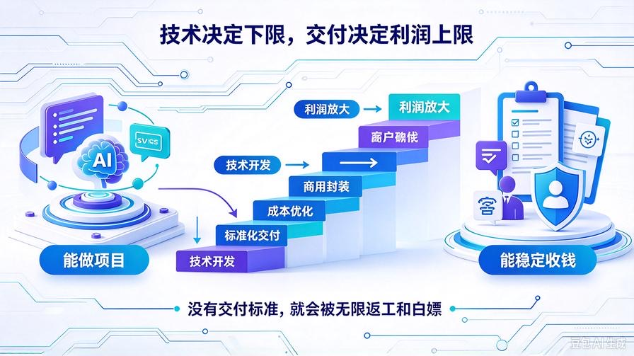
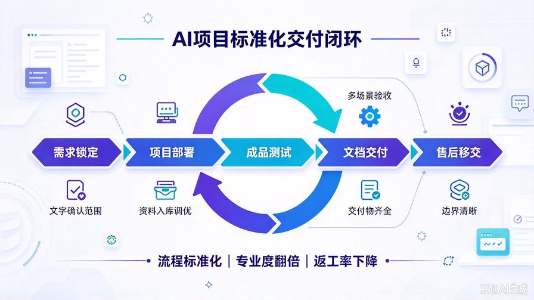
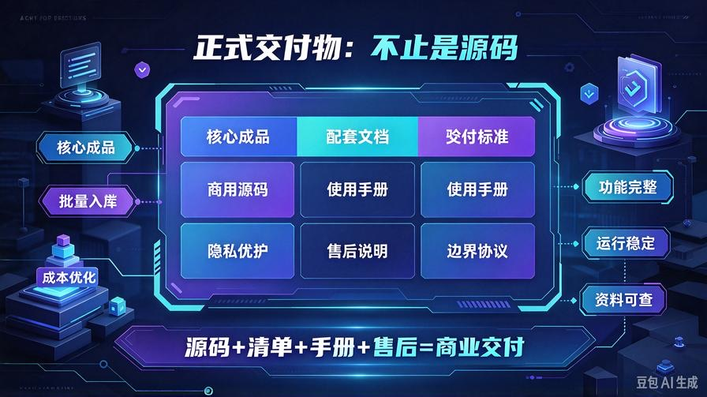
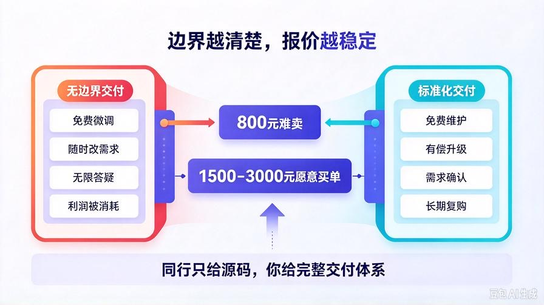

# 第32篇：标准化交付文档+售后方案，一套模板接所有单子

欢迎回到 **AI Agent 零基础实战连载·商业化落地篇**！

前面31篇内容，我们已经彻底搞定了 **技术开发、商用封装、成本优化**。

你的AI知识库系统：精度够高、输出够专业、成本够低、完全可商用。

但很多技术不错的人，接单始终做不大、赚不多，核心卡点只有一个：

**只会做项目，不会做交付。**

没有标准交付流程、没有正式文档、没有售后规则、没有边界约束。

结果就是：**小单不断、扯皮不断、返工不断、免费加需求不断**，一单活干三遍，利润全部被耗损殆尽。

真正靠AI接单稳定月入过万、过三万的人，拼的从来不是技术，而是**标准化交付体系**。

技术决定你能不能接单，交付决定你能不能**稳定赚钱、长久复购、不被白嫖**。

本篇直接给你全套**可直接复制商用的交付模板、交付清单、使用手册、售后规则、避坑协议**。

一套模板通吃所有企业RAG、AI知识库接单项目，从此**零扯皮、零返工、高专业度、高复购**。

读完本篇彻底掌握：

- 新手接单90%返工、扯皮、退款的核心根源
- 企业AI项目标准化交付全流程（行业通用标准）
- 全套交付文档：交付清单、用户手册、售后说明、需求边界协议
- 售后分级方案：免费维护、有偿升级、终身答疑边界划分
- 标准化谈单、锁需求、防白嫖的落地话术与规则

## 一、为什么你技术越好，反而越累、越不赚钱？

我接触过大量AI副业接单者，发现一个很诡异的规律：**技术越强的人，越容易被白嫖、被无限返工。**

根本原因不是客户不讲理，而是你**没有交付标准、没有需求边界**。

没有标准，客户就会默认：

- 所有微调都是免费的
- 所有新增资料都该免费导入
- 所有新功能都该免费赠送
- 随时提问、随时改、随时调试

最后变成：**收一次钱，服务一辈子**，一单单子拖半个月，完全没有精力接新单。

### 新手接单四大致命交付问题

1. **无交付清单**：口头承诺功能，做完客户不认，强行加需求
2. **无使用文档**：客户不会用，全程依赖你，无限售后
3. **无售后边界**：分不清免费维护和付费升级，被无限白嫖
4. **无需求协议**：做完挑毛病、主观不满意、随意要求返工

**没有标准化交付，你的技术价值会被无限稀释。**

## 二、商用AI项目标准化交付总流程（通用行业标准）

这是我打磨多遍、适配所有小微企业AI知识库项目的**标准交付闭环**，全程合规、专业、无漏洞，直接照抄落地即可。

完整交付5步走：

1. **需求锁定**：文字确认功能、场景、资料范围，杜绝口头需求
2. **项目部署**：纯净商用系统部署、资料批量入库、参数调试优化
3. **成品测试**：多场景问答测试、精度校验、异常兜底测试
4. **文档交付**：交付清单+使用手册+售后规则全套交付
5. **售后移交**：教会使用、锁定边界、开启售后维护

**流程标准化 = 专业度翻倍 = 返工率清零**

## 三、全套可直接商用：标准化交付清单（直接复制使用）

每一个接单项目，交付时必须附带这份清单，**签字/截图确认**，杜绝后续扯皮。

以下为通用标准版，适配所有企业私有知识库项目：

### AI企业知识库项目 · 正式交付清单

**项目名称**：企业私有智能问答知识库系统  
**交付日期**：\_\_\_\_\_\_\_  
**交付版本**：商用稳定版

**一、交付成品内容**

- ✅ 完整商用级AI知识库系统全套源码（私有化部署版）
- ✅ 企业资料批量解析、清洗、入库全套成品数据
- ✅ 商业化净化输出、无调试信息、标准化排版
- ✅ 隐私安全防护、敏感问题拦截、资料防泄露
- ✅ 成本优化模块、缓存节流、智能模型路由（低损耗运行）
- ✅ 全局异常兜底，无报错、无乱码、无空白应答

**二、交付配套文档**

- ✅ 项目使用操作手册
- ✅ 售后维护服务说明
- ✅ 项目功能边界说明（防无限加需求）

**三、成品标准验收项**

- ✅ 支持PDF/Word/TXT/MD多格式文档解析入库
- ✅ 基于企业私有资料精准问答，有据可查
- ✅ 无调试日志、无冗余参数、输出干净专业
- ✅ 自动节流降本，低功耗稳定运行
- ✅ 隐私隔离，杜绝内部资料外泄

**四、验收说明**

本项目以**交付清单功能、私有资料问答精度、系统稳定运行**为验收标准，无主观审美、无主观效果无限返工。

## 四、商用使用手册（客户直接照着用，减少90%咨询）

交付时随项目一并发送，客户自主查阅使用，大幅降低你的售后压力，不用反复解答基础问题。

### 企业AI知识库 · 官方使用手册

**1. 系统介绍**

本系统为企业私有化智能问答知识库，基于企业内部私有文档、规章制度、产品资料、流程文件搭建，可实现员工自助问答、客户咨询答疑、新人培训辅助，全程本地私有化存储，资料不泄露、不上传。

**2. 基础使用方式**

- 支持业务流程、产品参数、规章制度、售后标准等资料类提问
- 系统自动基于私有资料精准作答，无资料会如实提示，杜绝幻觉编造
- 输出内容经过商用排版，整洁清晰、重点明确

**3. 资料更新方式**

- 新增企业文档可放入指定data目录，执行批量增量入库即可更新知识库
- 支持随时迭代更新资料，无需重构系统

**4. 系统优势**

- 私有化部署：企业资料百分百本地存储，安全可控
- 低成本运行：自带缓存节流、智能模型路由，极低API开销
- 稳定可靠：全局异常兜底，无崩溃、无报错、无乱输出

## 五、核心赚钱关键：售后边界标准化方案

90%新手亏钱，都是因为**售后边界模糊**。

我给你定制一套 **免费售后 + 有偿升级** 的分级标准，既显专业、又不被白嫖，所有单子通用。

### 1. 免费售后范围（交付必含）

- 系统部署调试、运行故障排查
- 基础使用教学、操作答疑
- 交付后7天内非人为BUG免费修复
- 单次项目资料一次性完整入库调试

### 2. 有偿服务范围（杜绝白嫖）

- 后期频繁新增、大批量替换企业资料（按需收费）
- 新增额外功能、定制化开发需求
- 系统迁移、环境重装、多设备部署
- 长期月度维护、定期资料更新托管服务

### 3. 永久免费权益（锁客、做复购）

- 终身免费解答系统使用问题
- 终身免费提供基础技术支持
- 后续系统小版本优化免费同步

**有边界的服务，才是可持续、高利润的服务。**

## 六、接单避坑核心：需求边界协议（防返工、防退款）

很多新手被无限返工、被恶意挑刺、被无理退款，就是因为没有这句话的书面约定。

所有项目交付前，务必文字确认以下规则：

**项目验收标准说明：**

本AI知识库项目以「交付清单功能完整、系统稳定运行、基于客户提供私有资料可精准问答」为唯一验收标准。

不接受**主观感受、主观满意、无限微调、新增免费功能**作为返工与退款理由。

如需新增功能、大规模资料迭代、定制化改造，可另行协商有偿升级。

**短短一段话，能帮你避开95%的接单纠纷。**

## 七、标准化交付带来的商业价值（直接提升你的接单单价）

同样的一套AI知识库系统：

无文档、无标准、无售后 → 看着像野路子Demo，报价800都难卖

带全套交付文档、标准流程、售后体系 → 专业工作室质感，报价1500-3000客户心甘情愿买单

**技术是内核，包装和标准才是溢价。**

同行交付只有一个源码文件，你交付：**源码+清单+手册+售后方案+边界协议**，专业度直接碾压竞品，客户优先选你、愿意付高价。

## 八、本篇核心总结

1. AI接单赚小钱靠技术，赚大钱、稳赚钱靠**标准化交付**
2. 无边界服务=无限返工、无限白嫖、利润归零
3. 全套交付清单、使用手册、售后边界、需求协议，是商用必备体系
4. 标准化流程能大幅提升专业度，直接抬高客单价、降低售后成本
5. 一套模板通吃所有AI知识库接单项目，可无限复用、终身受用

## 下期预告：第33篇｜零案例新手破局！无作品、无口碑、无老客，从零开启AI接单首单

很多人技术、成品、交付模板全部配齐，依旧不开单！下一篇专门解决**新手最大痛点：零案例如何接单**，教你零成本打造真实案例、零信任快速成交，手把手带你拿下人生第一笔AI副业收入！

> 来源：头条号《AI Agent 零基础实战》第32篇｜版权归作者所有，仅供学习交流
