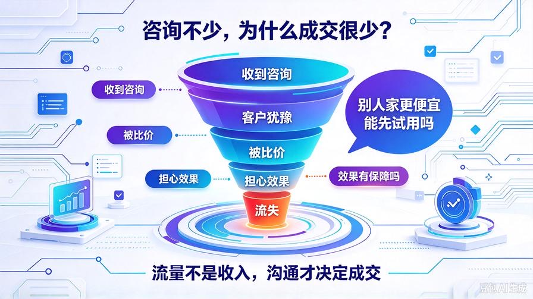
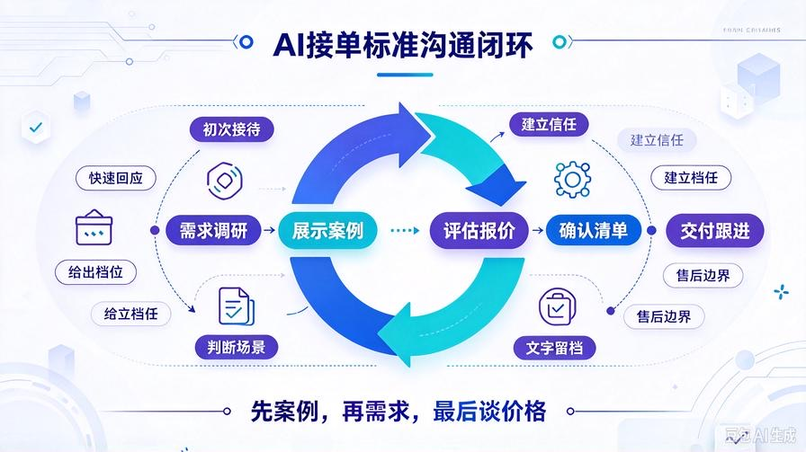
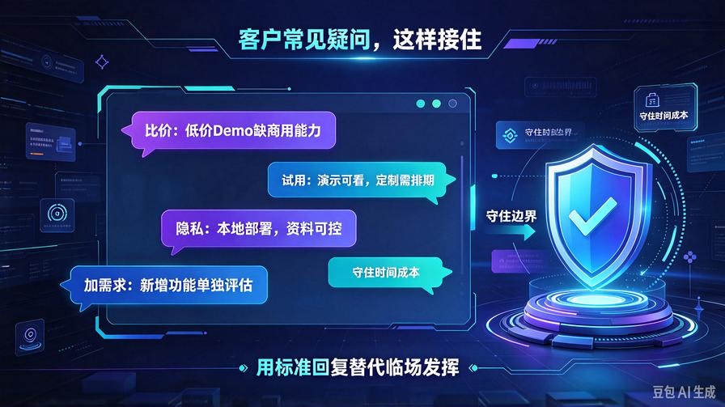
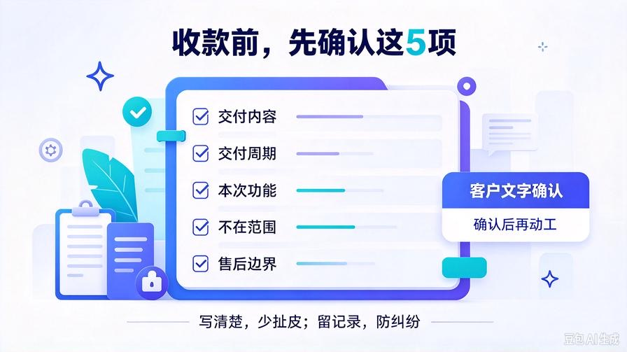

# 第35篇：AI接单成交话术全集，搞定咨询异议，提升下单转化率

欢迎回到 **AI Agent 零基础实战连载·商业化落地篇**！

上一篇第34篇，我们搭建好了闲鱼完整获客体系，搞定账号、商品链接、自然流量。

现在私信咨询会源源不断进来。但很多人会遇到同一个难题：咨询不少，下单很少。

不是技术不行，也不是客户不需要，而是**沟通环节把客户聊丢了**。

客户会不断抛出疑问、比价、担心效果、害怕踩坑、想免费试用。不会应对，再好的流量也会白白流失。

本篇直接给到一套完整、可复制的AI接单全套话术体系，覆盖从初次打招呼、需求确认、报价沟通、异议处理到签单收款全流程。拿来直接复制使用，减少沟通失误，拉高咨询转单率。

读完本篇你将掌握：

- 咨询接待基础原则，守住边界，避免白嫖
- 初次接待、需求调研标准话术模板
- 客户高频异议（比价、担心效果、想要免费试用）应对方案
- 报价谈判、确认需求、锁定订单话术
- 成交后，确认需求清单、规避纠纷的沟通模板

## 一、AI接单沟通三大底层原则

话术只是表层，这三条原则决定你能不能稳定成交，一定要牢记。

### 1. 先展示案例，再聊需求，最后谈价格

不要一上来就报价。客户还没看到成品实力，直接报价只会进入无休止比价。先给演示截图/演示视频建立信任，再沟通场景，最后报价。

### 2. 只做方案沟通，不做免费开发与完整调试

可以简单演示能力，但不接受“帮我先做一部分看看效果，满意再付款”。一旦开启免费开发，时间被无限消耗，客户大概率不会下单。

### 3. 所有核心需求、交付范围、售后边界，文字确认留档

口头承诺全部不算数，下单前把交付内容、验收标准、售后范围写清楚，防止后期客户无限加需求，产生纠纷差评。

## 二、阶段1：初次接待话术（客户刚私信）

客户发来：你好，请问AI知识库怎么做？

✅标准回复模板：

您好，我们可以搭建私有RAG智能知识库，支持文档批量导入、智能问答、答案溯源。我这边有现成成品演示，您可以先看下效果。简单问两个问题确认下场景：您主要是用来员工内部查阅资料，还是对外客服答疑？需要部署在本地还是云端？

优势：快速回应，主动抛出案例，同时引导客户描述场景，掌握对话主动权，不会被动被客户提问。

## 三、阶段2：需求深挖话术，判断客户预算与真实需求

拿到客户场景描述之后，继续收集关键信息，判断项目大小，匹配对应套餐：

✅需求调研提问模板：

- 需要导入的文档是什么格式，大概多少份？
- 有没有特殊定制功能，比如权限管理、多用户登录？
- 对响应速度、资料隐私是否有特殊要求？
- 项目预计什么时候需要交付？

根据客户回答，判断适合基础版/标准版/定制版，再给出对应报价。

## 四、阶段3：高频异议应对话术（接单最容易翻车环节）

### 场景1：客户说，别人家比你便宜很多

客户原话：别人才300块，你怎么贵这么多？

✅回复：低价大多只提供简单网页Demo，缺少文档清洗、溯源、成本优化、异常容错这些商用能力，后期容易出现幻觉、不稳定，而且不含完整源码和售后。我们交付的是可长期商用的完整系统，附带全套交付文档和BUG修复售后，一分钱对应一套完整交付标准。

### 场景2：客户担心效果，问能不能先试用，满意再付款

✅回复：可以给您看成品演示视频，直观看到问答效果。没办法免费搭建您专属知识库做试用，因为文档解析、切片、入库需要投入完整开发工时。下单之后，我们会按照约定需求开发，交付后7天内出现功能性BUG免费修复，保障交付质量。

### 场景3：客户担心资料泄露

✅回复：整套系统支持本地私有化部署，您的文档全部保存在自己设备，不会上传第三方公共知识库。检索内容仅在本地处理，从底层规避资料外泄风险。

### 场景4：客户需求模糊，不停增加想法

✅回复：理解您想完善功能。我们可以先把当前确定需求整理成清单，作为本次交付范围。新增功能单独评估工时和报价，这样项目边界清晰，交付周期可控。

## 五、阶段4：报价谈判，锁定订单话术

确认完需求之后给出套餐报价：

✅报价模板：结合您说的场景，推荐XX版本，费用XXX元。包含：知识库搭建、文档批量入库、全套源码、操作手册、7天BUG修复。交付周期X天。您确认需求无误，我们就可以开始安排。

如果客户犹豫，可以适度小幅让步，但不要无底线降价：

✅让步话术：价格这边没办法再大幅下调。如果今天确定下单，可以额外赠送一份文档批量处理小工具，不额外增加功能。

## 六、阶段5：成交收款前，需求确认清单（防纠纷核心）

收款之前，把下面内容整理文字发给客户确认，这一步是减少售后扯皮的关键：

本次项目约定：

1. 交付内容：XXX
2. 交付周期：收到款项后X个工作日
3. 本次包含功能：XXX
4. 不在本次交付范围：XXX
5. 售后范围：交付后7天免费修复功能BUG；新增功能不在售后内，单独报价。

客户回复确认，再开始动工。

## 七、阶段6：客户成交之后，沟通与交付话术

✅收款后回复：收到款项！我整理好需求清单，咱们按约定开发。过程中我会同步进度，交付时给您完整源码和操作教程，有问题随时沟通。

✅交付完成话术：项目已经完成，文件发给您。包含源码、操作文档。您可以测试验收，7天内如果遇到功能BUG，随时联系我处理。

## 八、新手沟通避坑红线，绝对不要触碰

- 不要承诺100%不会出现任何问答错误，可以承诺大幅降低幻觉、支持溯源核验
- 不要口头承诺额外功能，所有新增需求必须重新评估报价
- 不要和客户争论技术好坏，用案例演示代替争辩
- 不要承诺无限期免费维护，提前界定售后时间边界

## 九、本篇核心总结

1. 咨询转化低，大多不是技术问题，而是沟通流程和话术边界问题
2. 沟通固定顺序：展示案例→调研需求→评估项目→给出报价→确认需求清单
3. 面对比价、免费试用等高频异议，使用标准化话术稳定应对，守住时间成本
4. 成交前文字锁定交付边界，是规避售后纠纷最重要手段
5. 到这里，获客、谈单、成交整套商业流程全部打通

## 下期预告：第36篇｜多渠道矩阵获客，B站/小红书/私域联动放大接单量，摆脱单一平台依赖

只靠闲鱼单一渠道，流量上限有限。下一篇，拓展多渠道矩阵打法，搭建小红书、B站内容引流，沉淀私域客户池，放大接单规模，不再受制于单个平台流量波动！

> 来源：头条号《AI Agent 零基础实战》第35篇｜版权归作者所有，仅供学习交流
