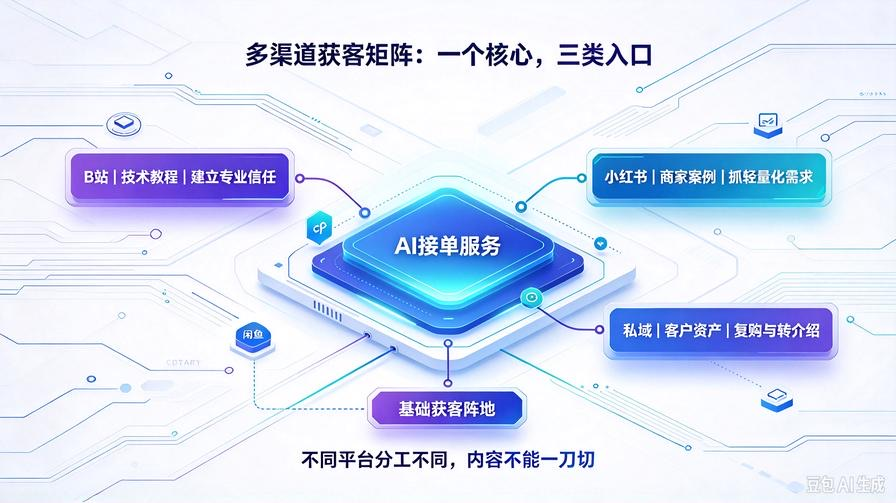
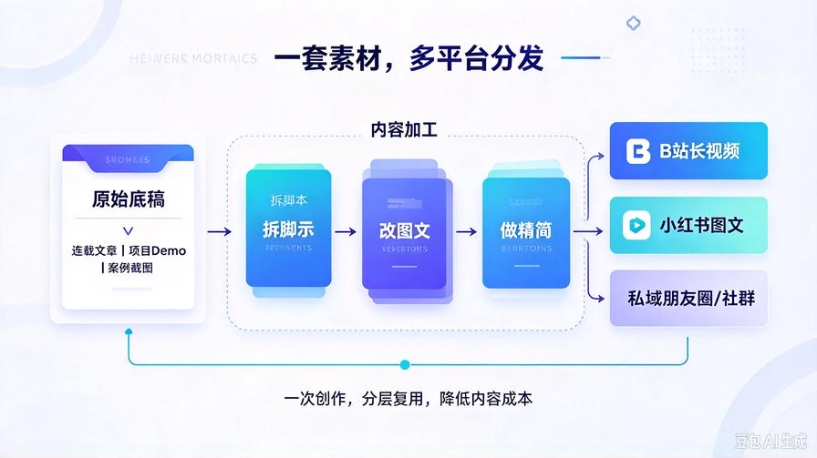
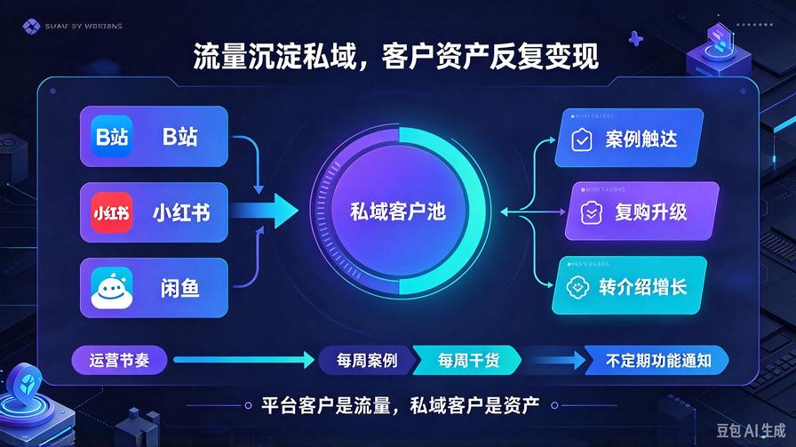
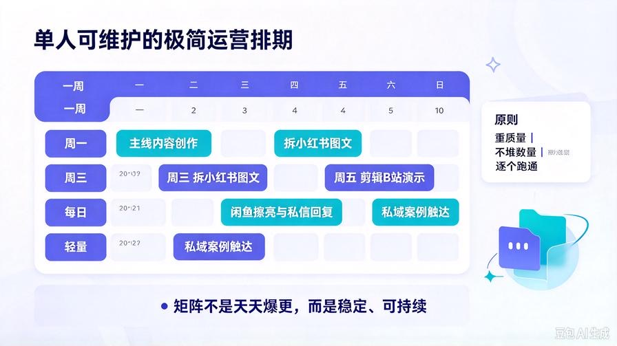

# 第36篇：多渠道矩阵获客，B站/小红书/私域联动放大接单量

欢迎回到 **AI Agent 零基础实战连载·商业化落地篇**！

上一篇第35篇，我们搞定全套谈单成交话术，把闲鱼咨询的转化率拉到稳定水平。

闲鱼作为新手起步渠道，上手快、见效快，但存在明显天花板：平台流量受规则波动、竞争慢慢增多，客户只能单次成交，很难长期复用。

想要把AI接单从小副业升级成稳定生意，核心思路就是**摆脱单一平台依赖，搭建多渠道获客矩阵**。B站做深度技术信任、小红书抓中小企业商家流量、最后全部沉淀到私域反复转化。

本篇手把手搭建这套低成本矩阵打法，不用出镜、不用复杂剪辑，复用我们前面写的连载内容、项目Demo素材，一次性生产内容，多平台分发。

读完本篇你将掌握：

- 三大渠道分工逻辑，搞清楚B站、小红书、私域各自承担什么任务
- 一套素材多平台复用，降低内容创作成本
- 各平台选题方向、内容模板、引流边界，规避封号风险
- 流量统一沉淀私域，客户二次复购、转介绍方案
- 矩阵运营极简排期，一个人就能稳定维护

## 一、渠道分工：不要每个平台都发一样内容

很多新手踩坑：把同一篇文章原样复制发到所有平台，效果很差。每个平台用户人群不一样，定位要严格区分。

### 1. B站：建立专业信任，承接技术型客户

B站用户以技术爱好者、中小企业技术负责人、开发人员为主。客户判断标准看重技术实力，适合发布完整实战教程、代码演示、RAG知识库搭建全过程。

价值：打造专业背书，拿下高客单定制项目。缺点：转化周期偏长，适合长期积累。

### 2. 小红书：面向商家老板，抓轻量化AI需求

小红书的主力人群：个体户、门店老板、自媒体博主、小企业运营。他们不懂底层代码，关心AI如何降本增效、知识库如何帮员工培训、自动回复客户咨询。

价值：客户基数大，需求轻量化，咨询来得快。重点讲落地效果、省钱提效，少堆砌代码。

### 3. 私域：客户资产池，复购与转介绍主战场

闲鱼、B站、小红书来的意向客户，全部合规沉淀到私域。平台客户属于平台，私域客户才属于你。可以持续推送项目案例、功能更新，挖掘老客户新增需求、老客户推荐新客户。

价值：持续反复变现，降低获客成本，长期放大收益。

## 二、内容复用策略，一套素材供给全平台

从头给每个平台单独创作内容，工作量巨大，单人很难坚持。我们用“一次创作，分层拆解复用”方案，依托本连载的素材，低成本持续产出：

1. 原文（本篇连载文章）：作为原始底稿
2. B站：截取实战演示片段，搭配讲解，做成技术教程视频；文章转为视频脚本
3. 小红书：提炼痛点、落地效果、收益，拆成图文笔记，减少代码，多用截图演示
4. 私域：精简案例、客户问答合集，定期发朋友圈/社群

核心：只写一次核心内容，按平台规则裁剪，不用重复构思主题。

## 三、B站内容模板与选题，打造技术IP

B站客户看重可复现的实战，选题优先选实操向，避开空洞理论。推荐选题方向：

- 从零搭建企业私有RAG知识库完整实战
- AI Agent成本优化，减少70%API开销实操演示
- RAG检索优化，解决幻觉、答非所问问题
- AI知识库商业化改造，Demo转为商用成品

视频结构模板：

1. 0\~30s：抛出痛点（很多人做的RAG只能当Demo，没法商用）
2. 30s\~8min：分步演示操作，代码讲解，效果对比
3. 8\~10min：商业化落地与接单价值总结
4. 结尾：引导私信获取项目资料，合规引流

引流注意：不要硬广刷屏，视频以教学为主，服务是附带落地支持，降低违规风险。

## 四、小红书图文笔记模板，吸引商家老板咨询

小红书不要贴大段代码，重点讲痛点、价值、成果。笔记结构模板：

标题示例：小微企业低成本搭建私有AI知识库，员工查资料不用反复问人

正文：

痛点：企业文档散落在微信、电脑，新人上手慢，客服重复答疑耗时间。

✅解决方案：私有RAG知识库

- 文档批量导入，自动解析清洗
- 问答可溯源，减少AI幻觉
- 本地私有化部署，资料不外泄
- 一次搭建，长期降低人力成本

适用：门店、自媒体、小型加工厂、咨询工作室。

结尾：如果你也想搭建私有AI知识库，可以留言【AI】获取案例演示。

配图：系统界面截图、流程示意图，沿用我们系列浅蓝科技风。

## 五、私域沉淀运营，把意向客户变成长期资产

### 1. 引流沉淀的合规方式

各平台不要直接硬留联系方式，优先引导私信沟通，再合规引导至私域，避免账号限流。

### 2. 私域内容运营节奏（轻量化版本，单人可维护）

- 每周1条：新完成项目案例展示，交付效果
- 每周1条：AI接单避坑干货，客户常见问题
- 不定期：功能升级、新套餐通知

### 3. 老客户转介绍激励

老客户成功推荐成交，赠送福利：免费小功能升级、文档批量处理工具包、延长售后维护周期。不用直接返现金，降低成本同时提升接受度。

## 六、单人矩阵运营排期，不被内容压垮

很多人一做矩阵就陷入天天剪辑写稿的内耗，这套极简排期，一个人完全hold住：

- 每周1次：主线内容创作（就是本连载的文章）
- 每周1次：拆出小红书图文（1\~2篇）
- 每两周1次：剪辑B站实战演示视频1条
- 每日：维护闲鱼商品擦亮、回复私信；私域简单维护

核心原则：重质量，不盲目堆数量。1条高质量视频，胜过5条粗糙搬运内容。

## 七、多渠道获客避坑清单

- 各平台严格遵守社区规范，禁止粗暴留联系方式、硬广营销，容易限流封号
- 不要同时一次性开通5个以上平台，优先跑通闲鱼，再新增小红书，再拓展B站，逐个验证流量
- 统一对外交付标准、报价体系，避免不同渠道报价混乱
- 客户咨询依旧沿用第35篇全套谈单话术，保持成交口径一致
- 所有客户需求、交付约定，文字留档，规避纠纷

## 八、本篇核心总结

1. 单一闲鱼渠道存在流量上限，搭建B站+小红书+私域矩阵，分散平台风险，放大接单总量
2. 不同平台人群不同，内容定位差异化，一套原始素材分层复用，大幅降低创作压力
3. B站用来建立技术信任拿下高客单项目；小红书抓取商家轻量化需求；私域沉淀客户资产，做复购和转介绍
4. 矩阵不是多平台撒网，循序渐进逐个跑通，单人轻量化运营，避免精力透支
5. 到这里，你已经拥有完整的技术、交付、谈单、多渠道获客整套商业化体系

## 下期预告：第37篇｜项目分级与报价体系搭建，精准定价，大项目小项目分开，利润最大化

报价凭感觉，很容易小单累死不赚钱、大单低价亏工时。下一篇搭建标准化项目分级体系，按工作量、难度划分项目等级，配套对应的报价模板，精准评估工时，合理报价，稳定拉高整体利润！

> 来源：头条号《AI Agent 零基础实战》第36篇｜版权归作者所有，仅供学习交流
