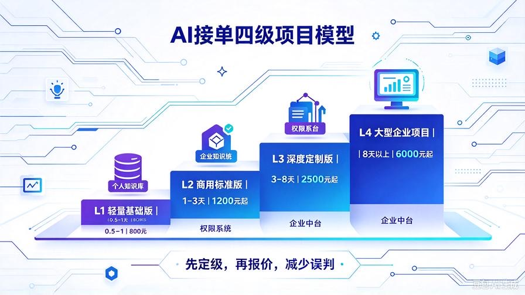
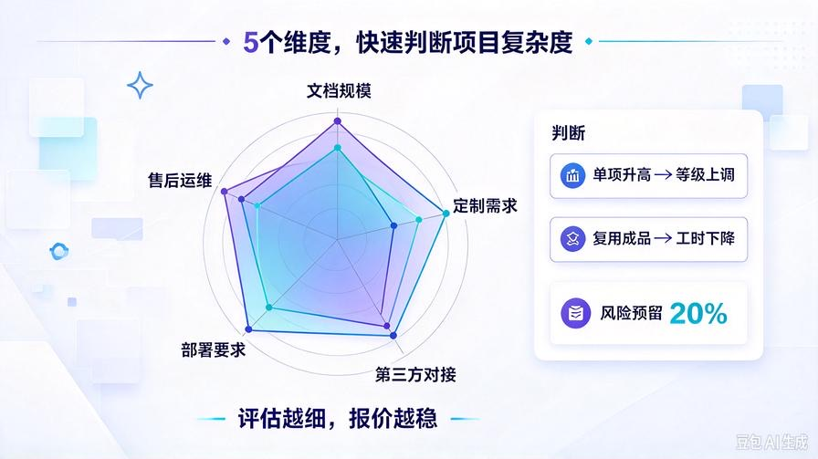
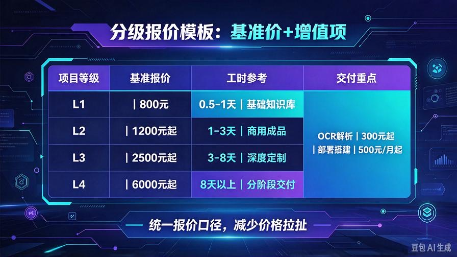
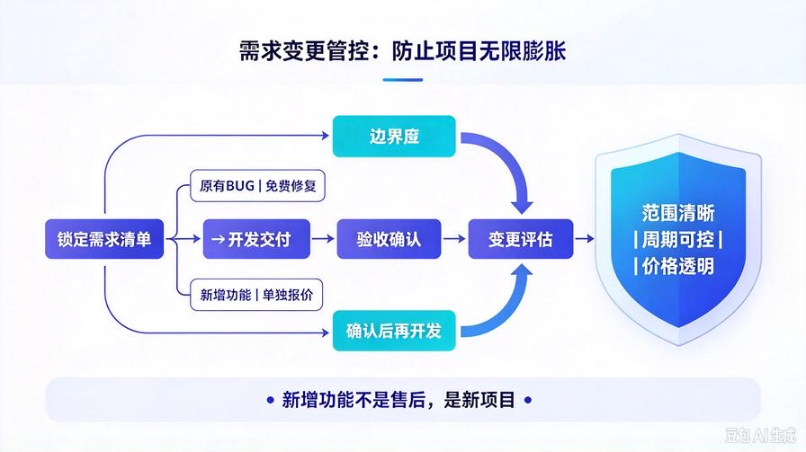

# 第37篇：项目分级与报价体系搭建，精准定价，利润最大化

欢迎回到 **AI Agent 零基础实战连载·商业化落地篇**！

上一篇第36篇，我们搭建了B站、小红书、私域多渠道获客矩阵，源源不断获取意向客户。

很多接单新手流量起来之后，会踩一个致命大坑：报价全凭感觉。

遇到小单报低价，开发耗大量工时，忙活几天几乎不赚钱；碰到复杂大单低估工作量，中途不断追加开发，要么亏本交付，要么和客户产生矛盾。

没有标准化的项目分级与报价规则，接单越多，亏损风险越高。

本篇就搭建一套适配AI知识库、Agent定制业务的分级评估模型，配套工时核算与报价模板。以后接到咨询，快速判定项目等级，给出合理报价，规避低价内卷，稳定拉高整体利润。

读完本篇你将掌握：

- AI接单4级项目划分标准，快速区分小单/标准单/定制单/大型项目
- 项目评估5大核心维度，快速估算工时
- 分级报价模板，基准价格+额外增值项计价规则
- 额外需求变更的计价机制，防止无限免费加功能
- 报价沟通话术，有理有据，客户更容易接受价格

## 一、AI知识库&Agent项目4级分级标准

按照需求复杂度、开发工作量、交付范围，我们把项目划分为4个等级，每个等级有清晰边界，不用反复纠结。

### L1 轻量基础版（快速交付小单）

适用场景：个人、自媒体、小型工作室，仅基础私有RAG知识库。

需求特征：文档数量不多，无额外定制功能，只需要文档导入、问答、溯源，使用现成框架，不需要改动底层代码。

工时预估：0.5～1个工作日

交付内容：基础RAG系统、文档批量入库、操作手册、7天BUG修复。

### L2 商用标准版（主力盈利单，接单重点）

适用场景：小微企业内部知识库、员工资料查询、基础客服问答。

需求特征：全格式文档解析、文本清洗、重排序检索、Token压缩、成本优化模块，少量界面微调，无复杂权限系统。基于我们连载中完成的商用成品改造。

工时预估：1～3个工作日

交付内容：全套商用源码、知识库全套能力、交付清单、完整文档、7天BUG修复。

### L3 深度定制版（高客单项目）

适用场景：商家多角色使用、企业内部多部门知识库。

需求特征：增加多用户权限管理、独立账号、对接第三方系统（企业微信/飞书）、定制前端页面、专属业务逻辑开发，需要修改底层代码。

工时预估：3～8个工作日

交付内容：定制开发后的完整系统、源码、部署文档、测试报告、15天BUG维护。

### L4 大型企业项目（高门槛大单）

适用场景：中大型企业，多知识库隔离、完整后台管理、数据看板、私有化服务器部署运维、长期迭代。

需求特征：多租户隔离、日志审计、高并发优化、对接企业现有业务系统，需要持续迭代开发，可配套月度运维服务。

工时预估：8个工作日以上，分阶段交付。

交付内容：分阶段交付、完整工程文档、测试用例、上线部署、专属运维方案。

## 二、项目评估5大维度，快速判断项目等级

客户咨询时，依次评估下面5项，快速定级，避免低估工作量：

1. **文档规模与类型**：文档数量、是否有大量扫描件、PDF图片、表格图纸。扫描文档解析会大幅增加工时。
2. **定制开发需求**：是否需要新增功能、修改底层逻辑、定制UI界面。纯使用现成Demo工作量最低。
3. **第三方对接需求**：是否对接飞书、企业微信、网页、小程序等外部系统，对接会增加开发和联调成本。
4. **部署环境要求**：本地私有化部署、云服务器部署，是否需要高可用、高并发。
5. **售后与运维要求**：短期BUG修复，还是需要长期驻场运维、持续迭代升级。

任意一项复杂度拉高，项目等级向上调整。

## 三、分级基准报价模板（参考，可根据地区微调）

这套报价和前面闲鱼获客套餐保持统一，多渠道报价口径一致：

- **L1轻量基础版：800元**，适合个人小需求，快速交付，利润稳定。
- **L2商用标准版：1200元**，主力接单产品，功能齐全，商用级能力，投入产出比最高。
- **L3深度定制版：2500元起**，根据定制功能多少，按工时累加报价。
- **L4大型企业项目：6000元起**，分阶段报价，按里程碑收款，不一次性全款交付。

额外增值项单独计价，不打包进基础套餐：

- 大批量扫描文档OCR解析：单独收费，按文档数量计价
- 服务器部署、环境搭建：300元起
- 月度运维托管服务：500元/月起
- 新增独立功能模块：按预估工时报价

## 四、需求变更管控：防止项目无限膨胀

很多项目亏钱，根源不是初始报价低，而是项目中途需求不断新增。客户在开发过程中持续加想法，工作量翻倍，但价格不变。

我们固定一套变更规则，写进需求确认文档：

项目开发前锁定本次交付需求清单。开发过程中，**需求分为两类**：

- 原有需求范围内BUG修复：免费处理，包含在售后内。
- 新增功能、修改原有业务逻辑：属于需求变更，需要重新评估工时，单独报价，双方确认后再开发。

沟通话术：本次报价对应的是咱们确认好的需求清单。如果后续新增功能，我这边评估工时，给您单独报一个新增项目的价格，这样项目周期可控，不会影响原定交付进度。

## 五、工时核算逻辑，报价有据可依

报价底层逻辑：你的单日人工成本 + 风险溢价。

举个简单例子：你期望单日收入800元。预估项目2天，基础报价1600元，可适当调整为1200元标准化套餐（复用现成代码，减少开发量）。

复用已有成品代码，工时会大幅下降，这也是我们整套连载学习最大优势：不用从零开发，大量模块可以直接复用，拉高利润率。

注意：定制开发项目，一定要增加**风险预留工时（20%）**。联调、环境兼容问题经常会意外消耗时间，预留工时避免亏本。

## 六、报价沟通的标准话术

客户觉得价格偏高时，不要直接降价，而是拆解交付价值：

✅话术：咱们这个属于L2商用版本，交付的不是简单Demo，包含文档清洗、RAG重排、溯源引用、API成本优化全套商用能力，附带完整源码和交付文档。后期资料增量更新、长期使用稳定，避免廉价Demo容易出现幻觉、系统崩溃的问题。

如果客户预算有限：可以推荐降级到L1基础版本，减少部分定制功能，降低预算，而不是直接在同等级项目上砍价。

## 七、报价阶段避坑要点

- 大单一定要分阶段收款，例如预付款50%，完成验收结清尾款，不要完工后一次性收款
- 不要口头评估工时，所有需求、范围、报价全部文字确认
- 不要为了接单，低估开发工作量，后期交付会非常痛苦
- 区分“BUG修复”和“新增功能”，边界一定要清晰
- 不同渠道客户，统一分级报价体系，避免价格混乱引发老客户不满

## 八、本篇核心总结

1. 报价不能凭感觉，建立L1\~L4四级项目分级体系，快速评估需求复杂度
2. 评估项目看5个核心维度，提前预判隐藏工作量，避免低估工时
3. L2商用标准版是个人接单的主力盈利产品，复用连载现成代码，利润最高
4. 需求变更机制是保护自己的关键，新增功能单独计价，杜绝无限免费开发
5. 标准化分级报价，让报价有理有据，客户更容易认可价值，减少价格谈判拉扯

## 下期预告：第38篇｜项目风险预判与合同简易模板，提前规避交付纠纷，保护开发者权益

谈单报价完成之后，下一步就是锁定项目约定。很多个人接单没有任何书面协议，一旦出现分歧，维权很难。下一篇讲解AI开发项目常见风险点，附带简易可直接复制使用的项目协议模板，清晰约定交付范围、验收标准、付款节点、责任边界，最大程度减少纠纷！

> 来源：头条号《AI Agent 零基础实战》第37篇｜版权归作者所有，仅供学习交流
