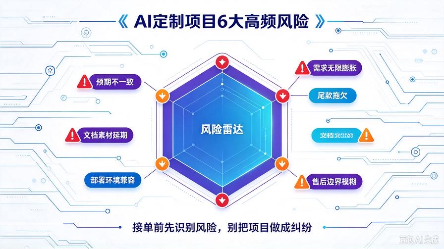
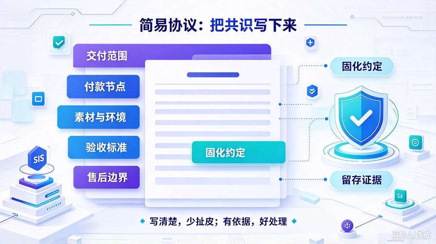
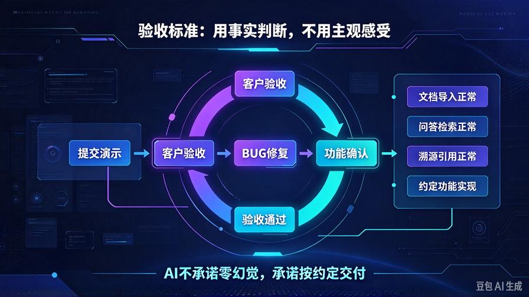
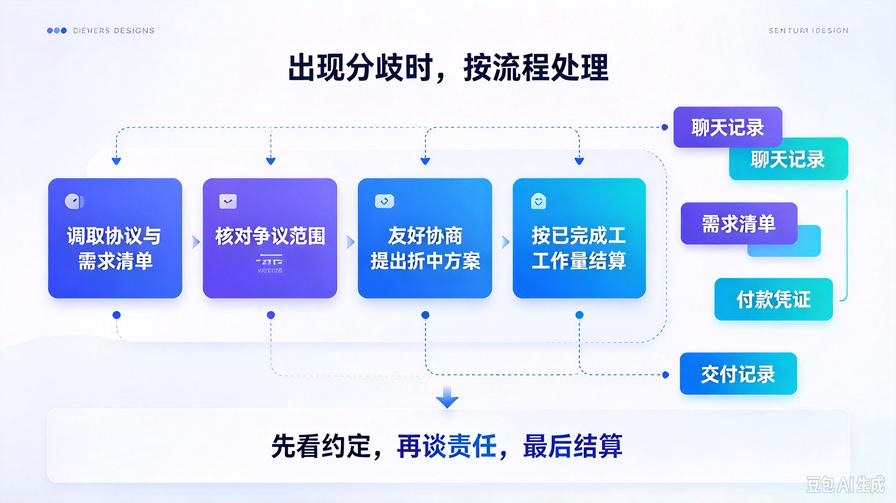

# 第38篇：项目风险预判与简易协议模板，规避交付纠纷，保护开发者权益

欢迎回到 **AI Agent 零基础实战连载·商业化落地篇**！

上一篇第37篇，我们搭建了L1-L4四级项目分级报价体系，接到咨询可以快速评估工作量、给出合理报价。

很多个人开发者接单容易忽略一件事：只靠口头沟通约定。

前期聊得再好，开发中途也可能出现需求变动、验收标准扯皮、客户拖延尾款、对效果预期不一致等问题。一旦发生纠纷，没有书面凭证，维权难度极大，辛苦做完项目拿不到钱。

本篇梳理AI知识库、Agent定制项目里最常见的风险点，同时提供一份可直接复制使用的简易项目协议模板。不用找律师，接单前双方确认，把交付范围、验收、付款、权责全部写清楚，提前隔绝绝大多数纠纷。

读完本篇你将掌握：

- AI定制项目最容易踩的6类交付风险，提前识别预警
- 简易项目协议核心条款设计思路
- 可直接复制的协议完整模板，适配个人接单场景
- 验收标准、付款节点、需求变更的规范写法
- 签署协议的实操流程与留存证据方法

## 一、AI Agent/RAG定制项目6大高频风险

### 1. 预期不一致风险

客户以为AI可以做到100%回答无误，但是RAG系统只能依托提供的文档作答，无法保证零幻觉。前期没有明确预期，验收阶段客户会拿这个理由拒绝收尾。

### 2. 需求无限膨胀风险

开发中途不断新增功能、修改界面、增加对接接口，工作量持续上涨，但是客户不愿意追加费用。这是个人接单最常见亏损原因。

### 3. 尾款拖欠风险

项目交付完成，客户拿到源码之后，以各种理由拖延、拒绝支付尾款。没有约定付款节点和违约责任，没有约束手段。

### 4. 文档素材延期风险

约定由客户提供文档资料，但是客户迟迟不给素材，导致项目延期，反过来把责任归到开发者身上。

### 5. 部署环境兼容风险

客户本地电脑/服务器环境老旧、缺少依赖，无法正常运行系统。客户认为是代码问题，要求免费适配所有环境。

### 6. 售后边界模糊风险

交付之后，客户把新增功能、业务调整、第三方API欠费全部算作售后BUG，要求永久免费维护。

## 二、协议核心设计思路：只约定事实，不夸大承诺

这份简易协议不是正式商业合同，适合个人线上接单，核心作用是**固化双方沟通共识，留存文字证据**。

撰写协议遵循3个原则：

- 明确交付边界：写清楚包含什么、不包含什么
- 量化验收标准：效果指标、验收周期写死，拒绝主观评判
- 划分权责：素材、环境、API费用各自由哪一方承担

## 三、AI项目简易协议模板（直接复制修改使用）

**AI知识库/Agent定制项目服务协议**

甲方（委托方/客户）：

乙方（服务提供方/开发者）：

甲乙双方经友好协商，就AI私有知识库系统开发服务达成如下约定：

1、项目需求与交付范围

1.1 项目类型：□L1轻量基础版 □L2商用标准版 □L3深度定制版 □L4大型企业项目

1.2 本次交付功能清单：【粘贴双方确认的功能列表】

1.3 本次交付不含：【填写不在本次范围内的功能，例如：多租户、小程序对接、长期运维托管等】

1.4 交付物：源码、操作使用手册、项目交付清单。

1.5 交付周期：乙方收到预付款，且甲方提供全部所需文档素材后 \_\_\_\_ 个工作日完成交付。甲方素材延迟提供，交付时间自动顺延。

2、项目费用与付款节点

2.1 项目总费用：人民币\_\_\_\_\_\_\_\_元。

2.2 付款方式：预付款\_\_\_\_%，金额\_\_\_\_元；项目开发完成，甲方验收通过后支付尾款\_\_\_\_%，金额\_\_\_\_元。

2.3 项目执行过程中新增需求，双方另行评估工时与费用，签署补充约定，乙方才开始开发新增功能。无补充约定的新增需求，乙方有权拒绝开发。

3、素材、环境与API费用约定

3.1 项目所需文档、资料文件由甲方提供，甲方保证提供资料合法，不侵犯第三方版权。

3.2 甲方需要自行准备部署硬件、服务器环境、大模型API密钥以及对应的API调用费用，API消耗费用由甲方承担。

3.3 乙方保证交付代码在约定测试环境可以正常运行；甲方本地特殊环境适配，不属于本次默认交付范围，如需适配另行报价。

4、验收标准

4.1 乙方完成开发后，提供演示版本供甲方验收，验收周期为\_\_\_\_个工作日。甲方在验收期内提出功能性BUG，乙方免费修复。

4.2 验收判定：系统实现协议1.2条约定全部功能，能够正常导入指定文档、完成问答检索、支持溯源，即为验收通过。

4.3 AI问答依托甲方提供文档内容作答，无法做到100%无偏差，乙方不承诺绝对零幻觉。甲方不能以主观层面不满意回答内容，判定项目不合格。

5、售后约定

5.1 免费售后周期：交付完成后7天（L3项目15天），仅针对约定范围内功能BUG进行修复。

5.2 免费售后不包含：新增功能开发、环境迁移、API故障排查、甲方业务逻辑修改、人为误操作导致的系统问题。以上需求可单独付费。

6、知识产权与保密

6.1 乙方交付项目源码，甲方获得项目使用权。乙方底层基础框架知识产权归乙方所有。

6.2 双方对项目沟通资料、甲方业务文档信息保密，不得泄露给第三方。

7、其他约定

7.1 协议通过线上文字确认生效，双方各保存一份。

7.2 本协议未尽事宜，双方友好协商解决。

甲方确认：\_\_\_\_\_\_\_\_ 日期：\_\_\_\_

乙方确认：\_\_\_\_\_\_\_\_ 日期：\_\_\_\_

## 四、协议使用实操要点

1. 不要跳过这一步，项目正式开工前，把协议发给客户确认，客户回复“确认同意”再收取预付款、启动开发。
2. 所有填写内容，截图留存聊天记录，不要只保存文件。
3. L1小单可以简化版本，只保留需求清单、付款节点、验收和售后边界；L3、L4定制大单建议完整使用全套模板。
4. 协议内容不要写过于绝对化承诺，避免留下纠纷漏洞。

## 五、纠纷预警：出现争议时的处理流程

一旦沟通出现分歧，按这个顺序处理：

1. 调取双方确认的需求清单与协议原文，核对争议点是否在约定交付范围内
2. 优先友好协商，针对分歧提出折中方案
3. 如果客户单方面终止项目：已经完成的开发工作量按比例结算，预付款扣除已产生工时成本，剩余部分退还

## 六、本篇核心总结

1. 个人接单最大隐患是口头约定，预期不一致、需求乱加、尾款拖欠是三大高频纠纷
2. 简易协议核心作用是明确边界、量化验收标准，留存沟通证据，降低扯皮概率
3. 协议里一定要写明：AI不能保证100%无幻觉，区分BUG修复和新增功能
4. 付款节点分开设置，大单必须收取预付款，规避尾款坏账风险
5. 风险防控不是不信任客户，是保护双方，让项目交付过程更顺畅

## 下期预告：第39篇｜项目交付上线与运维托管方案，交付不是终点，挖掘长期持续性收入

很多开发者做完交付就结束，只赚一次性开发费。下一篇讲解项目上线部署、日常运维托管的整套方案，设计月度运维套餐，把一次性项目收入转化成稳定持续的现金流，放大长期收益！

> 来源：头条号《AI Agent 零基础实战》第38篇｜版权归作者所有，仅供学习交流
