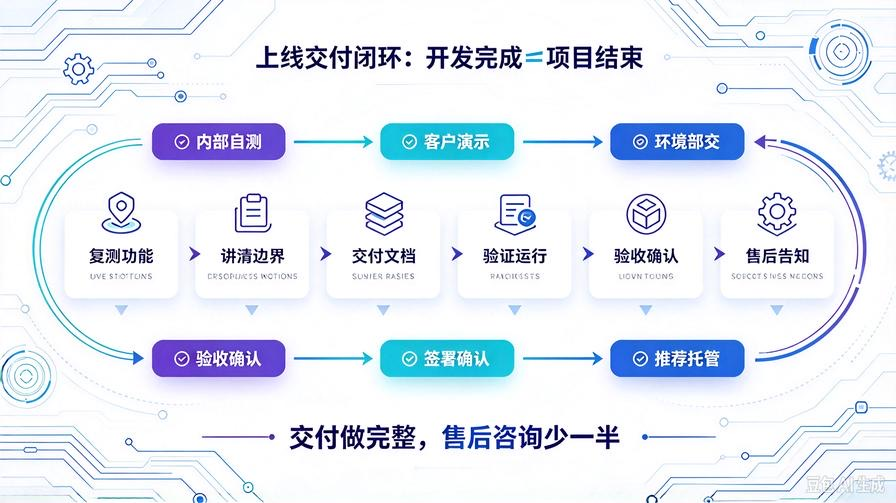
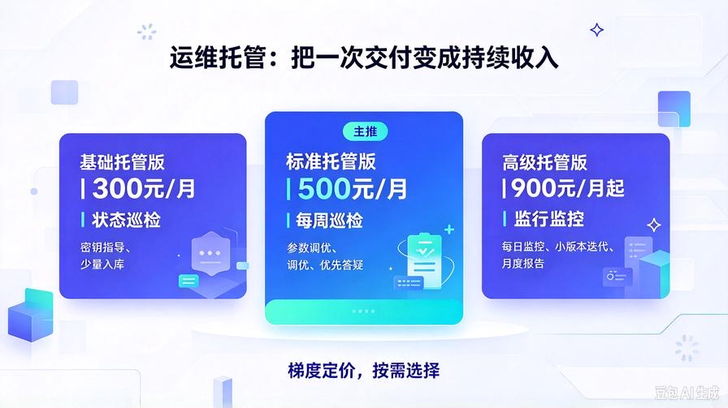
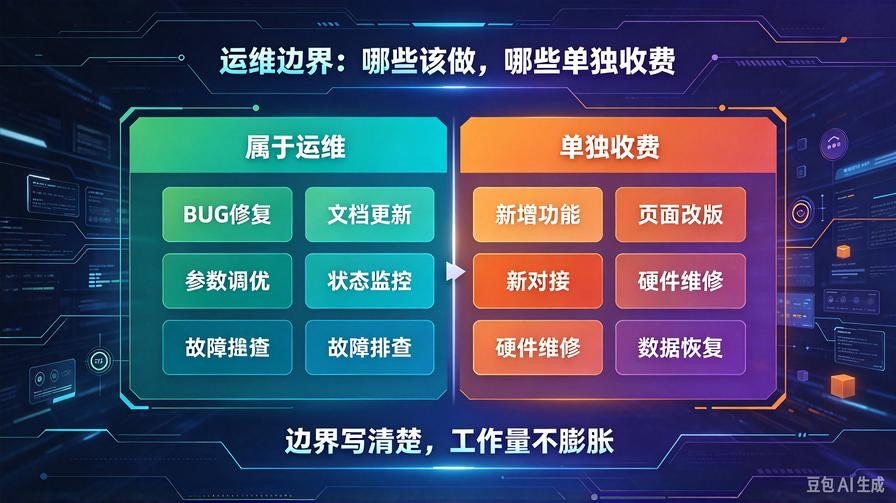
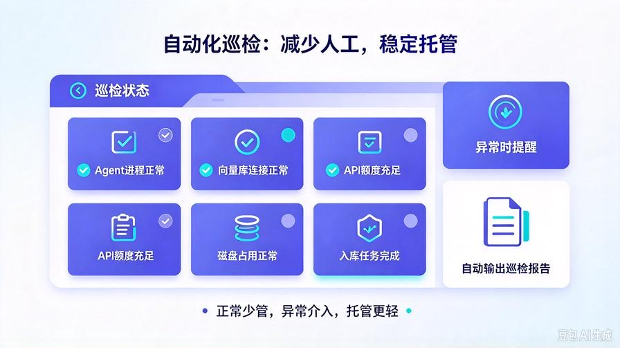

# 第39篇：项目交付上线与运维托管方案，挖掘长期持续性收入

欢迎回到 **AI Agent 零基础实战连载·商业化落地篇**！

上一篇第38篇，我们搭建了项目风险预判机制，配套简易项目协议模板，提前划定权责边界，减少交付扯皮。

绝大多数个人开发者接单，思维停留在“做完交付，项目结束”，只能赚取一次性开发费用。

但客户的系统上线之后，会持续遇到新问题：文档增量入库、API密钥更换、服务器异常、模型参数调优、功能小迭代。客户本身不懂技术，很难独立维护。

运维托管就是把一次性项目，转化为每月稳定的持续性现金流。本篇讲解交付上线标准化流程，设计分层运维套餐，明确运维服务边界，在不消耗过多精力的前提下，挖掘老客户复购收益。

读完本篇你将掌握：

- 标准化上线交付全流程，保证交付质量，降低上线故障概率
- 三级运维托管套餐设计，适配不同客户需求
- 运维服务边界划分：哪些属于托管范围，哪些单独收费
- 运维日常巡检清单，自动化减少人工工作量
- 运维套餐销售话术，交付时顺势推荐，提升转化

## 一、标准化上线交付流程，做好交付收尾

项目开发完成不等于交付完成，一套规范的上线交付流程，既能提升客户满意度，也能减少后续无意义的咨询。

1. 内部自测：功能复测、文档入库测试、问答溯源测试，确认无功能性BUG；清理调试日志、冗余代码。
2. 客户演示：远程演示整套系统，演示基础操作、文档上传、问答查询，同时演示系统限制（AI存在少量幻觉，依赖文档素材）。
3. 资料移交：交付源码、部署手册、操作手册、常见问题FAQ文档。
4. 环境部署：协助部署到客户本地设备或云服务器，完成基础环境验证。
5. 验收确认：客户按照协议清单完成验收，签署验收确认。
6. 售后告知：告知免费BUG维护周期，同步可选的付费运维托管方案。

交付时一定要同步交付FAQ文档，把高频问题写进去，减少客户反复咨询基础操作问题。

## 二、三级运维托管套餐设计

按照客户需求轻重，划分3档套餐，梯度定价，客户可以按需选择：

### 基础托管版（300元/月）

适合个人、小工作室，系统稳定，改动少。

包含服务：

- 系统状态月度巡检，检查服务是否正常运行
- 协助处理API调用异常、密钥更换指导
- 每月最多1次文档批量增量入库协助
- 基础操作问题线上答疑

不包含：服务器重装、大量扫描件OCR解析、新增功能开发。

### 标准托管版（500元/月）【主推套餐】

小微企业首选，也是利润最高的托管套餐。

包含服务：

- 每周一次系统巡检，监控服务状态、API消耗
- 每月最多3次文档批量入库、切片、知识库更新
- 模型参数调优，优化问答效果
- 服务器简单故障排查、日志分析
- 工作日线上优先响应答疑

不包含：第三方系统对接、大规模代码修改、服务器硬件故障维修。

### 高级托管版（900元/月起）

适合业务量大、需要频繁迭代的企业客户。

包含服务：

- 每日系统运行监控，异常告警
- 不限次数文档入库与知识库优化
- 系统小版本迭代优化（限已有模块微调）
- 优先响应，紧急故障远程排查
- 月度运维报告，统计知识库使用情况、API开销

不包含：全新功能模块开发，全新系统对接，如需开发，单独评估报价。

## 三、运维边界红线，避免托管变成无限免费开发

运维托管最容易踩坑：客户把新增功能、大规模改造都算作运维服务内。提前明确边界，写进运维协议：

- ✅属于运维：系统原有功能BUG修复、知识库文档更新、参数调优、运行状态监控、故障排查。
- ❌不属于运维：新增功能开发、页面大幅改版、新增第三方对接、服务器硬件故障、客户人为误操作导致的数据丢失恢复。

额外工作统一走需求评估，单独报价，不纳入月度托管范围。

## 四、自动化运维巡检清单，降低人工成本

如果全部靠人工手动检查，托管客户变多之后，时间成本会急剧上升。我们用简单脚本做自动化巡检，只在告警出现的时候人工介入。

巡检监控项：

- Agent服务进程存活状态
- 向量数据库连接状态
- API调用额度消耗监控
- 系统磁盘占用、日志大小
- 知识库文档入库任务执行状态

脚本自动输出巡检报告，异常项推送提醒。正常情况下，一个托管客户每月只需要少量时间维护，托管是高收益的持续性收入。

## 五、运维托管推荐话术，交付阶段顺势转化

交付验收的时候，向客户介绍托管套餐，不要强行推销，客观讲客户后续会遇到的问题：

✅推荐话术：系统已经部署完成，您这边后续会持续新增业务文档，需要定期更新知识库，同时监控API开销、保证系统稳定运行。如果团队没有技术人员维护，可以考虑我们的运维托管服务。分3个档位，按需选择，我们负责系统巡检、文档入库、故障排查，你们专注业务使用即可。

如果客户犹豫，可以先推荐基础版短期试用1个月，体验托管服务。

## 六、运维服务简易补充协议要点

客户选择托管之后，签署简易补充约定，明确套餐、服务周期、费用、服务边界：

- 托管套餐类型、月度费用、服务周期
- 套餐内包含的服务清单、次数限制（如文档入库次数）
- 不属于托管范围的项目清单
- 响应时效约定
- 到期续费、退订规则

## 七、本篇核心总结

1. 一次性开发项目只是单次收益，运维托管可以把老客户变成持续现金流来源，提升项目整体收益
2. 标准化交付流程，完善交付资料，减少基础问题咨询，提升客户体验
3. 设计三级梯度托管套餐，主推标准托管套餐，适配大多数小微企业客户
4. 清晰划定运维边界，区分运维维护和新增功能开发，防止工作量无限增加
5. 使用自动化巡检脚本，减少人工投入，托管客户越多，单位客户耗费时间越低

## 下期预告：第40篇｜复盘整套商业化闭环，复盘复盘获客、谈单、交付、运维全链路，打造可复制AI Agent接单生意

本篇是商业化落地篇的收尾章节。我们从头梳理全套AI Agent接单商业闭环，复盘整套体系的优势、短板与扩张路径，教你如何持续优化整套生意模型，实现稳定接单盈利！

> 来源：头条号《AI Agent 零基础实战》第39篇｜版权归作者所有，仅供学习交流
