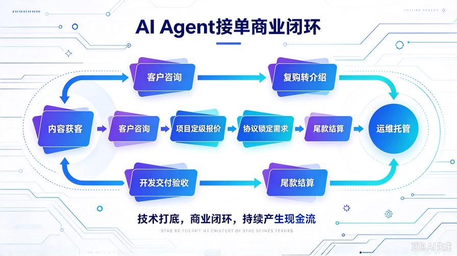
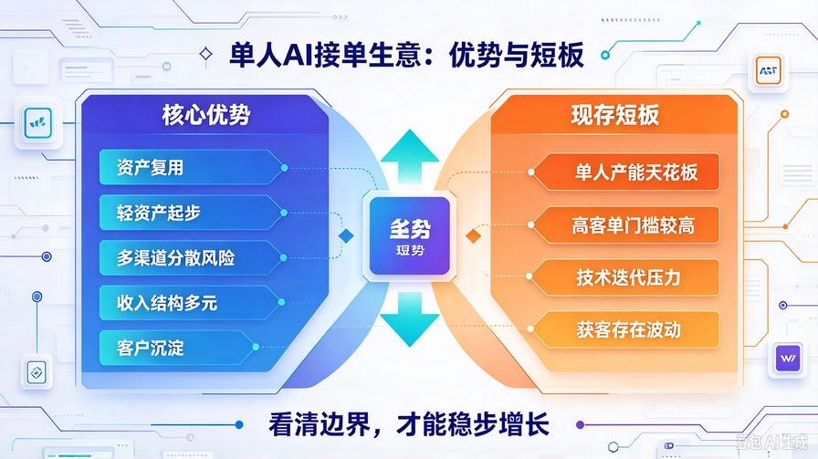
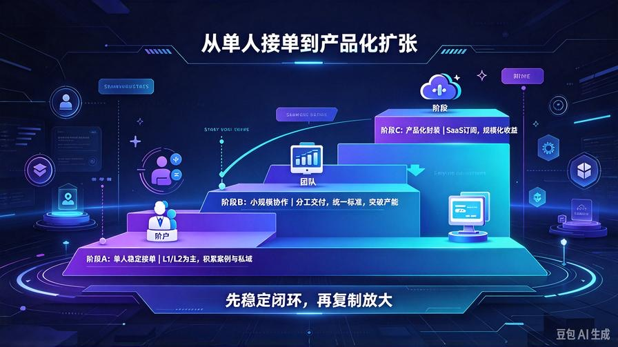
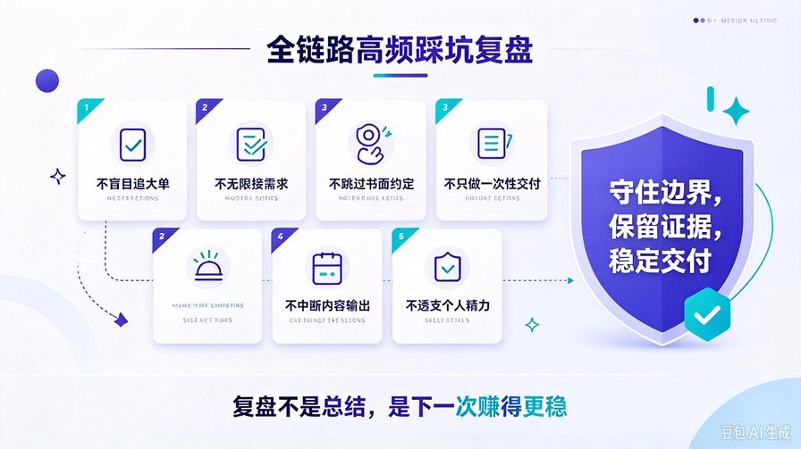

# 第40篇：商业化全链路复盘，打造可复制AI Agent接单生意

欢迎回到 **AI Agent 零基础实战连载·商业化落地篇**！

本篇是整个AI Agent零基础实战连载的收官章节。从第1篇搭建Agent基础思考闭环，一路到第39篇搭建运维托管持续收入体系，我们已经走完从0写代码，到把技术变成稳定接单生意的完整旅程。

很多人学AI开发，只埋头钻研技术，最后做出一堆Demo，却一分钱赚不到；也有人只想接单赚钱，技术底子薄弱，交付经常翻车。而我们这套路线，技术打底、商业配套跟上，技术与商业化完整打通。

本篇把全套链路串联复盘，梳理整套生意模型的核心优势、现存短板、迭代扩张路线。帮你看清全局，持续优化流程，把AI Agent接单做成一套可复制、可持续的小生意。

读完本篇你将掌握：

- 完整AI Agent接单商业全链路回顾，串联技术+获客+谈单+交付+运维
- 整套体系的优势、短板，看清自身能力边界
- 接单生意增长路径：单人起步→小规模协作→产品化
- 常见踩坑复盘，避开绝大多数创业者容易掉的陷阱
- 后续长期学习方向，持续保持竞争力

## 一、全套商业闭环完整回顾

我们整套体系分为两大阶段：技术筑基阶段 + 商业化落地阶段

### 阶段1：技术筑基（第1～28篇）

从零搭建AI Agent与商用RAG知识库底座：三层思考闭环、工具调用、记忆系统、文档解析、清洗切片、检索重排、Token压缩、溯源引用、知识库自检迭代，把Demo打磨成稳定可交付的技术成品。

核心价值：拥有可复用的代码资产，不用每次接单从零开发，大幅压缩开发工时，拉高利润空间。

### 阶段2：商业化落地（第29～39篇）

技术商业化改造，完整搭建接单全流程：去除调试痕迹、商用封装、API成本优化、标准化交付文档、售后方案、闲鱼起步接单、谈单成交话术、多渠道矩阵获客、项目分级报价、风险协议、上线交付、月度运维托管。

整条商业链路：**内容获客 → 客户咨询 → 项目定级报价 → 协议锁定需求 → 预付款开工 → 开发交付验收 → 尾款结算 → 可选运维托管（持续现金流）→老客户转介绍复购**

## 二、这套单人AI接单生意，优势与短板盘点

### ✅核心优势

- 资产复用：核心代码一次开发，多个项目复用，边际成本持续降低
- 轻资产起步：不需要公司场地、大量人员，单人在家即可启动
- 多渠道分散风险：闲鱼、小红书、B站、私域互相补充，不会单一平台断流直接停单
- 收入结构多元：一次性开发费 + 月度运维托管收入，收入更稳定
- 客户沉淀：私域客户资产可以持续挖掘复购与转介绍，降低获客成本

### ⚠️现存短板

- 单人产能天花板：一个人时间有限，项目太多会超负荷，无法同时承接大量大单
- 高客单企业客户门槛：大型企业项目需要资质、团队、现场服务，单人很难承接
- 模型与技术持续迭代压力：大模型技术更新快，需要持续学习，否则方案慢慢落后
- 获客存在波动：自媒体流量不稳定，需要长期坚持内容输出

## 三、生意三阶增长路线：单人起步，逐步扩张

### 阶段A：单人稳定接单（当前阶段）

聚焦L1、L2主力订单，少量L3定制项目。控制项目数量，优先保证交付质量，积累案例、口碑与私域客户池。同步持续更新连载内容，维持多渠道流量。

目标：稳定每月固定接单量，搭配运维托管，建立稳定现金流。

### 阶段B：小规模协作扩张（突破单人产能瓶颈）

订单量饱和之后，不再全部自己开发。可以寻找兼职技术伙伴，分工：你负责获客、谈单、需求对接；合作开发者负责开发、部署。项目利润按约定比例分成。

重点：统一交付标准、协议模板、代码规范，保证交付质量统一，避免合作交付翻车。

### 阶段C：产品化封装（长期终极方向）

积累足够客户需求之后，把整套Agent知识库系统封装成SaaS网页产品。标准化功能，客户自助注册、上传文档，按需订阅付费。

优势：不再一对一人工开发，一份产品卖给大量客户，突破人力限制，实现规模化收益。  
风险：SaaS需要服务器成本、持续运维、产品体验打磨，前期投入更高，竞争也更大。

## 四、全链路高频踩坑复盘，持续规避风险

- 不要盲目追求大单：L4大型企业项目对单人风险高，优先做好L2商用标准单，投入产出最优
- 不要无限承接新增需求：坚持需求变更单独报价，守住工时边界，避免亏本
- 不要忽视书面约定：无论单子大小，需求清单文字确认，大单务必签署简易协议
- 不要只做一次性交付：主动推荐运维托管，把一次性收入转化长期现金流
- 不要中断内容输出：流量和IP需要长期积累，停更之后咨询量会快速下滑
- 不要透支自身精力：项目排期预留缓冲时间，不要同时接太多项目导致交付质量下降

## 五、后续长期学习方向，保持技术竞争力

这套连载完成，并不代表学习结束。AI领域迭代速度很快，想要持续接单，需要持续跟进下面方向：

- 多模态RAG：图片、表格、音视频内容的检索问答，提升项目溢价能力
- Agent工作流深度优化：复杂任务规划、工具调用、记忆策略升级
- 轻量化模型本地部署：降低API依赖，进一步压缩商用成本
- SaaS产品开发：前端、用户权限、账单系统，为后续产品化铺路

## 六、整套连载结语

从第1篇搭建基础Agent，到本篇完成商业化闭环复盘，整套《AI Agent零基础实战连载》到此正式收官。

这套系列最大的价值，不是单纯学会写几段代码，而是打通“技术落地到变现”的完整思路。很多人卡在“只会做Demo，无法变现”，而我们从头到尾把技术、交付、获客、谈单、售后全部打通。

技术是工具，商业化落地才是最终目标。你手里已经拥有全套可复用代码、交付模板、获客方案、报价体系与协议文档。接下来，就是动手实践，跑通自己的第一单，持续迭代优化这套生意模型。

AI浪潮还在持续，机会永远留给愿意动手实战的人。

## 系列完结

AI Agent零基础实战连载 · 全文完

> 来源：头条号《AI Agent 零基础实战》第40篇｜版权归作者所有，仅供学习交流
