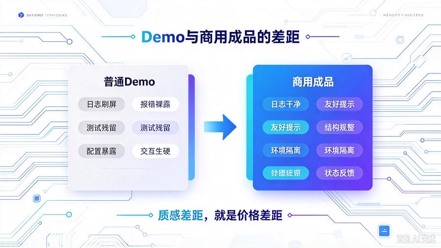
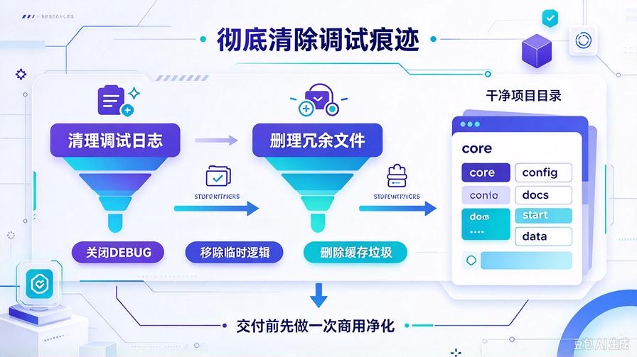
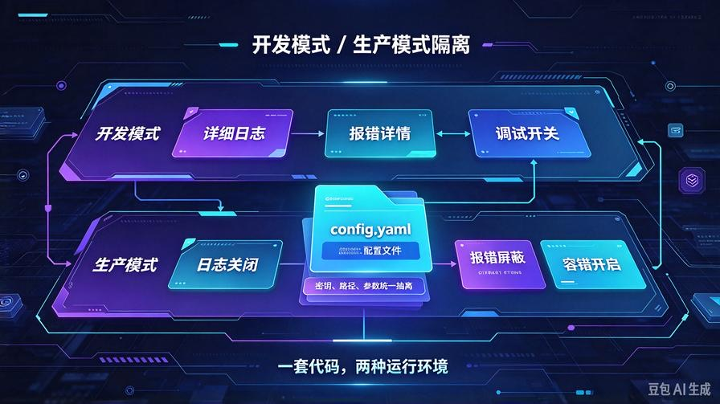
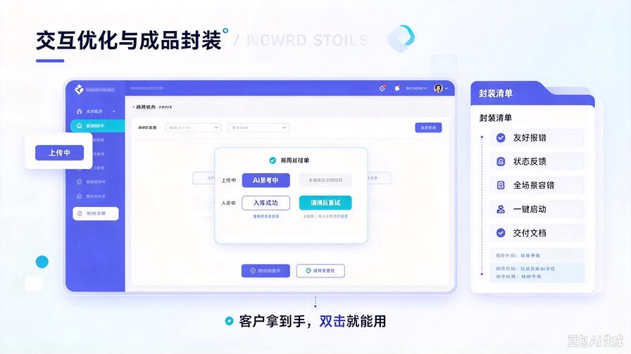

# 第41篇：Agent高阶商业化改造：彻底清除调试痕迹，打造交付级成品

欢迎回到 **AI Agent 商业化落地实战·第二季开篇**！

第一季1–40篇，我们彻底跑通了完整闭环：从零基础写代码、搭AI知识库、做Agent智能体，到获客、谈单、报价、交付、托管售后。

现在你**技术能落地、流程能跑单**，但很多人卡在最后一道致命短板：**代码能跑，但是卖不贵。**

你自己本地测试没问题，一旦要发给客户演示、交付，整体观感廉价、粗糙、满是调试痕迹。

客户不懂代码、不懂底层逻辑。他们只看「界面干不干净、稳不稳定、好不好用」。

满身Demo痕迹的项目，只能被迫接低价单、被客户压价、同质化内卷。

真正拉开接单利润差距的，**不是技术能力，而是商业化打磨能力**。

本篇作为第二季**商业化变现奠基第一篇**，带你从零完成全套商用改造。彻底剔除调试冗余、优化交互体验、封装成品结构，把“练习Demo”升级成「可高价交付、可直接售卖、客户一眼信任」的专业商用成品。

读完本篇你将彻底掌握：

- Demo和商用成品的10个核心差距（低价/高价的分水岭）
- 一键清理所有调试日志、测试代码、冗余垃圾文件
- 开发/生产双环境隔离，杜绝密钥泄露、配置暴露
- 商用交互优化：友好提示、状态反馈、全场景容错
- 标准化成品封装，客户拿到即可一键运行
- 可直接用于接单演示、交付、引流的成品验收标准

---

## 一、为什么你的AI项目永远卖不上价？

很多新手误区：只要功能能实现，就可以接单赚钱。

现实完全相反：**功能达标只是底线，成品质感才是定价权。**

我们开发时，会大量打印日志、保留测试参数、临时代码、调试开关。

这些内容在开发阶段是帮手，在交付阶段是「毁观感、压价格」的元凶。

### ❌ 普通Demo：廉价感拉满，只能低价走量

- 程序一运行，控制台疯狂刷屏日志、参数、检索分数、原始报文
- 界面残留测试按钮、废弃入口、未完善功能
- 报错直接裸露，展示代码行号、路径错误、参数异常
- 本地硬编码密钥、路径、测试参数，一眼看出是练习项目
- 交互生硬，没有加载、等待、成功反馈，卡住就像崩了
- 项目文件夹杂乱，缓存、测试文档、垃圾文件一堆
- 代码残留大量注释、废弃片段、临时调试逻辑

### ✅ 商用成品：专业干净，具备高价交付质感

- 控制台干净整洁，只保留必要运行状态
- 屏蔽所有底层报错，只展示普通人能看懂的友好提示
- 严格区分开发/生产环境，敏感信息完全隔离
- 全流程交互反馈：加载、思考、成功、失败、空状态
- 文件结构规整、无冗余、无测试残留
- 功能边界清晰，只保留客户需要的商用能力

**一句话总结：技术决定你能不能做出来，商业化打磨决定你能卖多少钱。**

---

## 二、核心第一步：彻底清除所有调试痕迹

这是见效最快、提升质感最明显的一步。零基础照着清单逐条排查，即可完成初级商用净化。

### 1. 全局清理调试日志

开发阶段为了排查问题，我们会打印海量过程日志。商用版本必须全部清理。

清理标准：

- 删除：切片详情、检索分数、模型原始参数、请求报文、响应源码
- 保留：启动成功、初始化完成、文件入库成功等必要状态提示
- 关闭所有框架DEBUG调试模式，禁止默认日志刷屏

改造后效果：程序启动干净、运行安静、无杂乱刷屏，观感直接提升一个档次。

### 2. 彻底删除废弃测试代码

绝大多数人的项目里，藏着大量自己都忘了的冗余代码。

这些代码不会报错，但会让项目显得极其不专业。

逐条清理：

- 注释掉的旧代码、废弃函数、临时测试逻辑
- 写死的本地路径、测试密钥、固定参数
- 多余的调试接口、测试按钮、备用入口
- 独立的测试脚本、临时启动文件

### 3. 清理项目冗余文件与缓存

商用交付项目，必须「干净、规整、无垃圾」。

批量删除：

- 向量数据库临时缓存、日志缓存、运行缓存
- 测试PDF、测试文档、样本素材
- 编译缓存、临时配置、自动生成垃圾文件

最终项目目录只保留：核心源码、配置文件、启动脚本、使用文档。

---

## 三、核心第二步：双环境隔离（开发模式 / 生产模式）

90%新手项目的通病：**一套配置跑到底**。

本地调试配置直接暴露在源码中，交付后极易出现：密钥泄露、路径报错、运行异常、隐私风险。

商用改造关键：**一套代码，两种运行环境**，调试归调试，交付归交付。

### 1. 所有敏感配置抽离

绝不允许代码内硬编码私密信息。全部统一抽离到独立配置文件：

- 大模型API密钥、接口地址、超时时间
- 向量数据库地址、账号、密码、端口
- 文件上传限制、问答阈值、运行参数

交付时只给配置模板，私密信息由客户自行填写，彻底规避泄露风险。

### 2. 全局模式开关控制

新增全局开关，区分两种运行状态：

- **开发模式**：开启详细日志、展示报错详情、方便迭代调试
- **生产模式**：关闭所有调试日志、屏蔽底层报错、开启容错、隐藏参数

对外交付默认开启「生产模式」，全程商用标准运行。

---

## 四、核心第三步：交互与容错升级（高价质感来源）

客户看不懂代码，只看体验。

Demo之所以廉价，是因为「生硬、冰冷、容易崩、看不懂提示」。

商用成品必须做到：**普通人点开就能用，怎么操作都不崩。**

### 1. 报错信息全面商用替换

彻底干掉所有原生代码报错，全部替换为用户友好文案。

标准替换模板：

- 代码超时报错 → 「当前AI服务请求超时，请稍后重试」
- 参数缺失报错 → 「请完善信息后重新提交」
- 文档解析失败 → 「文件损坏或格式不支持，请更换文件重试」
- 模型调用异常 → 「AI服务暂时异常，请稍后再试」

**绝对禁止**展示：代码行号、接口报错、堆栈信息、系统源码错误。

### 2. 补齐全流程状态反馈

空白、卡顿、无反馈，是用户体验最差的元凶。

补齐所有场景状态提示：

- 文档上传：上传中→解析中→入库成功/失败
- AI问答：思考加载动画、等待提示
- 操作完成：成功提示、结果反馈
- 空状态兜底：无文档、无记录时的友好空白提示

### 3. 全场景极限容错

客户操作永远不规范，商用系统必须「极度包容」。

- 拦截空文件、超大文件、非法格式文件
- 自动过滤空提问、纯符号无效提问
- 防重复点击、防高频请求，避免接口炸崩
- 请求超时自动重试，轻度异常自动兜底

改造完成后，系统不再轻易卡死、闪退、报错，稳定性直接对标付费软件。

---

## 五、核心第四步：标准化成品封装（交付即用）

最后一步，把优化好的代码，封装成「可直接交付的标准化产品」。

### 1. 规整项目目录结构

文件夹统一命名、分类清晰，客户一眼看懂、上手无压力。

- core：项目核心运行源码
- data：知识库数据、用户数据存储
- static：界面素材、静态资源
- config：配置文件目录
- docs：交付文档、使用教程、FAQ
- start：一键启动入口

### 2. 极简一键启动

抛弃复杂命令行启动。

封装桌面启动脚本，**双击即可运行**，零基础客户无需配置环境、无需敲代码。

### 3. 配套完整商用交付文档

高价交付的核心凭证，就是「完善的文档体系」。

必须包含：

- 零基础快速启动教程
- 全功能使用详解
- 常见问题排查手册
- 配置修改与参数说明

---

## 六、改造前后完整对比（商用验收标准）

**改造前（Demo版）**：日志杂乱、报错裸露、交互生硬、文件冗余、配置暴露、廉价感强，只能低价内卷。

**改造后（商用交付版）**：界面干净、运行稳定、交互流畅、安全合规、结构规整、无调试痕迹，可直接高价接单、演示引流、企业交付。

---

## 七、本篇核心总结

1. 能跑通的Demo ≠ 能卖钱的成品，质感差距就是利润差距
2. 商业化改造第一步：彻底清空所有调试、测试、冗余内容
3. 双环境隔离是商用安全底线，杜绝密钥泄露与环境报错
4. 优化交互、容错、友好提示，大幅提升产品专业度与客户信任度
5. 标准化封装+完整文档，实现「交付即用、零扯皮、零售后」

## 下期预告：第42篇｜企业级私有知识库封装，适配商用保密、内网、私有化场景

普通公开版知识库满足不了企业核心诉求。企业客户付费高、要求高，最看重**数据保密、内网隔离、私有化部署**。下一篇深度适配小微企业商用场景，打造真正能进企业、能卖高价的私有知识库系统！

> 来源：头条号《AI Agent 零基础实战》第41篇｜版权归作者所有，仅供学习交流
