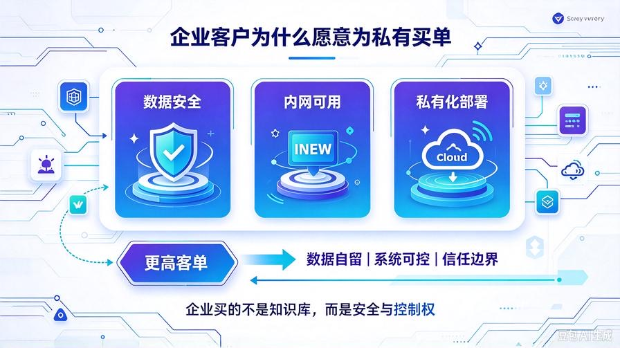
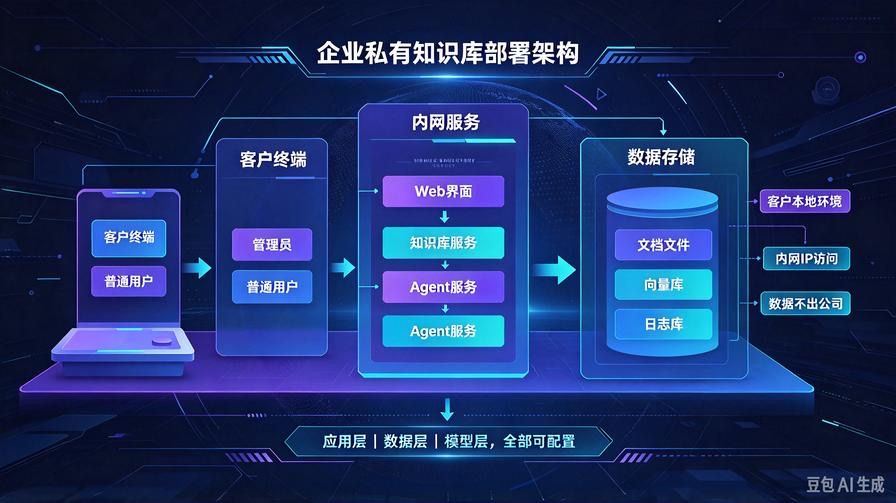
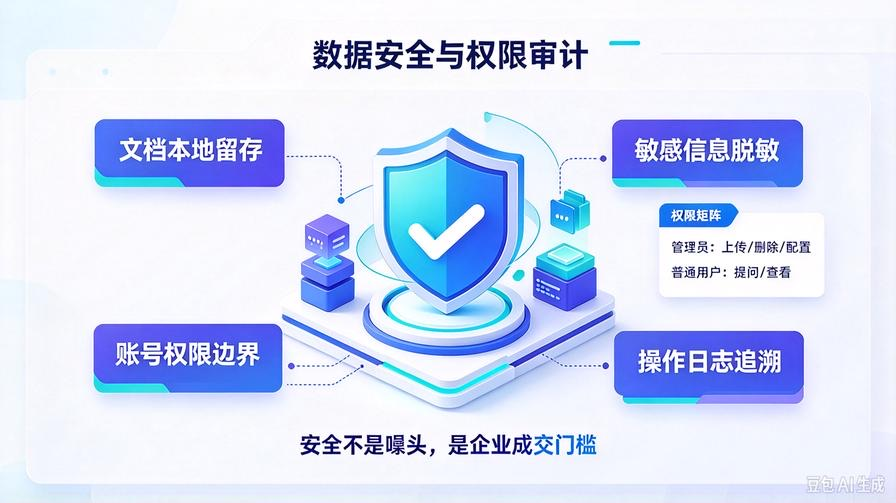
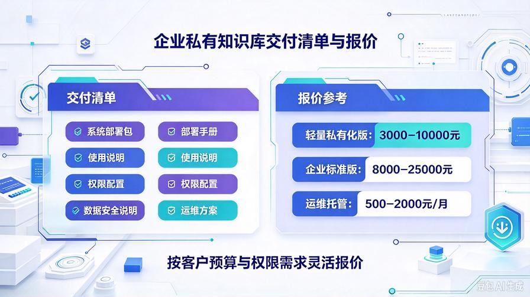

# 第42篇：企业级私有知识库封装，适配商用保密、内网、私有化场景

欢迎回到 **AI Agent 商业化落地实战**！

上一篇我们完成了 Agent 的高阶商业化改造，把 Demo 打磨成了可交付的商用成品。但如果你想进入企业客户市场，只做“表面包装”还不够。

企业愿意付更高价格，买的不只是“能问答”，而是三件事：

- **数据安全**：文档不能外流
- **内网可用**：不依赖公网也能跑
- **私有化部署**：系统可控、数据自留

这就是企业私有知识库的核心价值。

本篇带你把普通知识库升级成企业级私有知识库系统，重点解决保密、内网、私有化三类商用场景，帮你解锁更高客单。

---

## 一、企业客户为什么愿意为“私有”买单？

普通知识库和企业私有知识库，差别不是界面，而是信任边界。

### 1. 数据不能出公司

企业客户最担心的是：

- 合同文档会不会上传到第三方大模型？
- 客户资料会不会被外部抓取？
- 内部制度、财务资料、技术文档会不会泄露？

只要客户有这个顾虑，你就必须提供私有化方案。

### 2. 网络环境受限

很多企业不能随便访问外网，或者只允许内网运行业务系统。

如果你的知识库必须依赖公网 API、第三方云服务、外部域名，客户很可能直接拒绝。

### 3. 管理权限必须可控

企业客户希望知道：

- 谁能访问系统？
- 哪些文档可以上传？
- 哪些问题允许回答？
- 操作日志能不能追溯？

私有部署不是“换个服务器”，而是把控制权交还给企业。

---

## 二、企业级私有知识库的四个核心能力

### 1. 私有化部署能力

私有化部署的本质是：**系统运行在客户自己的环境里，而不是你的服务器上。**

它包括：

- 本地服务器部署
- 内网主机部署
- 客户自有云主机部署
- 局域网访问，不强制公网

对于接单来说，你不需要一开始就做复杂集群，先能做到：

- 客户一台电脑或服务器就能装
- 内网 IP 可访问
- 数据留在客户本地
- 不强制上传外部文档

这已经能满足大量小微企业需求。

### 2. 数据隔离能力

企业知识库必须明确区分：

- 客户文档数据
- 系统运行数据
- 账号权限数据
- 日志审计数据

数据隔离的关键不是“存在一个文件夹”，而是：

- 文档入库后只在本地向量库和本地文件系统中
- 不自动同步第三方云端
- 不同客户数据物理隔离或逻辑隔离
- 删除客户数据后可彻底清理

### 3. 内网运行能力

企业客户常见网络限制：

- 不能访问外网
- 只能访问指定服务器
- 不能开放高危端口
- 必须通过内网域名或 IP 访问

所以你的封装方案要提前考虑：

- 支持内网 IP 部署
- 支持自定义端口
- 减少对外依赖
- 能在离线或弱网环境运行基础功能
- 模型调用地址可改为客户本地私有模型地址

### 4. 权限与审计能力

企业客户不一定一开始就要复杂 RBAC，但至少要有基础边界：

- 管理员账号
- 普通用户账号
- 文档上传权限
- 问答访问权限
- 操作日志记录

权限系统不一定要做得很重，但要有雏形。

---

## 三、企业私有知识库封装路线：从轻量版到标准版

我建议你按两个版本封装，不要一开始就做很重。

### 版本 A：轻量私有化版

适合小微企业、律所、教育机构、工作室。

核心目标：

- 数据本地留存
- 内网可访问
- 部署简单
- 成本低

功能配置：

- 本地知识库解析
- 本地向量库
- 本地 Web 访问界面
- 管理员账号
- 基础操作日志
- 文档上传、删除、权限管理

这个版本最适合新手接单，因为交付难度可控，客户接受度高。

### 版本 B：企业标准版

适合有明确内网、保密、多人协作需求的客户。

功能配置：

- 用户登录认证
- 角色权限管理
- 部门或项目组隔离
- 文档分类管理
- 操作审计日志
- 模型地址可配置
- 接口私有化调用
- 部署文档与运维说明

版本 B 报价更高，但交付周期也更长。

---

## 四、企业级封装第一步：部署结构私有化改造

普通知识库通常是“开发者本地跑一下”，企业版要改成“客户环境可部署”。

### 1. 明确部署边界

企业客户要的不是你的开发电脑，而是可运行系统。

你要把系统拆成三层：

#### 应用层

包括 Web 界面、后端服务、知识库服务、Agent 服务。

#### 数据层

包括文档文件、向量库、关系数据库、日志文件。

#### 模型层

包括大模型接口、Embedding 接口、本地模型服务。

每一层都要能在客户环境配置，而不是写死在你本地。

### 2. 支持客户本地路径配置

很多新手项目会把文件路径写死成：

这在企业环境一定出问题。

企业版必须改成配置项：

客户可以根据服务器目录修改。

### 3. 支持内网访问

企业客户通常用内网 IP 访问，例如：

所以部署时要注意：

- 后端服务绑定 `0.0.0.0`
- 前端接口地址支持客户自定义
- 端口不要和客户现有系统冲突
- 提供端口修改说明

### 4. 减少外部依赖

企业环境最怕“什么都要外网”。

你至少要做到：

- 前端资源尽量本地化
- 不需要强制第三方账号登录
- 不依赖外部统计、埋点、广告服务
- 模型地址可切换为客户私有地址

---

## 五、企业级封装第二步：数据安全改造

企业客户不关心你用了什么高级算法，他们关心数据会不会丢、会不会漏。

### 1. 文档本地留存

企业知识库的底线是：

- 客户上传的文档只进入本地数据目录
- 文档解析结果只进入本地向量库
- 不自动上传第三方云盘
- 不自动发送外部分析服务

如果你用的是云端大模型 API，必须在合同里说明：

- 哪些内容会进入模型接口
- 是否做了脱敏处理
- 是否开启企业隐私模式
- 是否保留训练权关闭选项

### 2. 敏感信息脱敏

企业文档里经常包含：

- 手机号
- 身份证号
- 银行账号
- 合同金额
- 客户姓名
- 内部价格

在知识库入库前，最好做基础脱敏。

简单方案：

- 正则识别手机号、身份证号
- 用占位符替换
- 对合同金额做可选遮蔽
- 对客户名称做泛化处理

注意：脱敏不能影响客户后续检索需求，所以要按行业灵活处理。

### 3. 删除机制

企业客户可能要求文档删除后彻底清理。

你要保证删除动作不只删界面记录，还要清理：

- 文件原文档
- 向量库中的对应向量
- 缓存切片
- 索引记录
- 操作日志中的敏感原文

---

## 六、企业级封装第三步：权限与审计雏形

企业系统没有权限，就不算真正商用。

### 1. 基础账号体系

最小可用版本建议做两类账号：

#### 管理员

- 上传文档
- 删除文档
- 配置系统
- 查看日志
- 管理用户

#### 普通用户

- 提问
- 查看答案
- 查看允许访问的文档

不要一开始就做复杂权限矩阵，先把这两类账号跑通。

### 2. 文档访问边界

至少做到：

- 普通用户不能随便删除文档
- 普通用户不能修改系统配置
- 不同部门用户只能看到对应文档
- 敏感文档需要管理员授权

如果客户预算有限，可以先做“文档分类 + 用户绑定分类”。

### 3. 操作日志

企业客户很吃“可追溯”这一点。

日志至少记录：

- 用户登录
- 文档上传
- 文档删除
- 系统配置修改
- 高频异常提问

日志不一定要上复杂数据库，先用本地文件或轻量数据库即可。

---

## 七、企业级封装第四步：内网与离线适配

很多企业客户不是买不起云服务，而是不敢把资料放出去。

### 1. 内网部署方案

企业内网部署通常有三种方式：

#### 方式一：客户电脑本地运行

适合小团队。

优点：

- 部署简单
- 成本低
- 数据本地

缺点：

- 依赖电脑开机
- 并发能力弱

#### 方式二：客户服务器运行

适合标准企业客户。

优点：

- 稳定
- 可多人访问
- 数据可控

缺点：

- 需要服务器基础环境

#### 方式三：客户私有云运行

适合有私有云平台的客户。

优点：

- 企业接受度高
- 运维体系成熟

缺点：

- 交付要求更高

### 2. 弱网与离线运行

企业客户不一定网络很好，所以系统要尽量做到：

- 前端资源本地化
- 不强制在线登录
- 不强制第三方 CDN
- 基础问答功能可离线运行
- 模型接口支持本地部署地址

如果模型必须调用公网 API，要提前说明依赖关系，不要隐瞒。

---

## 八、企业私有知识库交付清单

做企业私有知识库项目，不能只交一个压缩包。

你要交付的是一套完整方案。

### 必须交付

- 系统部署包
- 部署手册
- 使用说明
- 管理员操作手册
- 数据安全说明
- 内网访问说明
- 常见问题排查

### 可选交付

- 权限配置培训
- 文档入库培训
- 定制化功能开发
- 一年运维支持
- 数据备份方案

---

## 九、企业私有知识库接单报价参考

企业私有知识库比普通知识库更贵，因为客户买的是安全、稳定、可控。

### 轻量私有化版

适合 10–50 人小团队。

报价参考：

- 基础部署：3000–6000 元
- 含文档入库培训：5000–8000 元
- 含基础权限：6000–10000 元

### 企业标准版

适合有内网、权限、审计需求的客户。

报价参考：

- 内网部署 + 权限 + 日志：8000–15000 元
- 多部门隔离 + 定制配置：12000–25000 元
- 长期运维托管：每月 500–2000 元

注意：报价一定要看客户预算，不要只按功能算。

---

## 十、企业客户最关心的五个问题

### 1. 数据会不会外泄？

答：系统部署在客户本地，文档和向量库都留在客户环境；模型调用部分按合同约定，可选择客户自有模型或隐私模式接口。

### 2. 能不能在内网运行？

答：可以。只要客户提供内网服务器或电脑，系统支持内网 IP 部署和本地访问。

### 3. 多少人同时用？

答：轻量版适合小团队，标准版可根据服务器配置支持更多并发用户。

### 4. 文档删了能不能彻底清理？

答：可以。删除动作覆盖原文档、向量索引、缓存和日志记录。

### 5. 以后能不能升级？

答：可以。系统按模块化封装，后续可升级权限、审计、多模型、接口能力。

---

## 十一、本篇核心总结

1. 企业客户买的不是知识库，而是数据安全、内网可用、私有化部署。
2. 企业级私有知识库的核心是部署私有化、数据隔离、权限审计、内网适配。
3. 不要一开始就做复杂系统，先做轻量私有化版，满足小微企业刚需。
4. 企业交付不能只交代码，必须交部署包、文档、权限说明和运维方案。
5. 私有知识库的报价空间远高于普通 Demo，是 AI Agent 接单的高价值赛道。

## 下期预告：第43篇｜零基础一键打包部署，Windows客户端/本地服务无门槛封装

企业客户懂技术的不多，交付难度往往卡在“不会部署”。下一篇把系统进一步封装成 Windows 客户端和本地服务，让客户双击就能运行，大幅降低交付门槛。

> 来源：头条号《AI Agent 零基础实战》第42篇｜版权归作者所有，仅供学习交流
