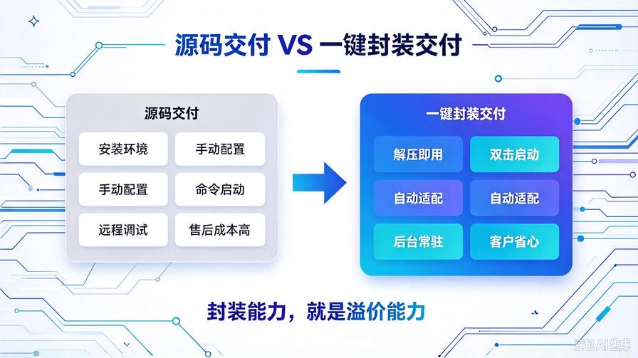
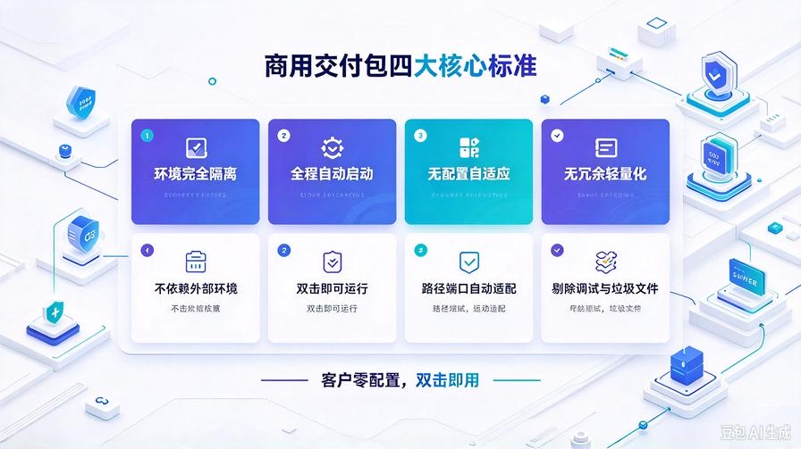
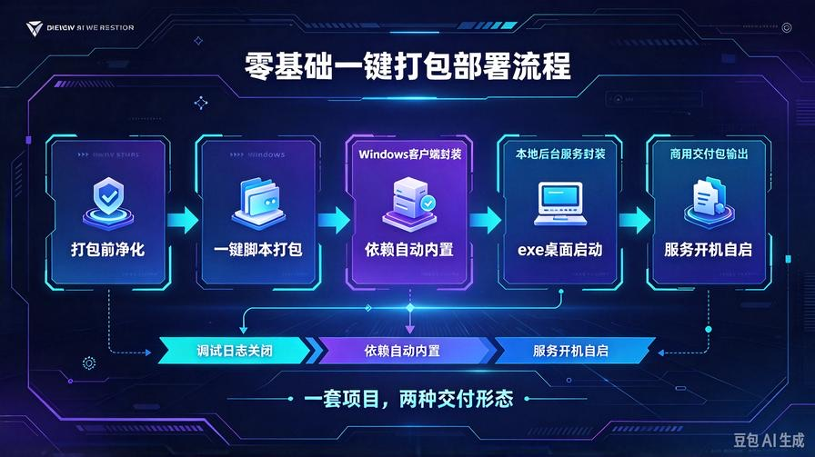
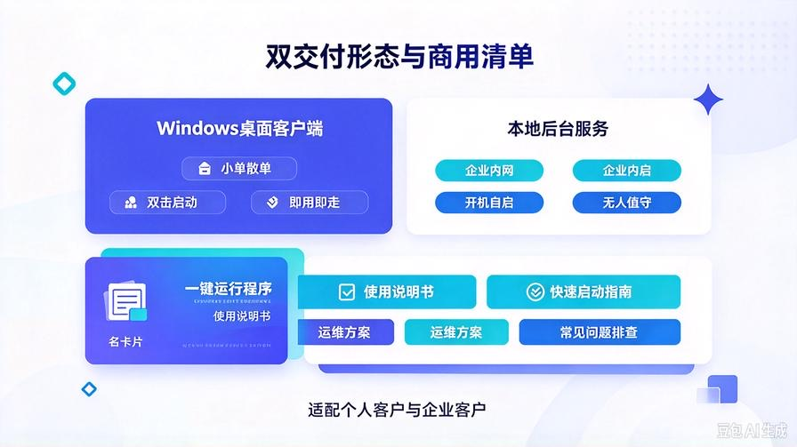

# 第43篇：零基础一键打包部署，Windows客户端/本地服务无门槛封装

欢迎回到 **AI Agent 高阶商业化落地实战**！

前两篇我们完成了两大核心升级：

第41篇把粗糙Demo改成了**商用干净成品**，彻底摆脱廉价调试痕迹；第42篇完成了**企业私有化、数据保密、内网适配**改造，打通了高客单交付的核心壁垒。

现在你的项目，功能、安全、专业性都已经达标。但绝大多数人会卡进最后一个致命短板：**做得出来，却交不出去。**

很多小微企业、个体户、传统企业客户，完全不懂代码、不会配环境、不会敲命令行。

你发给对方源码、教对方装Python、装依赖、输启动命令，90%的客户会直接放弃，甚至觉得你的产品低端、使用麻烦，直接压价、退单。

**真正的高价商用产品，从来不需要客户懂技术。**

本篇手把手带你完成**零基础一键打包部署**，把整套AI知识库、Agent系统，封装成**Windows客户端+本地后台服务**。客户拿到压缩包，解压双击就能运行，无需环境配置、无需敲代码、零基础零门槛。

彻底解决交付难、售后多、客户嫌麻烦的核心问题，让你的项目完全对标付费软件交付标准。

读完本篇你将掌握：

- 源码转客户端的完整封装逻辑，区分开发包/交付包
- 一键打包脚本制作，全自动打包，无需手动改配置
- Windows客户端封装，双击启动、自带界面、零环境依赖
- 本地后台服务部署，开机自启、后台常驻、无需人工值守
- 交付包瘦身优化，去除冗余文件，体积更小、运行更快
- 商用交付最终标准：客户拿到即用，全程无代码、无配置

---

## 一、为什么必须做「一键打包封装」？（接单利润分水岭）

很多新手以为：项目能本地跑、功能正常，就可以接单交付。

但在商业交付场景中，**需要客户动手配置的产品，都是不合格产品**。

我们对比两种交付模式的差距，你就能看懂利润差距在哪。

### ❌ 传统源码交付（低价、售后爆炸、容易丢单）

- 需要客户自行安装Python环境
- 需要手动安装几百条依赖库，极易报错
- 需要手动修改配置文件、适配本地路径
- 需要打开命令行、输入启动指令
- 电脑重启后需要重新手动启动
- 客户操作报错，你要全程远程调试，售后成本极高

这种交付方式，只能做低价小单，赚的是辛苦调试费，毫无复利可言。

### ✅ 一键封装交付（高价、专业、零售后）

- 纯绿色客户端，解压即用，无需安装环境
- 双击即可启动程序，自动初始化所有服务
- 内置自适应路径，客户电脑无需手动改配置
- 支持后台常驻运行，不占用前台窗口
- 可设置开机自启，全程无人值守
- 交付极简、质感拉满，客户信任感直接拉满，溢价空间翻倍

**核心真相：客户付费买的是“省心可用”，不是“动手折腾”。封装能力，就是你的溢价能力。**

---

## 二、商用交付包核心标准（必须满足4个条件）

不是简单打包一下就叫商用客户端，真正可交付的成品，必须满足四大标准。

### 1. 环境完全隔离

打包后的程序，**不依赖客户电脑任何外部环境**。

不管客户电脑有没有装Python、有没有装依赖、有没有配置环境变量，都可以直接运行。所有运行依赖全部内置在交付包中，完全独立。

### 2. 全程可视化/自动化

杜绝命令行黑屏启动、杜绝手动输入指令。

要么提供可视化客户端窗口，要么后台静默启动，客户只需要双击图标，等待启动完成即可使用。

### 3. 无配置自适应

所有路径、端口、缓存、日志配置，全部自动适配客户本地电脑。

不需要客户修改任何代码、任何配置文件，彻底杜绝路径报错、配置缺失报错。

### 4. 无冗余轻量化

打包完成后，自动剔除调试文件、缓存、日志、测试素材、废弃代码。

交付包体积精简、运行流畅，无多余垃圾文件，专业度拉满。

---

## 三、零基础一键打包核心实操（全程自动化）

本篇全程零基础实操，不需要深厚编程基础，照着步骤配置，即可生成专属商用交付包。

### 1. 打包前最终净化（必做步骤）

打包前必须做一轮最终净化，避免把调试痕迹、垃圾文件打包进交付包。

统一清理清单：

- 关闭所有DEBUG调试模式、关闭日志打印
- 删除所有测试文档、缓存文件、临时日志
- 删除废弃代码、注释、临时调试参数
- 确认配置文件为生产模式，无密钥、无本地私有路径暴露

这一步决定交付包的专业度，也是区别新手和老手的关键细节。

### 2. 制作全自动打包脚本

我们不手动繁琐操作，直接封装**一键打包脚本**，后续任何项目复用，一键即可完成打包。

脚本核心能力：

- 自动读取项目目录，无需手动修改路径
- 自动清理冗余文件、缓存、日志
- 自动打包依赖环境，内置运行库
- 自动屏蔽调试信息，开启生产模式
- 自动生成干净交付包，输出到指定目录

后续迭代版本、更新功能，直接双击打包脚本，即可生成最新商用交付包，效率翻倍。

### 3. 封装Windows客户端（桌面端成品）

将整套知识库/Agent系统，封装成**Windows桌面客户端**，适配所有Windows电脑。

成品效果：

- 生成专属exe启动图标，美观专业，对标商用软件
- 双击exe直接启动，自动拉起后端服务+前端页面
- 启动完成自动弹出浏览器访问界面，无需手动输入地址
- 程序窗口干净无黑屏、无代码弹窗、无调试日志

这种交付形态，是小微企业、工作室、个人客户最认可的形式，视觉质感和专业度远超源码交付。

### 4. 封装本地后台服务（服务器常驻方案）

针对企业内网部署、长期运行场景，我们再做一层**后台服务封装**。

解决两大痛点：

- 不用一直打开客户端窗口，不占用桌面和内存
- 电脑重启自动启动服务，无需人工手动重启

服务部署后效果：

- 系统后台静默运行，无前台弹窗
- 开机自启、异常自动重启
- 内网设备可随时访问知识库系统
- 全程无人值守，稳定性拉满

这个形态，专门适配**企业服务器、内网主机、长期托管**等高客单场景。

---

## 四、交付包极致优化（拉高专业度、减少售后）

打包完成不是终点，优化后的交付包，才能真正做到“零售后、高质感”。

### 1. 体积瘦身优化

默认打包会携带大量无用依赖、缓存文件，导致包体臃肿、启动缓慢。

优化方案：精准筛选运行依赖，剔除无效库、冗余文件、测试资源，在不影响功能的前提下，最大程度压缩包体，提升启动速度。

### 2. 启动速度优化

添加启动预加载、异常兜底机制，解决首次启动卡顿、黑屏、加载超时问题，让客户打开即秒响应。

### 3. 隐私安全优化

打包过程自动屏蔽所有私密信息：本地路径、个人密钥、调试参数、开发痕迹，交付包干净安全，无任何隐私泄露风险。

### 4. 容错兜底优化

针对客户电脑环境差异，做全场景容错：权限不足、端口占用、路径中文、内存不足等常见问题，自动适配、自动兜底，杜绝启动失败。

---

## 五、两种交付形态适配不同接单场景

我们封装的两种成品形态，可以精准匹配不同客户、不同价位的订单。

### 形态一：Windows桌面客户端（适合小单、散单、个人/小工作室）

适配场景：个体户、小团队、自媒体、职场个人使用。

优势：交付简单、即用即走、无需常驻、适合轻量需求。

### 形态二：本地后台服务（适合企业单、高客单、私有化部署）

适配场景：企业内网、公司服务器、长期使用、多人协作。

优势：稳定常驻、无人值守、开机自启、适配企业运维需求，溢价更高。

---

## 六、最终商用交付清单（打包后完整交付物）

打包完成后，一套标准高价交付套餐包含：

- 一键运行客户端/后台服务程序（核心成品）
- 极简使用说明书（零基础图文教程）
- 快速启动+常见问题排查手册
- 配置修改、参数调整简易指南
- 数据备份、重启、关闭运维方案

整套交付，无代码、无难度、无售后扯皮，完全对标专业软件交付标准。

---

## 七、本篇核心总结

1. 源码交付是低价接单的根源，一键封装交付才是高价商用的核心门槛
2. 合格的商用成品，必须做到客户零配置、零代码、双击即用
3. 双形态封装（客户端+后台服务），可适配所有个人、企业接单场景
4. 打包前净化、打包中优化、打包后兜底，三步杜绝售后问题
5. 封装能力直接决定产品溢价，是拉开同行差距的核心竞争力

## 下期预告：第44篇｜商用接口封装实战，AI系统对外标准化调用，适配二次开发

做完客户端和本地服务封装后，很多企业客户需要**对接自有系统、小程序、网站、ERP**。下一篇带你完成商用接口标准化封装，让你的AI系统支持二次开发、对外调用，直接解锁更高客单的定制化开发订单！

> 来源：头条号《AI Agent 零基础实战》第43篇｜版权归作者所有，仅供学习交流
