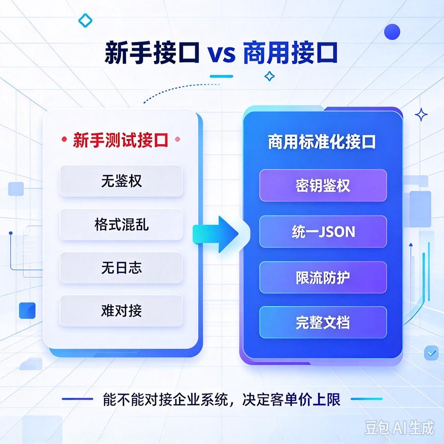
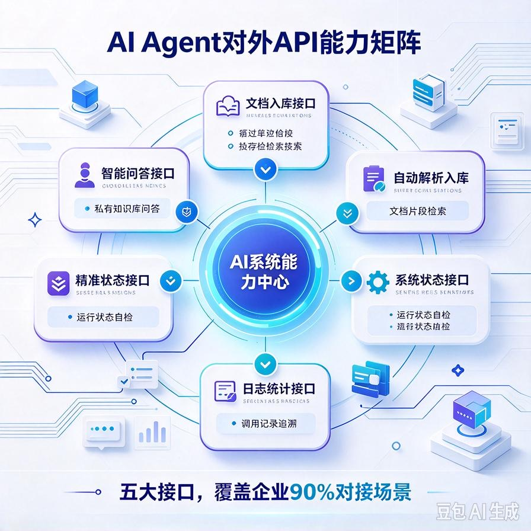
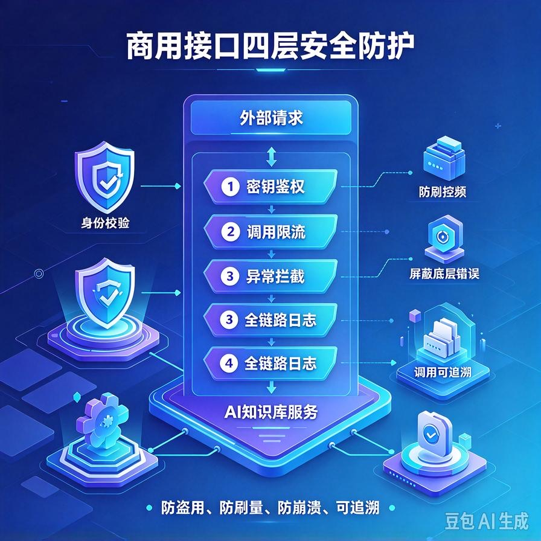
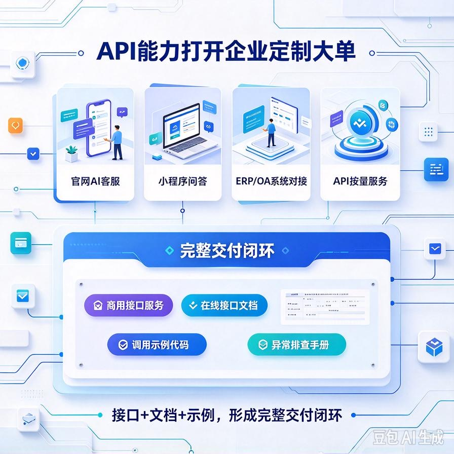

# 第44篇：商用接口封装实战，AI系统对外标准化调用，适配二次开发

欢迎回到 **AI Agent 高阶商业化落地实战**！

在前43篇的闭环打磨中，我们完成了AI项目从「Demo半成品」到「企业级成品」的完整蜕变：

从清理调试痕迹、私有化保密改造，到一键打包、Windows客户端、后台服务无门槛交付，彻底解决了**能用、好看、好交付、零售后**的核心问题。

但如果你想突破小单瓶颈、拿下企业定制、软件对接、系统集成的**高溢价大单**，只靠网页端、客户端本地使用，远远不够。

企业真正的高价需求，从来不是“自己点开网页问答”，而是：**把你的AI能力，嵌入他们的系统里。**

对接官网、小程序、企业ERP、CRM、内部OA、客服系统、进销存系统。

能做系统对接、支持二次开发，你的项目就从「工具软件」升级为「企业级AI能力底座」，客单价直接翻3–10倍。

本篇带你从零落地**商用标准化接口封装**，把私有知识库、智能Agent、问答检索、文档解析能力，封装成通用API接口。支持任意系统调用、支持客户二次开发，彻底解锁企业定制高价赛道。

读完本篇你将掌握：

- 商用接口和新手测试接口的核心差距（低价与定制大单的分水岭）
- 全套标准化API封装：问答、检索、文档入库、智能Agent调用
- 接口安全机制：密钥鉴权、访问限流、防盗用、权限隔离
- 统一入参出参规范，适配所有程序员二次开发
- 接口文档自动生成、调试测试、落地交付全套流程
- 对接企业系统的接单思路、报价体系、交付标准

---

## 一、为什么会「接口封装」，才能接企业大单？

很多新手的AI项目，永远只能卖终端使用权，客单几千封顶。

核心原因：**项目是封闭的，不具备扩展性。**

客户只能打开你给的客户端、网页端手动使用，无法和自己的业务打通，对企业来说只是“辅助工具”，可有可无，随时可以压价、替换。

但企业付费最贵的需求，全部是**业务融合**：

- 官网接入AI智能客服，自动解答客户问题
- 企业OA接入知识库，员工自助查询制度、流程、资料
- ERP系统对接AI，自动分析单据、汇总数据
- 小程序内嵌私有问答，服务终端用户
- 内部运维系统接入Agent，自动执行检索、分析、汇总任务

这些需求，**不靠接口完全做不了**。

简单说：**没有标准化API，你只能卖工具；有了商用接口，你才能卖服务、卖集成、卖定制开发。**

---

## 二、新手接口 VS 商用接口（差距决定客单价）

很多人本地也写过简单接口，但只能自己调试，完全无法商用交付。

我们直接对比差距，看懂商用接口的核心标准。

### ❌ 新手测试接口（只能自用，无法接单）

- 无任何鉴权，谁拿到地址都能随便调用，极易被盗刷、滥用
- 入参出参混乱，格式不统一，程序员对接难度极大
- 没有报错规范，出错只返回原生代码错误，无法定位问题
- 无调用限流、无日志、无统计，无法管控接口使用情况
- 没有正式文档，客户看不懂、对接无从下手
- 耦合严重，改一个功能，所有接口全部受影响

### ✅ 商用标准化接口（可交付、可二次开发、可高价售卖）

- 全局密钥鉴权，非法访问直接拦截，杜绝盗刷滥用
- 统一JSON规范入参、统一格式出参，行业通用标准
- 标准化错误码+友好提示，对接问题一眼定位
- 接口限流、频率管控，防止服务器被打崩
- 完整调用日志、调用次数统计、异常记录
- 模块化解耦，功能独立，迭代升级不影响原有接口
- 自动生成可视化接口文档，支持在线调试

**核心真相：企业买的不是接口数量，是「规范、安全、稳定、好对接」。**

---

## 三、商用核心接口全套封装（实战落地）

我们针对AI知识库+Agent系统，封装企业最常用、最有变现价值的五大类标准化接口，覆盖90%企业对接场景。

所有接口统一风格、统一规范，直接对标企业开发标准。

### 1. 通用智能问答接口（核心盈利接口）

这是企业对接最多的核心接口，支持私有知识库问答、智能推理、上下文应答。

适配场景：官网客服、小程序问答、员工智能咨询、客户自动答疑。

支持能力：

- 私有知识库精准检索应答
- Agent智能推理、多轮上下文对话
- 可设置回答字数、风格、精准度
- 自动溯源文档来源，返回参考资料

### 2. 文档入库解析接口

支持外部系统主动推送文档，自动解析、切片、入库向量化。

适配场景：企业OA自动同步制度、CRM自动同步客户资料、后台自动上传素材。

### 3. 精准检索接口

脱离大模型闲聊，纯高精度向量检索，返回匹配的文档片段。

适配场景：企业资料检索、合同比对、制度查询、内容匹配。

### 4. 系统状态接口

查询系统运行状态、知识库数量、服务是否正常。

适配场景：客户运维监控、后台看板、系统自检。

### 5. 日志与统计接口

获取调用记录、提问记录、异常记录、访问频次。

适配场景：企业数据统计、运营分析、审计追溯。

---

## 四、商用接口四大安全体系（企业交付必备）

接口一旦对外开放，安全就是第一底线。没有安全机制的接口，交付等于埋雷。

商用交付必须配齐四层安全防护，杜绝盗用、刷量、崩溃、数据泄露。

### 1. 全局密钥鉴权

所有接口统一携带密钥请求，密钥错误、为空、非法，直接拒绝访问。

支持客户自定义密钥、密钥定期更换，完全掌控接口访问权限。

### 2. 接口限流防刷

设置单IP、单密钥单位时间调用上限。

防止恶意高频请求、爬虫刷量、服务器过载崩溃，保障系统稳定运行。

### 3. 统一异常拦截

屏蔽所有底层报错、代码堆栈、路径信息。

所有接口异常统一返回标准化提示+错误码，安全且方便开发者排查问题。

### 4. 全链路日志记录

每一次接口调用全部留存日志：调用时间、调用IP、请求参数、返回结果、是否异常。

企业可随时审计、追溯、排查问题，满足商用合规要求。

---

## 五、标准化入参出参规范（适配所有二次开发）

想要让客户程序员愿意对接、快速对接，必须统一行业通用JSON格式，简洁、规范、无冗余。

### 统一返回结构标准

所有接口统一返回三段式结构，企业开发最熟悉、最好对接：

- code：状态码（成功/失败固定标识）
- msg：状态描述（友好中文提示）
- data：核心返回数据（内容按需返回）

### 标准化错误码体系

预设通用错误场景，对接效率翻倍：

- 密钥错误、权限不足
- 请求参数缺失、参数格式错误
- 接口请求超限、限流拦截
- 服务异常、模型调用失败
- 文档不存在、检索为空

规范统一的接口体系，能极大降低客户对接成本，也是你高价交付的核心底气。

---

## 六、接口文档自动化生成（商用交付核心凭证）

企业对接，**文档比代码更重要**。

没有规范文档，程序员不会帮你对接；文档越专业，客户越信任，越愿意高价付费。

我们直接配置自动化文档工具，实现：

- 自动生成可视化接口文档页面
- 展示每个接口的请求地址、请求方式、入参说明、出参字段
- 支持在线调试、实时请求、查看返回结果
- 支持一键导出离线文档，交付给客户留存

交付时直接给到客户：**接口说明文档+在线调试地址+调用示例代码**，零基础程序员也能快速完成对接。

---

## 七、接口封装后的商业价值与接单场景

一旦你的AI系统拥有标准化商用接口，你的接单赛道会彻底打开，从零售单升级为企业定制单。

### 1. 网站/官网AI客服对接

帮企业官网接入私有AI问答，自动接待客户、解答产品问题、留存线索，单项目报价 5000–15000。

### 2. 小程序/公众号AI问答功能

内嵌私有知识库能力，服务终端用户，适合教育、医美、律所、服务商，定制单 8000–20000。

### 3. 企业内部系统AI赋能

对接OA、CRM、ERP，实现内部资料智能查询、自动汇总、数据分析，企业私有化定制 1w–3w+。

### 4. 对外SaaS能力输出

可直接把AI接口作为服务售卖，按调用次数、按月收费，实现被动复利收益。

---

## 八、商用接口完整交付清单

接口类定制项目，交付必须完整，杜绝售后扯皮、对接纠纷。

一套标准高价交付包包含：

- 全套标准化商用接口服务（已鉴权、限流、容错）
- 可视化在线接口文档 + 离线PDF文档
- 各语言调用示例代码（适配二次开发）
- 接口配置修改、密钥更换教程
- 调用日志查询、异常排查手册
- 对接调试协助服务（商用增值服务）

---

## 九、本篇核心总结

1. 封闭的本地工具只能卖低价使用权，开放的标准化接口才能接企业定制大单
2. 商用接口核心差距不在数量，而在安全、规范、稳定、可对接
3. 五大核心接口覆盖90%企业AI对接场景，是高客单变现核心能力
4. 鉴权、限流、日志、统一报错四大安全体系，是商用交付必备底线
5. 自动化文档+标准化格式，大幅降低客户对接成本，提升产品溢价
6. 接口赋能可打通网站、小程序、企业系统，解锁复利变现模式

## 下期预告：第45篇｜账号权限分级体系搭建，多用户隔离+企业团队管控方案

企业团队使用、多部门协作、对外试用场景，都离不开权限隔离。下一篇带你搭建**商用级多用户权限系统**，实现管理员、员工、访客分级管控，数据隔离、功能分权，彻底适配团队商用交付场景！

> 来源：头条号《AI Agent 零基础实战》第44篇｜版权归作者所有，仅供学习交流
