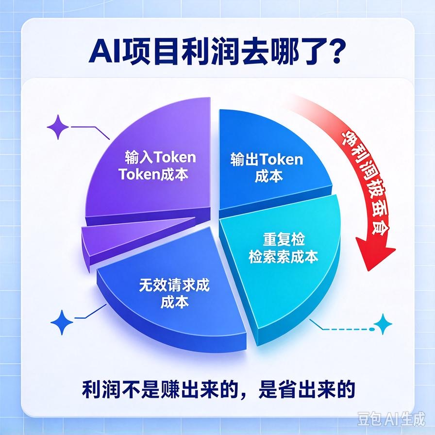
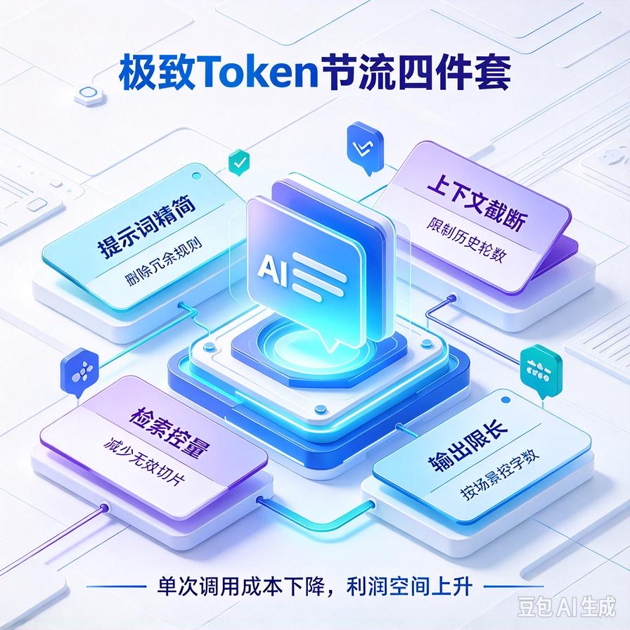
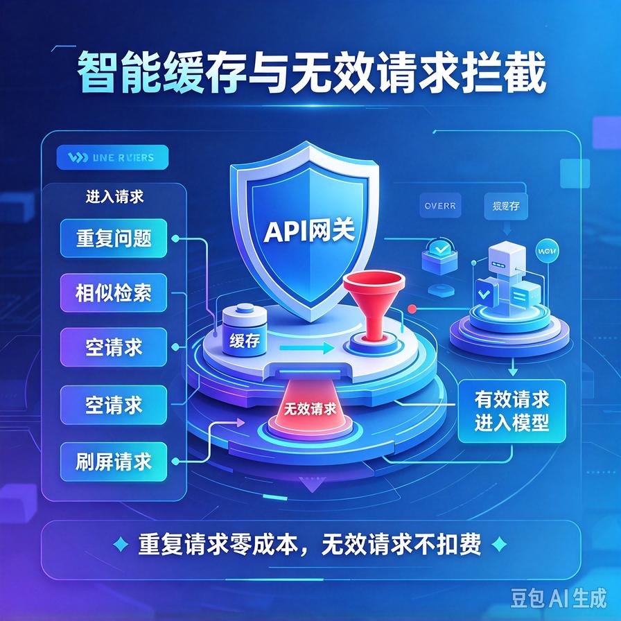
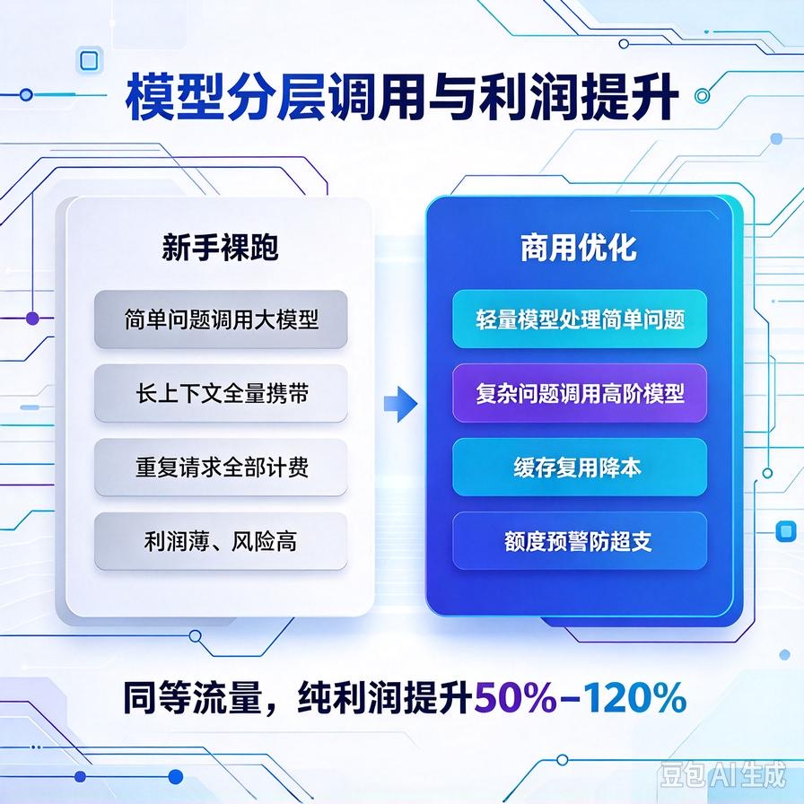

# 第45篇：极致成本控制实战，API计费节流优化，拉高纯利润

欢迎回到 **AI Agent 高阶商业化落地实战**！

前面44篇，我们一路完成了从「能做项目」到「能卖高价项目」的完整闭环。

从Demo商用打磨、企业私有化封装、一键打包交付，到标准化API接口对外开放，你的AI系统已经具备了**高价接单、企业交付、二次开发对接**的全部能力。

很多同学做到这一步，已经可以稳定接企业定制单、私有化部署单，客单价远超普通个人开发者。

但绝大多数人会卡在第二个致命瓶颈：**单子能接到，利润被消耗，赚得多、剩得少。**

你报价1万、3万、5万，看似利润可观，但长期运行下来，模型调用费、向量检索费、重复token消耗、无效请求扣费，会持续蚕食你的净利润。

很多AI服务商、个人接单开发者，**表面在赚钱，实则在给平台打工**。

商业交付的终极核心，从来不是“做大营收”，而是**守住净利润**。

本篇带你落地**全套商用级成本节流方案**，从零拆解AI项目所有扣费死角，手把手实现API计费优化、token节流、无效请求拦截、智能缓存降噪。让你的项目**营收不变，利润直接翻倍**，彻底拉开和普通开发者的差距。

读完本篇你将掌握：

- AI项目所有隐形扣费坑（90%新手都在白白亏钱）
- Token极致节流：输入、输出、上下文、重复检索全维度优化
- 智能缓存体系搭建，避免重复提问、重复检索重复扣费
- 请求过滤与无效拦截，杜绝空请求、垃圾请求、刷屏耗损
- 模型分层调用策略：高低模型按需匹配，不浪费高价算力
- 商用计费监控+额度预警，杜绝超支、超额、莫名扣费
- 最终实现：同等流量、同等订单，纯利润提升50%–120%

---

## 一、为什么你的AI项目，永远留不住利润？

很多人对AI接单的利润认知，存在巨大误区。

大家以为：报价 - 成本 = 利润。

但真实商用场景中，**大量成本都是隐形、被动、持续消耗的**。

新手项目普遍存在一个问题：**功能全开、请求全通、模型无脑调用**。

你每一次用户问答、每一次文档检索、每一次上下文拼接，都在实时消耗Token、消耗API费用。

我们盘点新手最容易亏钱的场景：

- 用户重复提问相同问题，系统重复检索、重复调用模型
- 简单问题用高价大模型，算力严重过剩、成本浪费
- 上下文无限制累加，对话越聊越贵，Token持续暴涨
- 无效空请求、符号请求、刷屏测试请求持续扣费
- 文档切片冗余、检索条数过多，多余向量检索消耗
- 无缓存、无拦截、无分层策略，每一次请求都是全新计费

**核心真相：AI项目的利润，不是赚出来的，是省出来的。**

不会做成本优化，你的项目流量越大、用户越多、单子越大，反而越容易薄利、甚至倒贴。

---

## 二、AI商用项目所有扣费逻辑（彻底摸清亏钱根源）

想要节流，必先懂扣费。

所有云端AI接口的计费逻辑，只有两个核心：**输入Token、输出Token**。

你可以简单理解：**传入内容越多、返回内容越长、调用模型越贵、请求次数越多，扣费越狠。**

我们拆解商用项目四大成本来源：

### 1. 提示词输入成本（最容易被忽视）

系统提示词、角色设定、规则说明、前置约束，每一次对话都会重复传入。

冗长、冗余、重复的提示词，会造成**每轮对话固定扣费损耗**。

### 2. 知识库检索拼接成本

每次问答都会拼接检索到的文档片段，检索条数越多、切片越长，输入Token越高，扣费越贵。

### 3. 上下文对话累加成本

多轮对话会不断携带历史记录，聊天越久，传入内容越大，成本持续攀升。

### 4. 模型输出生成成本

回答越长、字数越多、思考越久，输出Token越高，计费同步增加。

**所有成本优化，全部围绕这四点展开，直击扣费核心。**

---

## 三、极致Token节流：从根源砍掉隐形消耗

这是本篇最高收益的核心实操，优化后可直接降低30%–60%的基础调用成本。

### 1. 提示词精简瘦身

新手通病：提示词堆砌、规则重复、文案啰嗦，每一轮对话都在重复浪费Token。

商用优化方案：

- 删除冗余修饰、重复规则、无效话术，保留核心业务逻辑
- 统一精简句式，压缩无效字符、空格、换行
- 固定核心模板，避免动态超长提示词拼接

单轮对话看似省的不多，**日均几百上千次请求，累积利润差距极其恐怖**。

### 2. 上下文智能截断（防止越聊越贵）

无限制上下文=无限制扣费。

很多用户连续对话几十轮，历史记录全部携带，Token直接爆炸。

商用解决方案：**智能滑动窗口截断**

- 限制最大携带历史轮数，超出自动淘汰最早对话
- 超长历史自动精简、压缩摘要，保留核心语义
- 支持手动清空上下文、自动重置会话

既保证对话连贯性，又杜绝无限累加扣费。

### 3. 知识库检索精准控量

新手默认检索10条、20条文档片段，实则根本用不上，纯纯浪费算力。

商用精准优化：

- 常规问答固定精简检索条数，够用即止
- 根据问题复杂度，动态调整检索数量
- 过滤低分相似度片段，杜绝无效碎片拼接
- 精简切片长度，去除切片内冗余空格、换行、无效内容

大幅降低输入Token体积，同时**不降低回答质量**。

### 4. 输出字数智能限制

很多用户随便问一句，模型自动输出超长回答，输出Token严重浪费。

商用策略：根据问题类型，动态控制输出长度。简单问题短回答，复杂问题长回答，不盲目堆砌字数。

---

## 四、智能缓存体系：彻底杜绝重复扣费

真实商用场景中，**30%–60%的用户提问都是重复问题**。

相同问题、相同检索、相同回答，完全可以缓存复用，没必要重复调用模型、重复扣费。

搭建商用双层缓存体系，直接砍掉大半重复成本。

### 1. 问题问答缓存（高频复用）

对高频重复问题，建立问答缓存库。

用户再次提问时，直接读取缓存返回结果，**零模型调用、零扣费、秒响应**。

适配场景：企业制度问答、产品常见问题、基础流程咨询、高频通用提问。

### 2. 检索结果缓存

相似问题会检索出相同文档片段，对检索结果做缓存复用。

避免重复向量检索、重复拼接上下文，大幅降低检索开销。

### 3. 缓存自动过期+刷新机制

缓存不是永久生效，搭配智能刷新：

- 定时过期刷新，保证知识库更新后同步更新答案
- 新增文档后自动清空相关缓存
- 支持手动清空、一键刷新缓存数据

兼顾**低成本**和**答案准确性**。

---

## 五、无效请求拦截：堵住所有被动损耗漏洞

线上运行的项目，永远会被各种无效请求、测试请求、恶意刷屏消耗费用。

你不拦截，就是纯纯亏钱。

商用项目必须配置**全场景无效请求拦截机制**。

- 拦截空提问、纯空格、纯符号、无意义字符请求
- 拦截超长垃圾提问、恶意灌水提问
- 防重复点击、防高频刷屏，短时间重复请求直接拦截
- 拦截违规敏感提问，提前阻断，不进入模型计费
- 空知识库状态拦截，无文档时直接友好提示，不浪费调用

这些看似微小的请求，在线上高并发、长期运行场景下，**累积损耗极其惊人**。

---

## 六、模型分层调用：高价算力绝不浪费

新手最大的浪费：**不管什么问题，一律调用最贵的大模型**。

简单问答、短句咨询、基础检索，完全不需要高价模型，属于严重算力浪费。

商用高阶方案：**智能模型分层路由**

### 1. 轻量模型处理简单问题

普通问答、短句咨询、基础释义、简单检索，自动路由低价轻量模型，成本极低。

### 2. 高阶模型处理复杂问题

深度推理、文档分析、汇总总结、逻辑复杂需求，自动调用高价模型，保证效果。

### 3. 模型自动降级兜底

高价模型超时、限流、异常时，自动切换备用低价模型，**保服务、控成本**。

分层策略落地后，整体调用成本可直接下降**40%–70%**，效果立竿见影。

---

## 七、商用计费监控与额度预警（杜绝莫名超支）

商用交付、长期托管项目，最怕的不是成本高，而是**成本不可控**。

一不小心额度超标、账单爆炸、超额欠费，导致项目停机、客户投诉、售后崩盘。

必须搭建**可视化计费监控体系**。

### 1. 实时用量统计

统计每日、每小时调用次数、消耗Token、剩余额度，数据可视化展示。

### 2. 额度阈值预警

设置预警线，额度临近阈值自动提醒，提前充值、提前控量，杜绝突然停机。

### 3. 异常用量告警

突发暴涨、异常刷量、高频请求自动告警，第一时间排查问题，防止单日巨额扣费。

### 4. 客户用量隔离

私有化项目、多客户项目，分开统计用量，避免单一客户耗损全部额度，精准核算每个项目真实利润。

---

## 八、成本优化前后利润对比（直观差距）

### ❌ 未优化前（新手裸跑状态）

- 无缓存、全量重复调用
- 长短问题统一高价模型
- 上下文无限累加、提示词冗余
- 无效请求、垃圾请求持续扣费
- 用量无监控、超支无预警
- 利润薄、损耗大、风险高

### ✅ 全套节流优化后（商用盈利状态）

- 高频问题缓存复用，大量请求零成本
- 模型分层调用，算力按需匹配
- Token全维度精简，单轮成本大幅降低
- 全场景无效拦截，堵住所有损耗漏洞
- 用量可视、额度可控、风险可预警
- 服务更稳定、响应更快、利润更高

**同等流量、同等接单规模，纯利润直接翻倍，这就是商业化打磨的核心复利。**

---

## 九、本篇核心总结

1. AI接单的核心利润差距，不在营收规模，而在成本控制能力
2. Token冗余、重复调用、无效请求、模型滥用，是四大亏钱根源
3. 提示词精简、上下文截断、检索控量，从根源降低单次调用成本
4. 智能缓存体系可砍掉半数重复扣费，是性价比最高的优化手段
5. 模型分层路由+无效拦截，彻底杜绝算力浪费和被动损耗
6. 用量监控+额度预警，实现商用项目成本完全可控、利润可兜底

前面 45 篇，我们完成了 AI Agent 从开发、RAG 知识库、接口封装、打包部署、成本优化全套技术能力。 技术本身不能赚钱，**选对赛道、找对客户、交付对应的产品，才可以把技术变成稳定收入。**

从本篇开始，我们进入全新模块：6 大普通人可落地的 AI Agent 变现赛道。 不空谈概念，每一篇聚焦一个赛道，讲清楚目标客户、真实需求、报价方案、交付物、避坑要点。你可以挑选 1 条赛道深耕，直接上手接单变现。

> 来源：头条号《AI Agent 零基础实战》第45篇｜版权归作者所有，仅供学习交流
