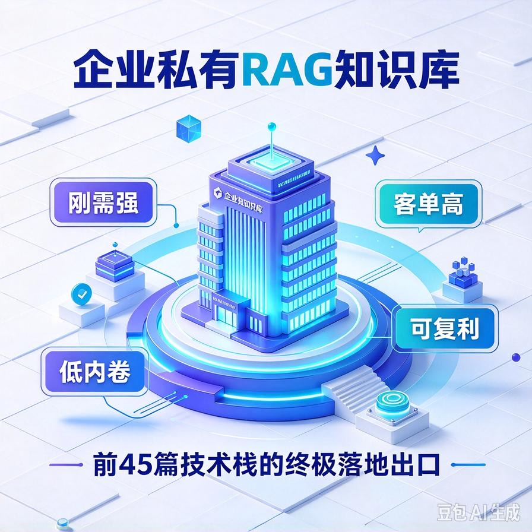
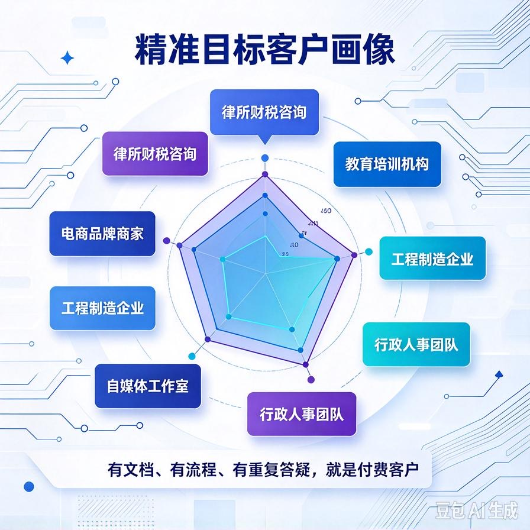
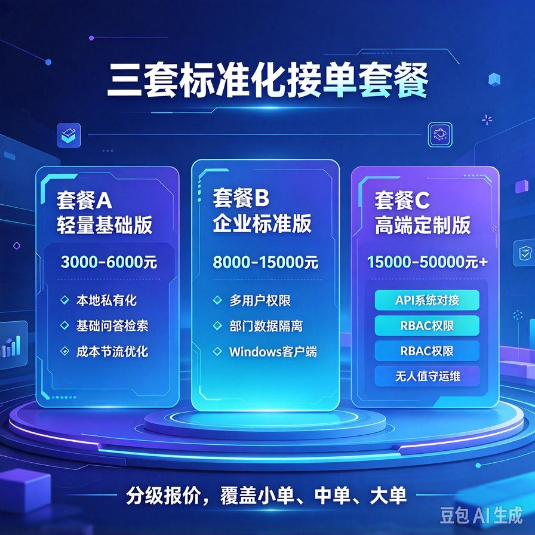
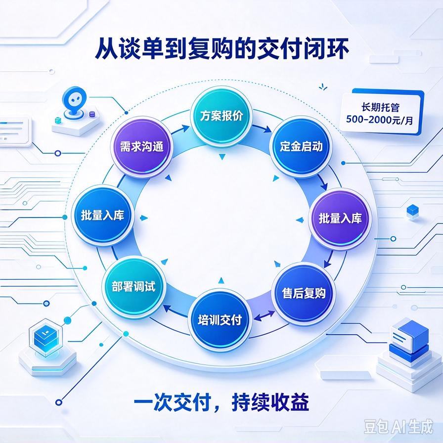

# 第46篇：赛道1｜企业私有RAG知识库：最稳、高客单、零内卷主力赛道

欢迎进入 **AI Agent 六大高利润变现赛道·实战模块**！

前面45篇，我们从零打通了AI Agent全套技术闭环：从Demo打磨、私有化部署、内网封装、一键打包、接口开放，再到成本节流、安全优化，所有商用技术底座已经全部落地。

**技术本身不赚钱，选对赛道、对接精准客户、标准化交付，才能稳定赚大钱。**

从本篇开始，正式解锁普通人可全职、可副业、可长期复利的**六大AI高利润变现赛道**，每一篇对应一个独立落地项目，不讲空话、不聊概念，只讲客户、需求、报价、交付、获客、避坑。

本篇开篇主推：**所有人首选的王牌主力赛道——企业私有RAG知识库**。

它是目前AI接单市场里 **最稳、客单最高、需求最刚需、内卷最低、复购最强** 的核心赛道，也是我们前45篇全套技术栈的终极落地出口。

不管你是新手入门接单，还是深耕企业定制、长期托管变现，这条赛道都是最优起步、最优深耕的首选。

读完本篇，你彻底吃透：

- 为什么私有RAG是AI接单的「常青主力赛道」，碾压90%普通AI项目
- 精准客户画像：谁愿意付费、谁付高价、谁复购最强
- 客户真实痛点拆解，精准拿捏成交话术
- 三套标准化接单套餐（低价引流+中端利润+高端定制）
- 完整交付清单、落地流程、售后体系、成本利润测算
- 避坑指南、谈单技巧、长期复利托管变现玩法

---

## 一、为什么优先做「企业私有RAG知识库」？（赛道核心优势）

市面上90%的AI接单赛道，要么内卷严重、要么客单极低、要么需求小众、要么售后爆炸。

而企业私有RAG知识库，是极少数同时集齐 **刚需、高价、稳定、低内卷、可复利** 的全能赛道。

### 1. 绝对刚需：企业无解的内部痛点

所有中小微企业、工作室、机构、律所、教育、电商、工程、财税公司，都有海量内部资料：制度、合同、流程、话术、产品手册、培训文档、技术资料。

传统模式三大死痛点：

- 新人培训成本极高，老员工反复答疑、重复内耗
- 资料分散杂乱，找文件、查流程耗时严重
- 关键知识沉淀不下来，人员离职直接带走经验

私有RAG知识库，完美解决企业「知识沉淀、自助查询、新人赋能、资料统一管理」核心刚需。

### 2. 客单上限高，利润空间极大

普通AI对话、AI绘画、小工具只能卖几百、几千元。

而私有RAG属于**企业数字化基础设施**，客户认知价值高、付费意愿强：

- 轻量基础版：3000–8000元
- 企业标准版：8000–20000元
- 高端私有化定制版：2w–5w+
- 长期托管运维：500–2000元/月/家

单项目利润远超普通小单，且可批量复制、长期复利。

### 3. 零公开内卷，差异化极强

市面上泛滥的AI源码、AI网页工具，都是公开烂大街资源，只能拼低价内卷。

而 **私有化部署、内网运行、数据本地留存、权限审计、接口封装、成本节流、一键打包** 的全套商用RAG体系，是极少人掌握的闭环能力。

你交付的是「企业级商用成品」，不是网上烂大街的Demo，天然避开低价内卷。

### 4. 售后可控、复购极强、可长期躺赚

一次性部署交付后，可衍生大量增值服务：

- 定期文档入库更新
- 权限扩容、账号新增
- 功能迭代升级
- 月度运维托管、监控优化
- 对接企业OA、官网、小程序二次开发

成交一次，长期收割复购，属于典型的 **一次交付、持续收益** 赛道。

---

## 二、精准目标客户画像（直接对标付费人群）

不是所有企业都需要RAG知识库，精准锁定以下6类客户，成交率直接翻倍。

### 1. 律所、财税、咨询服务机构（高客单首选）

痛点：合同模板、财税制度、法条资料、咨询话术繁多，新人上手慢，客户咨询重复度高。

付费意愿：极强，极其看重数据保密、内网私有化。

### 2. 教育、考证、培训机构

痛点：课件、考点、题库、培训资料杂乱，学员咨询重复问题多，老师答疑压力大。

需求：学员自助答疑、内部培训知识库、资料统一沉淀。

### 3. 电商、新零售、品牌商家

痛点：产品参数、售后话术、发货流程、退换货规则复杂，客服培训成本高、应答不统一。

需求：产品知识库、智能客服答疑、新人客服快速赋能。

### 4. 工程、科技、制造中小企业

痛点：技术文档、施工流程、设备手册、管理制度繁多，资料查找困难，技术人员流失经验丢失。

### 5. 自媒体工作室、小型团队

痛点：脚本库、选题库、运营话术、流程SOP杂乱，团队协作效率低。

### 6. 各类中小企业行政人事团队

痛点：公司制度、考勤、报销、入职流程咨询量大，行政反复答疑，内耗严重。

**核心总结：只要有文档、有流程、有培训、有重复答疑的团队，都是精准付费客户。**

---

## 三、客户核心痛点与成交话术（精准戳中付费点）

客户不买技术，客户买「解决麻烦、节省成本、规避风险」。

三个核心痛点，直接作为谈单核心卖点：

### 1. 解决「数据泄露风险」

免费ChatGPT、公有云AI，会上传数据到第三方服务器，企业机密文档、合同、制度极易泄露。

**成交话术：**我们的系统全程私有化部署，所有数据留在您公司内网本地，不上传、不外流、不被训练，彻底杜绝泄密风险，符合企业保密要求。

### 2. 解决「人力内耗严重」

新人入职反复问、员工重复答疑、查找资料耗时费力，企业人力成本极高。

**成交话术：**搭建专属知识库后，新人自助查流程、员工自助查资料、客户自助答疑，大幅减少重复工作，降低培训和人力成本。

### 3. 解决「知识无法沉淀」

老员工离职带走经验，文档散乱丢失，企业没有固定知识资产。

**成交话术：**所有资料统一入库、永久沉淀、智能检索问答，把员工经验变成公司固定资产，人员流动不影响企业运营。

---

## 四、三套标准化接单套餐（直接落地报价）

统一分级定价，不漫天报价、不低价乱卷，适配不同客户预算，最大化成交率与利润。

### 套餐A：轻量私有化基础版（引流刚需小单）

**适配客户：**10–30人小团队、工作室、个体户、预算有限客户

**报价区间：3000–6000元**

**包含功能：**

- 本地私有化部署，数据全部本地留存
- 基础文档解析、入库、智能问答、精准检索
- 内网IP访问、零公网依赖
- 管理员账号、基础文档管理
- 基础操作日志、数据彻底删除机制
- 基础成本节流优化，杜绝无效扣费

**交付周期：2–3天**

### 套餐B：企业标准版（主力利润中单）

**适配客户：**30–100人中小企业、机构、电商、律所

**报价区间：8000–15000元**

**在基础版上新增：**

- 多用户账号体系、管理员/普通用户权限隔离
- 文档分类权限、部门访问隔离
- 完整操作审计日志、可追溯可排查
- 敏感信息自动脱敏，适配商用保密场景
- 智能缓存、Token节流，长期使用成本极低
- Windows客户端+后台双形态运行

**交付周期：3–5天**

### 套餐C：高端定制私有化版（高客单暴利大单）

**适配客户：**有保密要求、系统对接、多人协作、长期运维的正规企业

**报价区间：15000–50000元+**

**在标准版上新增：**

- 全套标准化商用API接口，支持对接官网、小程序、OA、CRM
- 精细化RBAC角色权限、多部门隔离、数据严格隔离
- 模型分层调用、智能限流、额度预警、完整成本监控
- 开机自启、异常自愈、无人值守运维体系
- 专属部署培训、使用培训、运维培训
- 定制化功能开发、专属售后对接

**交付周期：5–10天**

### 增值托管盈利（长期复利）

- 基础运维托管：500元/月
- 月度文档批量入库+系统优化：800–1500元/月
- 功能迭代、接口对接定制：单独报价

---

## 五、标准化完整交付清单（专业高价交付核心）

高端接单不靠技术，靠**完整交付体系**。

普通开发者只交源码，你交付整套商用解决方案，差价直接拉开10倍。

### 必须交付物料

- 私有化纯净商用部署包（无调试痕迹、无冗余文件）
- Windows客户端/后台服务双形态成品
- 内网部署说明书、环境配置指南
- 管理员操作手册、用户使用手册
- 数据安全说明、隐私保密说明
- 常见问题排查手册、故障自愈方案

### 增值交付服务

- 远程上门部署调试（线上远程）
- 团队使用培训、管理员运维培训
- 首批文档批量入库整理
- 后期迭代升级指导、技术答疑

---

## 六、落地流程（从谈单到交付全流程）

1. **需求沟通**：确认客户文档量、使用人数、网络环境、保密需求、是否需要对接系统
2. **方案报价**：匹配对应套餐，出具专属私有化RAG解决方案
3. **定金启动**：收取定金，开始环境适配、系统微调、功能定制
4. **批量入库**：协助客户整理文档、脱敏处理、批量解析入库
5. **部署调试**：内网私有化部署、端口适配、权限配置、测试问答
6. **培训交付**：教会管理员运维、教会员工使用、交付全套资料
7. **售后复购**：定期维护、文档更新、功能升级、托管续费

---

## 七、赛道避坑指南（新手90%会踩的雷）

### 1. 不要低价乱卷

私有RAG是企业级服务，不是小工具，低价只会让客户觉得廉价、不信任，还会无限增加售后。坚持分级报价，做品质交付。

### 2. 绝不交付裸源码

交付源码=免费送技术、丧失复购、客户自行折腾出问题无限找你。必须交付**打包成品+部署服务+文档体系**。

### 3. 提前讲清边界

提前约定文档入库数量、功能范围、售后次数，避免客户无限加需求、无限白嫖调试。

### 4. 必须做成本优化

不做Token节流、缓存优化、无效拦截，客户长期使用会高额扣费，导致售后崩盘、退费投诉。

### 5. 保密条款必须明确

对接企业涉密资料，提前签订保密约定，规避数据纠纷风险。

---

## 八、本篇赛道核心总结

1. 企业私有RAG知识库是AI接单**最稳、最高客单、最低内卷**的主力常青赛道
2. 精准对标中小微企业、机构、工作室，刚需强烈、付费意愿高、复购性强
3. 三套标准化套餐覆盖小单、中单、大单，适配所有客户预算，成交率极高
4. 完整商用交付体系，拉开普通开发者差距，支撑高溢价报价
5. 一次性部署+长期托管复购，实现单次成交、持续复利收益

## 下期预告：第47篇｜赛道2｜自媒体内容Agent：全自动选题、脚本、配图、日更变现

下一篇解锁**个人副业天花板赛道**，不用对接企业、不用复杂部署，全自动跑通内容变现闭环，既可自己做账号盈利，也可卖给自媒体博主批量接单！

> 来源：头条号《AI Agent 零基础实战》第46篇｜版权归作者所有，仅供学习交流
