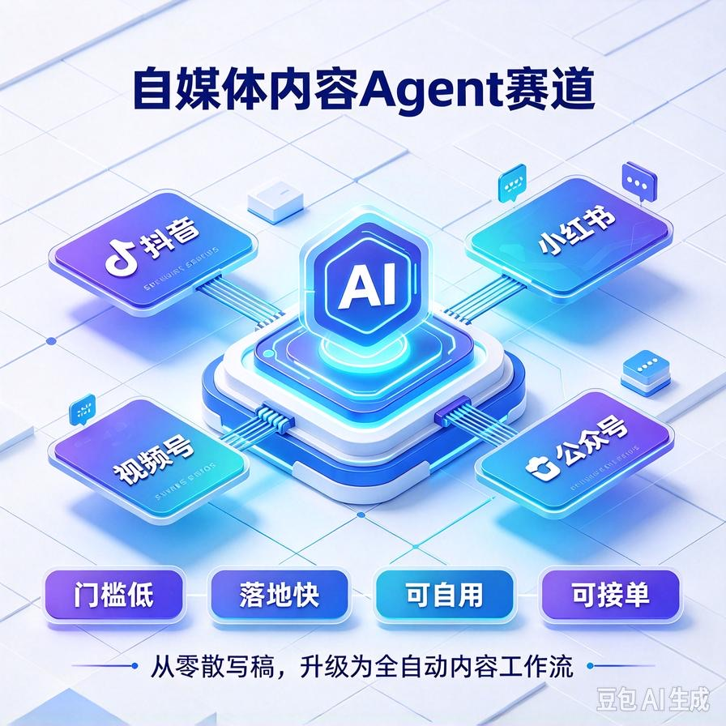
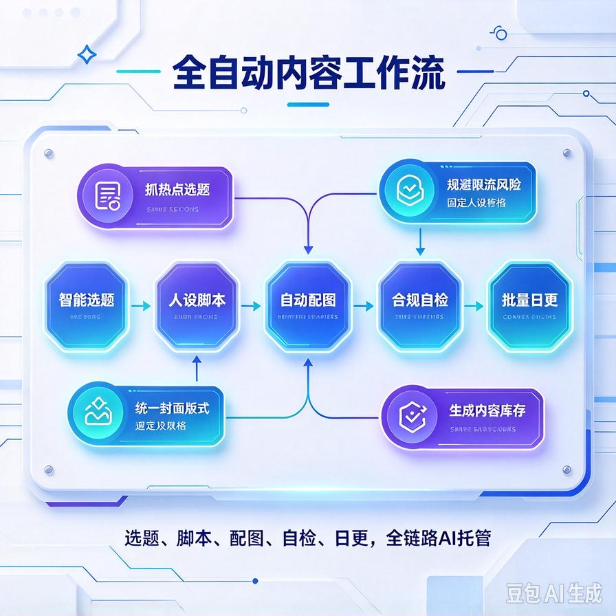
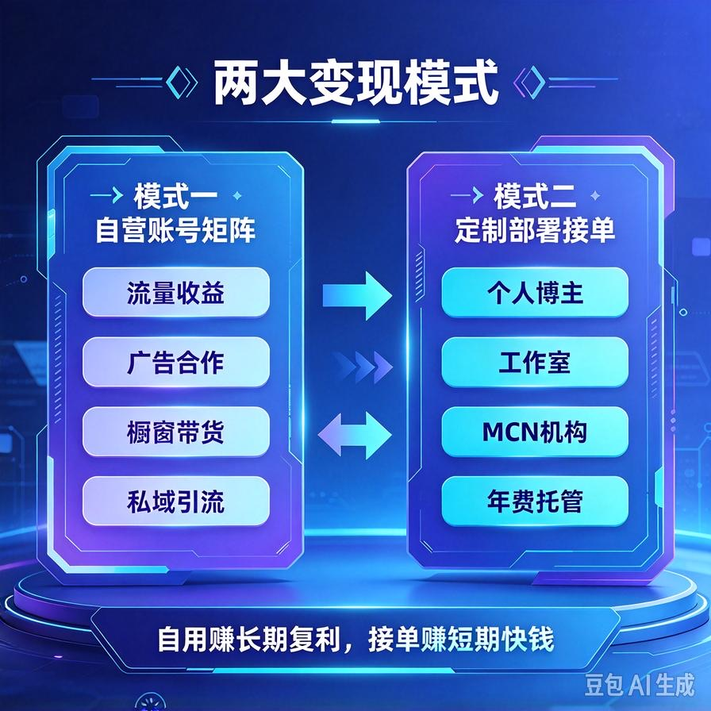
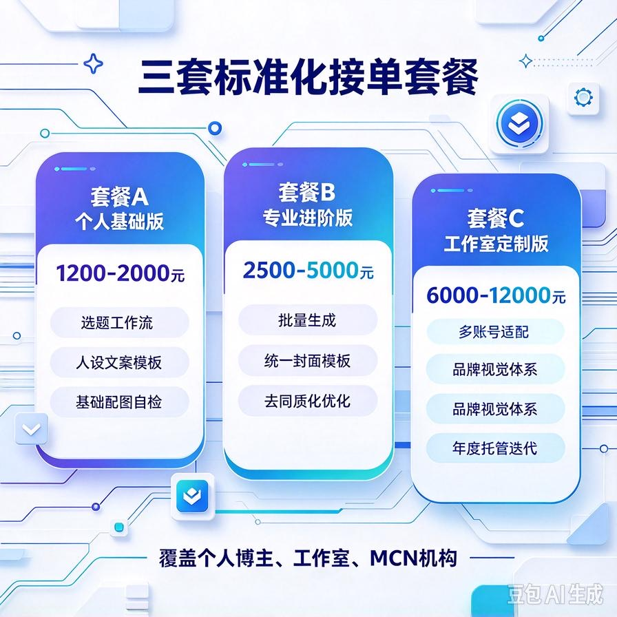

# 第47篇：自媒体内容Agent，全自动日更变现赛道

欢迎继续回到 **AI Agent 六大高利润变现赛道·实战模块**！

上一篇我们吃透了企业私有RAG赛道，主打**高客单、企业付费、长期复利**，是主力接单的商用王牌赛道。

本篇解锁第二条全民刚需赛道：**自媒体内容Agent全自动变现**。

和企业定制单不同，这条赛道**无需谈企业客户、无需复杂部署、无需售后对接**，是纯个人、轻副业、可批量放大的躺赚赛道。

不管是自己做账号涨粉变现，还是打包系统卖给博主、工作室接单，都能快速落地、快速出结果。

市面上90%的自媒体AI教程，只教“单条文案生成”，属于碎片化玩法，无法规模化。

我们本篇做的是 **完整自动化工作流**：选题→脚本→配图→排版→日更→自检，全链路AI托管，真正实现少人工、高产出、可批量。

读完本篇你彻底掌握：

- 为什么自媒体Agent是普通人最优AI副业赛道
- 全自动内容工作流搭建：选题、写稿、配图一站式搞定
- 规避AI低质通病，做出原创、高质、过审流量内容
- 两套变现模式：自营账号 + 卖给博主接单
- 标准化交付套餐、报价体系、获客与售后方案
- 批量矩阵玩法、避坑要点、长期复利打法

---

## 一、赛道核心优势：最适合普通人的轻量副业

对比企业RAG、系统对接等高客单赛道，自媒体内容Agent胜在**门槛极低、落地极快、可自用可接单**。

也是目前全网极少数 **零人脉、零技术、零成本、可批量放大** 的AI变现赛道。

### 1. 需求海量，全网永不缺客户

抖音、小红书、视频号、公众号、B站，无数博主、工作室、素人账号，最大痛点永远是：**不会选题、写稿太慢、配图耗时、日更坚持不住**。

所有人都想高频更新，但绝大多数人卡死在内容产能上，这就是我们的精准商机。

### 2. 双变现模式，收益灵活翻倍

单赛道两种赚钱方式，兼顾短期快钱和长期复利：

- **自营变现**：搭建自动化矩阵账号，流量收益、带货、广告、私域引流
- **接单变现**：把全自动Agent系统卖给博主、工作室，做定制部署+年费托管

### 3. 轻量交付，售后极少

无需企业内网部署、无需复杂调试、无需持续技术跟进。一次搭建、长期自动运行，交付简单、复购稳定、售后压力极小。

### 4. 可无限批量复制

一套工作流模板，可复制给10个、100个账号、100个客户，边际成本几乎为零，越做越轻松。

---

## 二、传统AI做内容 vs 商用Agent全自动内容（核心差距）

很多人用AI做内容，不仅不赚钱，还容易限流、没流量、同质化严重。

本质原因：用的是**零散工具**，不是**系统化工作流**。

### ❌ 普通人零散玩法（低效、易限流、难坚持）

- 手动找热点、手动搜选题，耗时费力
- 单条指令生成文案，句式僵硬、同质化严重
- 配图模糊、风格不统一、画面杂乱
- 内容无定位、无人设、无统一风格
- 日更靠自律，三天打鱼两天晒网，无法稳定产出

### ✅ 自媒体Agent商用玩法（全自动、高质量、可矩阵）

- 自动抓取垂直热点、行业选题、爆款关键词
- 基于账号人设自动生成专属脚本，风格统一不同质化
- 自动匹配高清配图、统一封面、统一排版
- 自动自检内容、规避违规词、降低限流风险
- 定时产出、批量生成，实现无人值守日更

**核心真相：工具只能辅助，Agent工作流才能规模化赚钱。**

---

## 三、自媒体全自动Agent工作流（全链路落地）

整套商用工作流分为五大模块，打通从0到1全自动内容产出闭环，适配所有自媒体平台。

### 1. 智能选题模块（解决没选题、没流量）

摒弃瞎写乱更，依托垂直领域爆款逻辑自动选题。

核心能力：

- 垂直行业关键词自动拓展
- 平台热点、近期爆款话题抓取筛选
- 规避低流量话题，优先高互动、高搜索选题
- 批量生成7天/30天选题清单，不用每日手动找题材

### 2. 人设化脚本生成模块（解决文案僵硬同质化）

市面上AI文案最大的问题是：千篇一律、没有个人风格。

商用Agent支持**固定人设、固定语气、固定结构**：

- 可设定：干货型、吐槽型、温柔型、专业型、接地气型等风格
- 固定开头、结尾、排版结构，账号辨识度拉满
- 自动口语化润色、去AI味、去机器感
- 适配小红书、抖音、视频号、公众号不同平台格式

### 3. 全自动配图模块（统一视觉风格）

自媒体流量一半靠封面配图，统一风格才能沉淀账号标签。

Agent自动实现：

- 根据文案内容智能匹配配图主题
- 固定配色、固定字体、固定版式
- 高清无水印、适配各平台尺寸
- 批量出图，无需逐张手动制作

### 4. 内容自检合规模块（杜绝限流违规）

商用级必备功能，规避账号封禁、限流、违规风险。

自动检测：敏感词、违规表述、极限词、低质话术，自动替换优化，保障内容安全过审。

### 5. 批量库存生成模块（实现稳定日更）

一次性批量生成10–30篇成品内容，形成内容库存，彻底解决断更、停更问题，账号权重稳定提升。

---

## 四、两大落地变现模式（自用+接单双收益）

### 模式一：自营账号矩阵变现（长期复利）

适合想做副业、长期躺赚的人群，零客户对接、纯内容收益。

优选低门槛变现赛道：

- 知识干货号：职场、AI、育儿、情感、副业
- 工具种草号：软件分享、效率工具、AI工具教程
- 行业解说号：财经科普、生活常识、数码测评

整套Agent全自动日更，积累粉丝后可实现：流量收益、广告合作、橱窗带货、私域引流、知识付费，收益持续叠加。

### 模式二：定制部署接单变现（短期快钱）

面向自媒体博主、工作室、MCN机构接单，帮对方搭建专属全自动内容Agent，客单稳定、成交率高。

目标客户：

- 更新频繁、产能不足的全职博主
- 批量做矩阵账号的工作室
- 想做自媒体但不会写文案、不会作图的新手
- MCN机构降本增效、减少人工文案成本

---

## 五、三套标准化接单套餐（直接落地报价）

适配不同客户需求，分级报价，最大化成交率和利润。

### 套餐A：个人基础版（引流小单）

**报价：1200–2000元**

**适配：个人博主、单账号运营、新手玩家**

**包含：**

- 专属垂直领域选题工作流配置
- 人设文案模板定制、风格固定
- 基础自动配图、内容自检功能
- 使用教程、全套操作手册

### 套餐B：专业进阶版（主力利润单）

**报价：2500–5000元**

**适配：全职博主、多账号运营、小型工作室**

**在基础版上新增：**

- 多风格文案切换、批量内容生成
- 全套统一封面视觉模板、专属版式定制
- 深度去AI同质化、人工质感优化
- 7–30天批量库存生成方案
- 一对一账号定位与内容策略指导

### 套餐C：工作室定制版（高客单大单）

**报价：6000–12000元**

**适配：MCN、矩阵工作室、批量账号运营团队**

**包含全套进阶能力+定制服务：**

- 多账号、多领域工作流批量适配
- 专属品牌视觉体系、全套封面模板库
- 自动化内容审核、批量管理后台
- 长期内容迭代、风格微调、功能更新
- 年度托管、定期策略优化、热点库更新

### 增值复购服务

- 月度热点库更新、选题库迭代：300–800元/月
- 账号风格改版、模板重做：单独报价
- 矩阵账号批量适配：按账号数量收费

---

## 六、完整交付清单（拉开同行溢价）

普通卖家只给提示词，你交付**整套可直接落地的自动化系统+全套资料**，天然支撑高价。

- 定制化自媒体Agent全自动工作流成品
- 专属人设文案模板、固定风格脚本库
- 全套封面配图模板、统一视觉素材包
- 内容合规自检配置、限流规避方案
- 7/30天批量选题清单模板
- 详细使用手册、快速上手教程
- 售后答疑、基础调试指导

---

## 七、赛道避坑指南（新手必看）

- **拒绝无脑AI堆砌**：纯机器生成内容必限流，必须做风格定制、去同质化、人工质感优化
- **坚持垂直定位**：账号越杂、领域越乱，流量越差，Agent必须绑定单一垂直赛道
- **严控内容合规**：开启自动自检，杜绝敏感词、违规话术，避免账号封禁
- **不低价内卷**：成套工作流≠零散提示词，坚持套餐定价，保障利润与售后质量
- **定期迭代更新**：平台规则、热点持续变动，需定期更新选题库与内容策略

---

## 八、本篇赛道核心总结

1. 自媒体内容Agent是普通人**零门槛、高灵活、可自用可接单**的优质副业赛道
2. 核心竞争力是全链路自动化工作流，而非零散AI工具，彻底拉开同质化差距
3. 双变现模式兼顾短期接单收益与长期账号复利收益
4. 三套标准化套餐覆盖全人群客户，成交门槛低、受众极广
5. 轻交付、低售后、可批量复制，适合长期放大、稳定盈利

## 下期预告：第48篇｜赛道3｜电商商家AI顾问，智能客服店铺答疑变现

下一篇解锁**刚需高频实体商家赛道**，面向千万中小电商卖家，解决客服答疑、培训繁琐、人工成本高的痛点，轻交付、高复购、批量接单超级好做！

> 来源：头条号《AI Agent 零基础实战》第47篇｜版权归作者所有，仅供学习交流
