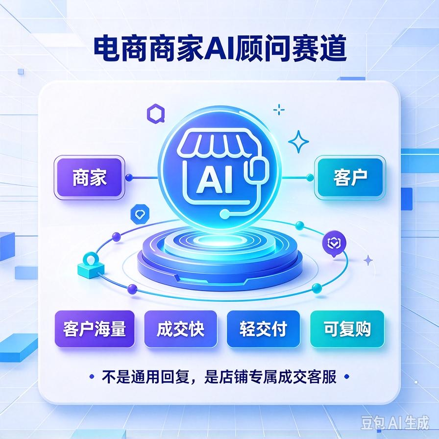
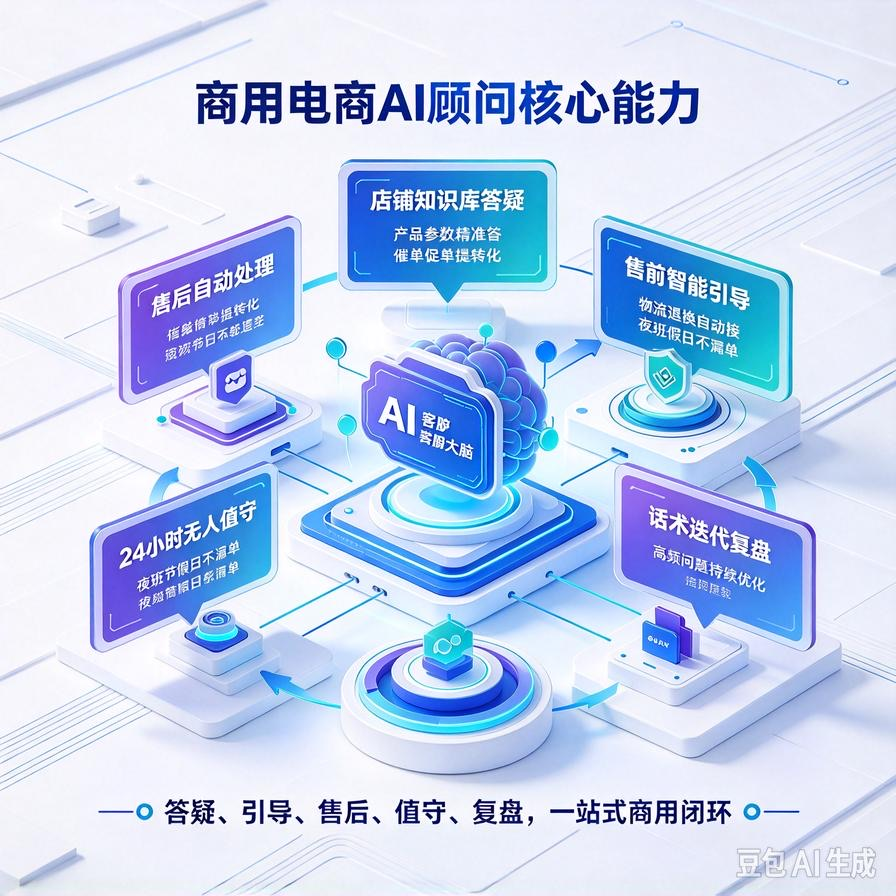
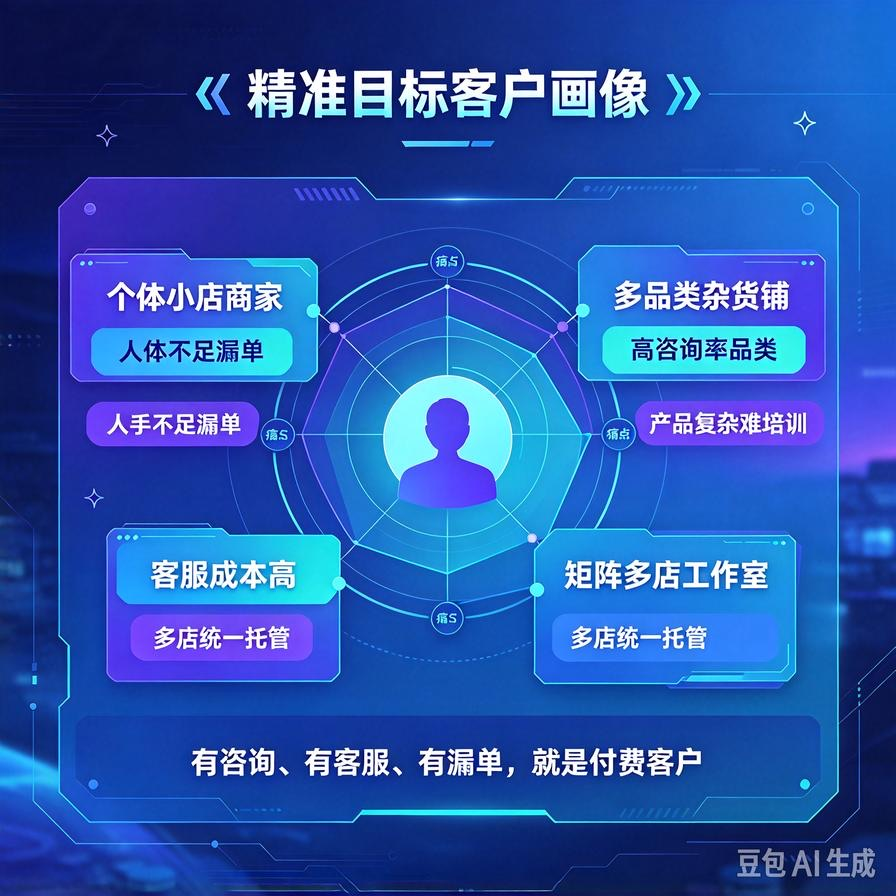
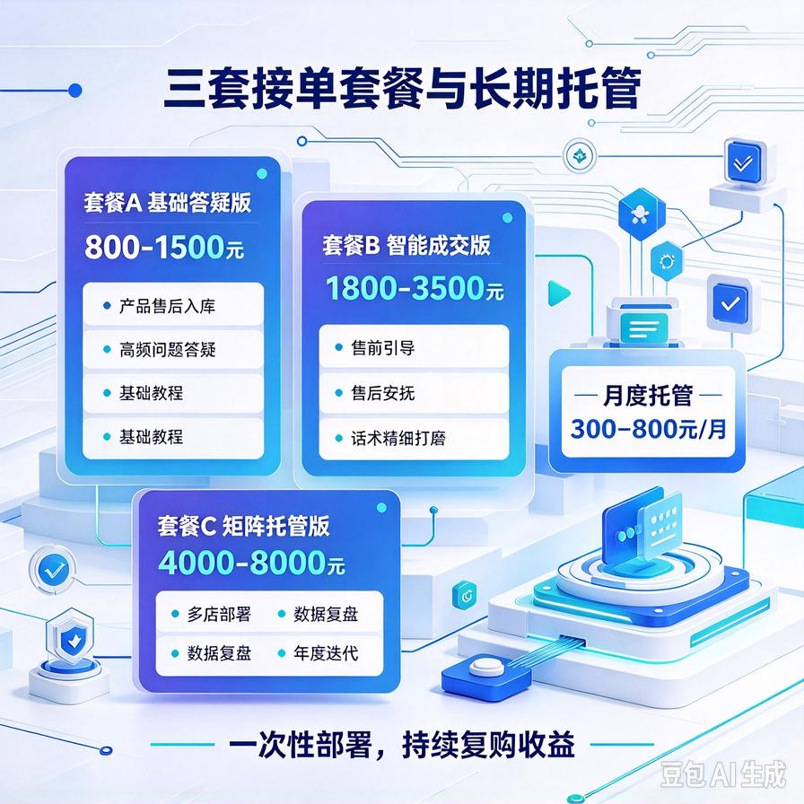

# 第48篇：赛道3 | 电商AI顾问赛道，智能客服店铺答疑变现

欢迎继续解锁 **AI Agent 六大高利润变现赛道**！

上一篇我们落地了自媒体内容Agent赛道，主打零门槛、轻副业、全自动日更变现，适合个人零基础起步。

本篇解锁**流量最大、刚需最强、复购最稳的实体商家赛道**：电商商家AI智能顾问。

区别于企业RAG的高客单重交付、自媒体的慢积累，电商AI客服赛道有着**客户海量、痛点直白、成交极快、按月复购**的四大核心优势。

全网千万中小电商卖家，几乎全部卡在同一个问题：**咨询量大、人工不够、夜班无人、新人难培训、客服成本高、流失订单多**。

我们搭建的商用电商AI顾问，不是平台自带的弱智自动回复，而是**专属店铺私有化智能客服**，吃透店铺产品、售后规则、话术体系，24小时无人值守承接咨询、提升转化、降低损耗。

这是极少数**新手可快速开单、老手可批量收割、长期稳定躺赚**的黄金赛道。

读完本篇彻底吃透：

- 电商AI顾问的赛道红利与刚需痛点，看懂为什么超好接单
- 商用级电商AI客服核心能力，吊打平台自带机器人
- 精准客户画像，快速锁定高意向付费商家
- 三套标准化接单套餐，小单快销+中单利润+长期复购
- 完整交付清单、谈单话术、落地流程、避坑指南
- 一次性部署+月度托管复利玩法，持续被动收益

---

## 一、赛道核心优势：普通人最好落地的复购赛道

对比其他AI变现赛道，电商AI顾问是**变现最快、客户最多、售后最轻、复购最强**的全能型赛道，没有之一。

### 1. 市场海量，永不缺客户

淘宝、拼多多、抖音小店、视频号小店、小红书店铺，海量中小商家、个体卖家、无货源团队。这类群体没钱养专职客服、没时间培训员工、夜班无人值守，是百分百刚需人群。

不用教育市场，不用科普价值，**所有商家都懂客服成本、都缺自动答疑工具**，成交门槛极低。

### 2. 痛点致命，付费意愿极强

中小电商商家的三大致命损耗：

- 白天咨询爆炸，人工回复不过来，客户直接流失
- 深夜、凌晨无人值守，精准询单白白浪费
- 新人客服上手慢、话术不统一、售后出错率高

AI客服可以完美解决：**24小时秒回、话术统一、零培训成本、永不离岗**，帮商家省钱、保转化、稳口碑，付费动机极其纯粹。

### 3. 轻量交付，售后压力极小

无需复杂内网部署、无需硬件配套、无需高频调试。一次性搭建专属店铺知识库，即可长期稳定运行，属于**一次交付、长期收钱**的优质项目。

### 4. 按月复购，复利收益拉满

区别于一锤子买卖，电商AI客服可以做**月度托管、年度续费、定期话术更新**，积累越多、收益越稳，后期全是被动躺赚收入。

---

## 二、平台自带客服 VS 我们商用AI顾问（核心差距）

很多商家自带平台官方机器人，但为什么依旧愿意花钱找你定制？因为免费工具只能“敷衍回复”，我们的商用AI可以“精准成交”。

### ❌ 平台免费机器人（鸡肋无用）

- 话术死板、固定模板，无法灵活应答客户个性化问题
- 不懂店铺专属产品参数、专属售后规则，经常答非所问
- 不会主动引导下单、不会安抚售后情绪，无法提升转化
- 统一模板同质化严重，没有店铺专属风格
- 复杂问题直接转人工，无法真正解放人力

### ✅ 商用电商AI顾问（可高价交付）

- 深度学习店铺**产品详情、规格参数、售后政策、发货规则、常见话术**，专属适配店铺场景
- 支持多轮对话，读懂客户潜台词，自然流畅不机械
- 自带营销引导属性，温柔催单、解答顾虑、提升询单转化率
- 自动处理售后咨询、物流查询、退换货答疑，降低人工转接率
- 24小时秒级响应，不错过任何一个深夜精准订单
- 可持续迭代更新话术、规则、产品库，越用越精准

**核心真相：免费工具是“被动回复”，商用AI是“店铺专属成交客服”。**

---

## 三、电商AI顾问五大核心商用能力（接单核心卖点）

所有功能全部贴合商家真实运营场景，每一项都是可直接报价、成交的硬核卖点。

### 1. 店铺专属知识库答疑

录入店铺全部产品资料：规格、材质、尺寸、价格、套餐差异、发货时效、包邮规则。同时收录售后体系：退换货政策、破损赔付、质保规则、差评安抚话术。客户任何疑问，AI均可精准应答，完全贴合店铺运营标准。

### 2. 售前智能成交引导

区别于机械答疑，AI自带销售思维：解答疑问的同时，主动告知优惠活动、套餐优势、发货时效，化解客户犹豫，引导快速下单，实打实提升店铺转化率。

### 3. 售后自动化处理

自动承接物流查询、到货时间、拒收规则、退换流程、赔付咨询等高频售后问题，自动安抚客户情绪，减少售后纠纷，大幅降低人工客服压力。

### 4. 24小时无人值守承接

解决商家最大痛点：夜班无人、节假日离岗、客服休息漏单。AI全年无休秒级响应，不放过任何一个流量订单，完美承接全时段咨询需求。

### 5. 话术迭代与数据复盘

自动记录高频咨询、常见问题、客户核心顾虑，定期迭代优化AI话术，越用越贴合店铺场景，持续降低客户疑问、提升成交效率。

---

## 四、精准客户画像（百分百高意向付费人群）

精准锁定以下4类商家，几乎一问一个准，成交率远超普通行业获客。

### 1. 个体小店、无货源商家

单人运营、人手不足，没时间时刻盯后台，无力聘请专职客服，极度依赖自动答疑工具降本增效。

### 2. 多品类杂货店铺

产品多、参数杂、咨询问题繁杂，新人上手难度大，急需标准化AI统一话术、统一答疑标准。

### 3. 高咨询率刚需品类

服饰、美妆、家居、零食、数码配件、母婴等品类，客户疑问多、尺码咨询多、售后问题多，人工压力极大，AI替代价值极高。

### 4. 工作室矩阵多店运营

多店铺、多账号运营，无法逐个配置人工客服，需要批量AI托管，极致压缩人力成本，规模化提效。

---

## 五、三套标准化接单套餐（直接落地报价）

分级定价适配不同商家预算，小单引流、中单利润、长期复购，最大化成交率与综合收益。

### 套餐A：基础答疑版（引流小单）

**报价：800–1500元**

**适配：单店个体商家、新手小店、低咨询量店铺**

**包含能力：**

- 店铺产品资料、基础售后规则入库配置
- 常规售前、售后高频问题自动答疑
- 统一店铺话术风格，告别机械回复
- 基础使用教程、单次调试优化

### 套餐B：智能成交版（主力利润单）

**报价：1800–3500元**

**适配：常规盈利店铺、咨询量高、需要提升转化的商家**

**在基础版上新增：**

- 全店产品深度入库、细分参数精准答疑
- 售前智能引导、催单促单、化解客户顾虑
- 售后情绪安抚、纠纷预处理、降低差评率
- 多轮自然对话，贴合人工客服沟通质感
- 首次运营优化、话术精细打磨

### 套餐C：矩阵托管版（高客单复购大单）

**报价：4000–8000元**

**适配：多店矩阵工作室、高流量店铺、精细化运营商家**

**包含全套能力+定制服务：**

- 多店铺批量AI客服部署、统一托管
- 专属营销话术定制、活动专题话术适配
- 咨询数据统计、高频问题复盘报告
- 全年不限次数话术微调、产品库更新
- 专属运维对接、紧急问题优先处理

### 长期复利托管服务（核心躺赚收益）

- 月度基础托管维护：300–500元/月
- 月度产品更新+话术迭代：500–800元/月
- 大促活动专属话术定制：单次300–1000元

---

## 六、标准化交付清单（支撑高价成交）

普通新手只给简单机器人配置，你交付**整套店铺专属AI成交方案**，专业度直接拉开差价，让商家心甘情愿高价付费。

- 店铺专属AI智能顾问完整部署成品
- 全店产品知识库、售后规则完整入库配置
- 售前+售后+催单+安抚全套专属话术库
- AI风格定制、拟人化对话优化包
- 详细使用手册、后台操作教程
- 首次调试优化、落地适配服务
- 售后答疑、基础问题终身微调

---

## 七、赛道谈单核心话术（直击痛点必成交）

不用讲复杂技术，只用商家听得懂、最扎心的价值话术，快速促成成交。

**核心成交话术：**

“平台自带机器人都是通用模板，不懂你店铺的产品和售后规则，答非所问留不住客户。我给你搭建的是**店铺专属AI客服**，完全学习你的产品参数、发货规则、售后政策。

可以实现24小时无人值守秒回，白天分担人工压力、晚上承接深夜咨询。既能帮你省下客服工资成本，又能统一话术、提升成交率，彻底解决漏单、错答、售后纠纷问题。后期我还可以帮你持续迭代话术，越用越精准。”

---

## 八、赛道避坑指南（新手必看）

- **拒绝通用模板敷衍**：必须一对一适配店铺产品和规则，通用话术极易导致答非所问，引发客户不满
- **区分答疑与营销边界**：AI只做合规引导，不夸大宣传、不违规承诺，规避店铺处罚风险
- **明确服务边界**：提前约定调试次数、更新范围，避免商家无限白嫖微调
- **定期迭代优化**：新品上架、活动更新需及时同步入库，保证AI应答精准度
- **不低价内卷**：专属定制+托管服务≠免费模板，坚持分级报价，保障利润与服务质量

---

## 九、本篇赛道核心总结

1. 电商AI顾问是**受众最广、刚需最强、成交最快、复购最稳**的AI变现赛道
2. 核心竞争力是店铺专属定制，彻底碾压平台通用免费机器人
3. 五大商用核心能力，精准解决商家漏单、高成本、难培训三大痛点
4. 三套标准化套餐覆盖全层级商家，小单快出、大单暴利
5. 一次性部署+月度托管续费，打造长期稳定复利收益

## 下期预告：第49篇：赛道4｜个人专属AI助理，高端记忆知识库接单赛道

下一篇解锁**高溢价小众高端赛道**，面向老板、自由职业者、精英人群，主打长效记忆+私人知识库，客单高、竞争极小、利润丰厚！

> 来源：头条号《AI Agent 零基础实战》第48篇｜版权归作者所有，仅供学习交流
