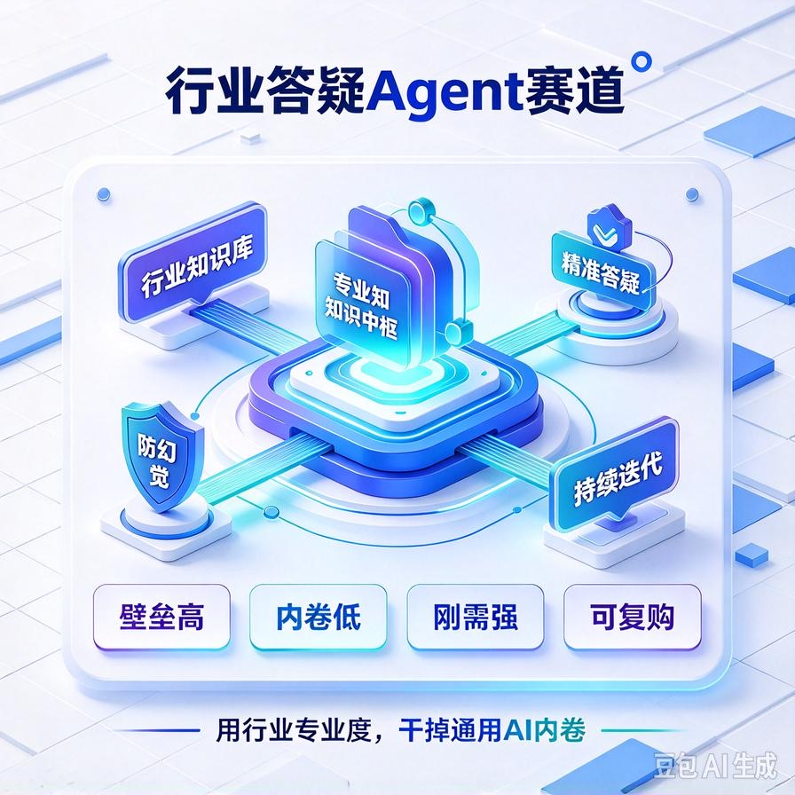
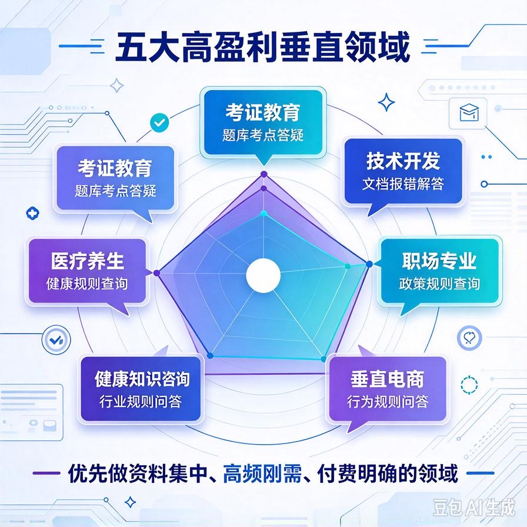
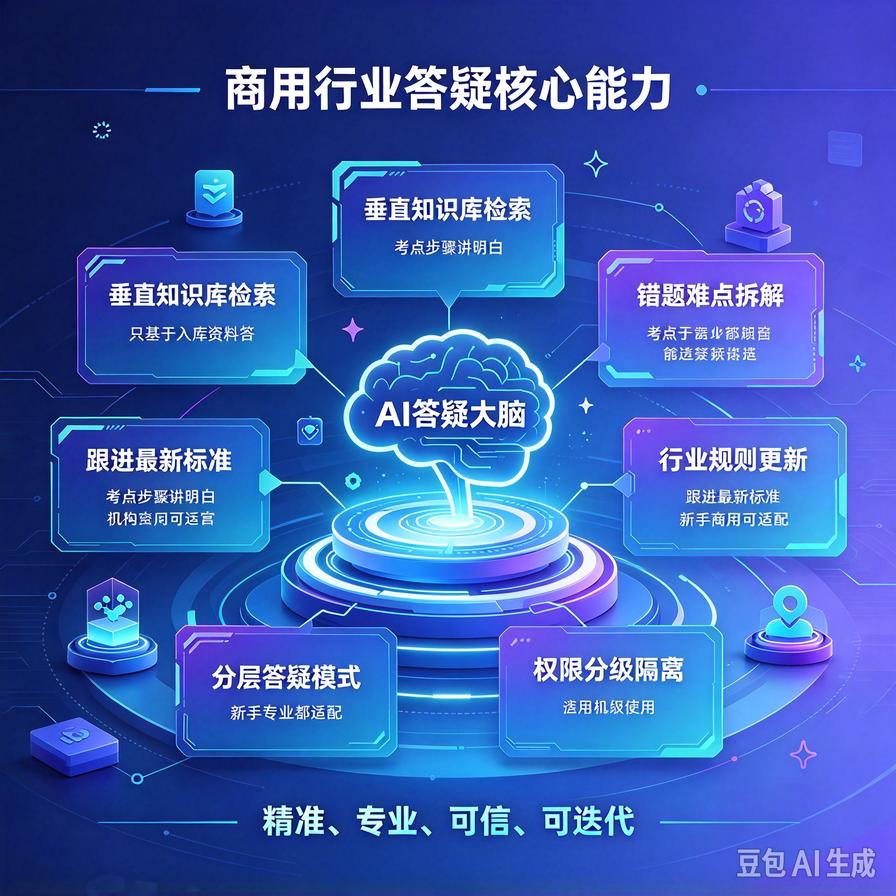
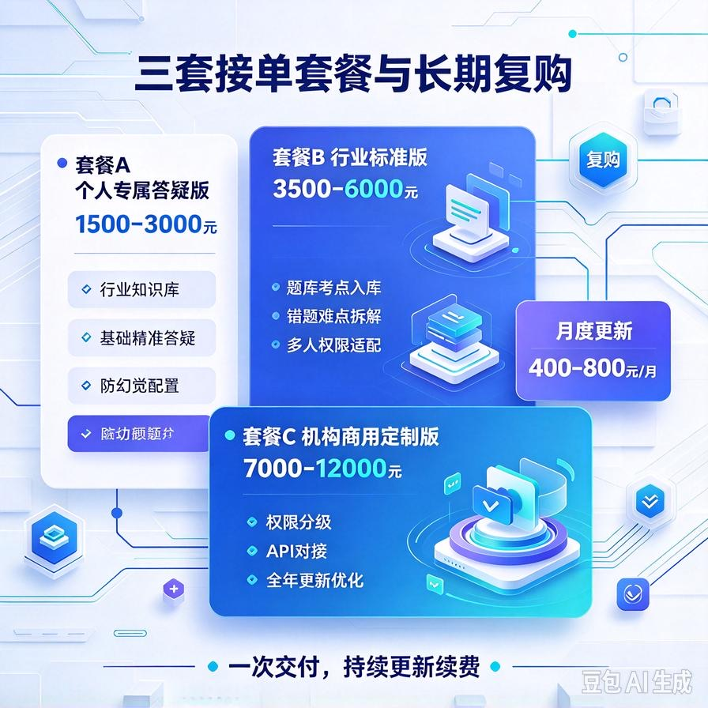

# 第50篇：行业答疑Agent，垂直领域专属变现赛道

欢迎继续解锁 **AI Agent 六大高利润变现赛道**！

上一篇我们吃透了高端个人AI助理赛道，主打高净值人群、高溢价、轻售后、长期复利，适合做精品高端单。

本篇解锁第五条黄金赛道：**垂直行业答疑Agent**。

这是一条**靠行业壁垒规避内卷、精准刚需、复购稳定、客单适中**的细分王牌赛道。

不同于通用客服、通用内容AI，行业答疑Agent**只深耕单一垂直领域**，吃透行业教材、考点、技术文档、专业规则，做到普通人做不出、通用AI做不准的专业答疑效果。

客户极其精准：培训机构、学员、技术团队、行业从业者、考证人群，全部是**有专业需求、愿意为精准、靠谱、专业付费**的精准用户。

最大优势：**一旦落地就是领域壁垒，同行无法低价内卷，客户粘性极强**。

读完本篇彻底吃透：

- 行业答疑Agent的赛道壁垒与核心商业红利
- 五大高盈利垂直领域，精准避开冷门赛道
- 商用级行业答疑核心能力，解决通用AI答不准痛点
- 精准客户画像、付费逻辑、谈单核心话术
- 三套标准化接单套餐，适配ToC/ToB双场景
- 交付清单、落地流程、避坑要点、长期复购玩法

---

## 一、赛道核心优势：壁垒最高、内卷最低的细分赛道

目前AI接单市场最大的问题就是**同质化严重、低价内卷**，所有人做通用客服、通用文案、通用知识库，只能拼价格。

而垂直行业答疑Agent，是**用专业壁垒干掉99%竞争对手**的优质赛道，拥有四大核心优势：

### 1. 极强行业壁垒，无法通用内卷

普通AI从业者只会搭建通用问答，无法吃透行业规则、专业术语、考点逻辑、技术原理。你的核心竞争力不是AI技术，而是**行业知识库+专业问答精度**，天然形成壁垒，没人能低价对标。

### 2. 刚需极强，客户付费极其精准

考证、学习、查资料、解难题、技术答疑，是用户**必须解决、立刻解决**的刚性需求。用户愿意为“更专业、更准确、更省心”付费，成交门槛极低。

### 3. 双变现场景：卖给机构+卖给个人

一条赛道两种赚钱模式：ToB卖给培训机构、企业技术部门；ToC落地个人学员、行业从业者，受众极广、收益灵活。

### 4. 长期迭代复利，越做越值钱

行业知识库可以持续更新、迭代升级，资料越积越多、问答越来越精准、壁垒越来越高。老客户续费、升级、迭代需求源源不断，属于越深耕越赚钱的赛道。

---

## 二、五大高盈利垂直领域（优先落地首选）

不是所有行业都适合做答疑Agent，优先选择**资料集中、需求高频、付费意愿强**的五大黄金领域，直接避开冷门、低收益赛道。

### 1. 考证教育赛道（最稳、走量最快）

公考、教资、会计、建造师、四六级、考研等考证人群极其庞大。痛点：考点繁杂、资料分散、错题没人讲、疑问没人解答、复习效率低。

变现方式：培训机构采购、学员个人定制、题库答疑系统、考点速查工具。

### 2. 技术开发赛道（高客单、高精度）

编程开发、数据分析、人工智能、运维技术文档答疑。痛点：官方文档晦涩、问题零散、报错没人快速解答、学习成本高。

变现方式：技术团队知识库、学员答疑系统、企业技术文档检索答疑。

### 3. 职场专业赛道（复购稳定）

财税、法务、人事、行政行业规则答疑。痛点：政策更新快、规则繁杂、查询耗时、容易出错。

变现方式：中小公司部门知识库、从业者个人答疑工具。

### 4. 医疗养生赛道（高需求、高粘性）

健康常识、养生知识、康复护理、药品常识答疑。用户需求高频、搜索量大、信任成本低、极易成交。

### 5. 垂直电商行业赛道（批量接单）

细分品类行业规则、产品知识、行业术语、运营规则答疑，适配行业工作室、垂直商家群体。

---

## 三、通用AI VS 行业专属答疑Agent（核心差距）

很多客户疑惑：免费AI也能答疑，为什么要付费定制行业专属Agent？

因为通用AI**不专业、不精准、易幻觉、答非所问**，完全无法满足垂直领域刚需。

### ❌ 通用免费AI（行业场景完全不适用）

- 不懂行业专属规则、最新政策、细分考点
- 容易编造答案、出现专业错误，误导用户
- 答案宽泛笼统，没有针对性、无法解决实际问题
- 无法聚焦行业题库、错题、重点难点
- 新旧知识混杂，不能同步最新行业迭代内容

### ✅ 垂直行业答疑Agent（商用核心价值）

- **行业专属知识库**：只收录对应领域教材、考点、文档、规则，精准度拉满
- **防幻觉机制**：无对应资料绝不乱答，只基于入库内容输出，杜绝错误答案
- **精细化答疑逻辑**：难点拆解、步骤讲解、考点分析、错题复盘
- **行业话术适配**：完全贴合行业术语、专业语境，专业度极高
- **持续同步更新**：跟进最新政策、最新题库、最新文档迭代内容

**核心真相：通用AI是泛泛而谈，行业Agent是精准解决专业问题。**

---

## 四、行业答疑Agent五大商用核心能力

以下能力全部为接单核心卖点，可直接用于谈单、方案撰写、客户讲解，每一项都支撑付费价值。

### 1. 垂直行业知识库精准检索答疑

批量入库行业教材、官方文档、考试大纲、题库错题、政策规则、实操流程。用户提问优先调取专属库内容，精准匹配答案，杜绝外行回答、错误回答。

### 2. 错题复盘与难点拆解

针对教育、考证、技术学习场景，支持错题解析、难点拆解、知识点溯源、同类题拓展，完美适配学员学习、员工培训场景。

### 3. 行业规则实时更新迭代

针对政策、规则、考点更新快的行业，持续迭代知识库，淘汰老旧内容，同步最新行业标准，保证答疑始终准确有效。

### 4. 分层答疑模式（新手+专业双适配）

支持两种答疑模式：新手通俗讲解、专业深度解析。既能给小白讲明白基础问题，也能给从业者输出专业深度内容，适配全层级用户。

### 5. 权限分级与内容隔离

机构版支持学员/老师/管理员权限隔离，可区分公开内容、付费内容、内部资料，适配培训机构商业化运营需求。

---

## 五、精准客户画像（高意向付费群体）

精准锁定两类核心客户，ToC走量、ToB赚高客单，双向收割。

### 1. ToC个人付费用户（走量、高复购）

- 各类考证、备考学生、学习人群
- 需要自学技术、提升专业能力的职场人
- 需要随时查询行业规则、专业知识的从业者

### 2. ToB企业/机构付费用户（高客单、高利润）

- 公考、教资、财会、技能类培训机构
- 技术培训、线上教育平台、知识付费工作室
- 企业技术部门、人事培训部门、行业服务机构

---

## 六、三套标准化接单套餐（直接落地报价）

分级适配个人用户与机构用户，小单引流、中单利润、大单溢价，全覆盖成交场景。

### 套餐A：个人专属答疑版（引流小单）

**报价：1500–3000元**

**适配：个人学习者、考证人群、职场从业者**

**包含服务：**

- 单一垂直行业知识库搭建与入库
- 基础精准答疑、知识点检索、问题解答
- 去AI幻觉配置，杜绝错误答案
- 个人使用教程、基础调试优化

### 套餐B：行业标准版（主力利润中单）

**报价：3500–6000元**

**适配：小型培训机构、工作室、技术小组**

**在个人版基础上新增：**

- 全量行业资料、题库、考点批量规整入库
- 错题解析、难点拆解、知识点拓展功能
- 多轮专业对话、行业深度答疑优化
- 基础账号权限管理、多人使用适配
- 首次内容精细化校对、答疑精度优化

### 套餐C：机构商用定制版（高客单大单）

**报价：7000–12000元**

**适配：正规教育机构、线上培训平台、企业部门**

**包含全套能力+商用定制服务：**

- 完整行业商用知识库体系搭建
- 精细化权限分级、付费内容隔离、学员管理
- 答疑风格定制、机构品牌适配
- API接口预留，可对接公众号、小程序、官网
- 全年知识库更新、内容迭代、精度优化
- 专属运维对接、商用落地培训

### 长期复利托管服务

- 月度内容更新、错题库迭代：400–800元/月
- 季度行业规则/考点同步更新：1000–1500元/季度
- 功能迭代、系统对接定制：单独溢价报价

---

## 七、标准化交付清单（支撑高价成交）

普通从业者只能做通用问答，你交付**垂直行业商用答疑系统**，专业度碾压同行，支撑高溢价报价。

- 专属垂直行业答疑Agent完整运行成品
- 规整分类的行业专属知识库、题库、文档库
- 防幻觉、精准答疑、难点拆解核心配置
- 行业专属答疑话术、专业输出风格打磨
- 权限管理、多人使用、内容隔离体系
- 全套使用手册、运维教程、落地指导
- 答疑精度校对、内容合规排查服务

---

## 八、赛道谈单核心话术（直击客户痛点）

行业客户不看技术，只看**准不准、专不专业、能不能解决实际问题**。

**标准成交话术：**

“普通AI没有咱们行业的专业资料和规则，很容易答非所问、编造错误内容，误导学习和工作。我给你搭建的是**专属行业答疑Agent**，只基于咱们领域的官方文档、考点和规则答疑，杜绝乱答。

可以自动拆解难点、解析错题、检索规则，既能帮个人高效学习、解决疑问，也能帮机构降低答疑人力成本、统一答疑标准，专业度和精准度是通用AI完全比不了的。后期我还会持续帮你更新行业内容，保证系统一直精准可用。”

---

## 九、赛道避坑指南（新手接单必看）

- **严禁通用库敷衍**：必须深耕对应行业资料，杜绝通用问答糊弄客户，影响口碑
- **严控幻觉风险**：行业内容容错率低，必须开启防幻觉机制，无依据不作答
- **及时迭代更新**：行业政策、考点、规则会更新，必须定期同步迭代内容
- **明确内容边界**：提前约定入库资料范围、更新频次，避免无限免费加内容
- **合规排查内容**：教育、专业领域内容需合规筛查，规避风险

---

## 十、本篇赛道核心总结

1. 行业答疑Agent是**高壁垒、低内卷、高精准**的优质垂直变现赛道
2. 核心竞争力是行业专属知识库+高精度答疑，彻底碾压通用AI工具
3. 双变现模式覆盖个人与机构客户，兼顾走量与高客单利润
4. 三套标准化套餐适配全场景，成交率高、客户粘性极强
5. 长期内容迭代+托管续费，形成稳定复利收益，越做越值钱

## 下期预告：第51篇｜赛道6｜办公自动化工作流，职场刚需副业变现

收官赛道来袭！解锁**全网最大刚需、最低门槛**的办公自动化赛道，批量处理文档、表格、工作流提效，面向亿万职场人群，小单海量、极速出单！

> 来源：头条号《AI Agent 零基础实战》第50篇｜版权归作者所有，仅供学习交流
