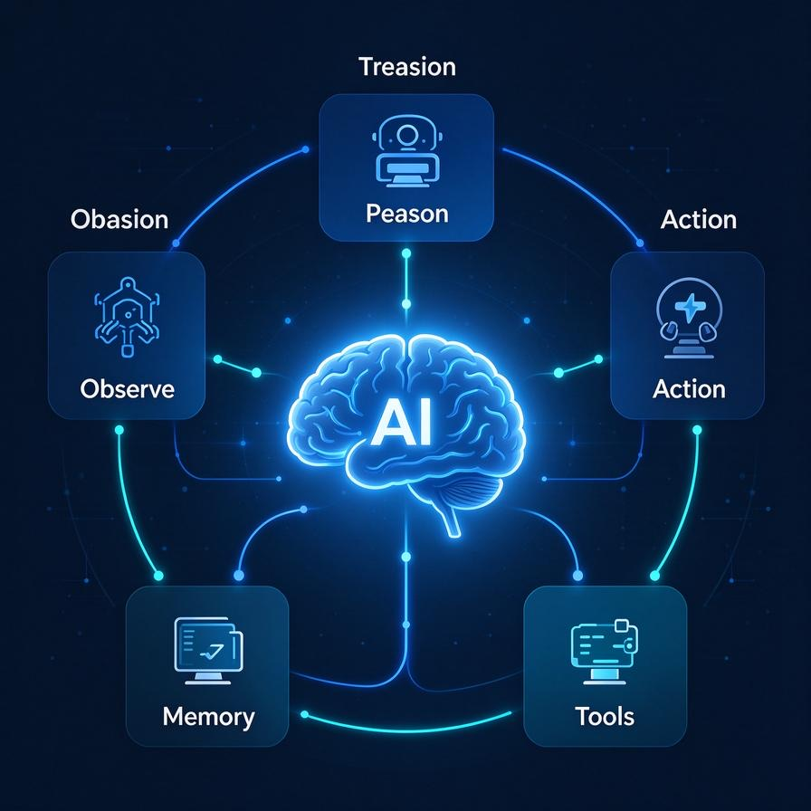
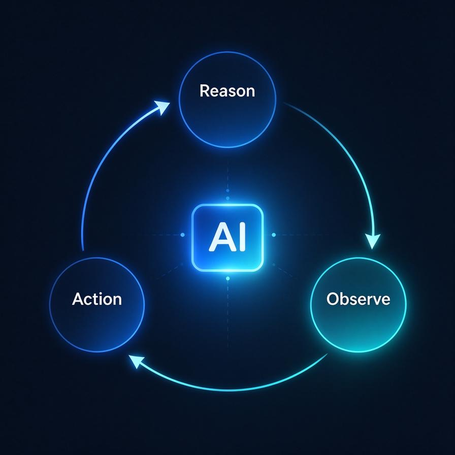

# 第52篇：Agent核心架构总览 | 从LLM到自主决策完整链路

过去半年，AI Agent这个词被讲烂了。打开公众号、刷短视频，到处都是用Agent月入十万、一个人顶一个团队的商业叙事。但如果你真的打开代码，会发现大多数所谓的Agent，本质上就是一个调API+写死Prompt的脚本。

这篇开始，开启Agent底层进阶技术。不讲变现、不讲赛道，就从工程实现的角度，把Agent这层壳子一层层拆开，看看里面到底是怎么跑起来的。

# 一、从一次普通的LLM调用说起

回到最基础场景：写Python脚本调用大模型接口，传入Prompt拿到返回结果。整个过程三个关键特征：

- **单向**：你发什么，它回什么，中间没有任何思考过程暴露给你
- **无状态**：每次调用都是独立的，模型不记得上一轮说了什么（除非手动拼接上下文）
- **无行动能力**：只能输出文本，不能执行任何外部操作

这就是**裸LLM**：能力很强，但本质只是一个会说话的函数。

# 二、Agent到底多了什么

Agent和裸LLM的区别，不在模型本身，而在外层包裹的控制循环。Agent五大核心模块：**推理层、行动层、观察层、记忆层、工具层**。

## 1. 推理层（Reason）

推理层就是LLM本身，但输入不再是一次性Prompt，而是动态组装上下文：系统提示+历史对话+观察返回结果+当前任务。裸LLM是你问我答；Agent推理层是根据现状，自己决定下一步思考内容。

## 2. 行动层（Action）

行动层把LLM输出的意图翻译成真实世界操作。比如模型说要查天气，行动层调用天气API、执行命令、操作浏览器。核心就是Function Calling：让模型输出结构化调用指令，而不是普通自然语言。

## 3. 观察层（Observe）

行动执行完成，API返回、命令输出、网页内容，不能直接丢弃；格式化清洗之后回写到上下文，供给下一轮推理。这是Agent和普通脚本最大区别：执行结果回流，影响下一轮决策。

## 4. 记忆层（Memory）

记忆不等于简单数据库。核心解决：上下文窗口有限，哪些信息保留、哪些丢弃、哪些压缩。短期记忆：当前对话上下文窗口；长期记忆：向量库存储历史经验、外部知识。

## 5. 工具层（Tools）

Agent的手，计算器、搜索、代码解释器、数据库查询、业务自定义API，全部属于工具。

# 三、一次完整Agent循环（查天气示例）

用户提问：北京今天天气怎么样？  
第1轮：组装上下文，LLM推理输出调用 get_weather(city=北京)；行动层调用天气API；观察得到结果：18℃，晴，西北风3级。  
第2轮：把工具执行结果回填上下文；LLM生成最终回答输出给用户；任务结束。

Agent本质就是：**思考 → 行动 → 观察 → 再思考**循环，直到模型判断任务完成输出最终结果。

# 四、大多数人写Agent跑不起来的4个坑

- **Prompt写满无关话术**：大量礼貌性描述，缺少明确任务指令、输出格式约束，模型不知道要干什么。
- **工具描述写得模糊**：Function Calling工具描述是模型判断何时调用工具的唯一依据，描述模糊就会乱调用工具。
- **观察结果不清洗**：原始大段JSON直接塞回上下文，几轮上下文直接溢出，模型开始胡言乱语。
- **缺少终止条件**：模型无限循环调用工具，没有最大迭代轮次，没有任务完成输出标记。

# 五、本系列后续内容预告

本篇搭建整体骨架，后续逐个模块拆解底层原理：ReAct模式、Function Calling底层协议、上下文工程与记忆压缩、RAG进阶（混合检索、重排序）、多Agent分工协作、生产环境工程部署落地。下一篇：第53篇 ReAct模式深度剖析。

# 📝 面试高频问答

**Q1：Agent和裸LLM核心区别是什么？**答：裸LLM单次单向问答，没有外部执行能力；Agent增加外层控制循环，具备推理、行动、观察回流、记忆、工具五大模块，多轮迭代自主完成复杂任务。

**Q2：Agent五大核心模块分别是什么，各自职责？**答：推理层做思考决策；行动层解析输出执行工具；观察层处理工具返回结果回传给模型；记忆层管理短期长期记忆；工具层对接外部系统。

**Q3：观察层如果不做数据清洗会产生什么后果？**答：原始返回数据过大，快速耗尽上下文窗口，Token成本飙升，模型输出质量下降。

**Q4：为什么Agent必须设置最大迭代轮次？**答：防止模型陷入无限循环调用工具，服务卡死，消耗大量Token。

**Q5：是不是只要会调用Function Calling就算Agent？**答：不是；单次Function Calling只是工具调用；Agent需要完整闭环：推理→行动→观察结果回流，多轮循环迭代。

> 来源：头条号《AI Agent 零基础实战》第52篇｜版权归作者所有，仅供学习交流
