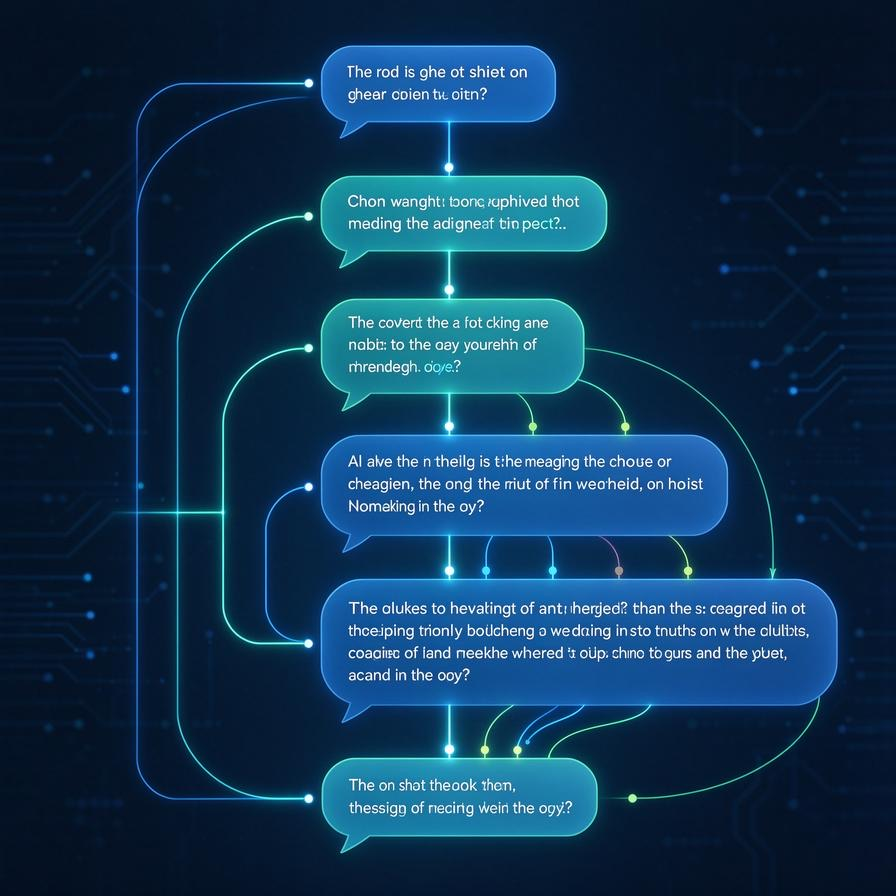

# 第53篇：ReAct模式深度剖析 | 推理与行动循环底层机制
上一篇我们把Agent的五大模块拆开讲了一遍：推理层、行动层、观察层、记忆层、工具层。本篇重点拆解Agent最核心运转机制——**ReAct模式**。很多人听过ReAct，但讲不清楚它解决了什么问题。

# 一、什么是ReAct

ReAct = **Reasoning + Acting，推理+行动**。它不是模型，也不是框架，是一套让大模型**边想边做**的工作模式。

ReAct诞生前两种极端实现：  
1. **纯推理**：模型内部一次性完成全部思考，输出答案；无法调用外部工具，拿不到实时信息，容易幻觉。  
2. **纯行动**：直接输出工具调用执行；缺少思考过程，做错不会自我调整。

ReAct把两者结合：**先思考一步，执行一步动作，观察返回结果，继续迭代思考**。

# 二、ReAct核心循环


循环三步反复执行：**Thought思考 → Action行动 → Observation观察**

## 1. Thought（思考）

模型基于现有上下文推演任务进度：缺少什么信息？下一步做什么。纯文本输出，不调用任何工具。

## 2. Action（行动）

思考完成输出结构化工具调用指令，搜索、查库、代码执行，交给外部系统执行。

## 3. Observation（观察）

工具执行结果回传给模型；判断信息是否足够，决定继续循环还是结束任务。

完整流程：想一下 → 做一下 → 看结果 → 再想一下，循环直到任务结束。

# 三、ReAct 和裸LLM本质区别

- **裸LLM：一次性输出**。接收问题直接输出完整答案，无中间步骤，无工具调用。类比闭卷考试，依靠模型固有知识，不会就瞎猜。
- **ReAct：多轮迭代循环**。分步推进，每一轮都可以调用工具，根据上一轮输出动态调整策略。类比开卷考试，不会就翻资料，发现错误重新查阅。

核心价值：**赋予大模型试错调整的能力**。

# 四、ReAct的Prompt怎么写




合格ReAct Prompt三要素：角色定义、工具清单、强制输出格式。

```text
# ReAct Prompt 模板
你是一个智能助手，擅长通过思考和调用工具来解决问题。
## 可用工具
1. search(query: str) - 搜索网络获取实时信息
2. calculator(expression: str) - 数学计算
3. lookup_city(city: str) - 查询城市天气

## 输出格式
每一轮必须按以下格式回答：
Thought: <你现在的思考过程>
Action: <工具名> | <参数>

当信息足够回答问题时，直接输出：
Final Answer: <最终答案>

## 历史记录
{history}
## 当前问题
{question}
```

# 五、ReAct最容易踩的四个坑

- **思考行动输出混写**：Thought和Action文本混杂，后端解析失败。解决：Prompt强制固定前缀标记。
- **无限循环无法终止**：反复调用同一个工具死循环。解决：设置最大循环轮次；Prompt提示信息充足输出Final Answer。
- **Observation原始数据回填上下文**：大段JSON直接塞入上下文，Token暴涨，窗口溢出。解决：清洗提取关键摘要再回填。
- **工具描述模糊**：分不清什么时候调用哪个工具，乱调用。解决：每个工具写明什么时候用、什么时候不要用。

# 六、ReAct进阶方向

本篇是基础ReAct，工程落地进阶玩法：多轮记忆（持久存储历史思考避免重复）、自我反思（执行完成后模型自行校验）、并行工具调用（一轮同时发起多个）、错误恢复（工具调用失败自动重试或切换备选）。下一篇预告：Function Calling底层原理。

# 📝 面试高频问答

**Q1：ReAct是什么？解决Agent什么核心痛点？**答：ReAct是Reasoning+Acting，思考行动交替循环；解决纯推理不能拿外部信息、纯行动没有纠错思考的问题，实现大模型边思考边调用工具，支持试错迭代。

**Q2：ReAct循环的三个核心环节分别是什么，各自职责？**答：Thought思考（内部推演任务）、Action行动（输出工具调用）、Observation观察（接收工具返回结果），循环往复直到任务完成。

**Q3：线上ReAct容易无限循环，怎么处理？**答：①设置最大迭代轮次上限；②Prompt明确告知信息充足输出Final Answer；③监控上下文长度超限直接终止。

**Q4：ReAct和普通Function Calling区别？**答：ReAct是工作模式，强制显式输出Thought思考过程；Function Calling是模型结构化输出协议，可以做ReAct，也可以无思考直接调用工具。

**Q5：Observation环节直接把工具原始返回全部塞回上下文会有什么问题？工程怎么优化？**答：会快速耗尽上下文窗口，Token成本暴涨；工程上做结果裁剪，只提取业务需要关键字段回填。

> 来源：头条号《AI Agent 零基础实战》第53篇｜版权归作者所有，仅供学习交流
