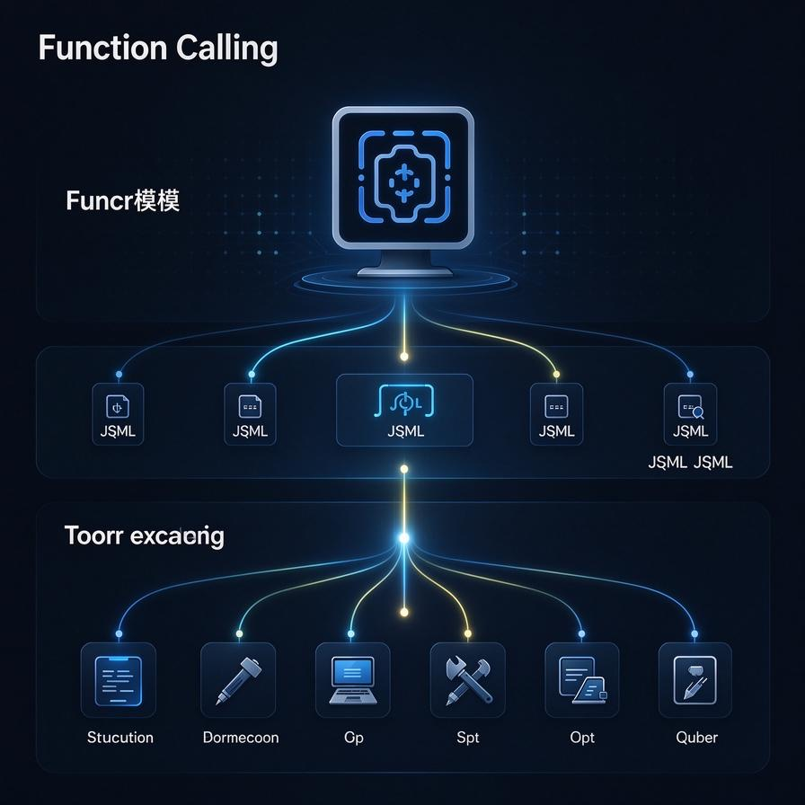

# 第54篇：Function Calling底层原理

上一篇我们讲了 ReAct 模式：模型边想边做，Thought → Action → Observation 循环往复。

但这里有个关键问题：模型怎么"输出 Action"？它怎么知道该调用哪个工具、传什么参数？

这就是 Function Calling 要解决的问题。这篇我们从底层把这个协议拆开看。

## 一、什么是 Function Calling？

Function Calling 是大模型的一种能力：你告诉它有哪些工具可用，它就能根据用户问题，自动输出结构化的工具调用指令。

注意，它不是模型自己执行工具。模型只负责"说"要调什么工具，真正执行的是你的代码。

打个比方：

模型像一个只会写菜单的食客，服务员（你的代码）根据菜单去厨房做菜。模型不用进厨房，它只负责点菜。

## 二、协议的核心设计


Function Calling 的协议设计非常简洁，核心就三件事：

### 1. 工具定义（你告诉模型有什么工具）

你需要把所有可用工具的信息，按照固定格式传给模型：

```json
{
  "name": "get_weather",
  "description": "查询指定城市的实时天气",
  "parameters": {
    "type": "object",
    "properties": {
      "city": {
        "type": "string",
        "description": "城市名称，比如：北京、上海"
      }
    },
    "required": ["city"]
  }
}
```

每个工具都有三个关键字段：

- **name**：工具名，唯一标识
- **description**：工具描述，模型靠这个判断什么时候用
- **parameters**：参数列表，每个参数的类型、说明、是否必填

### 2. 模型输出（模型告诉你它要调什么）

当模型判断需要调用工具时，它会输出一段结构化的 JSON：

```json
{
  "tool_calls": [
    {
      "function": {
        "name": "get_weather",
        "arguments": "{\"city\": \"北京\"}"
      }
    }
  ]
}
```

你解析这段 JSON，拿到工具名和参数，然后执行对应的函数。

### 3. 结果回流（你把执行结果喂回给模型）

工具执行完之后，把结果再传给模型：

```json
{
  "role": "tool",
  "tool_call_id": "call_abc123",
  "content": "{\"temp\": 18, \"weather\": \"晴\"}"
}
```

模型看到结果后，继续思考下一步，或者直接输出最终答案。

## 三、从 Prompt 到结构化输出

很多人好奇：模型是怎么学会输出这种固定格式的 JSON 的？

答案是：训练。

OpenAI 在训练阶段，就把大量"工具定义 → 问题 → 工具调用"的样本喂给了模型。模型学会了一种模式：

- 当我看到系统消息里有 tools 定义时
- 当用户问题需要外部信息时
- 我就输出 tool_calls 格式的 JSON

这不是模型"理解"了协议，而是它在训练数据里见过太多次这种模式，学会了模仿。

这也是为什么不同模型的 Function Calling 格式不一样——每个厂商的训练数据和输出格式都不同。

## 四、一个完整的调用流程


我们用一个实际例子走一遍：

**用户问**：北京今天天气怎么样？

**第 1 步：你发请求给模型**

你把用户问题 + 工具定义一起发给模型：

```python
response = client.chat.completions.create(
    model="gpt-4",
    messages=[{"role": "user", "content": "北京今天天气怎么样？"}],
    tools=[get_weather_tool]  # 工具定义
)
```

**第 2 步：模型返回工具调用指令**

```python
# 模型返回
{
  "tool_calls": [{
    "function": {
      "name": "get_weather",
      "arguments": "{\"city\": \"北京\"}"
    }
  }]
}
```

**第 3 步：你执行工具，拿到结果**

```python
result = get_weather("北京")
# → {"temp": 18, "weather": "晴", "wind": "西北风3级"}
```

**第 4 步：把结果喂回给模型**

```python
messages.append(response.choices[0].message)
messages.append({
    "role": "tool",
    "tool_call_id": "call_abc123",
    "content": str(result)
})

final_response = client.chat.completions.create(
    model="gpt-4",
    messages=messages,
    tools=[get_weather_tool]
)
```

**第 5 步：模型输出最终答案**

```
北京今天晴，气温 18℃，西北风 3 级，适合出门。
```

整个流程就是：你 → 模型 → 你（执行工具）→ 模型 → 最终答案。

## 五、最容易踩的四个坑



### 1. 工具描述写得太模糊

模型不知道什么时候该用哪个工具，只能瞎调。

解决办法：description 里写清楚"什么时候用"和"什么时候别用"。比如："只在用户问天气时使用，不要用来查时间。"

### 2. 参数格式对不上

模型输出的参数格式和你代码里期望的不一致，导致解析失败。

解决办法：parameters 里把每个参数的类型、说明写清楚。复杂参数用嵌套对象，简单参数用基础类型。

### 3. 不检查工具调用是否成功

模型有时候会输出不存在的工具名，或者参数缺失。

解决办法：执行前先校验工具名是否存在、必填参数是否齐全。失败了就返回错误信息，让模型重试。

### 4. 结果不清洗直接塞回去

工具返回一大坨 JSON，你原样塞回上下文，几轮下来窗口就爆了。

解决办法：观察层做数据提取，只把关键字段塞回去。

## 六、Function Calling 和 ReAct 的关系

上一篇讲的 ReAct，是"思考 + 行动"的模式。

Function Calling，是"行动"这一步的具体实现协议。

两者不是竞争关系，而是配合关系：

- ReAct 是宏观模式：模型边想边做
- Function Calling 是微观协议：模型怎么"做"

你可以理解为：ReAct 是方法论，Function Calling 是工具。

## 下一篇预告

下一篇我们讲上下文窗口工程：长对话怎么不丢信息？记忆压缩怎么做？上下文窗口就那么大，怎么安排哪些信息该留、哪些该丢？

> 来源：头条号《AI Agent 零基础实战》第54篇｜版权归作者所有，仅供学习交流
