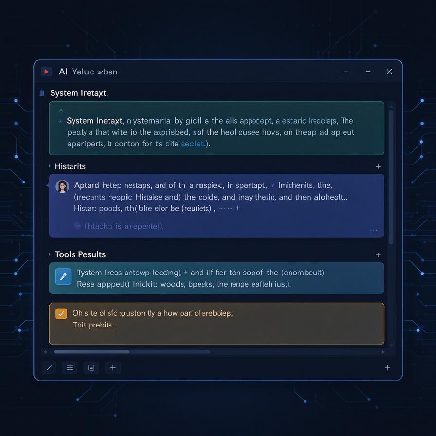
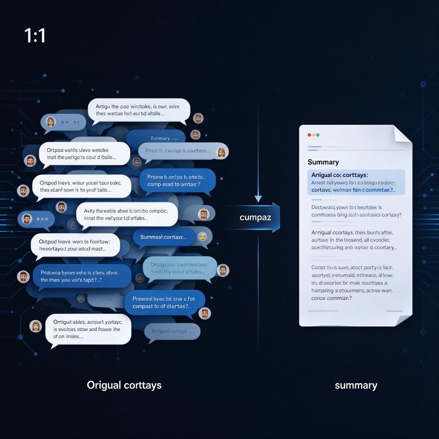
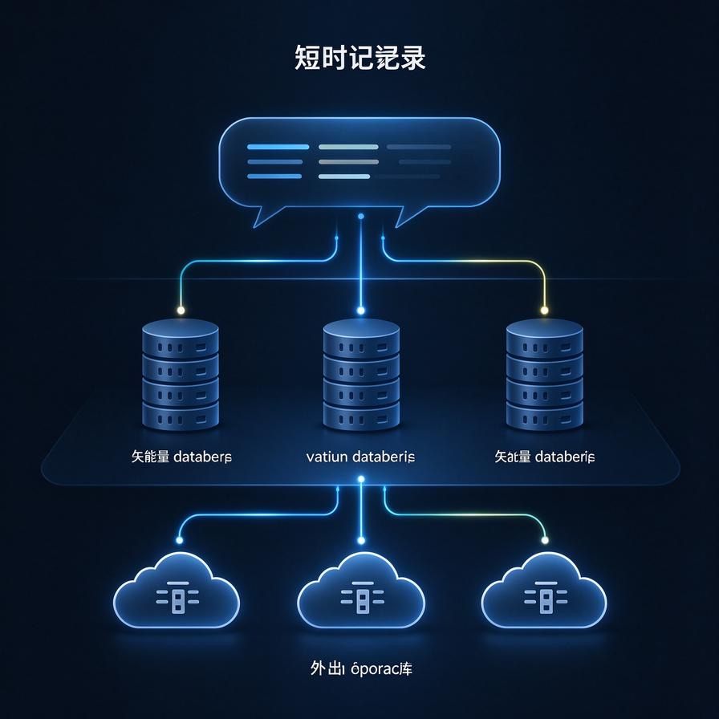

# 第55篇：上下文窗口工程

上一篇我们讲了 Function Calling：模型怎么学会输出结构化的工具调用指令。

但这里有个隐藏问题：Agent 每一步都要把历史对话、工具结果、系统提示全部塞进上下文窗口。几轮下来，窗口就满了，模型就开始"忘事"。

这就是上下文窗口工程要解决的问题。这篇我们从工程角度，聊聊怎么安排有限的窗口空间。

## 一、上下文窗口到底是什么？

上下文窗口（Context Window），就是模型一次能"看到"的最大文本长度。

你可以把它理解成模型的"短期记忆容量"。GPT-4 是 128K Token，Claude 是 200K，Gemini 甚至能到 1M。

但窗口大不代表可以随便塞。有三个现实约束：

**第一个约束：成本。**

Token 是按长度收费的。你塞进去的每一个 Token，都要花钱。128K 窗口听着大，真塞满一次调用，成本就上去了。

**第二个约束：注意力衰减。**

研究发现，模型对中间位置的信息注意力会下降。开头和结尾记得清楚，中间的内容容易被忽略。

**第三个约束：延迟。**

输入越长，模型生成越慢。用户等不了 10 秒才看到第一个字。

所以窗口工程的核心，不是"怎么塞更多"，而是"怎么塞得更聪明"。

## 二、窗口里都装了什么？



一次 Agent 调用，上下文里通常有四部分内容：

```
系统提示词 + 历史对话 + 工具结果 + 当前问题
```

我们拆开看每一部分占多少空间：

**系统提示词：** 固定不变，通常几百到几千 Token。包括角色定义、工具列表、输出格式要求。

**历史对话：** 每一轮的 Thought、Action、Observation 都存在这里。这是增长最快的部分，也是最容易爆窗口的部分。

**工具结果：** 搜索返回的网页内容、数据库查询结果、代码执行输出。这些往往是一大坨，占空间最多。

**当前问题：** 用户最新的问题，通常很短。

问题就出在：历史对话和工具结果是无限增长的，而窗口是有限的。

## 三、最朴素的策略：截断

最直觉的做法就是：窗口快满了，就把最早的对话删掉。

```python
def truncate_history(history, max_tokens=100000):
    while count_tokens(history) > max_tokens:
        history.pop(0)  # 删掉最早的一条
    return history
```

听起来很简单，但问题很大：

**删掉的可能是关键信息。**

比如用户最开始说"我要写一个 React 项目"，聊了 20 轮之后，这条需求被截断了，模型就开始乱写。

截断策略适合简单场景：对话不长、关键信息都在最近几轮里。但复杂任务就不行了。

## 四、进阶策略：摘要压缩



更聪明的做法是：不是删掉历史，而是把历史压缩成摘要。

具体流程是这样的：

1. 把前 N 轮对话收集起来
2. 让模型写一段摘要："之前用户问了 A，我们查了 B，结果是 C"
3. 用摘要替换掉原来的 N 轮对话
4. 这样既保留了关键信息，又省了空间

```python
def compress_history(history, threshold=50):
    if len(history) > threshold:
        # 压缩前一半
        old_part = history[:threshold//2]
        summary = llm.summarize(old_part)
        # 替换
        history = [{"role": "system", "content": f"之前的对话摘要：{summary}"}] + history[threshold//2:]
    return history
```

这个策略比截断好，但也有问题：

**摘要会丢细节。**

原来的对话里有具体的数字、文件名、参数，摘要可能只写了"用户查询了某个数据"。后面需要用到这些细节的时候，模型就想不起来了。

## 五、高级策略：分层记忆



更成熟的做法是分层：不是所有信息都放在上下文窗口里。

```
第一层：当前上下文（短期记忆）
  - 最近 5-10 轮对话
  - 最新的工具结果
  - 当前任务状态

第二层：向量数据库（长期记忆）
  - 历史对话的 embedding
  - 重要文档、代码片段
  - 用户偏好、历史决策

第三层：外部存储
  - 完整的对话日志
  - 所有工具执行结果
```

需要什么信息，就从对应层取出来，塞进当前上下文里。

这个思路其实就是 RAG 的思路：不要什么都塞在窗口里，需要的时候再去查。

## 六、工程实践中的几个技巧

### 1. 工具结果要清洗

工具返回一大坨 JSON，你原样塞回去，几轮就爆了。

解决办法：观察层做数据提取，只把关键字段塞回去。

比如搜索返回 10 条结果，你只保留标题和摘要，正文不要塞回去。

### 2. 重要信息放开头和结尾

因为模型对中间位置注意力弱，所以：

- 系统提示词放最开头（角色、工具、格式要求）
- 当前用户问题放最结尾（最新指令）
- 中间放历史对话

这样模型最容易"看到"最重要的信息。

### 3. 定期做记忆整理

不要等到窗口快满了才压缩。每隔 5-10 轮，主动做一次记忆整理：

- 哪些信息是当前任务还需要的？留下来。
- 哪些是已经用完的？删掉或者归档。
- 有没有可以合并的信息？合并成更紧凑的格式。

## 七、窗口工程的未来方向

这篇讲的是最基础的窗口管理思路。实际工程里还有很多进阶玩法：

- **动态 Prompt 优化：** 根据当前任务，动态选择哪些信息塞进窗口
- **KV Cache 复用：** 把历史对话的 Key-Value 缓存起来，不用每次重新计算
- **长上下文模型：** 模型本身支持更长的窗口，比如 1M Token
- **记忆自动反思：** 让模型自己判断哪些信息重要，哪些可以丢

这些后面都会专门讲。

## 下一篇预告

下一篇我们讲 RAG 进阶：检索增强生成怎么优化？怎么选 chunk 大小？怎么做混合检索？怎么解决检索不准的问题？

> 来源：头条号《AI Agent 零基础实战》第55篇｜版权归作者所有，仅供学习交流
