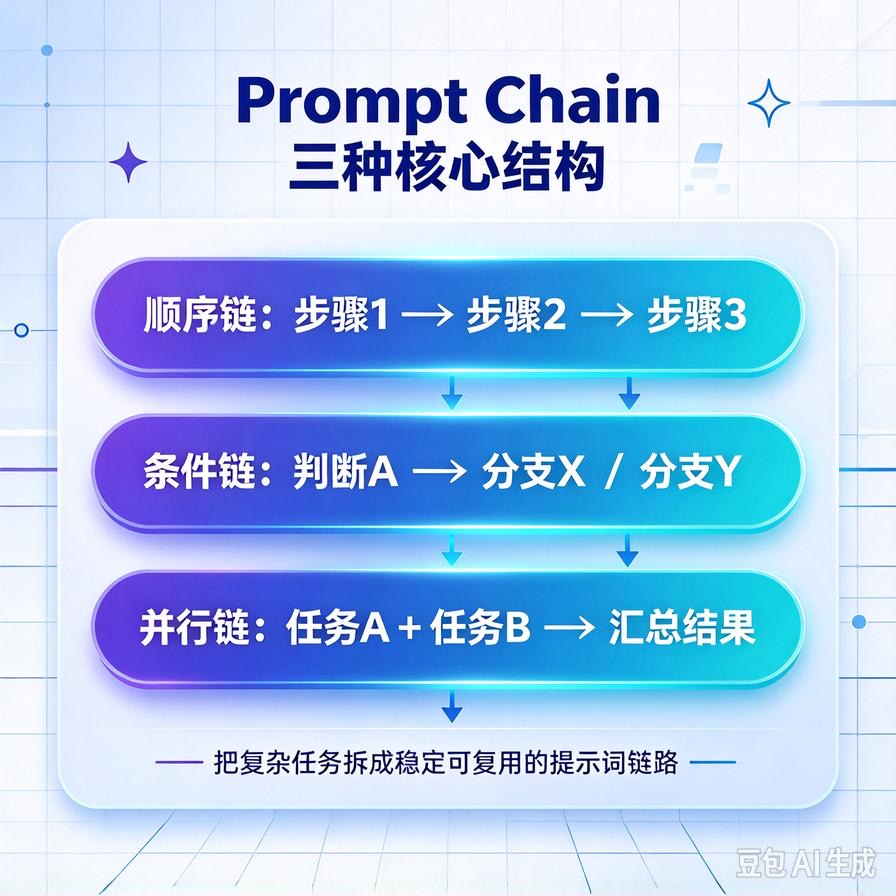
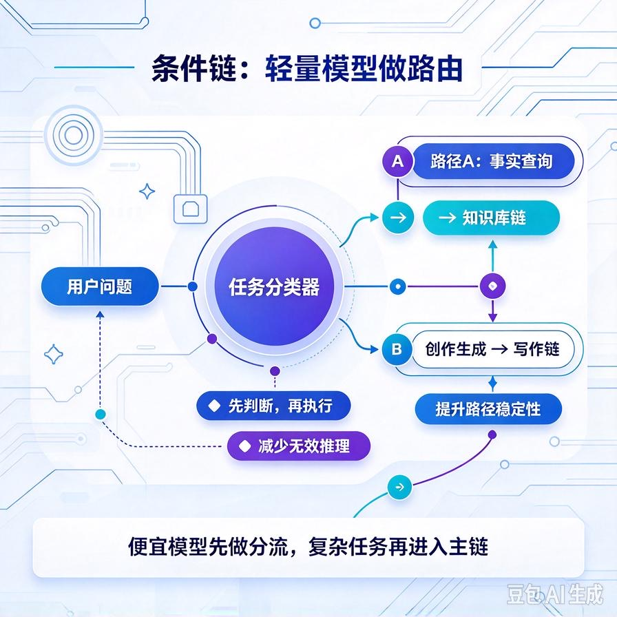
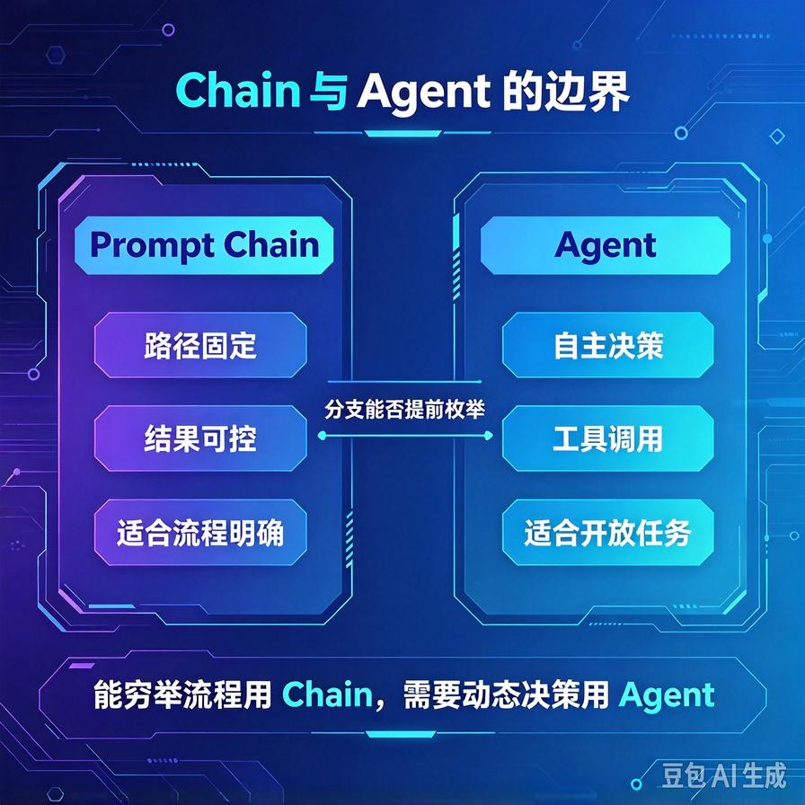
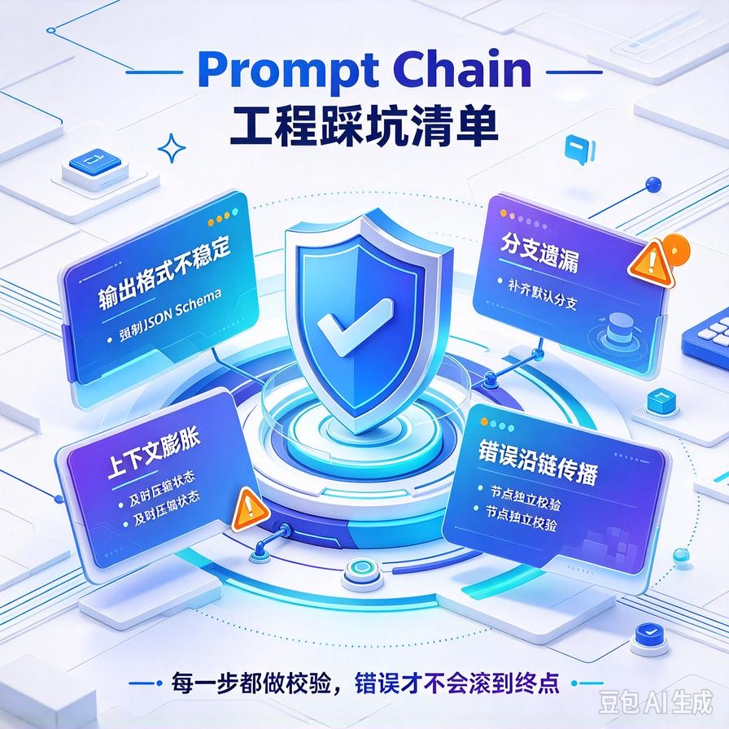

# 第57篇：Prompt Chain高级设计 | 条件分支链式编排，Chain与Agent边界
第56篇我们解决了RAG召回，知识库总算能答准问题了。但很快你会遇到第二种客户需求：不是"答一个问题"，而是"完成一套流程"。

比如企业客户的真实需求：**先判断客户属于售前咨询还是售后投诉→售前走产品推荐流程→售后先查订单→再查售后政策→最后生成处理结论**。这种多步骤、带条件判断的复杂任务，靠一条Prompt打天下已经不够，你需要的是**Prompt Chain（提示词链）**。

这一篇专讲三件事：**链式编排的三种结构、条件分支怎么设计、以及最关键的一题——Chain和Agent到底什么区别、什么时候必须升级成Agent**。文末附面试高频问答。

# 一、为什么单条Prompt解决不了复杂任务

新手写Prompt，总想"一条提示词把需求全塞进去"。真上了复杂业务场景，单条Prompt有三个硬伤：

- **上下文爆炸**：一套完整流程的背景、规则、示例全塞进去，输入Token暴涨，成本上去，模型还容易顾此失彼。
- **任务混淆**："先分类再回答"这种多步任务，模型常常跳过第一步，直接按最明显的意图回答。
- **无法插工具**：流程中间要查订单、查政策、调数据库，单条Prompt没地方安放这些工具调用点。

Chain的思路很简单：**把一个大任务拆成多个小步骤，每一步是一个独立的Prompt，前一步的输出作为后一步的输入**。每一步职责单一，规则可以写透，还能在中间任意插工具。

# 二、链式编排的三种核心结构



## 1. 顺序链（Sequential Chain）：最基础

A的输出给B，B的输出给C，线性串行。适合"输入→处理→输出"的固定流程，比如：抽取要点→生成摘要→润色成稿。

## 2. 条件链（Conditional Chain）：带分支判断



上一步的结果决定走哪条分支。这是商用项目里用得最多的结构，也是本篇核心。下面这段用LangChain风格的思路写一个可运行的条件分支：

```python
def route_by_intent(text):
    """用轻量模型判断意图，返回分支键"""
    prompt = f"""你是客服意图分类器。
    判断下面这条用户消息属于哪一类：
    - presale: 售前咨询、想买、问价格
    - after_sale: 售后、退换货、投诉
    - other: 其他
    只输出一个单词。
    消息：{text}"""
    result = llm_fast(prompt)   # 用便宜的小模型
    return result.strip().lower()

def presale_chain(text):
    return llm("你是产品推荐顾问，结合知识库推荐合适产品：" + text)

def aftersale_chain(text):
    order = query_order(text)          # 先插工具查订单
    policy = query_policy(order)       # 再查售后政策
    return llm(f"""订单信息：{order}；售后政策：{policy}。
    请给出处理结论。""")

def main_chain(text):
    intent = route_by_intent(text)     # 第一步：分类
    if intent == "presale":
        return presale_chain(text)     # 分支一
    elif intent == "after_sale":
        return aftersale_chain(text)   # 分支二
    return llm("请礼貌地引导用户到人工客服：" + text)
```

这里有个关键工程点：**分类这一步用便宜的小模型，业务分支才用主力大模型**。90%的请求可能都走同一类分支，把小模型放在入口当"路由器"，成本能省一大截——这个思想后面讲成本优化还会用到。

## 3. 并行链（Parallel Chain）：多路同时算

多个互不依赖的子任务并行执行，最后合并。比如生成商品详情：标题、卖点、参数、禁忌提示四条链并行生成，再汇总成一份完整文案。并行能显著降低整体延迟。

# 三、Chain的边界：什么情况必须升级成Agent



这是面试必考、也是项目里最容易踩坑的一题。**Chain是"写死的流程"，Agent是"动态决策的流程"**，区别在于：

| 对比维度 | Prompt Chain | Agent |
|-|-|-|
| **执行路径** | 开发时写死，固定走哪些步骤 | 运行时由模型自主决定下一步 |
| **步骤数** | 不确定，可能循环、回溯、追加工具 |  |
| **工具调用** | 模型自己判断什么时候调什么工具 |  |
| **可控性** | 低，更灵活但更不可控 |  |
| **适用** | 开放任务、步骤不确定、需自主推理 |  |

给一个实操判断标准：**如果这个任务的分支在你写代码时能枚举完，用Chain；如果模型运行时才知道该走几步、该用什么工具，用Agent**。"查订单→查政策"这种业务流固定，就该用Chain，硬上Agent反而会乱调工具、路径失控、还多花钱。反过来，一个"帮用户处理任何办公文档"的开放任务，分支无穷多，Chain根本写不完，必须上Agent。

# 四、工程踩坑清单



- **链太长、输出失去结构**：每一步尽量让模型输出结构化JSON（{"intent": "...", "data": {...}}），不要让它输出自由文本，否则下一步解析全靠猜。
- **中间错误全链崩**：给每一步加try/except和默认值。分类失败时就默认走"other"分支，而不是让整条链抛异常。
- **过度设计**：能一条Prompt+两三个条件判断解决的需求，不要硬拆成七八步链。链越长，维护成本和出错点越多，性价比是负的。
- **每步都用满血大模型**：入口分类、字段抽取用便宜模型，只有真正需要推理的地方用强模型。全链都用旗舰模型，成本直接失控。

# 📝 面试高频问答

## Q1：Chain和Agent的区别？什么场景用哪个？

答：Chain是开发时写死的固定流程，执行路径可预知、可控、好调试，适合分支可枚举的业务流程（如客服分流、内容生成流水线）；Agent由模型运行时自主决定调用哪些工具、走多少步，更灵活但不可控、成本更高，适合开放、步骤不确定的任务。判断标准是：分支在写代码时能否枚举完——能则Chain，不能则Agent。

## Q2：多步Agent/Chain任务里，怎么防止前一步输出把后一步带偏？

答：三个手段：一是让每步输出严格结构化（JSON），不用自由文本；二是每步Prompt只给"本步职责"所需的信息，不把全量上下文一股脑塞进去；三是加输出校验，不符合格式就重试或走兜底，不让脏数据继续往下传。

## Q3：条件分支链如何控制成本？

答：用"便宜小模型当路由器"——入口意图分类、字段抽取这类简单判断用轻量模型，只有业务推理环节才用主力大模型。再配合"尽量走默认分支""减少不必要的分支重试"，整体Token成本能降30%\~50%。

## Q4：什么情况说明我该把Chain重构为Agent？

答：三个信号：一是在迭代中发现分支越来越多、快枚举不完；二是模型需要根据中间结果反复调用不同工具、路径不可预测；三是单靠规则组合已经覆盖不了用户输入的多样性。出现这些，就该引入工具调用+自主决策，升级为Agent架构。

## Q5：链式流程怎么保证不崩、可回退？

答：每一环都要有异常兜底（try/except+默认分支），关键步骤做输入/输出校验，失败时能安全回退到兜底话术而不是抛错中断。生产环境把每一步的输入输出、耗时、模型版本全部打日志，出问题才能快速定位是哪一环、用了什么模型。

---

下一篇进入Agent的工具能力核心：**工具集编排实战**——多工具怎么选择、参数怎么校验、怎么防止模型乱调用工具。这也是Function Calling落地时最常踩的坑。

> 来源：头条号《AI Agent 零基础实战》第57篇｜版权归作者所有，仅供学习交流
