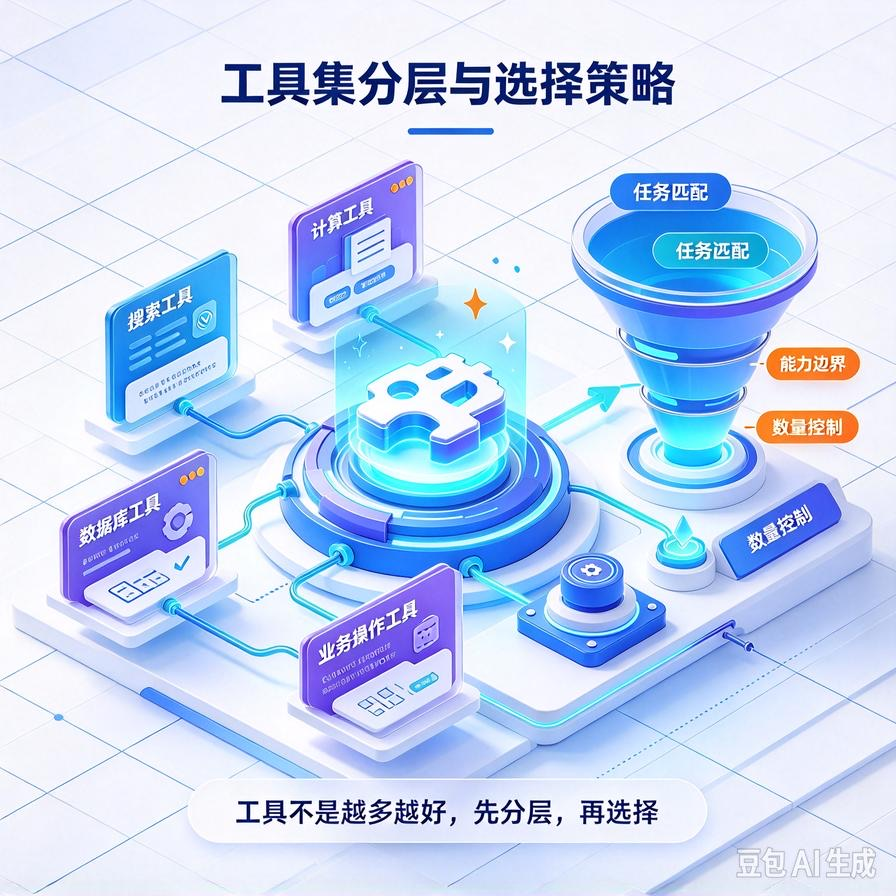
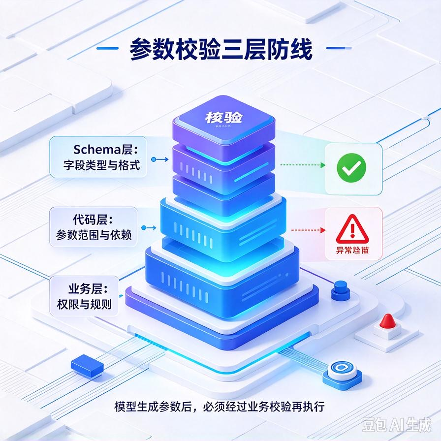
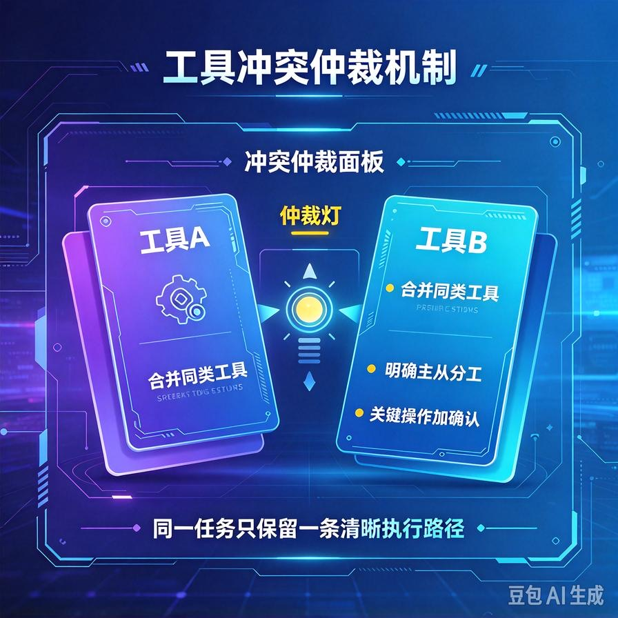
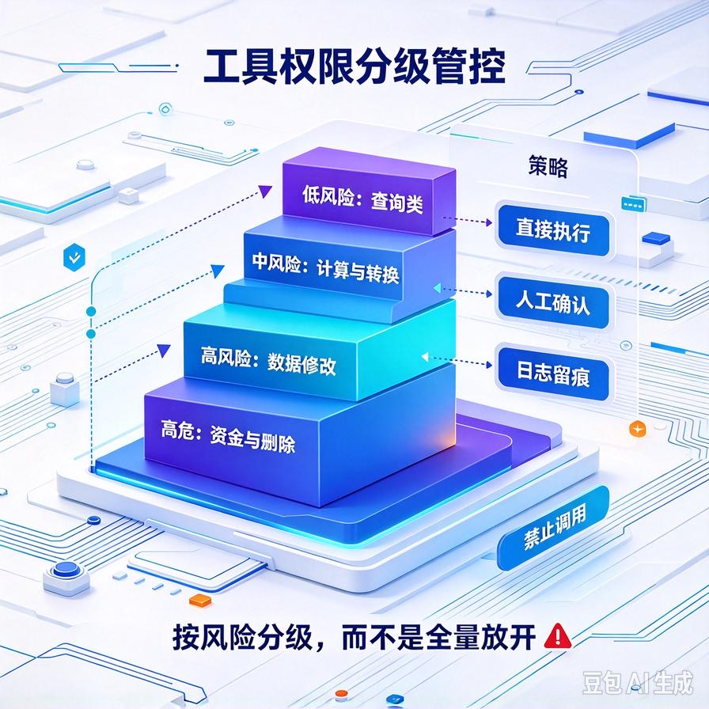

# 第58篇：工具集编排实战 | 多工具选择、参数校验、工具冲突与权限管控
前面几篇我们搭好了RAG检索、写好了Prompt Chain，Agent已经能"思考"了。但真正让Agent干活，还得靠工具——查订单、发邮件、调数据库、生成报表。

单工具很简单，一个Function Calling就搞定。一旦你给Agent配了十几个工具，问题马上就来：**模型选错工具、参数乱编、两个工具功能撞车、甚至调用了不该让它碰的删库接口**。这就是工具集编排要解决的问题。

这一篇专讲四件事：**怎么写工具描述让模型选对工具、怎么校验参数防止乱传、工具功能重叠怎么仲裁、以及权限管控怎么落地**。文末附面试高频问答。

# 一、为什么工具一多就翻车

新手做工具调用，最常见的错误是"工具随便加，描述随便写"。真上线后你会发现：

- 用户问"我的订单发了没"，模型去调了"搜索商品"，而不是"查订单物流"；
- 调对了工具，但参数里把订单号写成了收件人姓名；
- 有"发邮件"和"发企业微信通知"两个工具，模型每次随机挑一个；
- 最危险的是：模型自己调了"删除客户数据"接口，因为它觉得用户想清理。

这些问题的根子都在**工具集的工程设计**，而不是模型不够聪明。工具集不是越多越好，而是要像设计API一样严谨地编排。

# 二、工具描述：让模型选对工具的第一性原理



模型选工具，本质是读每个工具的**name + description + 参数说明**，然后判断"哪个工具和当前任务最匹配"。所以工具描述不是写给人看的，是写给模型看的。

## 1. 好的工具描述长什么样

对比一下同一个工具的两种描述写法：

| 写法 | 描述内容 | 效果 |
|-|-|-|
| **差** | "查订单" / "有用的工具" | 模型不知道什么时候该用，和其他工具混淆 |
| **好** | "查询订单物流状态。当用户问'我的订单到哪了''发货了没''快递单号'时使用。需要传入订单号order_id，不要用收件人姓名查。" | 模型明确触发条件和参数边界，选错率大幅下降 |

一个高质量工具描述必须包含三要素：**这个工具干什么、什么场景下用、什么时候别用**。"什么时候别用"这半句最关键——它直接帮模型在多个相似工具之间做区分。

## 2. 工具数量控制在7个以内

这是个被反复验证的经验值：**工具超过7个，模型选错率会明显上升**。因为所有工具的描述都塞进上下文，模型注意力被稀释。工具多了怎么办？做分层——先用一个"路由工具组"判断大方向，再进入具体工具集。比如：第一层只放"售前查询/售后处理/数据导出"三个大类，选中后再加载该类下的具体工具。

# 三、参数校验：模型不是程序员，它会编参数



这是工具调用里最容易被忽略、但线上事故最多的环节。**大模型生成的参数，永远不要直接拿去执行**。

```python
def call_get_order(order_id: str):
    # 1. 格式校验：订单号必须是固定格式
    import re
    if not re.match(r"^ORD-\d{8}$", order_id):
        return {"error": "订单号格式错误，请用户提供正确的订单号"}
    # 2. 存在性校验
    order = db.query_order(order_id)
    if order is None:
        return {"error": "未找到该订单，请确认订单号"}
    return order

# 工具注册时，参数 schema 也要写清楚
TOOL_SCHEMAS = [{
    "name": "get_order_status",
    "description": "查询订单物流状态。仅当用户提供了ORD-开头的订单号时调用。",
    "parameters": {
        "order_id": {"type": "string", "description": "格式为ORD-+8位数字，例如ORD-20240815"}
    }
}]
```

三个校验层次缺一不可：

- **schema层**：在工具定义里写清楚参数类型、格式、示例，模型看到了才不容易编；
- **代码层**：函数内部再做一次格式校验，模型没按格式来就返回错误提示，让它重试；
- **业务层**：查不到就明确返回"未找到"，不要让模型自己脑补一个结果。

# 四、工具冲突：功能重叠时怎么仲裁



做企业系统，工具功能重叠几乎不可避免：查客户数据，既有CRM里的，又有订单系统里的；发通知，既有邮件，又有企业微信。模型遇到这种情况会随机选，体验很不稳定。

工程上三种处理手段：

## 1. 合并同类工具

能合并就合并。两个查客户的工具，合成一个"get_customer_info"，内部决定从哪个库取。工具越少，模型选择越清晰。

## 2. 在描述里显式分工

实在不能合并，就在描述里写死边界。比如："查CRM客户资料用get_crm_info；查交易记录用get_order_history。不要用CRM查交易金额。"——把"谁干什么、谁不干什么"写成硬规则。

## 3. 加一个仲裁工具或后置校验

关键操作（发通知、删数据）加一个"确认步骤"：模型选完工具、填完参数，先不执行，把"我将调用XX工具，参数是YY"展示给用户或系统确认后再跑。这一步同时解决了误调用和权限问题。

# 五、权限管控：哪些工具绝不能让Agent自由调



这是商用交付里客户最关心、也是最容易出事故的一块。原则很简单：**读操作可以放手让模型调，写操作/删操作必须分级管控**。

| 风险等级 | 典型工具 | 管控策略 |
|-|-|-|
| **低风险** | 查知识库、查订单状态、搜索公开数据 | 模型自由调用，无需确认 |
| **中风险** | 发邮件、发通知、写入工单 | 调用前展示操作摘要，用户点确认后执行 |
| **高风险** | 删除数据、退款、改价格、批量导出 | 必须人工审批，Agent只能生成操作建议，不能直接执行 |

工程实现上，给每个工具打一个risk_level标签，执行前根据标签决定是直接跑、弹确认、还是转人工。客户验收时，这张表就是你的"安全设计"卖点。

# 六、工程踩坑清单

- **工具描述写得像注释，不像说明书**："根据订单号查订单"这种写法模型依然会选错。一定要写清触发场景和反例。
- **不校验参数直接执行**：这是线上事故第一名。模型编一个不存在的订单号，你直接拿去查库，轻则报错，重则返回错误数据。
- **把所有工具一次性全给模型**：超过7个工具就该分层路由，别硬塞。
- **高危工具不做确认**：删数据、退款类操作，必须人工二次确认，这是底线。
- **不记录工具调用日志**：每次调了什么工具、传了什么参数、返回什么，全打日志。线上出问题，日志是你唯一的排查依据。

# 📝 面试高频问答

## Q1：模型选错工具怎么办？

答：从三方面优化。一是重写工具描述，明确"什么场景用、什么场景别用"，把相似工具的边界写死；二是控制工具数量，超过7个就做分层路由，先分类再加载具体工具；三是把工具名和描述写得语义区分明显，不要让两个工具名字太像。

## Q2：工具调用的参数，能直接拿模型生成的值去执行吗？

答：绝对不能。模型会编造格式不对、甚至不存在的参数。必须做三层校验：schema层写清类型和示例，代码层做格式正则/范围校验，业务层做存在性检查。校验失败要返回清晰的错误信息，让模型重试，而不是直接报错给用户。

## Q3：多个工具功能重叠，怎么避免模型乱选？

答：优先合并同类工具；合并不了就在描述里显式写分工边界（谁干什么、谁不干什么）；关键工具再加一道执行前确认。本质是降低"模型需要做主观判断"的空间，把规则写死在描述里。

## Q4：Agent工具调用怎么做权限和风险控制？

答：按风险分级。读操作自由调用；写操作执行前让用户确认；删除/退款/改价等高风险操作必须人工审批，Agent只生成建议不直接执行。每个工具打risk_level标签，执行前自动走对应流程，关键操作全程留日志。

## Q5：工具调用失败了，Agent怎么处理？

答：工具返回结构化错误（不是抛异常），让模型看到错误信息后自己决定：是换参数重试、换个工具、还是告诉用户需要人工介入。重试要设上限（比如最多2次），防止模型陷入死循环反复调同一个失败工具。

---

下一篇我们进入一个更有挑战的话题：**多Agent协作架构**——什么时候需要多个智能体分工配合，通信机制怎么设计，角色冲突怎么仲裁。这也是高阶岗位面试的重头戏。

> 来源：头条号《AI Agent 零基础实战》第58篇｜版权归作者所有，仅供学习交流
